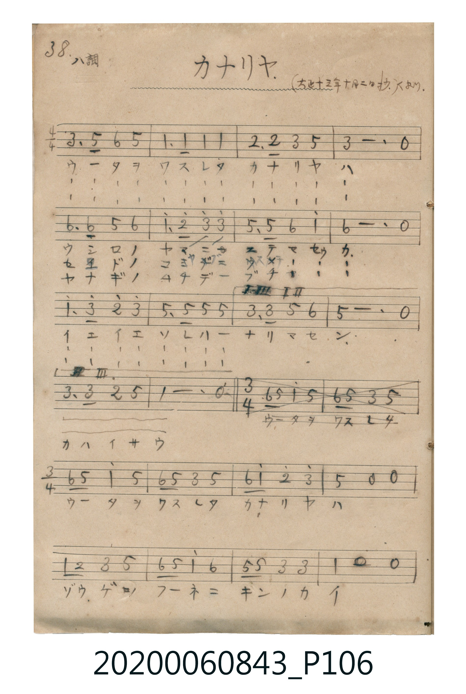
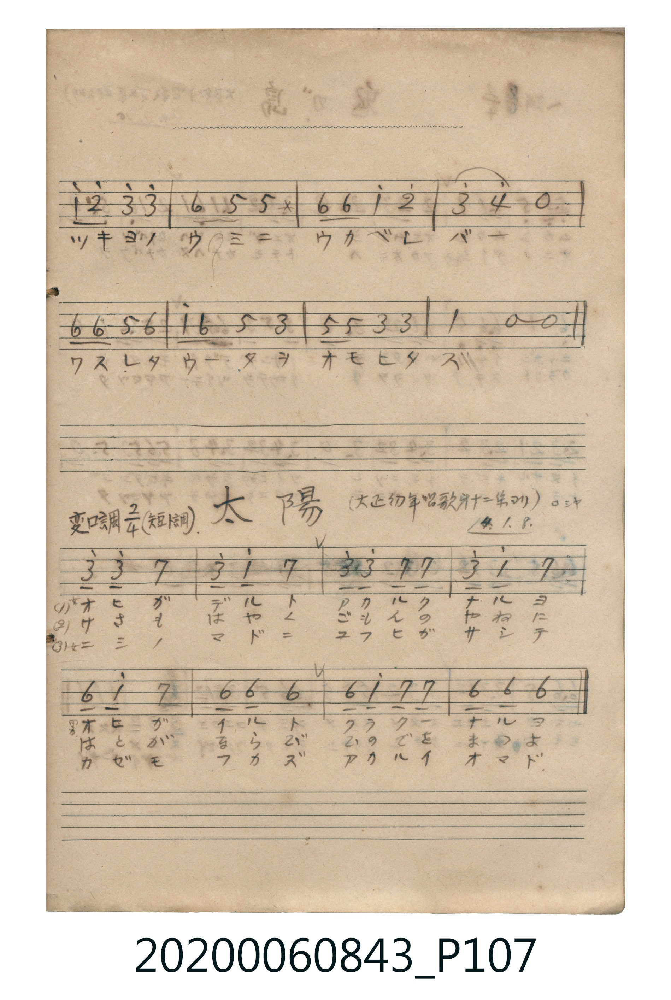

# カナリヤ

<audio controls src="kanariya.mp3"></audio>

- 詞：西條八十
- 曲：成田為三
- 唱歌帳（2020.006.0843）P106.jpg–P107.jpg（第 38–39 頁，大正十三年十月二日抄）

## 說明

原書資訊與歌詞全文（對應 P106.jpg–P107.jpg 上半，手抄簡譜第 38–39 頁）：
調性與拍號：ハ調（C 大調），前三節 4/4 拍，第四節轉 3/4 拍
抄寫註記：「（大正十三年十月二日抄）人より.」
第一〜三節（4/4 拍）：
ウータヲワスレタ　カナリヤハ

## 跨冊／重複收錄參照

> 同曲（西條八十作詞、成田為三作曲〈かなりや〉；收錄於《新定兒童唱歌》四年級與《唱歌帖》P106）

- **[同曲]** 《新定兒童唱歌》尋常科第四學年用（2020.006.0847.0004）：[**〈かなりや〉**](../../../shintei_jido_shoka/grade_4_2020.006.0847.0004/4_19_kanariya/index.md)（`C` / `2/4` — [原始 TMD](../../../shintei_jido_shoka/grade_4_2020.006.0847.0004/4_19_kanariya/kanariya.tmd)）
- 總表：[跨冊重複與同名歌曲總索引](../../../duplicate_songs.md)

## 歌詞

```text
1. ウシロノヤマニ　ステマセウカ
2. セドノコヤブニ　ウメマセウカ
3. ヤナギノムチデ　ブチマセウカ
イエイエソレハ　ナリマセン（一、二節結尾）
カハイサウ（三節結尾）

第四節（3/4 拍，P106.jpg 下半〜P107.jpg 上半）：
ウータヲワスレタ　カナリヤハ
ゾウゲノフーネニ　キンノカイ
ツキヨノウミニ　ウカベレバ
ワスレタウータヲ　オモヒダス
```

## ABC

```abc
X:1
T:カナリヤ
C:曲：成田為三
M:4/4
L:1/16
Q:1/4=96
K:C
V:V1 name="Vocal" snm="Voc"
[V:V1]
E6 G2 A4 G4 | C6 C2 C4 C4 | D6 D2 E4 G4 | E12 z4 |
A6 A2 G4 A4 | c6 d2 e4 e4 | G6 G2 A4 c4 | A12 z4 |
c6 e2 d4 e4 | G6 G2 G4 G4 | E6 E2 G4 A4 | G12 z4 |
E6 E2 D4 G4 | C12 z4 | A2 G2 c4 G4 A2 G2 | E4 G4 A2 c2 d4 |
e4 g4 z4 z4 | C2 D2 E4 G4 A2 G2 | c4 A4 G2 G2 E4 | E4 C4 z4 z4 |
c2 d2 e4 e4 A4 | G4 G2 z2 A2 A2 c4 | d4 e4 f4 z4 | A2 A2 G4 A4 c2 A2 |
G4 E4 G2 G2 E4 | E4 C4 z4 z4 |
```

## TMD 檔案連結

- [主旋律 TMD 檔案](kanariya.tmd) [[在 TMD Studio 編輯](https://tmdlang.github.io/Tmd-TS/#tmd=s7IKdvYPcrWy4tLSUnjctPpxc9fj5lWPm5coaGlxKdoqWJpx2dsqOHPZmOib2HHVKSi9WDnv_Z5ZL5buf7Zo7tPW1U97G5VAws9mbwIKP-uY8HzKhudNu57s6AQLP52y8dnanqc7Nr_f02FkYGSgZ2BgpmdgYWL8fk9ngCGQnVWQ_qhhMpBpDmICVT1fs0bB2AIoZmyp8HJB4_s9PU-XLH-2djHQIqChT3duATKezel4sqvn2fSlz7pagAYpcXHpaynYUgtwKSgoPO2b_2z2jheb21-s6HrR0Q70A9DfT1tXPJvWDnTj0w29z9o7FbB4QOHJjq6nvV1AVz_r7Aa67vmGhS_WzsHwUycwrEDWvFi1_1nDcpAF3b0vZs4Hij5u7gcKAu1wVgD6G8wEKu552tkL9P3z9Q0KwHhQAKoGigFNfTp7NlDsxd5OBWOIMMhQoLVP169-sWL3ixUzQCY29ICcTCgQn-za9bip43FTl97jhl4ukDlA85_saHjcMAdiM9AQuN0w9z9uWva4ec_jpv2Pmzc9bl7_uGnn4-Y1IG5DA3JaAnoKpNpQD6yhafvj5rWPm_vAEvMeN3eDVQN1toG4TbvBalaDNBiBNOx-3NwJUt20GaxhGkwD0OaF6BqMgRpAiroeN60D27DgcXPj4-Z2kAaQTiAbVcPjpiWPm1bAyL0g1zf3g1VDnA5W3QxKveCgaASGGDAonm-d8HTDPmAwQIwAerQfbMRWoMFgpaDwQiiCBiYksoDy0LgCRiEsBQGTTTcw2QDDGiMhkRfUj5v2gT0JVAoMhakgnc29sJADBj4wLIEhuhroarDq5haw6AqwKNCe-YhABpk9ExwuEyBKkaxGdhJINdABix43T3rcDIpPkGrKMyMUKGjpc3F5J-YlFmVWJlqF5Scn5jjUGNQoVINsUbCx0LIDM7AVA-jpGJaDFDQMTRSebugHCunAs7ImFv1Aq0Fm1ygYK-gCoamCGZjUBYoYgkUMwTQI1ygYgUWMwGohaiC6INAAJAI1DWSKLpAEqQKxgabFQTTHKRiDWGCiBiwPsxWsAqYV3Uig5zETqYKGp46Cp6cmwhdQW4CmAy3CsAVEI7vbGMl9EDVYrUUkeKCFKNbBjAEFDHKgIRuDN-4g2QZWwAGzj6GZwtOGbrAAJPqe9c9-vm46sNZRMDQCS4FiGCIFzWPQEhqYm_DFLyguwKED8bIp1PUQHlACHF5AMbASEAFyPXKUGiJFPEQ_2DhIejEFS0GMBAUBhmawBYiYR4S5KVCdGcQJ4CQGV2ICcwQiTSHSE1C1GdQAiJtwO6CWi0vXTgGWvRSAbGUuAA)]
- [鋼琴伴奏 TMD 檔案](kanariya_piano.tmd) [[在 TMD Studio 編輯](https://tmdlang.github.io/Tmd-TS/#tmd=s7IKdvYPcrWy4tLSUnjctPpxc9fj5lWPm5e839PxsnvP8wlbnuzZ8nRp__POjvd7OhW0tLgUbRUszbjsbRWcuWxM9E3suOoUlF6snPd-z6wXS_c_WzT3aevqp72NSiDhZ7M3AYWfdUx4PmXD86ZdT3Z0goWfTtn4bG3P0x2bgXYYGRgZ6BkYmOkZWJgYA20IMASyswrSHzVMBjLNQUygqudr1igYWwDFjC0VXi5ofL-n5-mS5c_WLgZaBDT06c4tQMazOR1PdvU8m770WVcL0CAlLi7vxLzEoszKRKuw_OTEHIcagxqFai4FILCx0LIDM2oUjBV0gdBUwQxM6gJFDMEihmAahGsUjMAiRmC1EDUQXRBoABKBmgYyRRdIglSB2EDT4iCa4xSMQSwwUQOWh9kKVgHTimkk1ACgRqAZGAaAaGQnGSNZDVGDaSJMJchbyF7G5h1TiP0QQ02hmiE8oATYRUAxsBIQAdKM4nikUIPoBxsHCWxTsBTESJALMDSDLUAEG8JXpkB1ZhAngOMHrsQE5giEDxCRAVRtBjUA4ibcDqhFSjwBmYl5-UEe2JOPoTYsAZlog-ww1saViMzjtWHpCKIJrhRqBJaIAhsJcjxELYQP9JQ2IlUZxmmDfQ6jQbpgiQOiHqoaYRyWeIYZCDTCXBscnNjNg7gC1d3GUBFIAABjA6oeS1KG64AGBkQpviAAxZ4xxHUQW6CpCCkEwcnAFOJqUKKBuNs4ThtnikTVDTLPBGIFxAughAFRAo41_MkTPfxhoQAxHZZQoeYDzUMNXaM4baxJFjm-ockWIgRxF8iFUJfhcCJGAvZBScAmiAQcD0ImYBJod3w8CgbmFiAJwhB1YPVQrgHCxVDVxnBdmOaA5GDyCDUwEUyzoJbAHIhkPdzFCMeBMMIIiAKYOHYnYzMVaCRcA1gxLuVAhZAAA_PgZmN6AoTBDoVbAHc21FGoemDBgaQH4Q0Ue4Dxq2unAItiBSBbmQsA)]

## 分析

```text
================================================================================
📊 TMD Song Profile: [ カナリヤ ]
================================================================================
⏱  Duration:       1:05 (65.0s), 26 measures total
🎼 Key & Tempo:    首調基準 C, != 96.0 BPM, <4/4>
   - 分析範圍：      由實際發聲的音符與和弦推測調性；播放脈絡另行呈現
🎤 人聲音域:    C4 (MIDI 60) – G5 (MIDI 79) [跨度: 19 個半音 / 1.6 個八度, 難度: challenging]
   - 最低音:  C4 in [Kanariya #1 @ m.2, 0:02]
   - 最高音: G5 in [Kanariya #1 @ m.17, 0:40]
   - 適合: soprano, mezzo-soprano, tenor, baritone
🏛  結構:      Kanariya (65.0s)
⚡ 編曲密度:        Peak 1 軌道同時演奏
🗝  調性診斷：       C 大調（純淨自然大調，未偵測到可信轉調）
   - 風格氣質:    純淨自然大調（陽光明朗、易唱易記，無明顯調外色彩）
   - 轉調歷程:    全曲維持單一推測調性（未偵測到可信轉調）
   - 核心骨幹音:  G, E, C, A, D
   - 調性數值:    C 大調 [相關度: 0.80, 穩定度: Moderate, 自然音純度: 100.0%]
   - 候選調性 (K-S): C 大調 (0.80), E 小調 (0.76), G 大調 (0.67)
   - 五度圈歷程:   +0
   - 各段落調性細節:
     • [Kanariya #1]: C 大調 (r: 0.80, 自然音純度: 100.0%)

  [ 五度圈游移軌跡 ]
              [C ]*
         F            G  
      Bb               D  
      Eb               A  
         Ab           E  
            Db       B  
               F# 
     (* = active key center)

  [ 十二半音累積音高分佈 ]
     C  : █████████████████         19.5%
     C# :                            0.0%
     D  : ███████                    8.1%
     D# :                            0.0%
     E  : ███████████████████████   25.9%
     F  : █                          1.1%
     F# :                            0.0%
     G  : ████████████████████████  27.6%
     G# :                            0.0%
     A  : ████████████████          17.8%
     A# :                            0.0%
     B  :                            0.0%
--------------------------------------------------------------------------------
Assignment 軌道音域：
  - Vocal         : C4 – G5 (19 個半音 / 1.6 個八度, 96 個音符)
================================================================================
```


## 原書掃描頁






