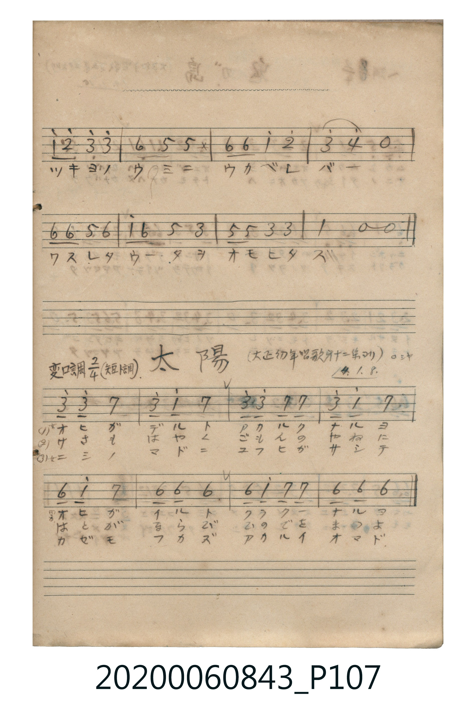

# 太陽

> Re:Shōka 使用 AI 協助辨識與重建樂譜，可能會有錯誤。歡迎回報。

- **鋼琴伴奏版**：<br><audio controls src="taiyo.mp3"></audio>

- 大正幼年唱歌 第十二集ヨリ（ロシヤ）
- 唱歌帳（2020.006.0843）P107.jpg 下半（大正十四年一月八日抄）

## 說明


- 出處：大正幼年唱歌 第十二集ヨリ（ロシヤ）
- 出處：唱歌帳（2020.006.0843）P107.jpg 下半（大正十四年一月八日抄）
- 調性與拍號：調號 ?= B,，拍號 <2/4>，速度 != 96


## 歌詞

```text
> [!NOTE]
> **原頁資訊與校勘記**（對應 `P107.jpg` 下半頁，手抄簡譜）：
> - **調性、拍號與抄錄題記**：題首左標「変ロ調 2/4（短調）」（關係調 `?= B,`、`key= Gm`、`<2/4>`），中題「太陽」，右註「（大正幼年唱歌才十二集ヨリ）ロシヤ　14. 1. 8.」（錄自《大正幼年唱歌》第十二集之俄羅斯民謠旋律，大正十四年［1925］1 月 8 日手抄）。第 2、6 小節末小節線上標有換氣記號 `v`。
> - **八度音域修正**：在 `TmdSwift` 中 `?= B,` 以 `1 = B♭4` 為基準。原簡譜中 `6, 7` 無高低音點（`G4, A4` 對應 `6_, 7_`），`1̇, 3̇` 上加一點（`B♭4, D5` 對應 `1, 3`），全曲實音音域為 `G4–D5`。先前版本誤加 `^` 寫成 `G5–D6`，今據原譜修正。
> - **男女應答標記與手抄筆誤校勘（依 Policy A 校訂）**：
>   1. **男女應答（Antiphonal）標記**：第一行左端標有「(1) 女」「(2)」「(3) 女」，第二行左端標有「男」，顯示前半句（第 1–4 小節）由女童領唱、後半句（第 5–8 小節）由男童應答。
>   2. **第二節首字漏筆校訂**：原抄第二節首字平假名「あ」漏寫下方繞圈筆畫，形似片假名「サ」（作「サさも　はやく」），今依文意與全段平假名體例按 Policy A 還原為「あさも　はやく」並備載原貌。
>
Reference Audio: 大正幼年唱歌チャンネル (YouTube)
https://www.youtube.com/@%E5%A4%A7%E6%AD%A3%E5%B9%BC%E5%B9%B4%E5%94%B1%E6%AD%8C%E3%83%81%E3%83%A3%E3%83%B3%E3%83%8D%E3%83%AB/videos

> **(1)**
> 〔女〕オヒガ　デルト　アカルク　ナルヨ
> 〔男〕オヒガ　イルト　クラクー　ナルヨ
>
> **(2)**
> 〔女〕あさも（原抄首字漏圈形似「サさも」）　はやく　ごもんの　やねに
> 〔男〕はとが　ならび　ひのでを　まつよ
>
> **(3)**
> 〔女〕ニシノ　マドニ　ユフヒガ　サシテ
> 〔男〕カゼモ　フカズ　アカルイ　オマド
```

## ABC

<div class="abc-score" data-abc-src="taiyo.abc" aria-label="五線譜載入中"></div>

[下載 ABC 原始檔](taiyo.abc)

## TMD 檔案連結

- [主旋律 TMD 檔案](taiyo.tmd) [[在 TMD Studio 編輯](https://tmdlang.github.io/Tmd-TS/#tmd=s7IKdvYPcrWy4qpTUCpJTLdSSM7PyUlNLsnMz7MqzsjPTkzOyFeCS5bl55TmploBqXgDI4RwcX5pUXJqfEFieqpVgKGBOboM3KT4vPyS1KT8_GyEioKi_LLUvMQ8oKrcxLzS4uSizIKS-OT8gkqEmtSyzJRUkIri5MS8-LLUosy0zNQUJGelFhWDHQxxR0lRYh7EHKAgQlV-UUlGfnpRYkFGpVVGZnFJflFmcmJOfHZiXiJCUUlGKtCDeYklpUWp6KIlmbmp8flp8SmJSG4DmpKemWeVm5qZlRlfklpRguo9qHRJYiYwDOKBuDwxPjcxMy8nMQ_oAS0thadLVr2cuVdBS4tL0VbB0ozL3lbBSYcrO7XSVsE9l8vGSN_EDmTY0yXLn61d_HTnnqc7tzydsvHZ2h6F52vWPO1tfLKr5-XstsfNKx43r3q_p-Nx89rHTdsfNy95v6cT7AqI4qc7NgMljQyMDPQMDMz0DCxMjIEKQHGll1WQrvBkR_fT3i6gCqg1vY1PZ88G2vRkR8OzOR1PW1c_m770WVcL2EwufS0FW2oBLgUFBTuFaEU__xDXWAhHS-tp3_yXCxpfbG5_saLrRUf7swULn3bPeLFihpYWyIUbep-1dyokwNyeAHU8UMf7PT3POruB7ny-YeGLtXOArn2_ZxbEUF2gsS9W7X_WsPxxQ-Oz7t4XM-eDTO5qednT8nJhD9TwWUDmy2XTnm5f9mzFzMcNPU-XdALDE6hPARgNQLufzwdxgOY-bugFcl9On_NkfxNIOgEcawlAsxOgMQdmg2MvAeyOnic71gJNBxsKinCwCT1P-ze_WLEbKIgIeqQYftbZixHBIAdBIvhxQ4OhiZ6CoZ6ChR7UPT0tL9pXPW7owjTqcUM3cnJ5srP7yf6W5_tan01b_2zDxBdrFjyb3v10XzfISagp4P2e3YaWRqbv9-w1VAAmBQULBVBSAIcyOByagMYqGAE9a6bwdEP_8_XA9LIawni-fdaTHV3AgHw2p_NZ_-xnGxYDQxkY7goJZcDAaULECzB5Pd217OX8zU_nz3-yfx3QdnBcPJ2zQiEhJDcluDwzrQQUy2thwazwZPdShQRDBSDn0cy1JgkKz5t2PZ2_69muaUBzgYkHEv1gDWY6CuZA-ZaFL1fPeLK3D2jJy93zgEGV4G6io-AI1ApLTmbxQJXx0LhKMDzTrqNgfKYdZG3X064FwHwA1Qe2UUfBxRSh1RCoFKrxaeuKZ7M3PV0P8g3EQ0CnKQAte9QwGagF5LzWjqedvc87O57NWfNi1RKg2QoJcUCz1q9-1jEBqNIUpNIMaFzPk91dzybPAnoH5BdwsKCE2vMp258u3Qx0wPO1U4CBDApbYIKGJP-1bUCjIdkG6OYn--YqBOTnZCZXKjgqAEVfrGgCuhYcxhDjFECJCNVEoDbHvJLMgoz8vMQcoGqIDWA9wAgHBseLhT3AbPJ89XpIBAOTsIahpgJQPzApgjhGmlCGMUwU6CWQ1l09mFqBNkMUvFy4_vmSXcAAAmbop_1LQVkOmLwMgWFiAk1eQLc8n7IRaOLz1UtfLpgBTN3AtPd0Xw-KBlAgWqBoANoA1ADxGzwYFRSMwP4GuwqoFJT1105_tqcfGICQcIIkxL75oEBFVfV05-anje1PJ4D8-LixCeh8oD5gLAILo2fTdj7fOe_pnA6gMc-nrgYli72LnuzZ87yzHaGlaSskzz7ZOwfKbZz6uAloTsPjxvWPm1oeN_aDFYCLjt1dwDh8Nq39WUs_MJJBiWzdVrgDXq6e8mRf97OeTkQkv2xqAWWDpl1Qx2Ez-smOZU-bZr7Y0wlKYZuABQQkUEBEUGpaahGovlVwLE3JzLcC1lEY5Ulz4-PmxY-bNz9u7n3cvFpBIzK_NKQ0KVUTpD-jpKSg2Epfv7y8XK8yv7QEKK6XnJ-r76DqaqrqaKLqaK7qaqbq6KLqaAwScbJUdXKGMUxADEsTVSdDqBoLoJSxqgUQAUXADJAuMMMJxrBwgUk56YOaCvnFXLC6BJgqgVUrmPO4YQo4JQIDY9Xj5kmPm9aAgqS5Hej-x80dIHbTosdNQPbqx03rwVJdYKkVcO3gdIqqvWkJkvb1j5tXgsk9GNrh7jHC4h5YFIFqAXBig6dEYCqCJB7URAJKGKjxCWRPAUk1TX7cuA7sGKD42seNq9EdD9TSuOJxIzDCgVpWPW7qfNwIdAOQvQmksXH546ZJYO6-x41LHjd1oDreGIvjm7vB9VEf2MvzHjcDa6huMHvZ42agLDygtoKVtWEEJjC09zxuXgTWAuECky1yXIBqOnCYgwwHaae82QEFClr6XFwhiZmV-VZh-cC2oEONQU01yAYFGwstsK8VqnPTasEMbK0eUBMMUhY-bt4NDA5IgaSggV5o6SjAWiuaWAwBOgJkQY2CMRCaxwNLdxDTEMEEiwIRsjBYi49hjQIwZBSAoQyk14CVAxM0EK8G4g4Iv2kREIP4QNy0HqyiC6piBcIkI6B4YxMQTwWqaoLobFwPZLcA6X4ofwpYDpjGgOx1YLNBsmuBeDXCJGOQDd1Aue1Aug_qpnlA3AkWh_CXATHQJqi7QSZthepoA5uEP8jBdQgwyIFJCFKkQ4IcudgnMsjN4hEBDWRDEJQDlgAHO7IM7oBvWoIW8MDga14JpiGexhXsQHWNK4C4BxrMQHObgIHVuBnK3wQObmDeBIpPAovsA2KgbU1gmxDBDormpj1AGxZBbQRFJkhsF5aksAQsAvIDJHJAJtVycenaKYBzRLSPYawCgmOEzDEGc5S5AA)]
- [鋼琴伴奏 TMD 檔案](taiyo_piano.tmd) [[在 TMD Studio 編輯](https://tmdlang.github.io/Tmd-TS/#tmd=s7IKdvYPcrWy4qpTUCpJTLdSSM7PyUlNLsnMz7MqzsjPTkzOyFeCS5bl55TmploBqXgDI4RwcX5pUXJqfEFieqpVgKGBOboM3KT4vPyS1KT8_GyEioKi_LLUvMQ8oKrcxLzS4uSizIKS-OT8gkqEmtSyzJRUkIri5MS8-LLUosy0zNQUJGelFhWDHQxxR0lRYh7EHKAgQlV-UUlGfnpRYkFGpVVGZnFJflFmcmJOfHZiXiJCUWIRUHN6am5qXolVQWZiXn58YnJyfm5BYl4mSAyhsCQDqMgqNaU0ORFijZaWwtMlq17O3Pt-T8fL7j3PJ2x5smfL06X9zzs73u_pVNDS4lK0VbA047K3VXDS4cpOrbRVcM_lsjHSN7EDGfp0yfJnaxc_3bnn6c4tT6dsfLa2R-H5mjVPexuf7Op5ObvtcfOKx82rgEY_bl77uGn74-YlQEPBroEofrpjM1DSyMDIQM_AwEzPwMLEGKgAFBl6WQXpCk92dD_t7QKqgFrT2_h09mygTU92NDyb0_G0dfWz6UufdbWAzeTS11KwpRbgUlCABouCRkhiZmW-psKjhikKAaCgVXBEDlqQymBIclGgsp9ARjvmAdMeOKqKgeaTEdggQ4JS01KLQClRwbE0JTMfm0GPmxsfNy9-3Lz5cXPv4-bVChqR-aUhpUmpmiD9GSUlBcVW-vrl5eV6lfmlJUBxPWAQ6DuoupqqOpqoOpqrupqpOrqoOhqDRJwsVZ2cYQwTEMPSRNXJEKrGAihlrGoBREARMAOkC8xwgjEsXGBSTvqgTJRfDHIG5dEKBQpa-lxc4Gi1CssHZiaHGoOaapANCjYWWnZgRnVuWi2YUaNgDITm8Qq6YKYhggkWBSJkYbAWH8MahcdNqxQeN08C0mvAyh83twPxaiDugPCbFgExiA_ETevBKrqgKlYgTDICijc2AfFUoKomiM7G9UB2C5Duh_KngOUeN00GsteBzQbJrgXi1QiTjEE2dAPltgPpPqib5gFxJ1gcwl8GxECboO4GmbQVqqMNbBI0RMziEeEAZEMQlAOWAIcKsgzucGlaghYuQN81rwTTEDfhChWgusYVQNwDDQWguU1AvzRuhvI3gUPjceNyoPgksMg-IAba1gS2CREqoFho2gO0YRHURlBYg8R2YYmpJWARkB8gYQcyqRaWmMDFQ5AH1uRUAEtOZvHahtrGMMo4XttUPV4bHphQGUxxrHoQLJx6YYk4XhscGRhGGwK1geUwGeBkjk0fsrX49aOFjQ9y2JjAwgYpaEBmQzyDh0W0ahAGO0HXTgHsimgfw1gFBMcImWMM5ihzAQA)]

## 分析

```text
================================================================================
📊 TMD Song Profile: [ 太陽 ]
================================================================================
⏱  Duration:       0:30 (30.0s), 24 measures total
🎼 Key & Tempo:    首調基準 B,, != 96.0 BPM, <2/4>
   - 分析範圍：      由實際發聲的音符與和弦推測調性；播放脈絡另行呈現
🎤 人聲音域:    G4 (MIDI 67) – D5 (MIDI 74) [跨度: 7 個半音 / 0.6 個八度, 難度: easy]
   - 最低音:  G4 in [Taiyo[L1] #1 @ m.5, 0:05]
   - 最高音: D5 in [Taiyo[L1] #1 @ m.1, 0:00]
   - 適合: soprano, mezzo-soprano, contralto, tenor, baritone, bass
🏛  結構:      Taiyo[L1] (10.0s) -> Taiyo[L2] (10.0s) -> Taiyo[L3] (10.0s)
⚡ 編曲密度:        Peak 1 軌道同時演奏
🗝  調性診斷：       G 調性不明確（純淨自然大調，未偵測到可信轉調）
   - 風格氣質:    純淨自然大調（陽光明朗、易唱易記，無明顯調外色彩）
   - 轉調歷程:    全曲維持單一推測調性（未偵測到可信轉調）
   - 核心骨幹音:  A, G, D, A#
   - 調性數值:    G 調性不明確 [相關度: 0.63, 穩定度: Ambiguous, 自然音純度: 100.0%]
   - 候選調性 (K-S): G 小調 (0.63), D 大調 (0.62), G 大調 (0.54)
   - 五度圈歷程:   +1 -> +1 -> +1
   - 各段落調性細節:
     • [Taiyo[L1] #1]: G 調性不明確 (r: 0.63, 自然音純度: 100.0%)
     • [Taiyo[L2] #1]: G 調性不明確 (r: 0.63, 自然音純度: 100.0%)
     • [Taiyo[L3] #1]: G 調性不明確 (r: 0.63, 自然音純度: 100.0%)

  [ 五度圈游移軌跡 ]
               C  
         F           [G ]*
      Bb               D  
      Eb               A  
         Ab           E  
            Db       B  
               F# 
     (* = active key center)

  [ 十二半音累積音高分佈 ]
     C  :                            0.0%
     C# :                            0.0%
     D  : ████████████              18.7%
     D# :                            0.0%
     E  :                            0.0%
     F  :                            0.0%
     F# :                            0.0%
     G  : ████████████████████      31.2%
     G# :                            0.0%
     A  : ████████████████████████  37.5%
     A# : ████████                  12.5%
     B  :                            0.0%
--------------------------------------------------------------------------------
Assignment 軌道音域：
  - Vocal         : G4 – D5 (7 個半音 / 0.6 個八度, 78 個音符)
================================================================================
```


## 原書掃描頁




