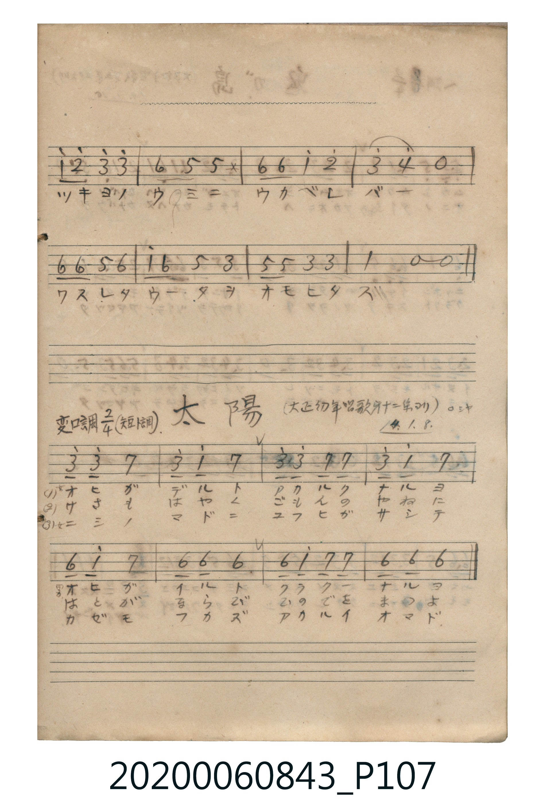

# 太陽

> Re:Shōka 使用 AI 協助辨識與重建樂譜，可能會有錯誤。歡迎回報。

- **鋼琴伴奏版**：<br><audio controls src="taiyo.mp3"></audio>

- 大正幼年唱歌 第十二集ヨリ（ロシヤ）
- 唱歌帳（2020.006.0843）P107.jpg 下半（大正十四年一月八日抄）

## 說明

原書資訊與歌詞全文（對應 P107.jpg 下半，手抄簡譜）：
調性與拍號：變ロ調四分之二拍子（短調 / G 小調 2/4 拍）
出處與日期註記：「（大正幼年唱歌第十二集ヨリ）ロシヤ 14. 1. 8.」


## 歌詞

```text
(1) オヒガデルト　アカルクナルヨ
オヒガイルト　クラクナルヨ
(2) あさもはやく　ごもんのやねに
はとがならび　ひのでをまつよ
(3) ニシノマドニ　ユフヒガサシテ
カゼモフカズ　アカルイオマド
```

## ABC

<div class="abc-score" data-abc-src="taiyo.abc" aria-label="五線譜載入中"></div>

[下載 ABC 原始檔](taiyo.abc)

## TMD 檔案連結

- [主旋律 TMD 檔案](taiyo.tmd) [[在 TMD Studio 編輯](https://tmdlang.github.io/Tmd-TS/#tmd=s7IKdvYPcrWy4qpTUCpJTLdSSM7PyUlNLsnMz7MqzsjPTkzOyFeCS5bl55TmploBqXgDI4RwcX5pUXJqfEFieqpVgKGBOboM3KT4vPyS1KT8_GyEioKi_LLUvMQ8oKrcxLzS4uSizIKS-OT8gkqEmtSyzJRUkIrUlMyS_KLMxBwkJ6UWFYMdC3FDSVFiHsQMoCBCVUlGKtDdeYklpUWpCFGgUemZeVa5qZlZmfElqRUlqE6DSpckZgLdHw_E5YnxuYmZeTmJeSlKXFpaCk-XrHo5c6-ClhaXoq2CpRmXva2Ckw5XdmqlrYJ7LpeNkb6JHciwp0uWP1u7-OnOPU93bnk6ZeOztT0Kz9esedrb-GRXz8vZbY-bVzxuXvV-T8fj5rWPm7Y_bl7yfk8n2BUQxU93bAZKGhkYGegZGJjpGViYGAMVgMJZL6sgXeHJju6nvV1AFVBrehufzp4NtOnJjoZnczqetq5-Nn3ps64WsJlc-loKttQCXAoKCk_75j-bvePF5vYXK7pedLQDXfti5bynrSueTWsHuWhD77P2TgUMp_Y86-wGOun5hoUv1s4BOuz9nlkgw16s2v-sYTnImO7eFzPnA0VfrOsCBgpQHOSljrYnO7uBQQaUfbp2AtD45_NBUgr6Cu4KTzf0g5jAEFcASgONBDuufdeLmVNB5gFDYM78Fyt2v1gxA2jq44YeRHAhxQq2SOmER4qCoYmegqGegoXe44ZeLpD5GoaaCo-bVj1unvS4ac3j5vbHzasfN3c8bmh43LTocROQvfpx0_rHzUAvANkrQDpAAKGjaQmSDqDClejKNYyAFjQ2PW6c-rgJSK5_3NTyuLEfpLxxCkikafLjxnVgwbWPG1fDLQAqbFzxuLHnceOqx02djxs3g3VsAqltXP64adLjxn2PG5c8buoA22EMtKO5G-zHvsfN8x43A73cDdLRvOxx81SYU7eCFbQhPAH0257HzYtASkDsXajeBpoO9CXIMJAOytMaFCho6XNxhSRmVuZbheUnJ-Y41BjUVIPdZGOhZQdmYEvhoOwGzA4vFvYoaJiA0srz9Q068GSpiUUD0B6QYTUKxnEgZK6gC2EbIrHB4uao4uB0gdsNu3rIcYMZwlozMISwwIIg--GCXLVcXLp2CuAAUgAylLkA)]
- [鋼琴伴奏 TMD 檔案](taiyo_piano.tmd) [[在 TMD Studio 編輯](https://tmdlang.github.io/Tmd-TS/#tmd=s7IKdvYPcrWy4tLSUni6ZNXLmXvf7-l42b3n-YQtT_Zsebq0_3lnx_s9nQpaWlyKtgqWZlz2tgpOOlzZqZW2Cu65XDZG-iZ2XHUKSk-XLH-2dvHTnXue7tzydMrGZ2t7FJ6vWfO0t_HJrp6Xs9seN6943LwKaPTj5rWPm7Y_bl4CNFQJrBGs-OmOzUBJIwMjAz0DAzM9AwsTY6CCAEMDc72sgnSFJzu6n_Z2AVVAreltfDp7NtCmJzsans3peNq6-tn0pc-6WsBmcoUkZlbmW4XlJyfmONQY1FRzKQCBjYWWHZhRo2AcB0LmCroQtiESGyxujioO1WWGUGgGhhAWWBCkAy7IVQtzQkBmYl5-kAdWR5hpA60AE8baUFMhHKCBKCJwNSCMRRXMU9pA65E1gwRgGMaHK4CYhaYEzeE-yA43QTg8XsE4HjeNqQqIMPggq3TtFMC2KQAZylwA)]

## 分析

```text
================================================================================
📊 TMD Song Profile: [ 太陽 ]
================================================================================
⏱  Duration:       0:10 (10.0s), 8 measures total
🎼 Key & Tempo:    首調基準 B,, != 96.0 BPM, <2/4>
   - 分析範圍：      由實際發聲的音符與和弦推測調性；播放脈絡另行呈現
🎤 人聲音域:    G5 (MIDI 79) – D6 (MIDI 86) [跨度: 7 個半音 / 0.6 個八度, 難度: easy]
   - 最低音:  G5 in [Taiyo #1 @ m.5, 0:05]
   - 最高音: D6 in [Taiyo #1 @ m.1, 0:00]
   - 適合: soprano, tenor
🏛  結構:      Taiyo (10.0s)
⚡ 編曲密度:        Peak 1 軌道同時演奏
🗝  調性診斷：       G 調性不明確（純淨自然大調，未偵測到可信轉調）
   - 風格氣質:    純淨自然大調（陽光明朗、易唱易記，無明顯調外色彩）
   - 轉調歷程:    全曲維持單一推測調性（未偵測到可信轉調）
   - 核心骨幹音:  A, G, D, A#
   - 調性數值:    G 調性不明確 [相關度: 0.63, 穩定度: Ambiguous, 自然音純度: 100.0%]
   - 候選調性 (K-S): G 小調 (0.63), D 大調 (0.62), G 大調 (0.54)
   - 五度圈歷程:   +1
   - 各段落調性細節:
     • [Taiyo #1]: G 調性不明確 (r: 0.63, 自然音純度: 100.0%)

  [ 五度圈游移軌跡 ]
               C  
         F           [G ]*
      Bb               D  
      Eb               A  
         Ab           E  
            Db       B  
               F# 
     (* = active key center)

  [ 十二半音累積音高分佈 ]
     C  :                            0.0%
     C# :                            0.0%
     D  : ████████████              18.7%
     D# :                            0.0%
     E  :                            0.0%
     F  :                            0.0%
     F# :                            0.0%
     G  : ████████████████████      31.2%
     G# :                            0.0%
     A  : ████████████████████████  37.5%
     A# : ████████                  12.5%
     B  :                            0.0%
--------------------------------------------------------------------------------
Assignment 軌道音域：
  - Vocal         : G5 – D6 (7 個半音 / 0.6 個八度, 26 個音符)
================================================================================
```


## 原書掃描頁




