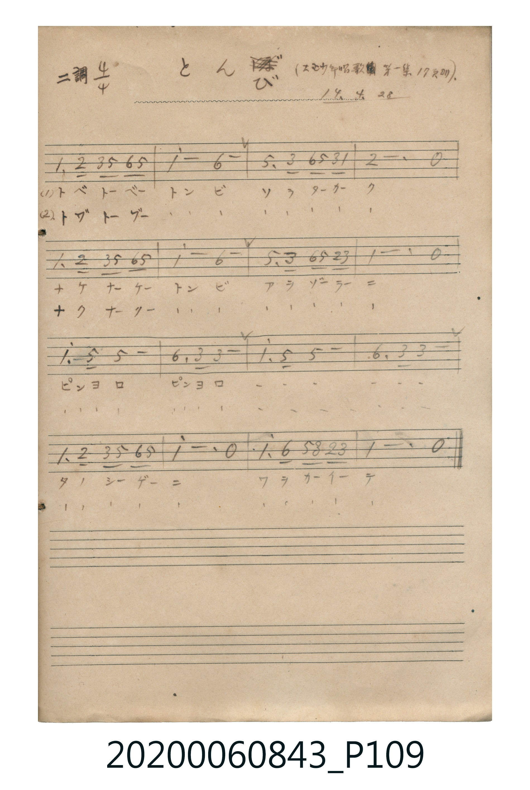

# とんび

<audio controls src="tonbi.mp3"></audio>

- 大正幼年唱歌 第一集 17頁ヨリ
- 唱歌帳（2020.006.0843）P109.jpg（大正十四年四月二十八日抄）

## 說明

原書資訊與歌詞全文（對應 P109.jpg，手抄簡譜）：
調性與拍號：ニ調四分之四拍子（D 大調 4/4 拍）
出處與日期註記：「（大正幼年唱歌第一集17頁ヨリ） 14. 4. 28」

## 跨冊／重複收錄參照

> 同曲（《大正幼年唱歌》第一集〈とんび〉；收錄於《新定兒童唱歌》四年級與《唱歌帖》P109）

- **[同曲]** 《新定兒童唱歌》尋常科第四學年用（2020.006.0847.0004）：[**〈とんび〉**](../../../shintei_jido_shoka/grade_4_2020.006.0847.0004/4_15_tonbi/index.md)（`C` / `4/4` — [原始 TMD](../../../shintei_jido_shoka/grade_4_2020.006.0847.0004/4_15_tonbi/tonbi.tmd)）
- 總表：[跨冊重複與同名歌曲總索引](../../../duplicate_songs.md)

## 歌詞

```text
(1) トベトーベー　トンビ　ソラターカーク
ナケナーケー　トンビ　アヲゾーラーニ
ピンヨロ　ピンヨロ　ピンヨロ　ピンヨロ
タノシーゲーニ　ワヲカーイーテ

(2) トブトーブー　トンビ　ソラターカーク
ナクナークー　トンビ　アヲゾーラーニ
ピンヨロ　ピンヨロ　ピンヨロ　ピンヨロ
タノシーゲーニ　ワヲカーイーテ
```

## ABC

```abc
X:1
T:とんび
M:4/4
L:1/16
Q:1/4=100
K:D
V:V1 name="Vocal" snm="Voc"
[V:V1]
D6 E2 F2 A2 B2 A2 | d8 B8 | A6 F2 B2 A2 F2 D2 | E12 z4 |
D6 E2 F2 A2 B2 A2 | d8 B8 | A6 F2 B2 A2 E2 F2 | D12 z4 |
d6 A2 A8 | B6 F2 F8 | d6 A2 A8 | B6 F2 F8 |
D6 E2 F2 A2 B2 A2 | d12 z4 | d6 B2 A2 F2 E2 F2 | D12 z4 |
```

## TMD 檔案連結

- [主旋律 TMD 檔案](tonbi.tmd) [[在 TMD Studio 編輯](https://tmdlang.github.io/Tmd-TS/#tmd=s7IKdvYPcrWy4tLSUnjcuOJx0-THjZsVtLS4FG0VDA0MuOxtFVy4bEz0Tey46hSUni5Z_mzt4qc79zzdueXplI3P1vYoPF-z5smOhpez2xQMzV8uaHzcvOJx8yolsGKwgqc7Nr_f02FkYGSgZ2BgpmdgYWL8fk9ngKGBpV5WQTpQCmpmb-PT2bNBxs6e_WxOx5NdPSCR1tXPpi991tUC1KHExaWvpWBLLcCloKDwtG_-s9k7Xmxuf7Gi60VHO9CxL1bOe9q64tm0dpC7NvQ-a-9UQLi051lnN9AtzzcsfLF2DtBF7_fMApnyYtX-Zw3LQfq7e1_MnA8UfdzcDRQEeaej7cnObpCPunufrp0ANNRFAehdoKQCMEQVgKJAY8Auad_1YuZUkBlA786Z_2LF7hcrZoBMauhBhBBSqMMDHSnMgUYpGJroKQCRkcXjhl4ukMEahpoKj5s7HjfPBJN7wIw9jxsawNzNj5sng9hNex83r3zctB8k1bQaTK4H6QaBx81dj5s2gkiQMJCBqXvR4-ZNj5v2gY1fCSa7EbqngBUCHbgWrI9YLtwAkKv6HjdtB1u_CWI6WO16sK0Q1y4Bi7dBvGwE9fI0mJeBDNK9DDQe4mUgYzB7GaiB8twABQpa-lxcIfl5SZlWYfnJiTkONQY1CtVgd9lYaNmBGdgyIbQQeLGwR0HDROHphv7n6xt04DlHE4sGoEUgw2oUDBV0gdBIwVjBVMEMiIEicWAhXSAXQtcAhUG0MViBMVBLDVADRA4EDUBqwFGP23G7eujiOJBSmDbiHbejkyzHQZxiCnUAyCkQRxkDIUyEGEX4XQcsvagcdPBggQlBohVX2NVycenaKYBTpQKQocwFAA)]
- [鋼琴伴奏 TMD 檔案](tonbi_piano.tmd) [[在 TMD Studio 編輯](https://tmdlang.github.io/Tmd-TS/#tmd=s7IKdvYPcrWy4tLSUnjcuOJx0-THjZvf7-l42b3n-YQtT_Zsebq0_3lnx_s9nQpaWlyKtgqGBgZc9rYKLlw2Jvomdlx1CkpPlyx_tnbx0517nu7c8nTKxmdrexSer1nzZEfDy9ltCobmLxc0Pm5e8bh5lRJYMVjB0x0gO4wMjAz0DAzM9AwsTIyBNgQYGljqZRWkA6WgZvY2Pp09G2Ts7NnP5nQ82dUDEmld_Wz60mddLUAdSlxcIfl5SZlWYfnJiTkONQY1CtVcCkBgY6FlB2bUKBgq6AKhkYKxgqmCGRADReLAQrpALoSuAQqDaGOwAmOglhqgBogcCBqA1JBrHEgpTBsW4yCaTaFaQJohxhgDIUyEGEWEnQe3GiYE8Swu99XCwjYgMzEvP8gDf-gaaoNsNNGG2GmsDbcVJARztLE2Zjibx2sTCmoyzAabCvYXUC920-HmAF0C1QsyB2Ym0HVwraQpJtb1iPiAC0KCBa_jUaPFByVaTBDREo9AQGfGIxBMDsgEy5nGx8OxAcLxBPXD9ID5IAaQwq8fxsMjh1830HgoB9lybVBAw8NG104BHDwKQIYyFwA)]

## 分析

```text
================================================================================
📊 TMD Song Profile: [ とんび ]
================================================================================
⏱  Duration:       0:38 (38.4s), 16 measures total
🎼 Key & Tempo:    首調基準 D, != 100.0 BPM, <4/4>
   - 分析範圍：      由實際發聲的音符與和弦推測調性；播放脈絡另行呈現
🎤 人聲音域:    D4 (MIDI 62) – D5 (MIDI 74) [跨度: 12 個半音 / 1.0 個八度, 難度: easy]
   - 最低音:  D4 in [Tonbi #1 @ m.1, 0:00]
   - 最高音: D5 in [Tonbi #1 @ m.2, 0:02]
   - 適合: soprano, mezzo-soprano, contralto, tenor, baritone, bass
🏛  結構:      Tonbi (38.4s)
⚡ 編曲密度:        Peak 1 軌道同時演奏
🗝  調性診斷：       D 大調（純淨自然大調，未偵測到可信轉調）
   - 風格氣質:    純淨自然大調（陽光明朗、易唱易記，無明顯調外色彩）
   - 轉調歷程:    全曲維持單一推測調性（未偵測到可信轉調）
   - 核心骨幹音:  D, A, B, F#, E
   - 調性數值:    D 大調 [相關度: 0.91, 穩定度: High, 自然音純度: 100.0%]
   - 候選調性 (K-S): D 大調 (0.91), B 小調 (0.70), A 大調 (0.57)
   - 五度圈歷程:   +2
   - 各段落調性細節:
     • [Tonbi #1]: D 大調 (r: 0.91, 自然音純度: 100.0%)

  [ 五度圈游移軌跡 ]
               C  
         F            G  
      Bb              [D ]*
      Eb               A  
         Ab           E  
            Db       B  
               F# 
     (* = active key center)

  [ 十二半音累積音高分佈 ]
     C  :                            0.0%
     C# :                            0.0%
     D  : ████████████████████████  37.5%
     D# :                            0.0%
     E  : ██████                     9.2%
     F  :                            0.0%
     F# : ██████████                15.8%
     G  :                            0.0%
     G# :                            0.0%
     A  : █████████████             20.8%
     A# :                            0.0%
     B  : ███████████               16.7%
--------------------------------------------------------------------------------
Assignment 軌道音域：
  - Vocal         : D4 – D5 (12 個半音 / 1.0 個八度, 56 個音符)
================================================================================
```


## 原書掃描頁




