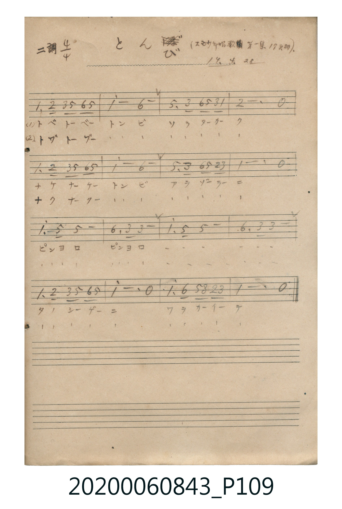

# とんび

> Re:Shōka 使用 AI 協助辨識與重建樂譜，可能會有錯誤。歡迎回報。

- **鋼琴伴奏版**：<br><audio controls src="tonbi.mp3"></audio>

- 大正幼年唱歌 第一集 17頁ヨリ
- 唱歌帳（2020.006.0843）P109.jpg（大正十四年四月二十八日抄）

## 說明

原書資訊與歌詞全文（對應 P109.jpg，手抄簡譜）：
調性與拍號：ニ調四分之四拍子（D 大調 4/4 拍）
出處與日期註記：「（大正幼年唱歌第一集17頁ヨリ） 14. 4. 28」
Reference Audio: 大正幼年唱歌チャンネル (YouTube)
https://www.youtube.com/@%E5%A4%A7%E6%AD%A3%E5%B9%BC%E5%B9%B4%E5%94%B1%E6%AD%8C%E3%83%81%E3%83%A3%E3%83%B3%E3%83%8D%E3%83%AB/videos


## 歌詞

```text
(1) トベトーベー　トンビ　ソラターカーク
ナケナーケー　トンビ　アヲゾーラーニ
ピンヨロ　ピンヨロ　ピンヨロ　ピンヨロ
タノシーゲーニ　ワヲカーイーテ

(2) トブトーブー　トンビ　ソラターカーク
ナクナークー　トンビ　アヲゾーラーニ
ピンヨロ　ピンヨロ　ピンヨロ　ピンヨロ
タノシーゲーニ　ワヲカーイーテ
```

## ABC

<div class="abc-score" data-abc-src="tonbi.abc" aria-label="五線譜載入中"></div>

[下載 ABC 原始檔](tonbi.abc)

## TMD 檔案連結

- [主旋律 TMD 檔案](tonbi.tmd) [[在 TMD Studio 編輯](https://tmdlang.github.io/Tmd-TS/#tmd=s7IKdvYPcrWy4qpTUCpJTLdSSM7PyUlNLsnMz7MqzsjPTkzOyFeCS5bl55TmploBqXgDI4RwcX5pUXJqfEFieqpVgKGBJboM3KT4vPyS1KT8_GyEioKi_LLUvMQ8oKrcxLzS4uSizIKS-OT8gkqEmtSyzJRUkIrUlMyS_KLMxBwkJ6UWFYMdC3FDSVFiHsQMoCBCVUlGKtDdiXmZuch6gUalZ-ZZ5aZmZmXGl6RWlKA6DSpdkpgJdH88EJcnxucmZublJOalIKsqychPL0osyKi0ysgsBrkvOTEnPjsxL1GJS0tL4XHjisdNkx83blbQ0uJStFUwNDDgsrdVcOGyMdE3sQMZ83TJ8mdrFz_duefpzi1Pp2x8trZH4fmaNU92NLyc3aZgaP5yQePj5hWPm1eB7YQoeLpj8_s9HUYGRgZ6BgZmegYWJsbv93SCwl4vqyAdKAU1s7fx6ezZIGNnz342p-PJrh6QSOvqZ9OXPutqAepQ4uLS11KwpRbgUlBQeNo3_9nsHS82t79Y0fWiox3o2Bcr5z1tXfFsWjvIXRt6n7V3KiBc2vOssxvolucbFr5YOwfoovd7ZoFMebFq_7OG5SD93b0vZs4Hij5u7gYKgrzT0fZkZzfIR929T9dOABrqogD0LlBSARiiCkBRoDFgl7TvejFzKsgMoHfnzH-xYveLFTNAJjX0IEIIKdThgY4U5kCjFAxN9BSAyMjicUMvyNyg1LTUIlB6VHAsTcnMtwLZjmbU42ag_sWPmzc_bu593LxaQSMyvzSkNClVE6Q_o6SkoNhKX7-8vFyvMr-0BCiul5yfq--g6mqq6mii6miu6mqm6uii6mgMEnGyVHVyhjFMQAxLE1UnQ6gaC6CUsaoFEAFFwAyQLjDDCcawcIFJOemDslJ-MRcXyCEahpoKj5s7HjfPBJN7wIw9jxsawFyg2yeD2E17HzevfNy0HyTVtBpMrgfpBoHHzV2PmzaCSJAwkIGpe9Hj5k2Pm_aBjV8JJrsRuqeAFQIDei1YH7FcuAEgV_U9btoOtn4TxHSw2vVgWyGuXQIWb4N42Qjq5WkwLwMZpHsZaDzEy0DGYPcy5dkaChS09Lm4QvLzkjKtwvKBZZxDjUFNNdhdNhZadmAGtsIEWpi9WNijoGGi8HRD__P1DTrwEkATiwagPSDDahQMFXSB0EjBWMFUwQyIgSJxYCFdIBdC1wCFQbQxWIExUEsNUANEDgQNQGrA4YDbcbt66OI4kFKYNuIdt6OTLMdBnGIKdQDIKRBHGQMhTIQYRfhdByyFqRx08GCBCUGiFVfY1XJx6dopgBOlApChzAUA)]
- [鋼琴伴奏 TMD 檔案](tonbi_piano.tmd) [[在 TMD Studio 編輯](https://tmdlang.github.io/Tmd-TS/#tmd=s7IKdvYPcrWy4qpTUCpJTLdSyC8qychPL0osyKi0ysgsLskvykxOzInPTsxLVIIrKs4vLUpOjS9ITE-1CjA0sETIlGSk5qZapaaUJieWZObnKXFpaSk8blzxuGny48bN7_d0vOze83zClid7tjxd2v-8s-P9nk4FLS0uRVsFQwMDLntbBRcuGxN9EzuQeU-XLH-2dvHTnXue7tzydMrGZ2t7FJ6vWfNkR8PL2W0KhuYvFzQ-bl7xuHkV2HKIgqc7QHYYGRgZ6BkYmOkZWJgYA20AuVAvqyAdKAU1s7fx6ezZIGNnz342p-PJrh6QSOvqZ9OXPutqAepQ4uLS11KwpRbgUlBABIKCRkh-XlKmpsKjhikKAZmJefkKjsnJ-bkFiXmZual5JSDFweDwtVKgrq9AJjvm5eWXgKOmGGg8kSEM0hiUmpZalJqXnKrgWJqSmY9N8-NmoPrFj5s3P27ufdy8WkEjMr80pDQpVROkP6OkpKDYSl-_vLxcrzK_tAQorgf0tb6DqqupqqOJqqO5qquZqqOLqqMxSMTJUtXJGcYwATEsTVSdDKFqLIBSxqoWQAQUATNAusAMJxjDwgUm5aRflpmSml8McgblkQkFClr6XFzgmLQKywfmEIcag5pqkA0KNhZadmBGjYKhgi4QGikYK5gqmAExUCQOLKQL5ELoGqAwiDYGKzAGaqkBaoDIgaABSA25xoGUwrRhMQ6i2RSqBaQZYowxEMJEiFFE2Hlwq2FCEM_icl8tLGjB-SPIA2_gGmqDLDTRhlhprA23FCQEc7OxNmYwm8drEwppMswGmwr2FlAvdtPh5gBdAtULMgdmJtB1cK2kKSbW9YjogAtCggWv41FjxQc5VkwQsRKPQEBXxiMQTA7IBMuZxsfDsQHC7QT1w_SA-SAGkMKvH8bDI4dfN9B4KAfZcm1QOMODRtdOARw6CkCGMhcA)]

## 分析

```text
================================================================================
📊 TMD Song Profile: [ とんび ]
================================================================================
⏱  Duration:       0:38 (38.4s), 16 measures total
🎼 Key & Tempo:    首調基準 D, != 100.0 BPM, <4/4>
   - 分析範圍：      由實際發聲的音符與和弦推測調性；播放脈絡另行呈現
🎤 人聲音域:    D4 (MIDI 62) – D5 (MIDI 74) [跨度: 12 個半音 / 1.0 個八度, 難度: easy]
   - 最低音:  D4 in [Tonbi #1 @ m.1, 0:00]
   - 最高音: D5 in [Tonbi #1 @ m.2, 0:02]
   - 適合: soprano, mezzo-soprano, contralto, tenor, baritone, bass
🏛  結構:      Tonbi (38.4s)
⚡ 編曲密度:        Peak 1 軌道同時演奏
🗝  調性診斷：       D 大調（純淨自然大調，未偵測到可信轉調）
   - 風格氣質:    純淨自然大調（陽光明朗、易唱易記，無明顯調外色彩）
   - 轉調歷程:    全曲維持單一推測調性（未偵測到可信轉調）
   - 核心骨幹音:  D, A, B, F#, E
   - 調性數值:    D 大調 [相關度: 0.91, 穩定度: High, 自然音純度: 100.0%]
   - 候選調性 (K-S): D 大調 (0.91), B 小調 (0.70), A 大調 (0.57)
   - 五度圈歷程:   +2
   - 各段落調性細節:
     • [Tonbi #1]: D 大調 (r: 0.91, 自然音純度: 100.0%)

  [ 五度圈游移軌跡 ]
               C  
         F            G  
      Bb              [D ]*
      Eb               A  
         Ab           E  
            Db       B  
               F# 
     (* = active key center)

  [ 十二半音累積音高分佈 ]
     C  :                            0.0%
     C# :                            0.0%
     D  : ████████████████████████  37.5%
     D# :                            0.0%
     E  : ██████                     9.2%
     F  :                            0.0%
     F# : ██████████                15.8%
     G  :                            0.0%
     G# :                            0.0%
     A  : █████████████             20.8%
     A# :                            0.0%
     B  : ███████████               16.7%
--------------------------------------------------------------------------------
Assignment 軌道音域：
  - Vocal         : D4 – D5 (12 個半音 / 1.0 個八度, 56 個音符)
================================================================================
```


## 原書掃描頁




