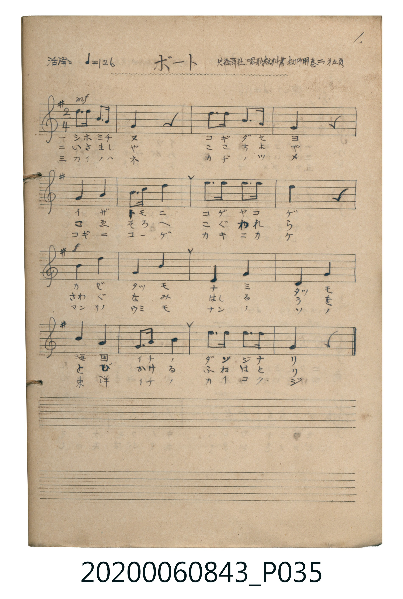

# ボート

> Re:Shōka 使用 AI 協助辨識與重建樂譜，可能會有錯誤。歡迎回報。

- **鋼琴伴奏版**：<br><audio controls src="boto.mp3"></audio>

- 出處：共益商社唱歌教科書教師用巻二 第五頁（1.）
- 《唱歌帖》（2020.006.0843）P035.jpg
- 原典：共益商社樂器店《唱歌教科書 教師用 巻二》第四～五頁（NDL PID 854863，https://dl.ndl.go.jp/pid/854863）

## 說明

原書資訊與歌詞全文（對應 P035.jpg；並依 NDL PID 854863《唱歌教科書 教師用 巻二》第四～五頁原典校訂）：
調性與拍號：ト調四分ノ二拍子（G 大調 2/4 拍），♩=126，「活潑ニ」
註記：共益商社唱歌教科書教師用巻二 第五頁 / 1.
原典演奏注意：第三段各小節之第一音符須特稍強聲歌唱；一個四分音符下配有兩個音節歌詞者，平均分作兩個八分音符歌唱。
原典語釋：「風たつも浪たつも」一句不接後句，移至「いざともに」之前理解則意義自明；「舟は鳥」謂飛馳之舟如鳥；「かいの羽、かぢの爪」以鳥之羽與爪比喻船之櫂與柁（舵）。


## 歌詞

```text
一、
潮みちぬ こぎだせよ
いざともに こげやこげ
風たつも 浪たつも
海國一の 男兒なり

二、
いさましや こゝちよや
こゑそろへ こぐわれら
さわぐ波 走る魚
とびかける 舟は鳥

三、
かいの羽 かぢの爪
こぎにこげ かきにかけ
萬里の海も なんのその
東洋一の 海國兒
```

## ABC

<div class="abc-score" data-abc-src="boto.abc" aria-label="五線譜載入中"></div>

[下載 ABC 原始檔](boto.abc)

## TMD 檔案連結

- [主旋律 TMD 檔案](boto.tmd) [[在 TMD Studio 編輯](https://tmdlang.github.io/Tmd-TS/#tmd=s7IKdvYPcrWy4qpTUCpJTLdSSM7PyUlNLsnMz7MqzsjPTkzOyFeCS5bl55TmploBqXgDY4RwcX5pUXJqfEFieqpVgIGxKboM3KT4vPyS1KT8_GyEioKi_LLUvMQ8oKrcxLzS4uSizIKS-OT8gkqEmtSyzJRUkIri5MS8-LLUosy0zNQUJGelFhWDHQxxR0lRYh7EHKAgQlVaflGuVXFJUX5BRmYyQrgkIxXoJbCegvyiEnSJ8sSS1CKEYH5RZnpmnlVuamZWZnxJakUJqm-ABmTkpxclFmRUWmVkFpcAlScn5sRnJ-YlKnFpaSk8bp7zuHnP4-YOBS0tLkVbBUMjMy57WwV3LhsjfRM7kDFP23e9mDn1_Z5ZT1s3Pp_d9XRq2_Ml-55O2fhsbc-zqTOfL5_4bPYOIOPpjtXPp6x4un33k109Cs_XrHmya8rLBY3v93QY6r3f0wl20OOGLoi-pzumPW7oBsoZGRgZ6BkYmOkZWJgYA5WB4kovqyAdrPxp3_ynrTvQLH62ounpzBVPd02HGwZ3hALcFQoQZwDtADrk6ezZ7_fOgzvHz8VHIcDTRcHC1MTCDGhnT0ZJSUGxlb5-So5eHhCn5wMdoF-QmaIPUwF0PJe-loIttQCXgoIC0G9AF7_Y3P5iRdeLjnagN16snPe0dcWzae1ANz7d0PusvVMBFhrv98x-smPZk31zFVAdT1YQQEL12YKFL1Y0Af0GDF6Qe16s2v-sYTnIJd29L2bOB4oCkwRQEKjzaUfb4-Y-oFlAqadrJwCd567wdMlyoKQCMIkoAEXBxvQ8mrnSFph6gKzHDT3Ptux-tnfi4-buxw29YPNX7H6xYgaZiUhBX8FQDxpqILfvmfJ0af-zzSuetfQDTQQp29H5bN3WpxNanm7of76-4clOkKef7Gh4OX_z8zXLXi7oeN658_mK3qd7tr9o3ARKf1M2gsO04WlDN8SHEJVPdnS_bO19NqfzaetKoBRIcH0DJG5eNLQCffZ05-anc9uB6p_snQNR87R1NVw7xOTHDU0It75YNe9lOzClzwKGyctFKx43zn_cuORxU9OzravgbGAQgZzSv_TJjt5nfUuf7usBsoGWPV---0X7ZqDGx40tjxunPW5cAVLcuBqkfmf3087e5xPaXixf_LSzHRgQz_etfNG-6tmMPqDHgFpedAANX_9y81Kg4hdrml4unv1y2WagLqD402VNQHGIsseN3WDD1z3ft_dxQyOYuwjE7VgFsmX3UqBKUGju2wtMGkDBZ-unPJ22-0XHTqDgs9VNoPQyH5SpXnRsBSYCkM9BXgf6BmgYiPVs77rHjfsfNy583LhG4XHj5MeNfY8bFzxunP24qQMkj-YziJJJj5uAoiAGSAlyqCkgBxvY_K3bn87pBtnXuE7h-ZTtT1snPW5c9bipC-IOUPoHuwNsz9THjfseN04Hmg62p2kuyF1NHUA-RAlQaOLjxrmPm3ofN-6AOGXC46b-x009j5s6IUqmgviNE55tXqTwYuuGx03dL9eCsw_IB42bwcE3ESiqAA9-aHgAgwbqDkR4QzjQ0Ia5ABQ-qyGeh8gD3QLkg8wFZ6MJa162A2NtHdDjoPAAexaoGBjKQN-sAwfJ3I3PtsCCBBI-wFAByVBeckGBgpY-F5dTfkm-VUBmYl6-Q41BTTXIAgUbQzMtOzCrOjetFswAFpyPm7YDq5nZQDwfiBsVaoBkD4hs2gzE64C8BiC9Gyy-AmQ2SF-NgqmCLhCaKhiDaSOgiCGYpatgAKWJUoNwxRIg3ga2pQOIFwFxN9wVm4A8kPxmsMgmhCtg5hnB7YTYZQK1GyRiBqbN4DTMXeiuqEYOE2Bib9oDtm0_0O4WsLtAbuoChxNCHCQKdw3EbpCPYXbD3AeTAbomHsqESQGdgyEEcwcwgSgAUwjYPqD_gbEDLOvBbgHGSTMoZIA5AegmkMgqTHcgQgVishGSO2BxA6OxxU0tF5eunQIoKSkAaWUuAA)]
- [鋼琴伴奏 TMD 檔案](boto_piano.tmd) [[在 TMD Studio 編輯](https://tmdlang.github.io/Tmd-TS/#tmd=s7IKdvYPcrWy4qpTUCpJTLdSyC8qychPL0osyKi0ysgsLskvykxOzInPTsxLVIIrKs4vLUpOjS9ITE-1CjAwNkXIlGSk5qZapaaUJieWZObnKXFpaSk8bp7zuHnP4-aO93s6XnbveT5hy5M9W54u7X_eCRTpVNDS4lK0VTA0MuOyt1Vw57Ix0jexA5n3tH3Xi5lT3--Z9bR14_PZXU-ntj1fsu_plI3P1vY8mzrz-fKJz2bvADKe7lj9fMqKp9t3P9nVo_B8zZonu6a8XNAItMpQD2g62GWPG7og-p7umPa4oRsoZ2RgZKBnYGCmZ2BhYgxUBvKEXlZBuhIXl1N-Sb5VQGZiXn6Qh0ONQU01lwIQ2BiaadmBWdW5abVgRo2Csbapgi4QmioYahuDWUYg0Xht03htQzBfV8EASmNTbR6vjUcD1BIkKbB6mHEwQ0zgBoNETbTNwCwzoDyMhbAa3fRquFdgpumimIZkN0IB0JJ4bbN4KM8MoQSkHmYIkiiGDSjegFthhGKFETywgKphTNxBVYscbz7I8WYBj7YCuF_jQQ41BpMwnmF8PNA4GM8UyDPCkETRDlJiDsToxpkAxYAiZhAKmwlICQibS3AZBHUTkA1UgekWJOfCTIAKg1yJxTPAINO1UwCFmgIWWpkLAA)]

## 分析

```text
================================================================================
📊 TMD Song Profile: [ ボート ]
================================================================================
⏱  Duration:       0:15 (15.2s), 16 measures total
🎼 Key & Tempo:    首調基準 G, != 126.0 BPM, <2/4>
   - 分析範圍：      由實際發聲的音符與和弦推測調性；播放脈絡另行呈現
🎤 人聲音域:    D4 (MIDI 62) – E5 (MIDI 76) [跨度: 14 個半音 / 1.2 個八度, 難度: moderate]
   - 最低音:  D4 in [Boto #1 @ m.12, 0:10]
   - 最高音: E5 in [Boto #1 @ m.7, 0:05]
   - 適合: soprano, mezzo-soprano, contralto, tenor, baritone, bass
🏛  結構:      Boto (15.2s)
⚡ 編曲密度:        Peak 1 軌道同時演奏
🗝  調性診斷：       G 大調（純淨自然大調，未偵測到可信轉調）
   - 風格氣質:    純淨自然大調（陽光明朗、易唱易記，無明顯調外色彩）
   - 轉調歷程:    全曲維持單一推測調性（未偵測到可信轉調）
   - 核心骨幹音:  D, G, B, E, A
   - 調性數值:    G 大調 [相關度: 0.90, 穩定度: High, 自然音純度: 100.0%]
   - 候選調性 (K-S): G 大調 (0.90), D 大調 (0.71), B 小調 (0.70)
   - 五度圈歷程:   +1
   - 各段落調性細節:
     • [Boto #1]: G 大調 (r: 0.90, 自然音純度: 100.0%)

  [ 五度圈游移軌跡 ]
               C  
         F           [G ]*
      Bb               D  
      Eb               A  
         Ab           E  
            Db       B  
               F# 
     (* = active key center)

  [ 十二半音累積音高分佈 ]
     C  : █                          0.9%
     C# :                            0.0%
     D  : ████████████████████████  28.6%
     D# :                            0.0%
     E  : █████████                 10.7%
     F  :                            0.0%
     F# :                            0.0%
     G  : ███████████████████████   27.7%
     G# :                            0.0%
     A  : ████████                   9.8%
     A# :                            0.0%
     B  : ███████████████████       22.3%
--------------------------------------------------------------------------------
Assignment 軌道音域：
  - Piano         : D4 – E5 (14 個半音 / 1.2 個八度, 38 個音符)
================================================================================
```


## 原書掃描頁




