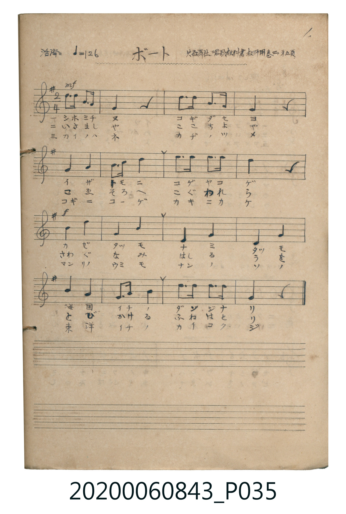

# ボート

> Re:Shoka 使用 AI 辨識樂譜，可能會有錯誤。歡迎回報。

<audio controls src="boto.mp3"></audio>

- 出處：共益商社唱歌教科書教師用巻二 第五頁（1.）
- 《唱歌帖》（2020.006.0843）P035.jpg
- 原典：共益商社樂器店《唱歌教科書 教師用 巻二》第四～五頁（NDL PID 854863，https://dl.ndl.go.jp/pid/854863）

## 說明

原書資訊與歌詞全文（對應 P035.jpg；並依 NDL PID 854863《唱歌教科書 教師用 巻二》第四～五頁原典校訂）：
調性與拍號：ト調四分ノ二拍子（G 大調 2/4 拍），♩=126，「活潑ニ」
註記：共益商社唱歌教科書教師用巻二 第五頁 / 1.
原典演奏注意：第三段各小節之第一音符須特稍強聲歌唱；一個四分音符下配有兩個音節歌詞者，平均分作兩個八分音符歌唱。
原典語釋：「風たつも浪たつも」一句不接後句，移至「いざともに」之前理解則意義自明；「舟は鳥」謂飛馳之舟如鳥；「かいの羽、かぢの爪」以鳥之羽與爪比喻船之櫂與柁（舵）。

## 歌詞

```text
一、
潮みちぬ こぎだせよ
いざともに こげやこげ
風たつも 浪たつも
海國一の 男兒なり

二、
いさましや こゝちよや
こゑそろへ こぐわれら
さわぐ波 走る魚
とびかける 舟は鳥

三、
かいの羽 かぢの爪
こぎにこげ かきにかけ
萬里の海も なんのその
東洋一の 海國兒
```

## ABC

```abc
X:1
T:ボート
M:2/4
L:1/16
Q:1/4=126
K:G
V:V1 name="Piano" snm="Pia"
[V:V1]
!mf! d3 d B3 A | G4 z4 | d3 d B3 A | G4 z4 |
G4 A4 | B3 c d4 | e3 e e3 e | d4 z4 |
!f! B4 d4 | G4 B4 | E4 G4 | D4 G4 |
B4 A4 | G3 A B4 | d3 d d3 d | G4 z4 |
!mf! d3 d B3 A | G4 z4 | d3 d B3 A | G4 z4 |
G4 A4 | B3 c d4 | e3 e e3 e | d4 z4 |
!f! B4 d4 | G4 B4 | E4 G4 | D4 G4 |
B4 A4 | G3 A B4 | d3 d d3 d | G4 z4 |
!mf! d3 d B3 A | G4 z4 | d3 d B3 A | G4 z4 |
G4 A4 | B3 c d4 | e3 e e3 e | d4 z4 |
!f! B4 d4 | G4 B4 | E4 G4 | D4 G4 |
B4 A4 | G3 A B4 | d3 d d3 d | G4 z4 |
```

## TMD 檔案連結

- [主旋律 TMD 檔案](boto.tmd) [[在 TMD Studio 編輯](https://tmdlang.github.io/Tmd-TS/#tmd=s7IKdvYPcrWy4qpTUCpJTLdSSM7PyUlNLsnMz7MqzsjPTkzOyFeCS5bl55TmploBqXgDY4RwcX5pUXJqfEFieqpVgIGxKboM3KT4vPyS1KT8_GyEioKi_LLUvMQ8oKrcxLzS4uSizIKS-OT8gkqEmtSyzJRUkIri5MS8-LLUosy0zNQUJGelFhWDHQxxR0lRYh7EHKAgQlVaflGuVXFJUX5BRmYyQrgkIxXoJbCegvyiEnSJ8sSS1CIlLi0thcfNcx4373nc3KGgpcWlaKtgaGTGZW-r4M5lY6RvYgfS9rR914uZU9_vmfW0dePz2V1Pp7Y9X7Lv6ZSNz9b2PJs68_nyic9m7wAynu5Y_XzKiqfbdz_Z1aPwfM2aJ7umvFzQ-H5Ph6He-z2dYAc8buiC6Hu6Y9rjhm6gnJGBkYGegYGZnoGFiTFQGSic9bIK0sHKn_bNf9q6A83iZyuans5c8XTXdLhhcEcowF2hAHEG0A6gQ57Onv1-7zy4c_xcfBQCPF0ULExNLMyAdvZklJQUFFvp66fk6OUBcXo-0AH6BZkp-jAVQMdz6Wsp2FILcCkoKAD9BnTxi83tL1Z0vehoB3rjxcp5T1tXPJvWDnTj0w29z9o7FWCh8X7P7Cc7lj3ZN1cB1fFkBQEkVJ8tWPhiRRPQb8DgBbnnxar9zxqWg1zS3fti5nygKDBJAAWBOp92tD1u7gOaBZR6unYC0HnuCk-XLAdKKgCTiAJQFGxMz6OZK22BqQfIetzQ82zL7md7Jz5u7n7c0As2f8XuFytmkJmIFPQVDPWgoQZy-54pT5f2P9u84llLP9BEkLIdnc_WbX06oeXphv7n6xue7AR5-smOhpfzNz9fs-zlgo7nnTufr-h9umf7i8ZNoPQ3ZSM4TBueNnRDfAhR-WRH98vW3mdzOp-2rgRKgQTXN0Di5kVDK9BnT3dufjq3Haj-yd45EDVPW1fDtUNMftzQhHDri1XzXrYDU_osYJi8XLTiceP8x41LHjc1Pdu6Cs4GBhHIKf1Ln-zofda39Om-HiAbaNnz5btftG8Ganzc2PK4cdrjxhUgxY2rQep3dj_t7H0-oe3F8sVPO9uBAfF838oX7auezegDegyo5UUH0PD1LzcvBSp-sabp5eLZL5dtBuoCij9d1gQUhyh73NgNNnzd8317Hzc0grmLQNyOVSBbdi8FqgSF5r69wKQBFHy2fsrTabtfdOwECj5b3QRKL_NBmepFx1ZgIgD5HOR1oG-AhoFYz_aue9y4_3HjwseNaxQeN05-3Nj3uHHB48bZj5s6QPJoPoMomfS4CSgKYoCUIIeaAnKwgc3fuv3pnG6QfY3rFJ5P2f60ddLjxlWPm7og7gClf7A7wPZMfdy473HjdKDpYHua5oLc1dQB5EOUAIUmPm6c-7ip93HjDohTJjxu6n_c1PO4qROiZCqI3zjh2eZFCi-2bnjc1P1yLTj7gHzQuBkcfBOBogrw4IeGBzBooO5AhDeEAw1tmAtA4bMa4nmIPNAtQD7IXHA2mrDmZTsw1tYBPQ4KD7BngYqBoQz0zTpwkMzd-GwLLEgg4QMMFZAM5SUXFCho6XNxOeWX5FsFZCbm5TvUGNQoVINsULAxNNOyA7Oqc9NqwQxgyfm4aTuwnpkNxPOBuFGhBkj2gMimzUC8DshrANK7weIrQIaD9NUomCroAqGpgjGYNgKKGIJZugoGUJooNQhXLAHibWBbOoB4ERB3w12xCcgDyW8Gi2xCuAJmnhHcTohdJlC7QSJmYNoMTsPche6KauQwAab2pj1g2_YD7W4Buwvkpi5wOCHEQaJw10DsBvkYZjfMfTAZoGvioUyYFNA5GEIwdwBTiAIwiYDtA_ofGDvAwh7sFmCcNINCBpgVgG4CiazCdAciVCAmGyG5AxY3MBpb3NRycenaKYDSkgIWWpkLAA)]
- [鋼琴伴奏 TMD 檔案](boto_piano.tmd) [[在 TMD Studio 編輯](https://tmdlang.github.io/Tmd-TS/#tmd=s7IKdvYPcrWy4tLSUnjcPOdx857HzR3v93S87N7zfMKWJ3u2PF3a_7wTKNKpoKXFpWirYGhkxmVvq-DOZWOkb2LHVaeg9LR914uZU9_vmfW0dePz2V1Pp7Y9X7Lv6ZSNz9b2PJs68_nyic9m7wAynu5Y_XzKiqfbdz_Z1aPwfM2aJ7umvFzQCLTKUA9ouhLIpMcNXRB9T3dMe9zQDZQzMjAy0DMwMNMzsDAxBioLMDA21csqSFfi4nLKL8m3CshMzMsP8nCoMahRqOZSAAIbQzMtOzCrOjetFsyoUTDWNlXQBUJTBUNtYzDLCCQar20ar20I5usqGEBpbKrN47XxaIBagiQFVg8zDmaICdxgkKiJthmYZQaUh7EQVqObXg33Csw0XRTTkOxGKABaEq9tFg_lmSGUgNTDDEESxbABxRtwK4xQrDCCBxZQNYyJO6hqkSPOB1fEFcB9C3In2LHGcBayqGE8iAQZjyxqChY1wqMYw3iIFnMwictaE7AsWM4MwcRnA1ISJOQTYixC8hdYBKwHl18wvI9sA5ISiJ_xBhYw0nTtFEDxpoCFVuYCAA)]

## 分析

```text
================================================================================
📊 TMD Song Profile: [ ボート ]
================================================================================
⏱  Duration:       0:45 (45.7s), 48 measures total
🎼 Key & Tempo:    首調基準 G, != 126.0 BPM, <2/4>
   - 分析範圍：      由實際發聲的音符與和弦推測調性；播放脈絡另行呈現
🎤 人聲音域:    D4 (MIDI 62) – E5 (MIDI 76) [跨度: 14 個半音 / 1.2 個八度, 難度: moderate]
   - 最低音:  D4 in [Boto #1 @ m.12, 0:10]
   - 最高音: E5 in [Boto #1 @ m.7, 0:05]
   - 適合: soprano, mezzo-soprano, contralto, tenor, baritone, bass
🏛  結構:      Boto (15.2s) -> Boto (15.2s) -> Boto (15.2s)
⚡ 編曲密度:        Peak 1 軌道同時演奏
🗝  調性診斷：       G 大調（純淨自然大調，未偵測到可信轉調）
   - 風格氣質:    純淨自然大調（陽光明朗、易唱易記，無明顯調外色彩）
   - 轉調歷程:    全曲維持單一推測調性（未偵測到可信轉調）
   - 核心骨幹音:  D, G, B, E, A
   - 調性數值:    G 大調 [相關度: 0.90, 穩定度: High, 自然音純度: 100.0%]
   - 候選調性 (K-S): G 大調 (0.90), D 大調 (0.71), B 小調 (0.70)
   - 五度圈歷程:   +1 -> +1 -> +1
   - 各段落調性細節:
     • [Boto #1]: G 大調 (r: 0.90, 自然音純度: 100.0%)
     • [Boto #2]: G 大調 (r: 0.90, 自然音純度: 100.0%)
     • [Boto #3]: G 大調 (r: 0.90, 自然音純度: 100.0%)

  [ 五度圈游移軌跡 ]
               C  
         F           [G ]*
      Bb               D  
      Eb               A  
         Ab           E  
            Db       B  
               F# 
     (* = active key center)

  [ 十二半音累積音高分佈 ]
     C  : █                          0.9%
     C# :                            0.0%
     D  : ████████████████████████  28.6%
     D# :                            0.0%
     E  : █████████                 10.7%
     F  :                            0.0%
     F# :                            0.0%
     G  : ███████████████████████   27.7%
     G# :                            0.0%
     A  : ████████                   9.8%
     A# :                            0.0%
     B  : ███████████████████       22.3%
--------------------------------------------------------------------------------
Assignment 軌道音域：
  - Piano         : D4 – E5 (14 個半音 / 1.2 個八度, 114 個音符)
================================================================================
```


## 原書掃描頁




