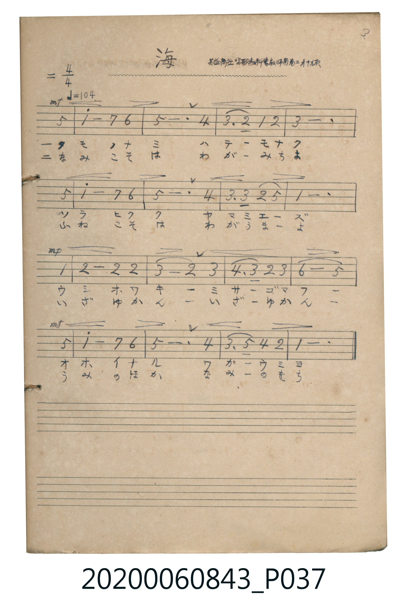

# 海（其一）

<audio controls src="umi.mp3"></audio>

- 出處：共益商社唱歌教科書教師用巻二 第十九頁（3.）
- 《唱歌帖》（2020.006.0843）P037.jpg

## 說明

原書資訊與歌詞全文（對應 P037.jpg）：
調性與拍號：ニ調 4/4 拍（D 大調 4/4 拍），♩=104
註記：共益商社唱歌教科書教師用巻二 第十九頁 / 3.

## 跨冊／重複收錄參照

> 同曲＋同名異曲（《新定兒童唱歌》五年級與《唱歌帖》P039 為同曲；《新定兒童唱歌》一年級〈ウミ〉與《唱歌帖》P037〈海〉為同名異曲）

- **[同名異曲]** 《新定兒童唱歌》尋常科第一學年用（2020.006.0847.0001）：[**〈ウミ〉**](../../../shintei_jido_shoka/grade_1_2020.006.0847.0001/4_08_umi/index.md)（`F` / `2/4` — [原始 TMD](../../../shintei_jido_shoka/grade_1_2020.006.0847.0001/4_08_umi/umi.tmd)）
- **[同名異曲]** 《新定兒童唱歌》尋常科第五學年用（2020.006.0847.0005）：[**〈海〉**](../../../shintei_jido_shoka/grade_5_2020.006.0847.0005/1_08_umi/index.md)（`F` / `3/4` — [原始 TMD](../../../shintei_jido_shoka/grade_5_2020.006.0847.0005/1_08_umi/umi.tmd)）
- **[同名異曲]** 楊金土手抄《唱歌帖》第 3 冊・I（2020.006.0843）：[**〈海（其二）〉**](../p039_umi/index.md)（`F` / `3/4` — [原始 TMD](../p039_umi/umi.tmd)）
- 總表：[跨冊重複與同名歌曲總索引](../../../duplicate_songs.md)

## 歌詞

```text
一、
カモメ ノ ナミ ハ テー モ ナク
ソラ ヒクク ヤマ ミエーズ
ウシホ ワキ ミサゴ マフ
オホイナル ワガ ウミ ヨ

二、
なみ こそ は わが みち よ
ふね こそ は わが うま よ
いざ ゆかん いざ ゆかん
うみ の ほか なみ の をち
```

## ABC

```abc
X:1
T:海（其一）
M:4/4
L:1/16
Q:1/4=104
K:D
V:V1 name="Piano" snm="Pia"
[V:V1]
!mf! z4 z4 z4 A4 | d8 c4 B4 | A12 G4 | F6 E2 D4 E4 |
F12 A4 | d8 c4 B4 | A12 G4 | F6 F2 E4 A4 |
D12 D4 | !mp! E8 E4 E4 | F8 E4 F4 | G6 F2 E4 F4 |
B8 A4 A4 | !mf! d8 c4 B4 | A12 G4 | F6 A2 G4 E4 |
D12 z4 | !mf! z4 z4 z4 A4 | d8 c4 B4 | A12 G4 |
F6 E2 D4 E4 | F12 A4 | d8 c4 B4 | A12 G4 |
F6 F2 E4 A4 | D12 D4 | !mp! E8 E4 E4 | F8 E4 F4 |
G6 F2 E4 F4 | B8 A4 A4 | !mf! d8 c4 B4 | A12 G4 |
F6 A2 G4 E4 | D12 z4 |
```

## TMD 檔案連結

- [主旋律 TMD 檔案](umi.tmd) [[在 TMD Studio 編輯](https://tmdlang.github.io/Tmd-TS/#tmd=s7IKdvYPcrWy4tLSUni2dfv7PR1PW7c92dHwfk-ngpYWl6KtgqGBCZe9rYILl42JvokdV52C0tP2XS9mTn2_Z9bT1o3PZ3c9ndr2fMm-p1M2Plvb82zqzOfLJz6bvQPIeLpj9fMpK55u3_1kV4_C8zVrnvY2Ptk59-WCRqAlxnpAC5RAhj1u6IJofbpj2uOGbqCckYGRgZ6BgZmegYWJMVBZgIGxuV5WQboSF5e-loIttQCXgoLC0775QLe-2Nz-YkXXi452oCterJz3tHXFs2ntoJDY0PusvVMBZj_QKUA_g7S9WLX_WcNykIbu3hcz5wNFHzd3AwUVgCGkABQD6nVReLpkOYoQUHPPo5krbUHhCTJjxe4XK2aQH4gK-grGelwgk4Cx9bihEcR63LT6cfOix80LFR439wFx1-Pm-UCqH4jbHjfvAVKLwKJN6yGq9z5uXgkUmAQUACIga8nj5nlAav7jphVA9Y-bdkHULXvctP1x82ygDFDdWoiCrY-btgBZ8x43T4UoWgVU8bgJaALQ1tUQpWvAesFuWAFx6q4emFMbVz1u3A-kJj9unAukgLY39T9u7AEy9z9uBHqgqQOibOvjRqCNWJS1PW7ch1DW8rhxGpAHFOx-3DQZQwCiCMgBWbkOiHcDxRGOAIo0TQJaC1JGecqCAgUtfS6u0NxMq4DMxLx8hxqDGoVqkAUKNhZadmBGdW5aLZhRo2CgoAvHpkBco2AYB6RA0ByIzcBCIAkYNAGLGIPZRgqGYBIhAoFgg6AWkGCcMdgoqCuQ1IDYEOOqcwtgDgcphbgB3QUgHohdAzYcZixEBOQAmAsRrkQKDxKcawrmQexGdi4oKGu4arm4dO0UgNGggKCUuQA)]
- [鋼琴伴奏 TMD 檔案](umi_piano.tmd) [[在 TMD Studio 編輯](https://tmdlang.github.io/Tmd-TS/#tmd=s7IKdvYPcrWy4tLSUni2dfv7PR1PW7c92dHwfk8nkP2ye8_zCVue7NnydGn_884OoKCClhaXoq2CoYEJl72tgguXjYm-iR1XnYLS0_ZdL2ZOfb9n1tPWjc9ndz2d2vZ8yb6nUzY-W9vzbOrM58snPpu9A8h4umP18ykrnm7f_WRXj8LzNWue9jY-2Tn35YJGoG3GekALlECGPW7ogmh9umPa44ZuoJyRgZGBnoGBmZ6BhYkxUFmAgbG5XlZBuhIXV2huplVAZmJefpCHQ41BjUI1lwIQ2Fho2YEZ1blptWBGjYKBgi4cmwJxjYKxtmEckAGCRtrmQNJQ2wwsYagNUgCD5vHaJlBhY4hiBUOIsBGKMASCjYZaSa4FxjDDgRTEqabx2iA7YRDEhlhSnVsA8yBUD9REqHZ0J0KFIAIgCZDNSDYiSYDdCtMDdgfCb0jhSq4nTRXMIEJAv8EdCvInSnCCYquGqxYpon1wRDQ8HJAjGqxdwTAebA2YAJEmYBIuDiKNEUyoOFjEDCyCIg7hgJkQx0FsJcsOZOMJW1IN9yJE2gihEsxE0YtkQg1E2gTuQrBDaiACUENQLUIEJvlBh-Q6XJ4CRquunQIwZhUQlDIXAA)]

## 分析

```text
================================================================================
📊 TMD Song Profile: [ 海（其一） ]
================================================================================
⏱  Duration:       1:18 (78.5s), 34 measures total
🎼 Key & Tempo:    首調基準 D, != 104.0 BPM, <4/4>
   - 分析範圍：      由實際發聲的音符與和弦推測調性；播放脈絡另行呈現
🎤 人聲音域:    D4 (MIDI 62) – D5 (MIDI 74) [跨度: 12 個半音 / 1.0 個八度, 難度: easy]
   - 最低音:  D4 in [Umi #1 @ m.4, 0:08]
   - 最高音: D5 in [Umi #1 @ m.2, 0:02]
   - 適合: soprano, mezzo-soprano, contralto, tenor, baritone, bass
🏛  結構:      Umi (39.2s) -> Umi (39.2s)
⚡ 編曲密度:        Peak 1 軌道同時演奏
🗝  調性診斷：       D 大調（純淨自然大調，未偵測到可信轉調）
   - 風格氣質:    純淨自然大調（陽光明朗、易唱易記，無明顯調外色彩）
   - 轉調歷程:    全曲維持單一推測調性（未偵測到可信轉調）
   - 核心骨幹音:  A, D, F#, E, G
   - 調性數值:    D 大調 [相關度: 0.93, 穩定度: High, 自然音純度: 100.0%]
   - 候選調性 (K-S): D 大調 (0.93), A 大調 (0.76), F# 小調 (0.69)
   - 五度圈歷程:   +2 -> +2
   - 各段落調性細節:
     • [Umi #1]: D 大調 (r: 0.93, 自然音純度: 100.0%)
     • [Umi #2]: D 大調 (r: 0.93, 自然音純度: 100.0%)

  [ 五度圈游移軌跡 ]
               C  
         F            G  
      Bb              [D ]*
      Eb               A  
         Ab           E  
            Db       B  
               F# 
     (* = active key center)

  [ 十二半音累積音高分佈 ]
     C  :                            0.0%
     C# : █████                      4.7%
     D  : ███████████████████████   21.9%
     D# :                            0.0%
     E  : ████████████████          14.8%
     F  :                            0.0%
     F# : █████████████████████     19.5%
     G  : █████████                  8.6%
     G# :                            0.0%
     A  : ████████████████████████  22.7%
     A# :                            0.0%
     B  : ████████                   7.8%
--------------------------------------------------------------------------------
Assignment 軌道音域：
  - Piano         : D4 – D5 (12 個半音 / 1.0 個八度, 92 個音符)
================================================================================
```


## 原書掃描頁




