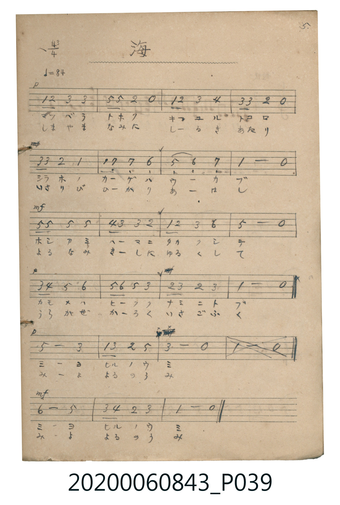

# 海（其二）

> Re:Shōka 使用 AI 協助辨識與重建樂譜，可能會有錯誤。歡迎回報。

- **鋼琴伴奏版**：<br><audio controls src="umi.mp3"></audio>

- 出處：《唱歌帖》（2020.006.0843）P039.jpg（5.）

## 說明

原書資訊與歌詞全文（對應 P039.jpg）：
調性與拍號：ヘ調 3/4 拍（F 大調 3/4 拍），♩=84
註記：5.（第五行第 4 小節 `| 1 - 0 |` 原稿打叉刪除，並接第六行 `mf` 結尾）


## 歌詞

```text
一、
マツバラ トホク キユル トコロ
シラホ ノ カゲ ハ ウカブ
ホシアミ ハマ ニ タカク シテ
カモメ ハ ヒクク ナミ ニ トブ
ミヨ ヒル ノ ウミ
ミヨ ヒル ノ ウミ

二、
しまやま なみ に しろき あたり
いさりび ひかり あはし
よる なみ きし に ゆるく して
うらかぜ かろく いさご ふく
みよ よる の うみ
みよ よる の うみ
```

## ABC

<div class="abc-score" data-abc-src="umi.abc" aria-label="五線譜載入中"></div>

[下載 ABC 原始檔](umi.abc)

## TMD 檔案連結

- [主旋律 TMD 檔案](umi.tmd) [[在 TMD Studio 編輯](https://tmdlang.github.io/Tmd-TS/#tmd=s7IKdvYPcrWy4qpTUCpJTLdSSM7PyUlNLsnMz7MqzsjPTkzOyFeCS5bl55TmploBqXgDY4RwcX5pUXJqfEFieqpVgIGxJboM3KT4vPyS1KT8_GyEioKi_LLUvMQ8oKrcxLzS4uSizIKS-OT8gkqEmtSyzJRUkIrUlMyS_KLMxBwkJ6UWFYMdC3FDSVFiHsQMoCBCVUlGKtDdeYklpUWp6KLliSWpRQhBoPnpmXlWufl5SaVAdytxaWkpPNu6_f2ejqet257s6nm_p1NBS4tL0VbBwoTL3lbBjcvGWN_EDqT_afuuFzOnvt8z63FD19MpG5-t7Xm6Y9rjhm6gXiMDIwM9AwMzPQMLE2OgEaBg0ssqSAdKmeoB-UpcXPpaCrbUAlwKCgpP--Y_m73jxeb2Fyu6XnS0A13zYuW8p60rnk1rB3lmQ--z9k4FhDs6ge4GaXuxav-zhuUgDd29L2bOB_mmeQZQUAHoSwWgGFCvm8LTJctRhICaex7NXGkLDBKQESt2v1gxA6gT5LWO52vWPNk15cXCHiBDwUTh6Yb-5-sbFBJqFAwVdBUMFGoSQC59vmL_s87JT_s7n3asejlzCdC4JzuWPetbCtTztHUtULNCQm5agsLzrROebtgHtI8LZM-THQ2PGxpBrMfN8x43tzxunvC4eSWQ0_G4efbjpvUKj5vWPm5e9rh5NVisafPj5rVg1U3bgeqAaoDCfUDe6sdNm4DMfiBzGYjXPA1iJtCM7Y-bFj1ung-SBdoBpLqBivaDtYCMB5rTBjERqAuocCHEmOZJQGmwiuYuiG6gNpCroAbPf9y8AqwK7DKQE4COnI9XDuzfXT0w_zZOf9y473FTC5AEclY9btwPpIAagOJNvY8be4GspseN8x83dUGUAxVOBXIeN24GcjY9buwGciBq1gP1QLwADCGgM2GGAU2ZDjGzqQ0o8bgR6C-QrcsgBgLFOkHGNM4BcoCmAZWDFIDtaZwCZG0FCkCUAoOrA2H8OrDmxv2E5CjPBFCgoKXPxRWam-mXaRWQmZiX71BjUKNQDbJCwcZCyw7MqC6oBdOgRGmkYAxMmCBco2AKhEbgZAriweRMwDxjIITLQXXDxEBJG6TePB6EdBXMQATQODgbLArJAiCIMKM6Nw3mFJDlpkAJEK4BWgoyXBdsPMIpZlBnYhgD95AxUCdIHqbSDMyDeA9kBsg8CA_TMQiTYSog6iEuAonhdDzIOhCEKTXBaVEtF5eunQI4ghSADGUuAA)]
- [鋼琴伴奏 TMD 檔案](umi_piano.tmd) [[在 TMD Studio 編輯](https://tmdlang.github.io/Tmd-TS/#tmd=s7IKdvYPcrWy4tLSUni2dfv7PR1PW7c92dXzfk8nkP2ye8_zCVue7NnydGn_884OoKCClhaXoq2ChQmXva2CG5eNsb6JHVedgtLT9l0vZk59v2fW44aup1M2Plvb83THtMcN3UBDjAyMDPQMDMz0DCxMjIFGBBgYW-plFaQDpUz1gHwlLq7Q3Ey_TKuAzMS8_CAPhxqDGoVqLgUgsLHQsgMzqgtqwXSNgqGCkYKhtrGCLpQEimibKpgqmMdrGwG5BhAhJEUmUEXGCsYoimDmIUuYxmsbQg0wjwfxgKSugkm8thmIrgGKACkwGyYHEgPrAUGEudW5aXAHg50HIkGuAZE1IOtMgLZCnAi1G9XVZjB1RmAtaKbDQ8NYwQRuNESLqYIZXAQSPkYI_wEpiBhWR0PcChGFBy6KZojrIXJ4PGwCdgvUGKgmkEvBgQYLaBS3oJlYi5IkfHAkCUSagMQIiAQzQWaCaCOEOIoiE6gQpipMA82gao3BNDb9EB4WayBugQYPQcciiUMVGUNMh6rB5lL0MEDWQWqgILkWm2ZIOECEiPYrJGjAcmhuwGkMxBxgAtC1UwCnAQVkhjIXAA)]

## 分析

```text
================================================================================
📊 TMD Song Profile: [ 海（其二） ]
================================================================================
⏱  Duration:       0:47 (47.1s), 22 measures total
🎼 Key & Tempo:    首調基準 F, != 84.0 BPM, <3/4>
   - 分析範圍：      由實際發聲的音符與和弦推測調性；播放脈絡另行呈現
🎤 人聲音域:    C4 (MIDI 60) – D5 (MIDI 74) [跨度: 14 個半音 / 1.2 個八度, 難度: moderate]
   - 最低音:  C4 in [UmiNi #1 @ m.7, 0:12]
   - 最高音: D5 in [UmiNi #1 @ m.11, 0:22]
   - 適合: soprano, mezzo-soprano, contralto, tenor, baritone, bass
🏛  結構:      UmiNi (47.1s)
⚡ 編曲密度:        Peak 1 軌道同時演奏
🗝  調性診斷：       A 調性不明確（純淨自然大調，未偵測到可信轉調）
   - 風格氣質:    純淨自然大調（陽光明朗、易唱易記，無明顯調外色彩）
   - 轉調歷程:    全曲維持單一推測調性（未偵測到可信轉調）
   - 核心骨幹音:  A, C, F, G, D
   - 調性數值:    A 調性不明確 [相關度: 0.81, 穩定度: Ambiguous, 自然音純度: 95.8%]
   - 候選調性 (K-S): A 小調 (0.81), F 大調 (0.79), C 大調 (0.75)
   - 五度圈歷程:   +3
   - 各段落調性細節:
     • [UmiNi #1]: A 調性不明確 (r: 0.81, 自然音純度: 95.8%, 調外音: A#)

  [ 五度圈游移軌跡 ]
               C  
         F            G  
      Bb               D  
      Eb              [A ]*
         Ab           E  
            Db       B  
               F# 
     (* = active key center)

  [ 十二半音累積音高分佈 ]
     C  : █████████████████████     22.9%
     C# :                            0.0%
     D  : ██████████                11.0%
     D# :                            0.0%
     E  : ████                       4.2%
     F  : ███████████████           16.1%
     F# :                            0.0%
     G  : ██████████████            15.3%
     G# :                            0.0%
     A  : ████████████████████████  26.3%
     A# : ████                       4.2%
     B  :                            0.0%
--------------------------------------------------------------------------------
Assignment 軌道音域：
  - Piano         : C4 – D5 (14 個半音 / 1.2 個八度, 66 個音符)
================================================================================
```


## 原書掃描頁




