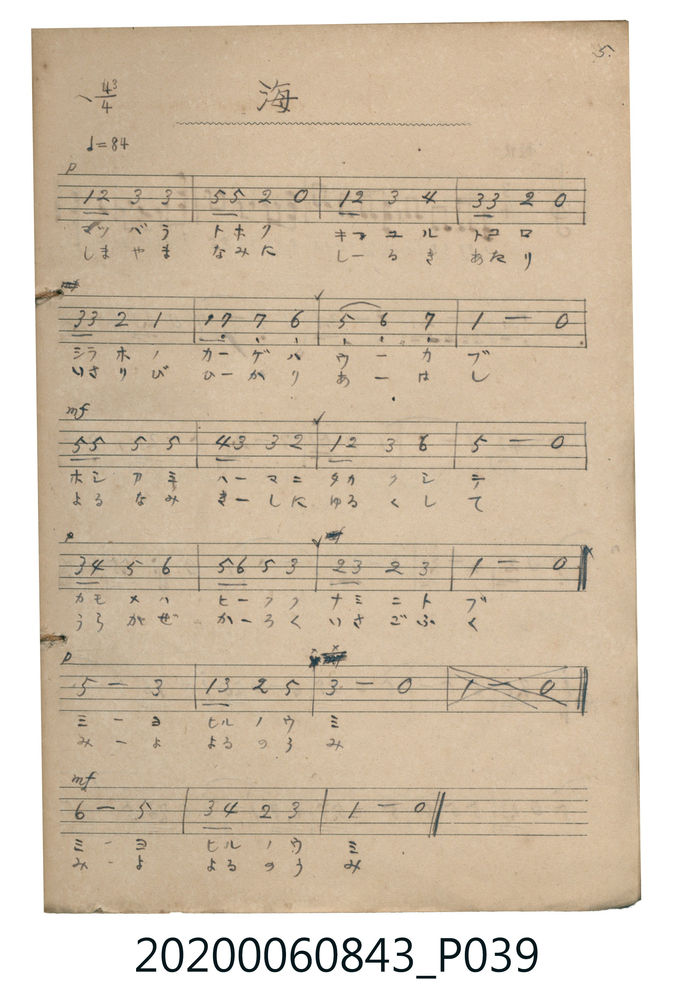

# 海（其二）

> Re:Shoka 使用 AI 協助辨識與重建樂譜，可能會有錯誤。歡迎回報。

<audio controls src="umi.mp3"></audio>

- 出處：《唱歌帖》（2020.006.0843）P039.jpg（5.）

## 說明

原書資訊與歌詞全文（對應 P039.jpg）：
調性與拍號：ヘ調 3/4 拍（F 大調 3/4 拍），♩=84
註記：5.（第五行第 4 小節 `| 1 - 0 |` 原稿打叉刪除，並接第六行 `mf` 結尾）

## 跨冊／重複收錄參照

> 同曲＋同名異曲（《新定兒童唱歌》五年級與《唱歌帖》P039 為同曲；《新定兒童唱歌》一年級〈ウミ〉與《唱歌帖》P037〈海〉為同名異曲）

- **[同名異曲]** 《新定兒童唱歌》尋常科第一學年用（2020.006.0847.0001）：[**〈ウミ〉**](../../../shintei_jido_shoka/grade_1_2020.006.0847.0001/4_08_umi/index.md)（`F` / `2/4` — [原始 TMD](../../../shintei_jido_shoka/grade_1_2020.006.0847.0001/4_08_umi/umi.tmd)）
- **[同曲]** 《新定兒童唱歌》尋常科第五學年用（2020.006.0847.0005）：[**〈海〉**](../../../shintei_jido_shoka/grade_5_2020.006.0847.0005/1_08_umi/index.md)（`F` / `3/4` — [原始 TMD](../../../shintei_jido_shoka/grade_5_2020.006.0847.0005/1_08_umi/umi.tmd)）
- **[同名異曲]** 楊金土手抄《唱歌帖》第 3 冊・I（2020.006.0843）：[**〈海（其一）〉**](../p037_umi/index.md)（`D` / `4/4` — [原始 TMD](../p037_umi/umi.tmd)）
- 總表：[跨冊重複與同名歌曲總索引](../../../duplicate_songs.md)

## 歌詞

```text
一、
マツバラ トホク キユル トコロ
シラホ ノ カゲ ハ ウカブ
ホシアミ ハマ ニ タカク シテ
カモメ ハ ヒクク ナミ ニ トブ
ミヨ ヒル ノ ウミ
ミヨ ヒル ノ ウミ

二、
しまやま なみ に しろき あたり
いさりび ひかり あはし
よる なみ きし に ゆるく して
うらかぜ かろく いさご ふく
みよ よる の うみ
みよ よる の うみ
```

## ABC

```abc
X:1
T:海（其二）
M:3/4
L:1/16
Q:1/4=84
K:F
V:V1 name="Piano" snm="Pia"
[V:V1]
!p! F2 G2 A4 A4 | c2 c2 G4 z4 | F2 G2 A4 B4 | A2 A2 G4 z4 |
A2 A2 G4 F4 | F2 E2 E4 D4 | C4 D4 E4 | F8 z4 |
!mf! c2 c2 c4 c4 | B2 A2 A4 G4 | F2 G2 A4 d4 | c8 z4 |
!p! A2 B2 c4 d4 | c2 d2 c4 A4 | G2 A2 G4 A4 | F8 z4 |
c8 A4 | F2 A2 G4 c4 | A8 z4 | !mf! d8 c4 |
A2 B2 G4 A4 | F8 z4 |
```

## TMD 檔案連結

- [主旋律 TMD 檔案](umi.tmd) [[在 TMD Studio 編輯](https://tmdlang.github.io/Tmd-TS/#tmd=s7IKdvYPcrWy4qpTUCpJTLdSSM7PyUlNLsnMz7MqzsjPTkzOyFeCS5bl55TmploBqXgDY4RwcX5pUXJqfEFieqpVgIGxJboM3KT4vPyS1KT8_GyEioKi_LLUvMQ8oKrcxLzS4uSizIKS-OT8gkqEmtSyzJRUkIrUlMyS_KLMxBwkJ6UWFYMdC3FDSVFiHsQMoCBCVUlGKtDdeYklpUWp6KLliSWpRUpcWloKz7Zuf7-n42nrtie7et7v6VTQ0uJStFWwMOGyt1Vw47Ix1jexA-l92r7rxcyp7_fMetzQ9XTKxmdre57umPa4oRuo18jAyEDPwMBMz8DCxBhoBCg09LIK0oFSpnpAvhIXl76Wgi21AJeCgsLTvvnPZu94sbn9xYquFx3tQNe8WDnvaeuKZ9PaQZ7Z0PusvVMB4Y5OoLtB2l6s2v-sYTlIQ3fvi5nzQb5pngEUVAD6UgEoBtTrpvB0yXIUIaDmnkczV9oCgwRkxIrdL1bMAOoEea3j-Zo1T3ZNebGwB8hQMFF4uqH_-foGhYQaBUMFXQUDhZoEkEufr9j_rHPy0_7Opx2rXs5cAjTuyY5lz_qWAvU8bV0L1KyQkJuWoPB864SnG_YB7eMC2fNkR8PjhkYQ63HzvMfNLY-bJzxuXgnkdDxunv24ab3C46a1j5uXPW5eDRZr2vy4eS1YddN2oDqgGqBwH5C3-nHTJiCzH8hcBuI1T4OYCTRj--OmRY-b54NkgXYAqW6gov1gLSDjgea0QUwE6gIqXAgxpnkSUBqsorkLohuoDeQqqMHzHzevAKsCuwzkBKAj5-OVA_t3Vw_Mv43THzfue9zUAiSBnFWPG_cDKaAGoHhT7-PGXiCr6XHj_MdNXRDlQIVTgZzHjZuBnE2PG7uBHIia9UA9EC8AQwjoTJhhQFOmQ8xsagNKPG4E-gtk6zKIgUCxTpAxjXOAHKBpQOUgBWB7GqcAWVuBAhClwODqQBi_Dqy5cT8hOcozARQoaOlzcYXmZvplWgVkJublO9QY1ChUg6xQsLHQsgMzqgtqwTQoURopGAMTJgjXKJgCoRE4mYJ4MDkTMM8YCOFyUN0wMVDSBqk3jwchXQUzEAE0Ds4Gi0KyAAgizKjOTYM5BWS5KVAChGuAloIM1wUbj3CKGdSZGMbAPWQM1AmSh6k0A_Mg3gOZATIPwsN0DMJkmAqIeoiLQGI4HQ-yDgRhSk1wWlTLxaVrpwCOIAUgQ5kLAA)]
- [鋼琴伴奏 TMD 檔案](umi_piano.tmd) [[在 TMD Studio 編輯](https://tmdlang.github.io/Tmd-TS/#tmd=s7IKdvYPcrWy4tLSUni2dfv7PR1PW7c92dXzfk8nkP2ye8_zCVue7NnydGn_884OoKCClhaXoq2ChQmXva2CG5eNsb6JHVedgtLT9l0vZk59v2fW44aup1M2Plvb83THtMcN3UBDjAyMDPQMDMz0DCxMjIFGBBgYW-plFaQDpUz1gHwlLq7Q3Ey_TKuAzMS8_CAPhxqDGoVqLgUgsLHQsgMzqgtqwXSNgqGCkYKhtrGCLpQEimibKpgqmMdrGwG5BhAhJEUmUEXGCsYoimDmIUuYxmsbQg0wjwfxgKSugkm8thmIrgGKACkwGyYHEgPrAUGEudW5aXAHg50HIkGuAZE1IOtMgLZCnAi1G9XVZjB1RmAtaKbDQ8NYwQRuNESLqYIZXAQSPkYI_wEpiBhWR0PcChGFBy6KZojrIXJ4PGwCdgvUGKgmkEvBgQYLaBS3oJlYi5IkfHAkCUSagMQIiAQzQWaCaCOEOIoiE6gQpipMA82gao3BNDb9EB4WayBugQYPQcciiUMVGUNMh6rB5lL0MEDWQWqgILkWm2ZIOECEiPYrJGjAcmhuwGkMxBxgAtC1UwCnAQVkhjIXAA)]

## 分析

```text
================================================================================
📊 TMD Song Profile: [ 海（其二） ]
================================================================================
⏱  Duration:       0:47 (47.1s), 22 measures total
🎼 Key & Tempo:    首調基準 F, != 84.0 BPM, <3/4>
   - 分析範圍：      由實際發聲的音符與和弦推測調性；播放脈絡另行呈現
🎤 人聲音域:    C4 (MIDI 60) – D5 (MIDI 74) [跨度: 14 個半音 / 1.2 個八度, 難度: moderate]
   - 最低音:  C4 in [UmiNi #1 @ m.7, 0:12]
   - 最高音: D5 in [UmiNi #1 @ m.11, 0:22]
   - 適合: soprano, mezzo-soprano, contralto, tenor, baritone, bass
🏛  結構:      UmiNi (47.1s)
⚡ 編曲密度:        Peak 1 軌道同時演奏
🗝  調性診斷：       A 調性不明確（純淨自然大調，未偵測到可信轉調）
   - 風格氣質:    純淨自然大調（陽光明朗、易唱易記，無明顯調外色彩）
   - 轉調歷程:    全曲維持單一推測調性（未偵測到可信轉調）
   - 核心骨幹音:  A, C, F, G, D
   - 調性數值:    A 調性不明確 [相關度: 0.81, 穩定度: Ambiguous, 自然音純度: 95.8%]
   - 候選調性 (K-S): A 小調 (0.81), F 大調 (0.79), C 大調 (0.75)
   - 五度圈歷程:   +3
   - 各段落調性細節:
     • [UmiNi #1]: A 調性不明確 (r: 0.81, 自然音純度: 95.8%, 調外音: A#)

  [ 五度圈游移軌跡 ]
               C  
         F            G  
      Bb               D  
      Eb              [A ]*
         Ab           E  
            Db       B  
               F# 
     (* = active key center)

  [ 十二半音累積音高分佈 ]
     C  : █████████████████████     22.9%
     C# :                            0.0%
     D  : ██████████                11.0%
     D# :                            0.0%
     E  : ████                       4.2%
     F  : ███████████████           16.1%
     F# :                            0.0%
     G  : ██████████████            15.3%
     G# :                            0.0%
     A  : ████████████████████████  26.3%
     A# : ████                       4.2%
     B  :                            0.0%
--------------------------------------------------------------------------------
Assignment 軌道音域：
  - Piano         : C4 – D5 (14 個半音 / 1.2 個八度, 66 個音符)
================================================================================
```


## 原書掃描頁




