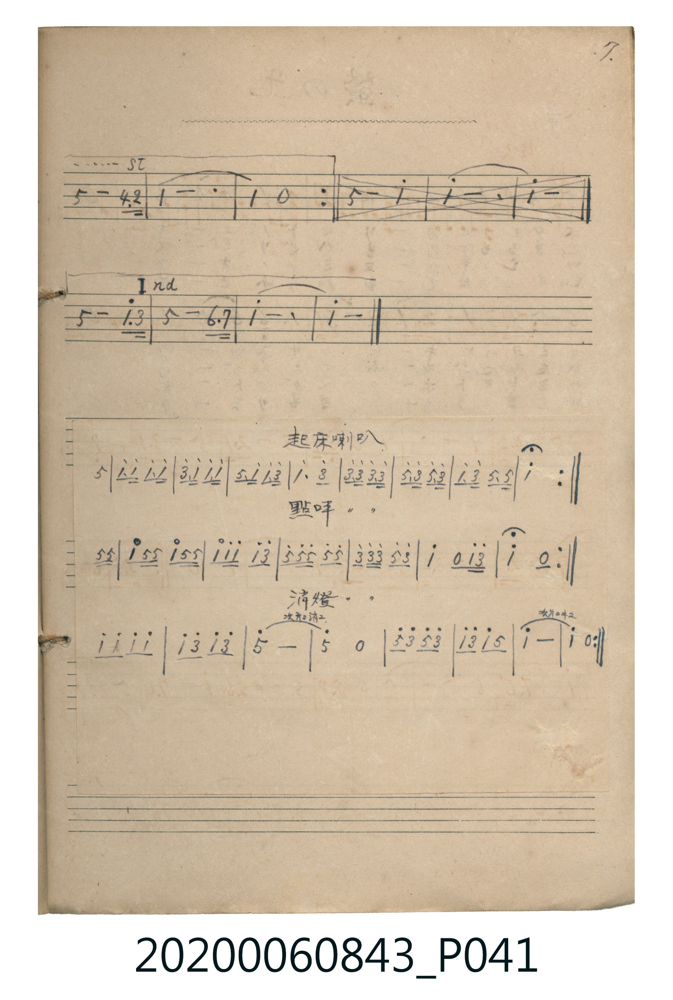

# 無題・三拍子曲

> Re:Shōka 使用 AI 協助辨識與重建樂譜，可能會有錯誤。歡迎回報。

- **鋼琴伴奏版**：<br><audio controls src="mudai.mp3"></audio>

- 出處：《唱歌帖》（2020.006.0843）P040.jpg–P041.jpg (top)（第 6–7 頁，實為町田櫻園編〈舞踏〉無詞重抄譜）

## 說明

> [!NOTE]
> **原件資訊與雙抄本互校考證**（對應《唱歌帖》第 3 冊 `P040.jpg`–`P041.jpg` 上半頁，互校第 1 冊 `P171.jpg`–`P172.jpg`〈舞踏〉）：
> - **曲名與性質**：原件頁頂未題曲名（僅畫波浪裝飾線，左上標示「軽快ニ」），經與第 1 冊 `P171.jpg`–`P172.jpg` 比對，實為楊金土重抄町田櫻園編《小學新唱歌》第 10 頁〈舞踏〉之無詞純旋律稿。
> - **調性與拍號**：ヘ長調 3/4 拍（F 大調 3/4 拍，`?= F`）。
> - **結構與親筆塗銷校改痕跡**：
>   1. `P040.jpg` 第一行為 5 小節五線譜附簡譜前奏（第 2、3 小節為 `3 - 1 1 1 - 1 - 3 - 3 -`、`5 - 3 3 3 - 3 - 5 - 5 -`，第 4 小節為 `1^ - - - - - 3 2 1 2 3 2`），第 5 小節末拍接第二行首弱起 `5_ - - 1`。
>   2. **一房子括號正範**：不同於第 1 冊 `P172.jpg` 誤將 `I---st` 拉長為 6 小節，本件 `P040.jpg` 末小節至 `P041.jpg` 第一行明確以 `1.....st` 精確框出最後 4 小節（`| 5 - 3. 1= | 5 - 4. 2= | 1 - . | 1 0 :||`）。
>   3. **二房子親筆打叉重寫**：`P041.jpg` 第一行反覆記號 `:||` 右側，楊氏原先誤寫漏去中間小節之三小節結尾（`5 - 1^ | 1^ - . | 1^ - ||`），旋即親筆畫大叉 `×` 整段塗銷，於第二行另起 `II nd` 重抄正確之四小節結尾（`| 5 - 1^. 3= | 5 - 6. 7= | 1^ - . | 1^ - ||`）。


## 歌詞

```text
（TMD 檔案未包含歌詞註解）
```

## ABC

<div class="abc-score" data-abc-src="mudai.abc" aria-label="五線譜載入中"></div>

[下載 ABC 原始檔](mudai.abc)

## TMD 檔案連結

- [主旋律 TMD 檔案](mudai.tmd) [[在 TMD Studio 編輯](https://tmdlang.github.io/Tmd-TS/#tmd=s7IKdvYPcrWy4qpTUCpJTLdSSM7PyUlNLsnMz7MqzsjPTkzOyFeCS5bl55TmploBqXgDY4RwcX5pUXJqfEFieqpVgIGJAU4ZQ3QZuB3xefklqUn5-dkIFQVF-WWpeYl5QFW5iXmlxclFmQUl8cn5BZUINallmSmpIBXFyYl58WWpRZlpmakpSA5OLSoGewXijpKixDyIOUBBhKqSjFSgr3JLizOTEYL5RZnpmXlWJYmZQDfGA3F5YnxuYmZeTmIekgX5RSUZ-elFiQUZlVYZmcUlQF3JiTnx2Yl5iUpcWloKz1sWvlzY87h595Mdnc-6e5-unfBs9iYFLS0uRVsFQyMDLntbBTcuG2N9EzuQkU_bd72YOfX9nlmPG7qeTtn4bG3P0x3THjd0v9_TYWRgZKBnYGCmZ2BhYvx-TyconPWyCtIfNUwGBSyIqaBRkl-gCVT7fM0aBTOghLnCywWN7_f0PF2_7HnTrudTgGjDs9W7n86Z9Hz7iscNHS865r3Y0f-4oRPoyhcr571s733W1fJi7Ryg8UpcXPpaCrbUAlwKCgp2CtGKfv4hrrEQjpbW0775T3Zve7G5_cWKrhcd7S9nzwRa_2zOmie7Jj1bsPBFQ_OLtZ1aWkD_PN3Q-6y9Ey1MQJ40Vnja1qWQAAuLBKCfQRxwaCQoPNnR9bS3CxIEEDNBegyhegzNIcrAegzNjcAc5EABhgIwJiCO1QU6FxhxTyf0Ah36rGH5i82rQC6bBfEC0IqXC5qezVkFjGqIKpCjm1ufT139bPOiZ1tXvVg89-Xifc-3zwJFxvZlQIc9WzHz-ZJdjxt6Xuze-3T_6sfN3Y8bgLqANvY83zYZaAlBpyo8Wz8FGDDw6H22tOtl-8Snc-ZDohEjtruebuh_unbHs2kbIKEIDUJDA1AiQfb3k53dkPTwfMuUZ9O7n-7rfr5i_-OGJkRIvFi1HxQGwJDo7n0xcz44JB43z3g5dTtQRgGYmBWAEsAgcFN4umQ5ilBPAijBJwA9imLg860Tni3vBhr4Ytmq52vbni6c_rJrOzC-nk3Z-Xz61BfbF4KtgKhXUDDUQ4pyBaAnnuxoeLGwBxgGCqYKQF8-X9_wZNcUYGgDk_LLmS3PNywEMp529j5d2g_NHEaPGxqBaQesFKQtwRjoDEMwBNG6wIQFxsD00JhgCmaDIEQcxAdioCd6QGaZIJtjGAeUhEFjBSOgYUYgGuRjqHqYE5_NWQ0Mkmd9S0Ee2NUD9MDLZdOe7tn4Yut2hQTTeLAJhkAHQINJQcFIDxhSQK8-69gPKka61wCD_tnaxc_Xt4BD58mO3qcTep5N24OacqCJ5cWqJU83tCskeOrq6haXABNPdycwukBuNoO6B-g8UN7bvQ05cIGOhMi-aN8MFodmLXigP5vR93zRrie7lwL9rgcCIMOfb9oHFHy2sA1Ynj2b0_B0Xw88lIARkFADDkJjPQVDWwUI20RPwQjEBgW9Hpg2ULCqqUFJJwogHcAA2NUDCQBIUnnWOflpfycwyT9dvxocDNgc-bS_98WythcrZgBDTCEBZLDC0_7NTxu3gPy8tOsZMGP0zX_a2gEKpPWrn-0BcoHl9dqX0yZDU9PObmDxDY3mrROebtgH8gbI4cD4BroWFOlgZ4MYEGeDTAbmnd7NEGcCSwJgVgC6VCHh8HRgsE7d8mzdVkgyB6kERxokETztXwZOAZ6eCnkpCQqQzAyKZmAo7-x-Ons2ujMgIWgYp6dgDAtOMz0Fc3BwYnEYNDwpL9KhQEFLn4vLtzQlMdMqIDMxL9-hxqCmGmSDgo2hmZYdmFWdm1YLZmCrUuAZApJDFTRgqQ8RfwraYDZqJtHEYhTQLSBrIAkJBIH5CI5gebsGnIux5HZo6GHJ67AgxJKzgVJGUFEDhKXgzKtQw4Xb10DfApOAgiEs-6H5e1fP-73zgLEN9DFej4IciQwhbgFaDXY2MoSoBMnAAscc4k4ErIGzYF6BGGcM9AnEOhOshoICAd06iEqQDMw6dIhpG1LADUffQUm8qWJfDzBVQBL-y8ZeYML3VCguUdCAJxMdBeRkAkkgwEIamFjgrUB4tsGbcMzQ3GuqDqbM0JM6OCjhUjBd6OGBz7eU2IduD277IPGAiEuYTnQa00y4S6FuNMd0EKZ1cCeiWQeDiPRI_6SzqweadEBVCEragVaEwLocJbWAC9bR1ILkUjqnFqgRQPdgSMFsweJxTPvQ7a3hquXi0rVTANfPCkCGMhcA)]
- [鋼琴伴奏 TMD 檔案](mudai_piano.tmd) [[在 TMD Studio 編輯](https://tmdlang.github.io/Tmd-TS/#tmd=s7IKdvYPcrWy4qpTUCpJTLdSSM7PyUlNLsnMz7MqzsjPTkzOyFeCS5bl55TmploBqXgDY4RwcX5pUXJqfEFieqpVgIGJAU4ZQ3QZuB3xefklqUn5-dkIFQVF-WWpeYl5QFW5iXmlxclFmQUl8cn5BZUINallmSmpIBXFyYl58WWpRZlpmakpSA5OLSoGewXijpKixDyIOUBBhKrEIqB4empual6JVUFmYl5-fGJycn5uQWJeJkgMobAkA6jIKre0ODMZIZhflJmemWdVkpgJ9Ew8EJcnxucmZublJOYhuQSqqjy1uCS1KC8-NzUnPwXJI_lFJRn56UWJBRmVVhmZxSVA5cmJOfHZiXmJSlxaWgrPWxa-XNjzuHn3kx2dz7p7n66d8Gz2pvd7Ol5273k-YcuTPVueLu1_3tnxfk-ngpYWl6KtgqGRAZe9rYIbl42xvokdyJ6n7btezJz6fs-sxw1dT6dsfLa25-mOaY8buoGmGBkYGegZGJjpGViYGAPNAEWiXlZB-qOGyaBYAzEVNEryCzSBap-vWaNgBpQwV3i5oBGoVomLy7c0JTHTKgAUckEeDjUGNdVcCkBgY2imZQdmVeem1YIZNQqGCrpgaBqPQCAxEK5RMAazQBAiAuKDcI2CKZgFghAREB-EgSbGQY0EQWMFI6BGIzBdA8QQUQOEpSDKUKEG6hqQScgQogEoDzYbGUJUgmRgPjCHGIaANXAWzD6IccZw60ywGgpyKbp1EJUgGZh16BDTtmHuOygJs80MTYepOpgyQ08RYM_ApWC60F1EK_vQ7cFtHyQkEKEJ04lOY5oJdynUjeaYDsK0Du5ENOtgEJEiRiOPsP8GWeRBjQC6B0MKZgsWj2Pah25vDVctSmnvg1zam8AL-wJ4YR-vEG0YC8ZEc0zj44H2GcD9BpUEUphs03igLhAB0wYiYRqNwArMYyGCYBKZj-4CA7CxA2mpCUixCdBgEAM7l0y9UGeguRvTvyjRAfYw3CAwAeGj-hhZ9cj0Li7fgvINOMfo2imAM40CkKHMBQA)]

## 分析

```text
================================================================================
📊 TMD Song Profile: [ 無題・三拍子曲 ]
================================================================================
⏱  Duration:       1:19 (79.5s), 53 measures total
🎼 Key & Tempo:    首調基準 F, != 120.0 BPM, <3/4>
   - 分析範圍：      由實際發聲的音符與和弦推測調性；播放脈絡另行呈現
🎤 人聲音域:    C4 (MIDI 60) – F5 (MIDI 77) [跨度: 17 個半音 / 1.4 個八度, 難度: challenging]
   - 最低音:  C4 in [Mudai #1 @ m.1, 0:00]
   - 最高音: F5 in [Mudai #1 @ m.4, 0:04]
   - 適合: soprano, mezzo-soprano, contralto, tenor, baritone, bass
🏛  結構:      Mudai (79.5s)
⚡ 編曲密度:        Peak 1 軌道同時演奏
🗝  調性診斷：       F 大調（純淨自然大調，未偵測到可信轉調）
   - 風格氣質:    純淨自然大調（陽光明朗、易唱易記，無明顯調外色彩）
   - 轉調歷程:    全曲維持單一推測調性（未偵測到可信轉調）
   - 核心骨幹音:  C, F, D, A, E
   - 調性數值:    F 大調 [相關度: 0.88, 穩定度: High, 自然音純度: 97.9%]
   - 候選調性 (K-S): F 大調 (0.88), C 大調 (0.74), F 小調 (0.57)
   - 五度圈歷程:   -1
   - 各段落調性細節:
     • [Mudai #1]: F 大調 (r: 0.88, 自然音純度: 97.9%, 調外音: C#)

  [ 五度圈游移軌跡 ]
               C  
        [F ]*          G  
      Bb               D  
      Eb               A  
         Ab           E  
            Db       B  
               F# 
     (* = active key center)

  [ 十二半音累積音高分佈 ]
     C  : ████████████████████████  34.2%
     C# : █                          2.1%
     D  : ███████                   10.1%
     D# :                            0.0%
     E  : █████                      7.7%
     F  : ████████████████████      28.9%
     F# :                            0.0%
     G  : ███                        4.1%
     G# :                            0.0%
     A  : ██████                     8.6%
     A# : ███                        4.3%
     B  :                            0.0%
--------------------------------------------------------------------------------
Assignment 軌道音域：
  - Piano         : C4 – F5 (17 個半音 / 1.4 個八度, 145 個音符)
================================================================================
```


## 原書掃描頁





