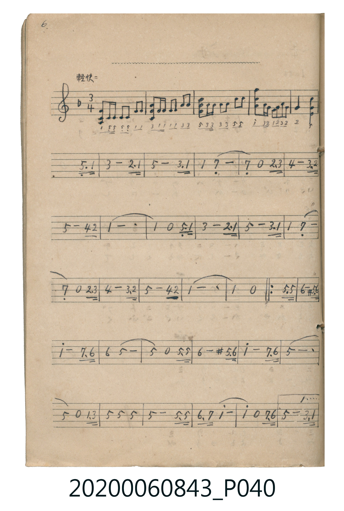

# 無題・三拍子曲

> Re:Shōka 使用 AI 協助辨識與重建樂譜，可能會有錯誤。歡迎回報。

- **鋼琴伴奏版**：<br><audio controls src="mudai.mp3"></audio>

- 出處：《唱歌帖》（2020.006.0843）P040.jpg–P041.jpg (top)（第 6–7 頁，實為町田櫻園編〈舞踏〉無詞重抄譜）

## 說明

> [!NOTE]
> **原件資訊與雙抄本互校考證**（對應《唱歌帖》第 3 冊 `P040.jpg`–`P041.jpg` 上半頁，互校第 1 冊 `P171.jpg`–`P172.jpg`〈舞踏〉）：
> - **曲名與性質**：原件頁頂未題曲名（僅畫波浪裝飾線，左上標示「軽快ニ」），經與第 1 冊 `P171.jpg`–`P172.jpg` 比對，實為楊金土重抄町田櫻園編《小學新唱歌》第 10 頁〈舞踏〉之無詞純旋律稿。
> - **調性與拍號**：ヘ長調 3/4 拍（F 大調 3/4 拍，`?= F`）。
> - **結構與親筆塗銷校改痕跡**：
>   1. `P040.jpg` 第一行為 5 小節五線譜附簡譜前奏（第 2、3 小節為 `3 - 1 1 1 - 1 - 3 - 3 -`、`5 - 3 3 3 - 3 - 5 - 5 -`，第 4 小節為 `1^ - - - - - 3 2 1 2 3 2`），第 5 小節末拍接第二行首弱起 `5_ - - 1`。
>   2. **一房子括號正範**：不同於第 1 冊 `P172.jpg` 誤將 `I---st` 拉長為 6 小節，本件 `P040.jpg` 末小節至 `P041.jpg` 第一行明確以 `1.....st` 精確框出最後 4 小節（`| 5 - 3. 1= | 5 - 4. 2= | 1 - . | 1 0 :||`）。
>   3. **二房子親筆打叉重寫**：`P041.jpg` 第一行反覆記號 `:||` 右側，楊氏原先誤寫漏去中間小節之三小節結尾（`5 - 1^ | 1^ - . | 1^ - ||`），旋即親筆畫大叉 `×` 整段塗銷，於第二行另起 `II nd` 重抄正確之四小節結尾（`| 5 - 1^. 3= | 5 - 6. 7= | 1^ - . | 1^ - ||`）。


## 歌詞

```text
（TMD 檔案未包含歌詞註解）
```

## ABC

<div class="abc-score" data-abc-src="mudai.abc" aria-label="五線譜載入中"></div>

[下載 ABC 原始檔](mudai.abc)

## TMD 檔案連結

- [主旋律 TMD 檔案](mudai.tmd) [[在 TMD Studio 編輯](https://tmdlang.github.io/Tmd-TS/#tmd=s7IKdvYPcrWy4qpTUCpJTLdSSM7PyUlNLsnMz7MqzsjPTkzOyFeCS5bl55TmploBqXgDY4RwcX5pUXJqfEFieqpVgIGJAU4ZQ3QZuB3xefklqUn5-dkIFQVF-WWpeYl5QFW5iXmlxclFmQUl8cn5BZUINallmSmpIBXFyYl58WWpRZlpmakpSA5OLSoGewXijpKixDyIOUBBhKqSjFSgr3JLizOTEYL5RZnpmXlWJYmZQDfGA3F5YnxuYmZeTmIe0AItLYXnLQtfLux53Lz7yY7OZ929T9dOeDZ7k4KWFpeirYKhkQGXva2CG5eNsb6JHcjMp-27Xsyc-n7PrMcNXU-nbHy2tufpjmmPG7rf7-kwMjAy0DMwMNMzsDAxfr-nExSEelkF6Y8aJoPCDMRU0CjJL9AEqn2-Zo2CGVDCXOHlgsb3e3qerl_2vGnX8ylAtOHZ6t1P50x6vn3F44aOFx3zXuzof9zQCXTli5XzXrb3PutqebF2DtB4JS4ufS0FW2oBLgUFBTuFaEU__xDXWAhHS-tp3_wnu7e92Nz-YkXXi472l7NnAq1_NmfNk12Tni1Y-KKh-cXaTi0toH-ebuh91t6JFiYgTxorPG3rUkiAhUUC0M8gDjg0EhSe7Oh62tsFCQKImSA9hlA9huYQZWA9huZGYA5yoABDARgTEMfqAp0LjLinE3qBDn3WsPzF5lUgl82CeAFoxcsFTc_mrAJGNUQVyNHNrc-nrn62edGzrateLJ77cvG-59tngSJj-zKgw56tmPl8ya7HDT0vdu99un_14-buxw1AXUAbe55vmwy0hKBTFZ6tnwIMGHj0Plva9bJ94tM58yHRiBHbXU839D9du-PZtA2QUIQGoaEBKJEg-_vJzm5Ieni-Zcqz6d1P93U_X7H_cUMTIiRerNoPCgNgSHT3vpg5HxwSj5tnvJy6HSijAEzMCkAJYBC4KTxdshxFqCcBlOATgB5FMfD51gnPlncDDXyxbNXztW1PF05_2bUdGF_Ppux8Pn3qi-0LwVZA1CsoGOohRbkC0BNPdjS8WNgDDAMFUwWgL5-vb3iyawowtIFJ-eXMlucbFgIZTzt7ny7th2YOo8cNjcC0A1YK0pZgDHSGIRiCaF1gwgJjYHpoTDAFs0EQIg7iAzHQEz0gs0yQzTGMA0rCoLGCEdAwIxAN8jFUPcyJz-asBgbJs76lIA_s6gF64OWyaU_3bHyxdbtCgmk82ARDoAOgwaSgYKQHDCmgV5917AcVI91rgEH_bO3i5-tbwKHzZEfv0wk9z6btQU050MTyYtWSpxvaFRI8dXV1i0uAiae7ExhdIDebQd0DdB4o7-3ehhy4QEdCZF-0bwaLQ7MWPNCfzeh7vmjXk91LgX7XAwGQ4c837QMKPlvYBizPns1peLqvBx5KwAhIqAEHobGegqGtAoRtoqdgBGKDgl4PTBsoWNXUoKQTBZAOYADs6oEEACSpPOuc_LS_E5jkn65fDQ4GbI582t_7YlnbixUzgCGmkAAyWOFp_-anjVtAfl7a9QyYMfrmP23tAAXS-tXP9gC5wPJ67ctpk6GpaWc3sPiGRvPWCU837AN5A-RwYHwDXQuKdLCzQQyIs0EmA_NO72aIM4ElATArAF2qkHB4OjBYp255tm4rJJmDVIIjDZIInvYvA6cAT0-FvJQEBUhmBkUzMJR3dj-dPRvdGZAQNIzTUzCGBaeZnoI5ODixOAwanpQX6VCgoKXPxeVbmpKYaRWQmZiX71BjUFMNskHBxtBMyw7Mqs5NqwUzsFUp8AwByaEKGrDUh4g_BW0wGzWTaGIxCugWkDWQhASCwHwER7C8XQPOxVhyOzT0sOR1WBBiydlAKSOoqAHCUnDmVajhwu1roG-BSUDBEJb90Py9q-f93nnA2Ab6GK9HQY5EhhC3AK0GOxsZQlSCZGCBYw5xJwLWwFkwr0CMMwb6BGKdCVZDQYGAbh1EJUgGZh06xLQNKeCGo--gJN5Usa8HmCogCf9lYy8w4XsqFJcoaMCTiY4CcjKBJBBgIQ1MLPBWIDzb4E04ZmjuNVUHU2boSR0clHApmC708MDnW0rsQ7cHt32QeEDEJUwnOo1pJtylUDeaYzoI0zq4E9Gsg0FEeqR_0tnVA006oCoEJe1AK0JgXY6SWsAF62hqQXIpnVML1AigezCkYLZg8Timfej21nDVcnHp2imA62cFIEOZCwA)]
- [鋼琴伴奏 TMD 檔案](mudai_piano.tmd) [[在 TMD Studio 編輯](https://tmdlang.github.io/Tmd-TS/#tmd=s7IKdvYPcrWy4qpTUCpJTLdSSM7PyUlNLsnMz7MqzsjPTkzOyFeCS5bl55TmploBqXgDY4RwcX5pUXJqfEFieqpVgIGJAU4ZQ3QZuB3xefklqUn5-dkIFQVF-WWpeYl5QFW5iXmlxclFmQUl8cn5BZUINallmSmpIBXFyYl58WWpRZlpmakpSA5OLSoGewXijpKixDyIOUBBhKrEIqB4empual6JVUFmYl5-fGJycn5uQWJeJkgMobAkA6jIKre0ODMZIZhflJmemWdVkpgJ9Ew8EJcnxucmZublJOYhuQSqqjy1uCS1KC8-NzUnPwXoES0thectC18u7HncvPvJjs5n3b1P1054NnvT-z0dL7v3PJ-w5cmeLU-X9j_v7Hi_p1NBS4tL0VbB0MiAy95WwY3LxljfxA5kw9P2XS9mTn2_Z9bjhq6nUzY-W9vzdMe0xw3dQFOMDIwM9AwMzPQMLEyMgWaA4kcvqyD9UcNkUISAmAoaJfkFmkC1z9esUTADSpgrvFzQCFSrxMXlW5qSmGkVAAqUIA-HGoOaai4FILAxNNOyA7Oqc9NqwYwaBUMFXTA0jUcgkBgI1ygYg1kgCBEB8UG4RsEUzAJBiAiID8JAE-OgRoKgsYIRUKMRmK4BYoioAcJSEGWoUAN1DcgkZAjRAJQHm40MISpBMjAfmEMMQ8AaOAtmH8Q4Y7h1JlgNBbkU3TqISpAMzDp0iGnbMPcdlITZZoamw1QdTJmhpwiwZ-BSMF3oLqKVfej24LYPEhKI0ITpRKcxzYS7FOpGc0wHYVoHdyKadTCISBGjkUfYf4Ms8qBGAN2DIQWzBYvHMe1Dt7eGqxaltPdBLu1N4IV9Abywj1eINowFY6I5pvHxQPsM4H6DSgIpTLZpPFAXiIBpA5EwjUZgBeaxEEEwicxHd4EB2NiBtNQEpNgEaDCIgZ1Lpl6oM9DcjelflOgAexhuEJiA8FF9jKx6ZHoXl29B-QacY3TtFMCZRgHIUOYCAA)]

## 分析

```text
================================================================================
📊 TMD Song Profile: [ 無題・三拍子曲 ]
================================================================================
⏱  Duration:       1:19 (79.5s), 53 measures total
🎼 Key & Tempo:    首調基準 F, != 120.0 BPM, <3/4>
   - 分析範圍：      由實際發聲的音符與和弦推測調性；播放脈絡另行呈現
🎤 人聲音域:    C4 (MIDI 60) – F5 (MIDI 77) [跨度: 17 個半音 / 1.4 個八度, 難度: challenging]
   - 最低音:  C4 in [Mudai #1 @ m.1, 0:00]
   - 最高音: F5 in [Mudai #1 @ m.4, 0:04]
   - 適合: soprano, mezzo-soprano, contralto, tenor, baritone, bass
🏛  結構:      Mudai (79.5s)
⚡ 編曲密度:        Peak 1 軌道同時演奏
🗝  調性診斷：       F 大調（純淨自然大調，未偵測到可信轉調）
   - 風格氣質:    純淨自然大調（陽光明朗、易唱易記，無明顯調外色彩）
   - 轉調歷程:    全曲維持單一推測調性（未偵測到可信轉調）
   - 核心骨幹音:  C, F, D, A, E
   - 調性數值:    F 大調 [相關度: 0.88, 穩定度: High, 自然音純度: 97.9%]
   - 候選調性 (K-S): F 大調 (0.88), C 大調 (0.74), F 小調 (0.57)
   - 五度圈歷程:   -1
   - 各段落調性細節:
     • [Mudai #1]: F 大調 (r: 0.88, 自然音純度: 97.9%, 調外音: C#)

  [ 五度圈游移軌跡 ]
               C  
        [F ]*          G  
      Bb               D  
      Eb               A  
         Ab           E  
            Db       B  
               F# 
     (* = active key center)

  [ 十二半音累積音高分佈 ]
     C  : ████████████████████████  34.2%
     C# : █                          2.1%
     D  : ███████                   10.1%
     D# :                            0.0%
     E  : █████                      7.7%
     F  : ████████████████████      28.9%
     F# :                            0.0%
     G  : ███                        4.1%
     G# :                            0.0%
     A  : ██████                     8.6%
     A# : ███                        4.3%
     B  :                            0.0%
--------------------------------------------------------------------------------
Assignment 軌道音域：
  - Piano         : C4 – F5 (17 個半音 / 1.4 個八度, 145 個音符)
================================================================================
```


## 原書掃描頁




