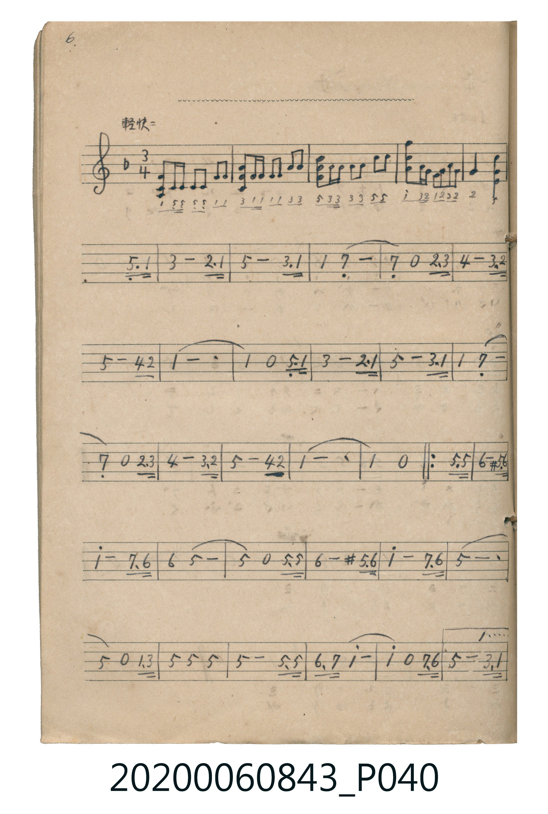

# 無題・三拍子曲

<audio controls src="mudai.mp3"></audio>

- 出處：《唱歌帖》（2020.006.0843）P040.jpg–P041.jpg (top)（6.–7.）

## 說明

原書資訊（對應 P040.jpg – P041.jpg 上半）：
調性與拍號：ヘ調 3/4 拍（F 大調 3/4 拍），「輕快ニ」
結構：5 小節五線譜（附簡譜）前奏 + 主旋律（含反覆記號與一、二房子結尾）

## 跨冊／重複收錄參照

> 同曲＋同名異曲（《唱歌帖》P040〈無題・三拍子曲〉與 P171〈舞踏〉為同曲；《新定兒童唱歌》五年級、高女用及《唱歌帖》P230b 為同名異曲）

- **[同名異曲]** 《新定兒童唱歌》尋常科第五學年用（2020.006.0847.0005）：[**〈舞踏〉**](../../../shintei_jido_shoka/grade_5_2020.006.0847.0005/4_02_buto/index.md)（`G` / `3/4` — [原始 TMD](../../../shintei_jido_shoka/grade_5_2020.006.0847.0005/4_02_buto/buto.tmd)）
- **[同名異曲]** 《新定兒童唱歌》高等科女子用（2020.006.0849）：[**〈舞踏〉**](../../../shintei_jido_shoka/koto_girls_2020.006.0849/1_3_05_buto/index.md)（`G` / `4/4` — [原始 TMD](../../../shintei_jido_shoka/koto_girls_2020.006.0849/1_3_05_buto/buto.tmd)）
- **[同曲]** 楊金土手抄《唱歌帖》第 1 冊（2020.006.0843）：[**〈舞踏〉**](../../vol_01/p171_buto/index.md)（`F` / `3/4` — [原始 TMD](../../vol_01/p171_buto/buto.tmd)）
- **[同名異曲]** 楊金土手抄《唱歌帖》第 7 冊・VII（2020.006.0843）：[**〈舞踏（舞蹈）〉**](../../vol_07/p230b_buto/index.md)（`B,` / `3/4` — [原始 TMD](../../vol_07/p230b_buto/buto.tmd)）
- 總表：[跨冊重複與同名歌曲總索引](../../../duplicate_songs.md)

## 歌詞

```text
（TMD 檔案未包含歌詞註解）
```

## ABC

```abc
X:1
T:無題・三拍子曲
M:3/4
L:1/16
Q:1/4=120
K:F
V:V1 name="Piano" snm="Pia"
[V:V1]
!mf! F4 C C C C F2 F2 | A4 F F F F A2 A2 | c4 A A A A c2 c2 | f4 A G F G A2 G2 |
G4 z4 C3 F | A8 G3 F | c8 A3 F | F4 E8 |
E4 z4 G3 A | B8 A3 G | c8 B3 G | F12 |
F4 z4 C3 F | A8 G3 F | c8 A3 F | F4 E8 |
E4 z4 G3 A | B8 A3 G | c8 B3 G | F12 |
F4 z4 c3 c | d8 ^c3 d | f8 e3 d | d4 c8 |
c4 z4 c3 c | d8 ^c3 d | f8 e3 d | c12 |
c4 z4 F3 A | c4 c4 c4 | c8 c3 c | d3 e f8 |
f4 z4 e3 d | c8 A3 F | c8 B3 G | F12 |
F4 z4 c3 c | d8 ^c3 d | f8 e3 d | d4 c8 |
c4 z4 c3 c | d8 ^c3 d | f8 e3 d | c12 |
c4 z4 F3 A | c4 c4 c4 | c8 c3 c | d3 e f8 |
f4 z4 e3 d | c8 f3 A | c8 d3 e | f12 |
f8 z4 |
```

## TMD 檔案連結

- [主旋律 TMD 檔案](mudai.tmd) [[在 TMD Studio 編輯](https://tmdlang.github.io/Tmd-TS/#tmd=s7IKdvYPcrWy4qpTUCpJTLdSSM7PyUlNLsnMz7MqzsjPTkzOyFeCS5bl55TmploBqXgDY4RwcX5pUXJqfEFieqpVgIGJAboM3KT4vPyS1KT8_GyEioKi_LLUvMQ8oKrcxLzS4uSizIKS-OT8gkqEmtSyzJRUkIrUlMyS_KLMxBwkJ6UWFYMdC3FDSVFiHsQMoKASl5aWwvOWhS8X9jxu3v1kR-ez7t6nayc8m71JQUuLS9FWwdDIgMveVsGNy8ZY38QOZObT9l0vZk59v2fW44aup1M2Plvb83THtMcN3e_3dBgZGBnoGRiY6RlYmBi_39MJ8qleVkH6o4bJQKYhiKmgUZJfoAlUa6YHFDXXA6pS4uLS11KwpRbgUlBQeNo3_9nsHS82t79Y0QW06-mG3mftnQow5ygAbQZxIA56sqPraS9QVSfQSyC9L1btf9aw_EVHOzAoXsycD_Jo8wygoAIwABSAYkDz3BSeLlmOIgTU3PO4oefFnqlP969-3Nz9uKEXZNbzrROeLQeGzCxThacb-p-vb3iya8rz7bNerJ0DNOXlzJbnGxaC2Z1PO3ufLu1X0Aa6Zvez6d1P94GC8-mE1U_7e18sa3uxYgbQJUAnPdnR8Lih8cmunmcd-4HRBDT-6YZ9QO0guygPOShQ0NLn4vItTUnMtArITMzLd6gxqFGoBlmhYGNopmUHZlXnptWCGcCoM9VNSixSyMwrKcpPKQVnDJARIMkaBUMFXTA0jUcgkBgI1ygYQ2UNoRDEB-EaBVOojDEUgvggDDQxDi5lBNRiBNZgBJYCkSBogLAUYnoNzKnBkIyr4IhwIcwNMAgxBKgH7gYYhKgEycB8ZQ6xAAFrEEIwR0DMM4a6oUbBBKupRljsg6gEycDsQ4cIGRxeHnbeg5IYEeqkoGFYXKJQkpmbqomIWzM0A03VwZQZcjKCQXO4FEwXuoMRXsDuHHLtQ7cHt32Q4EAENkwencY0E-5SqBvNMR2E5EaYfXA3otkHg4gkQ-vINcpLGY1cdJ1wl8BcStXIhWoAOghDCmYNFp9jsRAGYRbXcNVycenaKYDrGAUgQ5kLAA)]
- [鋼琴伴奏 TMD 檔案](mudai_piano.tmd) [[在 TMD Studio 編輯](https://tmdlang.github.io/Tmd-TS/#tmd=s7IKdvYPcrWy4tLSUnjesvDlwp7Hzbuf7Oh81t37dO2EZ7M3vd_T8bJ7z_MJW57s2fJ0af_zzo73ezoVtLS4FG0VDI0MuOxtFdy4bIz1Tey46hSUnrbvejFz6vs9sx43dD2dsvHZ2p6nO6Y9bugGmmJkYGSgZ2BgpmdgYWIMNCPAwMRAL6sg_VHDZCDTEMRU0CjJL9AEqjXTA4qa6wFVKXFx-ZamJGZaBWQm5uUHeTjUGNQoVHMpAIGNoZmWHZhVnZtWC2bUKBjHa5vGaxsq6IKhaTwCgcRAuAbI0TbUNoYqMYRCEB-EaxSActqmUFljKATxQRhogbaptmEcXNoIqNVIwTwebB6QMoLZAGWDoAHCNRAba2COhUvAXQzRA1QCtg7MhjsVQoPkEP4D2oOFDXUBmv0Qs43h1ptAxZGcCrHCCMl6JEmIepAkkv0I56Fw0EJ5NAgQQQAlYU4w1DaDexPmHFN1MGUGciEitSFUmsOlEXoRiRaZjZqcaeMGUPjArcDNQVMIcwskIBFRgssnuH2FzIb7DBoy5siOR2KieArmFLiX4E7BlwKBvsGbQlDKodFEMnwTCYolMBZEG9DFeDwLsx29VsHJQVMIgzCn1XDVolSXPriqywJYdWmIKDphLLgQ1WURLFCqRy-aEZ5Ac5oxQj-m6dgkEWYbESsLl4ZaTokR2LxujE161OfoPjfBTEkmCO34ZWlrtxFc1iweMwwIBgwJyZ3Y3ASPf5DT0XUAHYkki243wl_wSEc3AMn00TgfiXGOz2cEgx3GhkGUCkrXTgFcRykAGcpcAA)]

## 分析

```text
================================================================================
📊 TMD Song Profile: [ 無題・三拍子曲 ]
================================================================================
⏱  Duration:       1:19 (79.5s), 53 measures total
🎼 Key & Tempo:    首調基準 F, != 120.0 BPM, <3/4>
   - 分析範圍：      由實際發聲的音符與和弦推測調性；播放脈絡另行呈現
🎤 人聲音域:    C4 (MIDI 60) – F5 (MIDI 77) [跨度: 17 個半音 / 1.4 個八度, 難度: challenging]
   - 最低音:  C4 in [Mudai #1 @ m.1, 0:00]
   - 最高音: F5 in [Mudai #1 @ m.4, 0:04]
   - 適合: soprano, mezzo-soprano, contralto, tenor, baritone, bass
🏛  結構:      Mudai (79.5s)
⚡ 編曲密度:        Peak 1 軌道同時演奏
🗝  調性診斷：       F 大調（純淨自然大調，未偵測到可信轉調）
   - 風格氣質:    純淨自然大調（陽光明朗、易唱易記，無明顯調外色彩）
   - 轉調歷程:    全曲維持單一推測調性（未偵測到可信轉調）
   - 核心骨幹音:  C, F, D, A, E
   - 調性數值:    F 大調 [相關度: 0.88, 穩定度: High, 自然音純度: 97.9%]
   - 候選調性 (K-S): F 大調 (0.88), C 大調 (0.75), A 小調 (0.57)
   - 五度圈歷程:   -1
   - 各段落調性細節:
     • [Mudai #1]: F 大調 (r: 0.88, 自然音純度: 97.9%, 調外音: C#)

  [ 五度圈游移軌跡 ]
               C  
        [F ]*          G  
      Bb               D  
      Eb               A  
         Ab           E  
            Db       B  
               F# 
     (* = active key center)

  [ 十二半音累積音高分佈 ]
     C  : ████████████████████████  34.6%
     C# : █                          2.1%
     D  : ███████                   10.1%
     D# :                            0.0%
     E  : █████                      7.7%
     F  : ████████████████████      28.3%
     F# :                            0.0%
     G  : ███                        4.3%
     G# :                            0.0%
     A  : ██████                     8.7%
     A# : ███                        4.3%
     B  :                            0.0%
--------------------------------------------------------------------------------
Assignment 軌道音域：
  - Piano         : C4 – F5 (17 個半音 / 1.4 個八度, 157 個音符)
================================================================================
```


## 原書掃描頁




