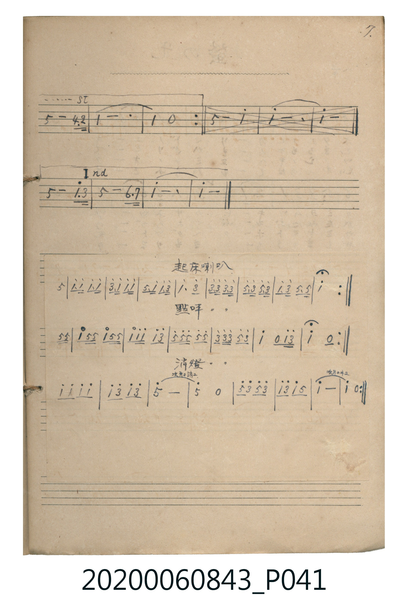

# 起床喇叭・點呼喇叭・消燈喇叭

<audio controls src="kisho_rappa.mp3"></audio>

- 出處：《唱歌帖》（2020.006.0843）P041.jpg (bottom)（7. 貼附喇叭譜）

## 說明

原書資訊（對應 P041.jpg 下半貼附紙張）：

## 歌詞

```text
1. 起床喇叭（Reveille）
2. 點呼喇叭（Roll Call）
3. 消燈喇叭（Taps / Lights Out，註記「次ハ二消ユ」「次ハ二ヰユ」）
```

## ABC

```abc
X:1
T:起床喇叭・點呼喇叭・消燈喇叭
M:2/4
L:1/16
Q:1/4=112
K:C
V:V1 name="Piano" snm="Pia"
[V:V1]
!f! z4 z2 G2 | c G c2 c G c2 | e c e c c G c2 | G c c2 c e c2 |
c3 e c2 e2 | e e e2 e e e2 | g e g e g e g e | c e c2 G G G2 |
c6 z2 | z4 z2 G G | c2 G G c2 G G | c2 c2 c2 e2 |
g g g2 g2 g2 | e e e2 g2 e2 | c4 z2 c e | c4 z2 G G |
c2 G G c2 G G | c2 c2 c2 e2 | g g g2 g2 g2 | e e e2 g2 e2 |
c4 z2 c e | c4 z4 | !mf! c2 c2 c2 c2 | c2 e2 c2 e2 |
g8 | !p! g4 z4 | !mf! g e g e g2 e2 | c2 e2 c2 G2 |
c8 | !pp! c4 z4 |
```

## TMD 檔案連結

- [主旋律 TMD 檔案](kisho_rappa.tmd) [[在 TMD Studio 編輯](https://tmdlang.github.io/Tmd-TS/#tmd=s7IKdvYPcrWy4tLSUnixdfvTXV1Pp7U_7V_7uHn3y93znk7cA-c-29bxvL0DwlXQ0uJStFUwNDTisrdVcOayMdI3seOqU1B62r7rxcyp7_fMetzQ9XTKxmdre57umPa4ofv9ng4jAyMDPQMDMz0DCxPj93s6AwxMDPWyCtIVNJLyS0ryczWBasz1FF5s2vNyZgvEmhdr5wAVKnFx6Wsp2FILcCkoKDztm_9s9o4Xm9tfrOgCWvt0Q--z9k4FuIue7Oh-2tsFccnzLTOf7tkKdAbQUyCthkAnIoUTUHdQallqZk5OKlANSIGRngJyyIEU5OfkKDgn5uRAVRjrKSAHJlBFSGJBsYK-gk9mekZJsYJ_acn7PT0vVux-sWLG44aeZ2sWPm7uf7KrB6jpcfOyxw29yIKPmzdABKGGUx5AUKCgpc_F5Z1ZnJEflFhQkGgVkJmYl-9QY1CjUA2yR8HG0EzLDsyqTqsF08BYQgsdkBkgmRoFAwVdMATRpkBco2AYB2QACV0kVo2CcRyIBSGRxcEMmGqINNQQkKkwASANFIVaCeRAEFgcxgQaBWZhkmDTYCaZgiGSFQjnQ8wHehYtpnF51hRmCIgJZ0DFEATCdRAEVAYnUDwDFkHxKdyJIAshnkATpI4rMAMWyS1EuAIE4aGHlgtgoVedC01NGE5DjnKwlWgORsQSwp7qAphhcAWoDkGyDi1FoPoLYSGWVIFsH9xCLD6v5eLStVNA5CkFIE-ZCwA)]
- [鋼琴伴奏 TMD 檔案](kisho_rappa_piano.tmd) [[在 TMD Studio 編輯](https://tmdlang.github.io/Tmd-TS/#tmd=s7IKdvYPcrWy4tLSUnixdfvTXV1Pp7U_7V_7uHn3y93znk7cA-c-29bxvL0Dwn2_p-Nl957nE7Y82bPl6dL-550d7_d0KmhpcSnaKhgaGnHZ2yo4c9kY6ZvYcdUpKD1t3_Vi5tT3e2Y9buh6OmXjs7U9T3dMe9zQDTTFyMDIQM_AwEzPwMLEGGhGgIGJoV5WQbqCRlJ-SUl-riZQjbmewotNe17ObIHY_WLtHKBCJS4u78zijPygxIKCRKuAzMS8_CAPhxqDGoVqLgUgsDE007IDs6pz02rBjBoFAwVdMATRpkBco2CsbRgHZIIpXTRejYKptnGcAkgISmPIQ5jIuoEK4dJQBlAGLgg2CSgHdRCYC0RQYTRuDdBObVOwCB4G1B6EHYbapkCXgUiII0xhzkB4HmY_aoCYItwM4iAx4eKoFJo7gQjCALoBjcbwKkwCLUBQXAtyFcRnWCRo61zs8YPuaBKcC4IQU6tzC2DpEasr0ZMP1DIsfjCGOgcZQu2AW4GmDKdTcCUwFM9icQ_OZIbsGCQPYw2WWszM7IMrM8PNQk674DStYBgPch6IQLCoIAoLIdw6jOECYBaGqGk8ivFwM3BlRYLeQRhtiKYUIYNDFNU3qE7BL0q2QzACEIsjiXEIetLG7Sx8otBwxkibMAm0LEK0dVBPYfcVdhthMig5QddOAZEZFIA8ZS4A)]

## 分析

```text
================================================================================
📊 TMD Song Profile: [ 起床喇叭・點呼喇叭・消燈喇叭 ]
================================================================================
⏱  Duration:       0:32 (32.1s), 30 measures total
🎼 Key & Tempo:    首調基準 C, != 112.0 BPM, <2/4>
   - 分析範圍：      由實際發聲的音符與和弦推測調性；播放脈絡另行呈現
🎤 人聲音域:    G4 (MIDI 67) – G5 (MIDI 79) [跨度: 12 個半音 / 1.0 個八度, 難度: easy]
   - 最低音:  G4 in [KishoRappa #1 @ m.1, 0:00]
   - 最高音: G5 in [KishoRappa #1 @ m.7, 0:06]
   - 適合: soprano, mezzo-soprano, tenor, baritone
🏛  結構:      KishoRappa (32.1s)
⚡ 編曲密度:        Peak 1 軌道同時演奏
🗝  調性診斷：       C 大調（純淨自然大調，未偵測到可信轉調）
   - 風格氣質:    純淨自然大調（陽光明朗、易唱易記，無明顯調外色彩）
   - 轉調歷程:    全曲維持單一推測調性（未偵測到可信轉調）
   - 核心骨幹音:  C, G, E
   - 調性數值:    C 大調 [相關度: 0.89, 穩定度: High, 自然音純度: 100.0%]
   - 候選調性 (K-S): C 大調 (0.89), C 小調 (0.61), E 小調 (0.58)
   - 五度圈歷程:   +0
   - 各段落調性細節:
     • [KishoRappa #1]: C 大調 (r: 0.89, 自然音純度: 100.0%)

  [ 五度圈游移軌跡 ]
              [C ]*
         F            G  
      Bb               D  
      Eb               A  
         Ab           E  
            Db       B  
               F# 
     (* = active key center)

  [ 十二半音累積音高分佈 ]
     C  : ████████████████████████  46.6%
     C# :                            0.0%
     D  :                            0.0%
     D# :                            0.0%
     E  : ████████████              22.6%
     F  :                            0.0%
     F# :                            0.0%
     G  : ████████████████          30.8%
     G# :                            0.0%
     A  :                            0.0%
     A# :                            0.0%
     B  :                            0.0%
--------------------------------------------------------------------------------
Assignment 軌道音域：
  - Piano         : G4 – G5 (12 個半音 / 1.0 個八度, 119 個音符)
================================================================================
```


## 原書掃描頁




