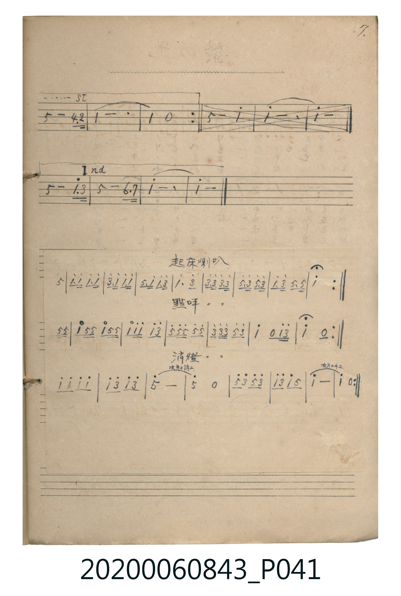

# 起床喇叭・點呼喇叭・消燈喇叭

> Re:Shōka 使用 AI 協助辨識與重建樂譜，可能會有錯誤。歡迎[回報](https://github.com/TMDLang/reshoka/issues)。

- **鋼琴伴奏版**：<br><audio controls src="kisho_rappa.mp3"></audio>

- 出處：《唱歌帖》（2020.006.0843）P041.jpg (bottom)（7. 貼附喇叭譜）

## 說明

原書資訊（對應 P041.jpg 下半貼附紙張）：


## 歌詞

```text
1. 起床喇叭（Reveille）
2. 點呼喇叭（Roll Call）
3. 消燈喇叭（Taps / Lights Out，註記「次ハ二消ユ」「次ハ二ヰユ」）
```

## ABC

<div class="abc-score" data-abc-src="kisho_rappa.abc" aria-label="五線譜載入中"></div>

[下載 ABC 原始檔](kisho_rappa.abc)

## TMD 檔案連結

- [主旋律 TMD 檔案](kisho_rappa.tmd) [[在 TMD Studio 編輯](https://tmdlang.github.io/Tmd-TS/#tmd=s7IKdvYPcrWy4qpTUCpJTLdSSM7PyUlNLsnMz7MqzsjPTkzOyFeCS5bl55TmploBqXgDY4RwcX5pUXJqfEFieqpVgIGJIboM3KT4vPyS1KT8_GyEioKi_LLUvMQ8oKrcxLzS4uSizIKS-OT8gkqEmtSyzJRUkIrUlMyS_KLMxBwkJ6UWFYMdC3FDSVFiHsQMoCBCFVBTemaeVWkeyKCSzLTM1BRkyZKM_PSixIKMSquMzGKQDcmJOfHZiXmJCEUlGalAn6emlCYnQozW0lJ4sXX7011dT6e1P-1f-7h598vd855O3APnPtvW8by9A8JV0NLiUrRVMDQ04rK3VXDmsjHSN7EDmf20fdeLmVPf75n1uKHr6ZSNz9b2PN0x7XFD9_s9HUYGRgZ6BgZmegYWJsbv93SCQlYvqyBdQSMpv6QkP1cTqMZcT-HFpj0vZ7ZArHmxdg5QoRIXl76Wgi21AJeCgsLTvvnPZu94sbn9xYouoLVPN_Q-a-9UgLvoyY7up71dEJc83zLz6Z6tQGcAPQXSagh0IlI4AXUHpZalZgJTGVANSIGRngJyyIEUANOggnNiTg5UhbGeAnJgAlWEJBYUK-gr-GSmZ5QUK_iXlrzf0_Nixe4XK2Y8buh5tmbh4-b-J7t6gJoeNy973NCLLPi4eQNEEGo45QEEBQpa-lxc3pnAtB6UWFCQaBWQmZiX71BjUFMNskbBxtBMyw7Mqk6rBdPASEILHJARIJkaBQMFXTAE0aZAXKNgGAdkAAldJFaNgnEciAUhkcXBDJhqiDTUEJCpMAEgDRSFWgnkQBBYHMYEGgVmYZJg02AmmYIhkhUI50PMB3oWLaJxedYUZgiICWdAxRAEwnUQBFQGJ1A8AxZB8SnciSALIZ5AE6SOKzADFsktRLgCBOGhh5YJYKFXnQtNTRhOQ45ysJVoDkbEEsKe6gKYYXAFqA5Bsg4tRaD6C2EhllSBbB_cQiw-r-Xi0rVTQGQpBSBPmQsA)]
- [鋼琴伴奏 TMD 檔案](kisho_rappa_piano.tmd) [[在 TMD Studio 編輯](https://tmdlang.github.io/Tmd-TS/#tmd=s7IKdvYPcrWy4qpTUCpJTLdSyC8qychPL0osyKi0ysgsLskvykxOzInPTsxLVIIrKs4vLUpOjS9ITE-1CjAwMUTIlGSk5qZapaaUJieWZObnKXFpaSm82Lr96a6up9Pan_avfdy8--XueU8n7oFzn23reN7eAeG-39PxsnvP8wlbnuzZ8nRp__POjvd7OhW0tLgUbRUMDY247G0VnLlsjPRN7EAWPm3f9WLm1Pd7Zj1u6Ho6ZeOztT1Pd0x73NANNMXIwMhAz8DATM_AwsQYaAbIkXpZBekKGkn5JSX5uZpANeZ6Ci827Xk5swVi94u1c4AKlbi4vDOLM_KDEgsKEq0CMhPz8oM8HGoMaqq5FIDAxtBMyw7Mqs5NqwUzahQMFHTBEESbAnGNgrG2YRyQCaZ00Xg1CqbaxnEKICEojSEPYSLrBiqES0MZQBm4INgkoBzUQWAuEEGF0bg1QDu1TcEieBhQexB2GGqbAl0GIiGOMIU5A-F5mP2oAWKKcDOIg8SEi6NSaO4EIggD6AY0GsOrMAm0AEFxLchVEJ9hkaCtc7HHD7qjSXAuCEJMrc4tgKVHrK5ETz5Qy7D4wRjqHGQItQNuBZoynE7BlcBQPIvFPTiTGbJjkDyMNVhqMfOyD3JetoBnZbhJIM0GQAh0ebyCaTyUJIEH8ze6CmMwE0gi8Uzj4drBaoHWEnYGRKshXArCR-MhuwJmNDYeEQajeAjFMuwGoycUwgGHLUZBgogSBb9xYEehugqbiSBRiJHAdKFrp4BIGgoEeMpcAA)]

## 分析

```text
================================================================================
📊 TMD Song Profile: [ 起床喇叭・點呼喇叭・消燈喇叭 ]
================================================================================
⏱  Duration:       0:32 (32.1s), 30 measures total
🎼 Key & Tempo:    首調基準 C, != 112.0 BPM, <2/4>
   - 分析範圍：      由實際發聲的音符與和弦推測調性；播放脈絡另行呈現
🎤 人聲音域:    G4 (MIDI 67) – G5 (MIDI 79) [跨度: 12 個半音 / 1.0 個八度, 難度: easy]
   - 最低音:  G4 in [KishoRappa #1 @ m.1, 0:00]
   - 最高音: G5 in [KishoRappa #1 @ m.7, 0:06]
   - 適合: soprano, mezzo-soprano, tenor, baritone
🏛  結構:      KishoRappa (32.1s)
⚡ 編曲密度:        Peak 1 軌道同時演奏
🗝  調性診斷：       C 大調（純淨自然大調，未偵測到可信轉調）
   - 風格氣質:    純淨自然大調（陽光明朗、易唱易記，無明顯調外色彩）
   - 轉調歷程:    全曲維持單一推測調性（未偵測到可信轉調）
   - 核心骨幹音:  C, G, E
   - 調性數值:    C 大調 [相關度: 0.89, 穩定度: High, 自然音純度: 100.0%]
   - 候選調性 (K-S): C 大調 (0.89), C 小調 (0.61), E 小調 (0.58)
   - 五度圈歷程:   +0
   - 各段落調性細節:
     • [KishoRappa #1]: C 大調 (r: 0.89, 自然音純度: 100.0%)

  [ 五度圈游移軌跡 ]
              [C ]*
         F            G  
      Bb               D  
      Eb               A  
         Ab           E  
            Db       B  
               F# 
     (* = active key center)

  [ 十二半音累積音高分佈 ]
     C  : ████████████████████████  46.6%
     C# :                            0.0%
     D  :                            0.0%
     D# :                            0.0%
     E  : ████████████              22.6%
     F  :                            0.0%
     F# :                            0.0%
     G  : ████████████████          30.8%
     G# :                            0.0%
     A  :                            0.0%
     A# :                            0.0%
     B  :                            0.0%
--------------------------------------------------------------------------------
Assignment 軌道音域：
  - Piano         : G4 – G5 (12 個半音 / 1.0 個八度, 119 個音符)
================================================================================
```


## 原書掃描頁




