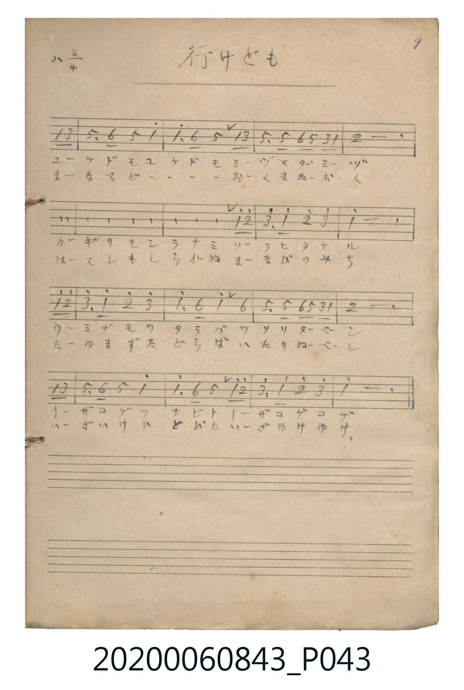

# 行けども

> Re:Shoka 使用 AI 協助辨識與重建樂譜，可能會有錯誤。歡迎回報。

<audio controls src="yukedomo.mp3"></audio>

- 曲：蘇格蘭民謠（Comin' Thro' the Rye / 故郷の空）
- 《唱歌帖》（2020.006.0843）P043.jpg（9）

## 說明

原書資訊與歌詞全文（對應 P043.jpg）：
調性與拍號：ハ調 4/4 拍（C 大調 4/4 拍）

## 跨冊／重複收錄參照

> 同曲異詞＋同名異曲（《新定兒童唱歌》六年級〈故郷の空〉與《唱歌帖》P043〈行けども〉同採蘇格蘭民謠 *Comin' Thro' the Rye* 旋律；高等科男子用〈故郷の空〉為同名異曲）

- **[同曲異詞]** 《新定兒童唱歌》尋常科第六學年用（2020.006.0847.0006）：[**〈故郷の空〉**](../../../shintei_jido_shoka/grade_6_2020.006.0847.0006/2_01_kokyo_no_sora/index.md)（`G` / `2/4` — [原始 TMD](../../../shintei_jido_shoka/grade_6_2020.006.0847.0006/2_01_kokyo_no_sora/kokyo_no_sora.tmd)）
- **[同名異曲]** 《新定兒童唱歌》高等科男子用（2020.006.0848）：[**〈故郷の空〉**](../../../shintei_jido_shoka/koto_boys_2020.006.0848/2_1_07_kokyo_no_sora/index.md)（`C` / `4/4` — [原始 TMD](../../../shintei_jido_shoka/koto_boys_2020.006.0848/2_1_07_kokyo_no_sora/kokyo_no_sora.tmd)）
- 總表：[跨冊重複與同名歌曲總索引](../../../duplicate_songs.md)

## 歌詞

```text
一、
ユケドモ ユケドモ ミヅマタミヅ
カギリモ シラナミ ソラヒタセル
ウミヂモ ワタラバ ワタリヌベシ
イザコゲ フナビト イザコゲコゲ

二、
まなべど まなべど おくまたおく
はてしも しられぬ まなびのみち
たゆまず たどらば いたりぬべし
いざいけ ひとびと いざゆけゆけ
```

## ABC

```abc
X:1
T:行けども
C:曲：蘇格蘭民謠（Comin' Thro' the Rye / 故郷の空）
M:4/4
L:1/16
Q:1/4=96
K:C
V:V1 name="Piano" snm="Pia"
[V:V1]
!mf! z4 z4 z4 C2 E2 | G6 A2 G4 c4 | c6 A2 G4 C2 E2 | G6 G2 A2 G2 E2 C2 |
D12 C2 E2 | G6 A2 G4 c4 | c6 A2 G4 c2 d2 | e6 c2 d4 e4 |
c12 c2 d2 | e6 c2 d4 e4 | c6 A2 c4 A4 | G6 G2 A2 G2 E2 C2 |
D12 C2 E2 | G6 A2 G4 c4 | c6 A2 G4 c2 d2 | e6 c2 d4 e4 |
c12 z4 | !mf! z4 z4 z4 C2 E2 | G6 A2 G4 c4 | c6 A2 G4 C2 E2 |
G6 G2 A2 G2 E2 C2 | D12 C2 E2 | G6 A2 G4 c4 | c6 A2 G4 c2 d2 |
e6 c2 d4 e4 | c12 c2 d2 | e6 c2 d4 e4 | c6 A2 c4 A4 |
G6 G2 A2 G2 E2 C2 | D12 C2 E2 | G6 A2 G4 c4 | c6 A2 G4 c2 d2 |
e6 c2 d4 e4 | c12 z4 |
```

## TMD 檔案連結

- [主旋律 TMD 檔案](yukedomo.tmd) [[在 TMD Studio 編輯](https://tmdlang.github.io/Tmd-TS/#tmd=s7IKdvYPcrWy4qpTUCpJTLdSSM7PyUlNLsnMz7MqzsjPTkzOyFeCS5bl55TmploBqXgDY4RwcX5pUXJqfEFieqpVgIEJhgzcpPi8_JLUpPz8bISKgqL8stS8xDygqtzEvNLi5KLMgpL45PyCSoSa1LLMlFSQitSUzJL8oszEHCQnpRYVgx0LcUNJUWIexAygoBKXlpbCi4U9jxsnPm5c-bipSUFLi0vRVsHSjMveVsGZy8ZE38QOZNKz2Zve75n1Ykb7swV7XsxY-2zDxBdrFrzf0-Gcn5uZp64QklGUr65QkpGqEFSZqqCv8Gxq68vm7Y8b1z1fuev9nk6wYx43dD2dsvHZ2p6nO6Y9bugGajYyMDLQMzAw0zOwMDEGKgOFjF5WQTpQyhKsi0tfS8GWWoBLQUHhad_8Z7N3vNjc_mJF14uOdqBjXqyc97R1xbNp7UBLn27ofdbeqYBwRifQzyBtL1btf9awHKShu_fFzPlA0cfN_UBBBWDwKADFQAGh8HTJchShTi6Q1ic7Gh43NIJYj5uXPW7a-Li583HzInTO_MfNrY-b5z1u2g9hg9U3rX7ctO5x8yqwkqbtj5tXPm7uAsoDOXvBnEkg9U27HzevhqhfBtbcBDFyPdgwoKoJcA7QpJ7HzTOBZkHUL3nctO1x0-bHTZuASqaCDZ_8uLkDRQZCQryyqwfmlcZ9jxtXPW7cCUw06Jyux439YKH5EDZE_frHjcseN04HpTAw1fm4CZjo1sA1bwamlceN-x83LoSon_-4qQ0sNwvMAaXNzseNG4CcFrAk0OQ1YCunQ9QDRaeByYlAzqbHjSvARq6AyYAMmwghQeopT0xQoKClz8UVWZqdmpKfm28VkJmYl-9QY1CjUA2yRcHGQssOzKjOTasFM2oUDBR04dhQwRgoYgpk6SqYgWnDOCBRA6HgYkiqTMFixkCxGgUjsAgEgtVAbSBoXpyCURxQ0BgiCOHqQrhwpVBjIUqhBuPVYAZhmIHFBsSxoBCt4arl4tK1U4BFiQIaW5kLAA)]
- [鋼琴伴奏 TMD 檔案](yukedomo_piano.tmd) [[在 TMD Studio 編輯](https://tmdlang.github.io/Tmd-TS/#tmd=s7IKdvYPcrWy4tLSUnixsOdx48THjSsfNzW939PxsnvP8wlbnuzZ8nRp__POjvd7OhW0tLgUbRUszbjsbRWcuWxM9E3suOoUlJ7N3vR-z6wXM9qfLdjzYsbaZxsmvlizAGiCc35uZp66QkhGUb66QklGqkJQZaqCvsKzqa0vm7c_blz3fOUuoKlKICMeN3Q9nbLx2dqepzumPW7oBmo2MjAy0DMwMNMzsDAxBioLMDAx1ssqSAdKWYJ1cUWWZqem5OfmWwVkJublB3k41BjUKFRzKQCBjYWWHZhRnZtWC2bUKBgo6MKxoYIxUMRQ2xTI1lUwg7KMtQ3jgFSNggmEgZBBVW8KFDcFihgCxczjtY3AghAIVgi1kATj4xSM4oASptrGEAmggKk2UAhoF0SoBqjbFKYNahVEE9QyfFqR7IMyDbXNwDKDy0egmKnhqkWPWR8cMVuALWbBZigYxoMsAhFgljGIALoSRIEJZFGEWoQU0OEgyggiBSIhboMGA6mmg9lgDRDDMIzAbjqYQDYdLIWwZ2DdjuZ4YLTp2inAYk4Bja3MBQA)]

## 分析

```text
================================================================================
📊 TMD Song Profile: [ 行けども ]
================================================================================
⏱  Duration:       1:25 (85.0s), 34 measures total
🎼 Key & Tempo:    首調基準 C, != 96.0 BPM, <4/4>
   - 分析範圍：      由實際發聲的音符與和弦推測調性；播放脈絡另行呈現
🎤 人聲音域:    C4 (MIDI 60) – E5 (MIDI 76) [跨度: 16 個半音 / 1.3 個八度, 難度: moderate]
   - 最低音:  C4 in [Yukedomo #1 @ m.1, 0:01]
   - 最高音: E5 in [Yukedomo #1 @ m.8, 0:17]
   - 適合: soprano, mezzo-soprano, contralto, tenor, baritone, bass
🏛  結構:      Yukedomo (42.5s) -> Yukedomo (42.5s)
⚡ 編曲密度:        Peak 1 軌道同時演奏
🗝  調性診斷：       C 大調（純淨自然大調，未偵測到可信轉調）
   - 風格氣質:    純淨自然大調（陽光明朗、易唱易記，無明顯調外色彩）
   - 轉調歷程:    全曲維持單一推測調性（未偵測到可信轉調）
   - 核心骨幹音:  C, G, D, E, A
   - 調性數值:    C 大調 [相關度: 0.91, 穩定度: High, 自然音純度: 100.0%]
   - 候選調性 (K-S): C 大調 (0.91), G 大調 (0.70), C 小調 (0.54)
   - 五度圈歷程:   +0 -> +0
   - 各段落調性細節:
     • [Yukedomo #1]: C 大調 (r: 0.91, 自然音純度: 100.0%)
     • [Yukedomo #2]: C 大調 (r: 0.91, 自然音純度: 100.0%)

  [ 五度圈游移軌跡 ]
              [C ]*
         F            G  
      Bb               D  
      Eb               A  
         Ab           E  
            Db       B  
               F# 
     (* = active key center)

  [ 十二半音累積音高分佈 ]
     C  : ████████████████████████  34.4%
     C# :                            0.0%
     D  : ███████████               16.4%
     D# :                            0.0%
     E  : ███████████               16.4%
     F  :                            0.0%
     F# :                            0.0%
     G  : █████████████████         24.2%
     G# :                            0.0%
     A  : ██████                     8.6%
     A# :                            0.0%
     B  :                            0.0%
--------------------------------------------------------------------------------
Assignment 軌道音域：
  - Piano         : C4 – E5 (16 個半音 / 1.3 個八度, 134 個音符)
================================================================================
```


## 原書掃描頁




