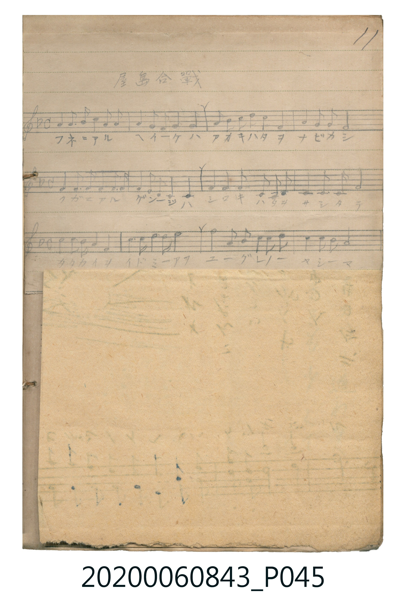

# 屋島合戰

> Re:Shōka 使用 AI 協助辨識與重建樂譜，可能會有錯誤。歡迎回報。

- **鋼琴伴奏版**：<br><audio controls src="yashima_gassen.mp3"></audio>

- 詞曲作者：未在 TMD metadata 中提供

## 說明


- 調性與拍號：調號 ?= F，拍號 <4/4>，速度 != 96


## 歌詞

```text
title = 屋島合戰
?= F
!= 96
<4/4>
來源：『唱歌帖』(2020.006.0843) 第一冊 p.11 (掃描頁 P045.jpg)
記譜：手抄五線譜（下半頁被 P046.jpg 夾頁遮蓋，可見前3行共12小節）
歌詞：
フネニアル ヘイケハ アオキハタヲ ナビカシ
クガニアル ゲンジハ シロキハタヲ サシタテ
タタカイヲ イドミアフ ユーグレノ ヤシマ
```

## ABC

<div class="abc-score" data-abc-src="yashima_gassen.abc" aria-label="五線譜載入中"></div>

[下載 ABC 原始檔](yashima_gassen.abc)

## TMD 檔案連結

- [主旋律 TMD 檔案](yashima_gassen.tmd) [[在 TMD Studio 編輯](https://tmdlang.github.io/Tmd-TS/#tmd=s7IKdvYPcrWy4qpTUCpJTLdSSM7PyUlNLsnMz7MqzsjPTkzOyFeCS5bl55TmploBqXgDY4RwcX5pUXJqfEFieqpVgIGJKboM3KT4vPyS1KT8_GyEioKi_LLUvMQ8oKrcxLzS4uSizIKS-OT8gkqEmtSyzJRUkIrUlMyS_KLMxBwkJ6UWFYMdC3FDSVFiHsQMoCBCFVBTemaeVWkeyKCSzLTM1BRkyZKM_PSixIKMSquMzGKQDcmJOfHZiXmJCEUlGalAn6emlCYnQozW0lJ4urH76eZtTyd0POvYoKClxaVoq2BpxmVvq-DGZWOib2LHxaWvpWBLLcCloKBQklmSk6pgi2IzSBxsJ5CGuADIgNgPZDzZ1_Zs14T3e2Y9buh7OmXjs7U9T3dMe9zQr2FkYGSgZ2BgpmdgYWKsqfB8zZonOxqetnUpFOgZGipoPOtrftbf_3JBowIoRvWyCtI1Qca9WDHjxdo5QOOedXY_62p5smvK8-2zwCIdT3Z0P-3tAup4sWg1SJMZSJPC0yX7gEIvG9e9mNz9fk_P0_71L5Z1P-3sNX6xsOdp60ZDo6cb-p-vb3i_pxNkPNB5L1bOAxoP4jxunvq4ufdxc_fjpkWPm1cD-TMeNy153LTxcXO_AkisadXjprVAzuOm_Y-bNwHlux43T37ctPpx03aw_qb1j5vWIOlv2vS4efPjph0Q_dsfN69F1d-0FSQK4rRB9O8HI6B5SyDyQKrzcfN8sHlTgfYte9y853HThsfNQFv6gHyg44CmzgNppjy-oUBBS5-LKzKxOCMzN9E9sbg4Nc8qLB-YPh1qDGqqQTYp2BiaaYHjWgGY3CAO6wXiblAYAWlwwIEcD8QbgWxw2AHxKiBeC-XvB9LgAATiyUA-KLC2g2wGmVqjYBqvoItEwKAZXMQYRGCoMwRiIyT1IFijYIwkA2LDVMCNrgFLIzQbYxoC923TeiBeg-rbJpBPNgPpHVDfbQfSQJ-i-7ZpK0QOzG-j2LdgUSOYDkOEb8BiYAKsBAbBImBlYBYwYOBGIawChQIOnwNdDcYgHwPjFpJAgXQnEM-HhgYskQK5G4BMUECB0yk0UOYhPG0GshZkK7KPoXxQLEFUgHgg2jAORqDGrRGGOIYuhEGwyMf0Yy0Xl66dAkqiVwAKKHMBAA)]
- [鋼琴伴奏 TMD 檔案](yashima_gassen_piano.tmd) [[在 TMD Studio 編輯](https://tmdlang.github.io/Tmd-TS/#tmd=s7IKdvYPcrWy4qpTUCpJTLdSyC8qychPL0osyKi0ysgsLskvykxOzInPTsxLVIIrKs4vLUpOjS9ITE-1CjAwMUXIlGSk5qZapaaUJieWZObnKXFpaSk83dj9dPO2pxM6nnVseL-n42X3nucTtjzZs-Xp0v7nnR3v93QqaGlxKdoqWJpx2dsquHHZmOib2HFx6Wsp2FILcCkoKJRkluSkKtgSdg5IMdghQBriLCAD4igg48m-tme7JrzfM-txQ9_TKRufre15umPa44Z-DSMDIwM9AwMzPQMLE2NNhedr1jzZ0fC0rUuhQM_QUEHjWV_zs_7-lwsaFUAhppdVkK4JMo5yv0GBgpY-F1dkYnFGZm6ie2JxcWqeVVg-MOocagxqqkE2KdgYmmmBvaBQo2Aar6CLRMCgGVzEGERgqDMEYiMk9SBYo2CMJANiw1TAja4BSyM0G2MaQpm7wKJGMB2GCHvBYmACrAQGwSJgZWAW0AtwoxBWgdyLzY1mIFUgRcgOhPJB3oeoAPFAtGEcjEANNCMMcQxdCINgoYrppFr0SA_ITMzLD_LAHu2G2sbaMGcTw8atwzxe2wjOQfiKKOUoHFQ9ZvHahtomeO2guldQ7ARzQMEN0WMarw1yBZSPykOoQzEB1SIUPyB0YPrGRBsU2RBVyGzcvsGjQxtbgiPKCoQ4qhUE_YE9IfogJ0QTRDqMB2UxCAnmAfMfkGkaD-VC2TBZE4QsHgOAqszABkC1QjSCywqQCDi7w_QDJUwgYkCNyFywecBCASgC0w-xHaod6E1dOwUUnyoABZS5AA)]

## 分析

```text
================================================================================
📊 TMD Song Profile: [ 屋島合戰 ]
================================================================================
⏱  Duration:       0:30 (30.0s), 12 measures total
🎼 Key & Tempo:    首調基準 F, != 96.0 BPM, <4/4>
   - 分析範圍：      由實際發聲的音符與和弦推測調性；播放脈絡另行呈現
🎤 人聲音域:    F3 (MIDI 53) – G5 (MIDI 79) [跨度: 26 個半音 / 2.2 個八度, 難度: difficult]
   - 最低音:  F3 in [YashimaGassen #1 @ m.6, 0:14]
   - 最高音: G5 in [YashimaGassen #1 @ m.11, 0:25]
   - 適合: mezzo-soprano, baritone
🏛  結構:      YashimaGassen (30.0s)
⚡ 編曲密度:        Peak 1 軌道同時演奏
🗝  調性診斷：       C 調性不明確（純淨自然大調，未偵測到可信轉調）
   - 風格氣質:    純淨自然大調（陽光明朗、易唱易記，無明顯調外色彩）
   - 轉調歷程:    全曲維持單一推測調性（未偵測到可信轉調）
   - 核心骨幹音:  C, F, G, A, D
   - 調性數值:    C 調性不明確 [相關度: 0.85, 穩定度: Ambiguous, 自然音純度: 100.0%]
   - 候選調性 (K-S): C 大調 (0.85), F 大調 (0.82), C 小調 (0.54)
   - 五度圈歷程:   +0
   - 各段落調性細節:
     • [YashimaGassen #1]: C 調性不明確 (r: 0.85, 自然音純度: 100.0%)

  [ 五度圈游移軌跡 ]
              [C ]*
         F            G  
      Bb               D  
      Eb               A  
         Ab           E  
            Db       B  
               F# 
     (* = active key center)

  [ 十二半音累積音高分佈 ]
     C  : ████████████████████████  30.2%
     C# :                            0.0%
     D  : █████████                 11.5%
     D# :                            0.0%
     E  :                            0.0%
     F  : ████████████████████      25.0%
     F# :                            0.0%
     G  : █████████████████         21.4%
     G# :                            0.0%
     A  : ██████████                12.0%
     A# :                            0.0%
     B  :                            0.0%
--------------------------------------------------------------------------------
Assignment 軌道音域：
  - Vocal         : F3 – G5 (26 個半音 / 2.2 個八度, 67 個音符)
================================================================================
```


## 原書掃描頁




