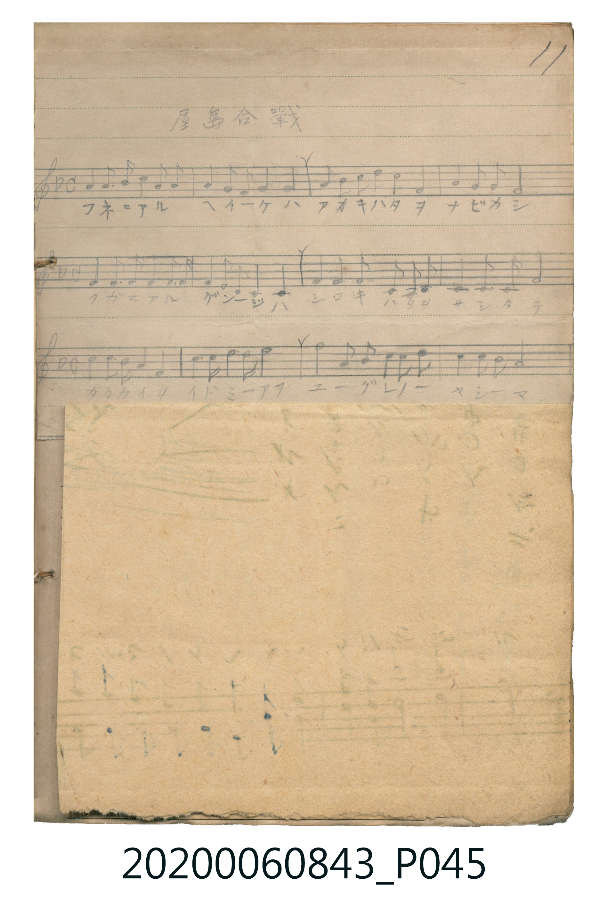

# 屋島合戰

<audio controls src="yashima_gassen.mp3"></audio>

- 詞曲作者：未在 TMD metadata 中提供

## 說明

・調性與拍號：調號 ?= F，拍號 <4/4>，速度 != 96

## 歌詞

```text
title = 屋島合戰
?= F
!= 96
<4/4>
來源：『唱歌帖』(2020.006.0843) 第一冊 p.11 (掃描頁 P045.jpg)
記譜：手抄五線譜（下半頁被 P046.jpg 夾頁遮蓋，可見前3行共12小節）
歌詞：
フネニアル ヘイケハ アオキハタヲ ナビカシ
クガニアル ゲンジハ シロキハタヲ サシタテ
タタカイヲ イドミアフ ユーグレノ ヤシマ
```

## ABC

```abc
X:1
T:屋島合戰
M:4/4
L:1/16
Q:1/4=96
K:F
V:V1 name="Vocal" snm="Voc"
[V:V1]
C2 C2 C6 D2 C2 A,2 | C2 C2 C2 F2 G8 | A2 F2 G2 A2 G4 C4 | F2 F2 G3 A G8 |
C2 C2 C6 D2 C2 A,2 | C2 C2 C2 A,2 G,4 F,4 | G,2 G,2 A,6 G,2 F,2 G,2 | A,2 C2 D2 C2 F8 |
d2 d2 c6 d2 c2 A2 | d2 c2 d2 f2 f8 | g2 f6 d2 c2 d2 f2 | d2 c2 A2 G2 F8 |
```

## TMD 檔案連結

- [主旋律 TMD 檔案](yashima_gassen.tmd) [[在 TMD Studio 編輯](https://tmdlang.github.io/Tmd-TS/#tmd=s7IKdvYPcrWy4qpTUCpJTLdSSM7PyUlNLsnMz7MqzsjPTkzOyFeCS5bl55TmploBqXgDY4RwcX5pUXJqfEFieqpVgIGJKboM3KT4vPyS1KT8_GyEioKi_LLUvMQ8oKrcxLzS4uSizIKS-OT8gkqEmtSyzJRUkIrUlMyS_KLMxBwkJ6UWFYMdC3FDSVFiHsQMoKASl5aWwtON3U83b3s6oeNZxwYFLS0uRVsFSzMue1sFNy4bE30TOy4ufS0FW2oBLgUFhZLMkpxUBVsUm0HiYDuBNMQFQAbEfiDjyb62Z7smvN8z63FD39MpG5-t7Xm6Y9rjhn4NIwMjAz0DAzM9AwsTY02F52vWPNnR8LStS6FAz9BQQeNZX_Oz_v6XCxoVQMGul1WQrgky7sWKGS_WzgEa96yz-1lXy5NdU55vnwUW6Xiyo_tpbxdQx4tFq0GazECaFJ4u2QcUetm47sXk7vd7ep72r3-xrPtpZ6_xi4U9T1s3Gho93dD_fH3D-z2dIOOBznuxch7QeBDncfPUx829j5u7Hzctety8Gsif8bhpyeOmjY-b-xVAYk2rHjetBXIeN-1_3LwJKN_1uHny46bVj5u2g_U3rX_ctAZJf9Omx82bHzftgOjf_rh5Lar-pq0gURCnDaJ_PxgBzVsCkQdSnY-b54PNmwq0b9nj5j2PmzY8bgba0gfkAx0HNHUeSDPl8Q0FClr6XFyRicUZmbmJ7onFxal5VmH5yYk5DjUGNQrVIKsUbAzNtMCRrQBMbxCX9QJxNyiQgDQ45ECuB-KNQDY48IB4FRCvhfL3A2lwCALxZCAfFFrbQVaDTK1RMI1X0EUiYNAMLmIMIjDUGQKxEZJ6EKxRMEaSAbFhKuBG14ClEZqNMQ2B-7ZpPRCvQfVtE8gnm4H0DqjvtgNpoE_Rfdu0FSIH5rdR7FuwqBFMhyHCN2AxMAFWAoNgEbAyMAsYMHCjEFaBQgGHz4GuBmOQj4FxC0mhQLoTiOdDQwOWSoHcDUAmKKDACRUaKPMQnjYDWQuyFdnHUD4oliAqQDwQbRgHI1Dj1ghDHEMXwiBY5GP6sZaLS9dOASXVKwAFlLkA)]
- [鋼琴伴奏 TMD 檔案](yashima_gassen_piano.tmd) [[在 TMD Studio 編輯](https://tmdlang.github.io/Tmd-TS/#tmd=s7IKdvYPcrWy4tLSUni6sfvp5m1PJ3Q869jwfk_Hy-49zydsebJny9Ol_c87O97v6VTQ0uJStFWwNOOyt1Vw47Ix0Tex4-LS11KwpRbgUlBQKMksyUlVsCXsHJBisEOANMRZQAbEUUDGk31tz3ZNeL9n1uOGvqdTNj5b2_N0x7THDf0aRgZGBnoGBmZ6BhYmxpoKz9esebKj4Wlbl0KBnqGhgsazvuZn_f0vFzQqBBiYmOplFaRrgoyj3G9QoKClz8UVmVickZmb6J5YXJyaZxWWn5yY41BjUKNQDbJKwcbQTAvsB4UaBdN4BV0kAgbN4CLGIAJDnSEQGyGpB8EaBWMkGRAbpgJudA1YGqHZGNMQytwFFjWC6TBE2AsWAxNgJTAIFgErA7OAXoAbhbAK5F5sbjQDqQIpQnYglA_yPkQFiAeiDeNgBGqgGWGIY-hCGAQLVUwn1aLHekBmYl5-kAeOeDfUNtaGuZsYNm4d5vHaRnAOwltEKUfhoOoxi9c21DbBawfVvYJiJ5gDCm-IHtN4bZAroHxUHkIdigmoFqH4AaED0zcm2qDYhqhCZuP2DR4d2thSHFFWIMRRrSDoD-wp0QdnSoTlR3hGxxRBUgXPvnBJ03gsyrDIYjPNBJ9pFDoQbrYZkgOxOAfTMdBiDdU5cGUwCHMfXJsJplq4Y_ArQ_IHvPCEq8fmPsxww-I8YELQtVNASQsKQAFlLgA)]

## 分析

```text
================================================================================
📊 TMD Song Profile: [ 屋島合戰 ]
================================================================================
⏱  Duration:       0:30 (30.0s), 12 measures total
🎼 Key & Tempo:    首調基準 F, != 96.0 BPM, <4/4>
   - 分析範圍：      由實際發聲的音符與和弦推測調性；播放脈絡另行呈現
🎤 人聲音域:    F3 (MIDI 53) – G5 (MIDI 79) [跨度: 26 個半音 / 2.2 個八度, 難度: difficult]
   - 最低音:  F3 in [YashimaGassen #1 @ m.6, 0:14]
   - 最高音: G5 in [YashimaGassen #1 @ m.11, 0:25]
   - 適合: mezzo-soprano, baritone
🏛  結構:      YashimaGassen (30.0s)
⚡ 編曲密度:        Peak 1 軌道同時演奏
🗝  調性診斷：       C 調性不明確（純淨自然大調，未偵測到可信轉調）
   - 風格氣質:    純淨自然大調（陽光明朗、易唱易記，無明顯調外色彩）
   - 轉調歷程:    全曲維持單一推測調性（未偵測到可信轉調）
   - 核心骨幹音:  C, F, G, A, D
   - 調性數值:    C 調性不明確 [相關度: 0.85, 穩定度: Ambiguous, 自然音純度: 100.0%]
   - 候選調性 (K-S): C 大調 (0.85), F 大調 (0.82), C 小調 (0.54)
   - 五度圈歷程:   +0
   - 各段落調性細節:
     • [YashimaGassen #1]: C 調性不明確 (r: 0.85, 自然音純度: 100.0%)

  [ 五度圈游移軌跡 ]
              [C ]*
         F            G  
      Bb               D  
      Eb               A  
         Ab           E  
            Db       B  
               F# 
     (* = active key center)

  [ 十二半音累積音高分佈 ]
     C  : ████████████████████████  30.2%
     C# :                            0.0%
     D  : █████████                 11.5%
     D# :                            0.0%
     E  :                            0.0%
     F  : ████████████████████      25.0%
     F# :                            0.0%
     G  : █████████████████         21.4%
     G# :                            0.0%
     A  : ██████████                12.0%
     A# :                            0.0%
     B  :                            0.0%
--------------------------------------------------------------------------------
Assignment 軌道音域：
  - Vocal         : F3 – G5 (26 個半音 / 2.2 個八度, 67 個音符)
================================================================================
```


## 原書掃描頁




