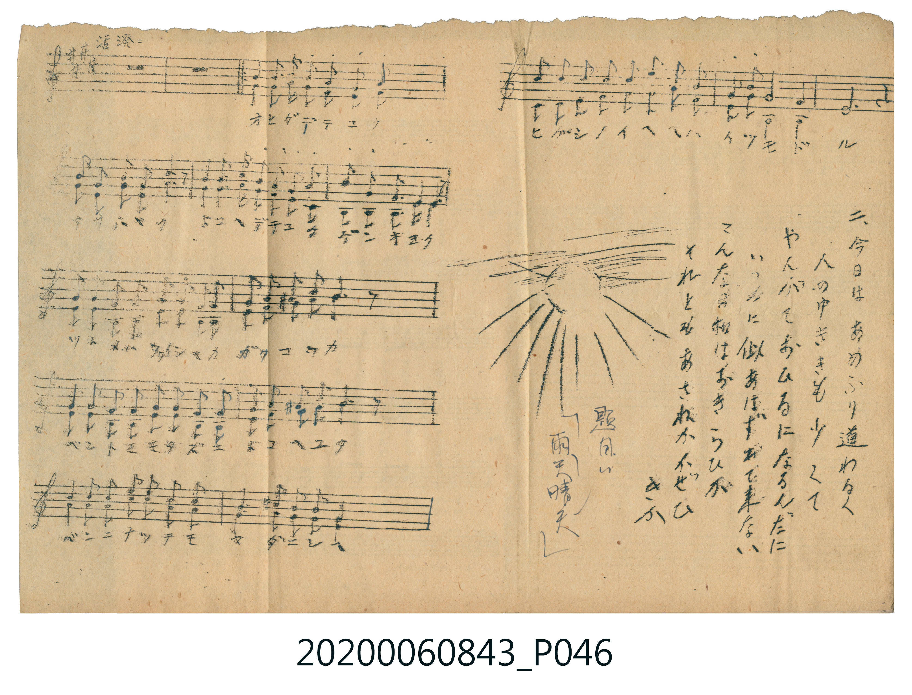

# 雨天晴天

> Re:Shōka 使用 AI 協助辨識與重建樂譜，可能會有錯誤。歡迎回報。

- **鋼琴伴奏版**：<br><audio controls src="uten_seiten.mp3"></audio>

- 詞曲作者：未在 TMD metadata 中提供

## 說明


- 調性與拍號：調號 ?= A，拍號 <2/4>，速度 != 108


## 歌詞

```text
title = 雨天晴天
?= A
!= 108
<2/4>
來源：『唱歌帖』(2020.006.0843) 第一冊 p.11 夾頁 (掃描頁 P046.jpg)
標記：左上註「活潑ニ」、下方註「題目ハ『雨天晴天』」
記譜：手抄五線譜（同譜表內含高音旋律與低音伴奏/二部）
歌詞：
一、オヒガ デテ ユク / アサ ハヤク ドコヘ デテユク ゲンキ ヨク
ツトメハ カイシャカ ガクコウカ / ベントモ モタズニ ドコヘ ユク
バンニ ナッテモ マダ ニシヘ / ヒガシノ イヘヘハ イツモ ドール
二、今日はあめふり道わるく / 人のゆききも少くて
やんがておひるになるんだに / いつもに似あはずおで来ない
そんなにお日様はおきらひか / それともあさねかおせひきか
```

## ABC

<div class="abc-score" data-abc-src="uten_seiten.abc" aria-label="五線譜載入中"></div>

[下載 ABC 原始檔](uten_seiten.abc)

## TMD 檔案連結

- [主旋律 TMD 檔案](uten_seiten.tmd) [[在 TMD Studio 編輯](https://tmdlang.github.io/Tmd-TS/#tmd=s7IKdvYPcrWy4qpTUCpJTLdSSM7PyUlNLsnMz7MqzsjPTkzOyFeCS5bl55TmploBqXgDY4RwcX5pUXJqfEFieqpVgIGJGboM3KT4vPyS1KT8_GyEioKi_LLUvMQ8oKrcxLzS4uSizIKS-OT8gkqEmtSyzJRUkIrUlMyS_KLMxBwkJ6UWFYMdC3FDSVFiHsQMoCBCFVBTemaeVWkeyKCSzLTM1BRkyZKM_PSixIKMSquMzGKQDcmJOfHZiXmJCEUlGalAn6emlCYnQozW0lJ4OXvF0yUrn83cAiQVtLS4FG0VDA0suOxtFRy5bIz0Tey4uPS1FGypBbgUFBRKMktyUhVsUawGiYPtBNJQJwBZEAcAGU_2tT3bNeH9nlmPG_qeTtn4bG3P0x3THjf0axgZGBnoGRiY6RlYmBhrKjxfs-bJjoanbV0KBXqGhgpPl-x7uaBRQeNZX_Oz_n4QExS1elkF6ZogU5-tmPlixQygqU-3L3uyo-vFit2PG3qebdn9bO_Ex83djxt6Hzc0PtnR_WzaTojUy4U9z2eve9zcD3QFsuOBDgEqBpkINO7F2jlAE591dj_ranmya8rz7bPAIh1PJ_QAGS8WrnjauvzphNUvV894OX_zs-ndT_d1v-hof7K3D8h9smfL06X9-k929bxsXvF-TyfYkWt7XqycBzQSHA47GoBuety06nHzpMdNaxQeN7c_bm4DUsseN61X0Fd43LTocdNWIL__cfMSkNDj5s7HTZsfN8-AKoWqfNy06XHz5sdNa4HCK4ACILMfN7c8bu543LwQqBuoYPXjJqAJ2x83Lwaygfw1QGUgo5qABqwGWdU8E2QESMciIAdo7_7HTbuA4YZiJ8g2iOETwKpBsl2Pm5vBTgHpm_e4uQFIdYOtmgE2F-QzMLcPaO0SoCgYgdwE5ADdCNLW-bh5z-Pm1eAw2dUDiqfdXc-mL33cuP5xY9PjpsbHjVsfN3W9bJz8uKn_cVP348Z-oNFPdu163LjucVPb48ZeEGpqerphIlDqceMysBubWh43TX7c2APkP27sety4Caxz9ePGVSAGSGoBkAtyY2PL40Zg6DQBuU_27AFZCbJ4FljX8mdzge5YBVQDNrRxLlgnkA80COTGZ8tngFUDlQKd0AmyprEbbChQJdBuYHwAjQOiqY8b1wKlwCpng5UBXd0NMpTyfAgFClr6XFyhJal5wamZQDLeM6-kKN8qLB9Ydhg61BjUVINsA2ZDLXAuVKhRMIBgrlpc2oxI0OaIaZOhGVQPsNDBlcyBboaYahqvoKtgCMRGQGwMxDVgFkgELAWCNQjTyMsaCOuQbTIB22YKtcQAZpmCGZAEYZAMwkUgFogGuwpiEAibQxwJpCBiKEbB3U1stgRJIhwLsg4Z18AdAbLJDOIQuAJ1GAFRhsMhxGZ4hCtAhiHjGnDAwVwCCTKU0AATwGCERR8WVxBXkKAmEnhKAWHUOEE4AgRhAVQDixysSYmUIopQYCBjhBq01IIMsaUVrPkKOSvC8xVQNzgsUAlQMEHCCS6E8DHEQnB4wLIAlmQC9wRIBhKEiKBHEEB1IApMQEMWSEFdhRnjuAyB53FwSgGbBk01aATUAGwmw9IDarpALT0UjEFMMIFsPY70iawcQWD4AVpUwJiIAEFyLCQm8DsXj3-RCWiIwcxDSkeYvgAmJF07BfSiXQFVzBHEV-YCAA)]
- [鋼琴伴奏 TMD 檔案](uten_seiten_piano.tmd) [[在 TMD Studio 編輯](https://tmdlang.github.io/Tmd-TS/#tmd=s7IKdvYPcrWy4qpTUCpJTLdSyC8qychPL0osyKi0ysgsLskvykxOzInPTsxLVIIrKs4vLUpOjS9ITE-1CjAwMUPIlGSk5qZapaaUJieWZObnKXFpaSm8nL3i6ZKVz2ZuAZLv93S87N7zfMKWJ3u2PF3a_7yz4_2eTgUtLS5FWwVDAwsue1sFRy4bI30TOy4ufS0FW2oBLgUFhZLMkpxUBVvC7gEpBjsESEPdBWRBXAVkPNnX9mzXhPd7Zj1u6Hs6ZeOztT1Pd0x73NCvYWRgZKBnYGCmZ2BhYqyp8HzNmic7Gp62dSkU6BkaKjxdsu_lgkYFjWd9zc_6-0FMUNDpZRWka4JMpdyPUKCgpc_FFVqSmhecmgkk4z3zSoryrcLygdHoUGNQUw2yDOgZLbBfFGoUDCCYqxaLroDMxLz8IA8kfRZwfabxCoYKRgrGQKYRkAXk6uIzxQfZFEMzuDGGIH0gaByvDTYDBEGmw9jm8fHaRnAJNAscMTyGZDTYOEMgNgIZDzYWxAKJIGyCOQNJmQnEBVAVBnA3mQFJEAbJIIwDsUA0JADABoGwOcQGIAURQzEKailIGzKugRsG0mEGMRCuQB1GQJRhMxAkjoxrwH6BGQrxBYoDwQTQZ7DgQDcQ7Cl4OIIwqqcRRoIgzOU1MN9jCWjsTkTGCDVowYoMsQUqetLATL1IiQM5uQHZMNOA3kOSQGbDPYBQbApMmQj3aBtrY6YZQ20TbVCaAUFkFaCg1TZH6EflAQMlXtsMxSJ4iEKdDpfDjDJ85oI0asOSD9AgJEtAyQCuEsQEpTVkt-JKdShmonAgRmqDYhWbY1Dth3gL1Z84EyZa9CGFB6EQQLUUEs4o4YM77RLwKDCuoVwUDqY-dPcguR4Gcccy1lSOUrqaIBeuhsCCFFKcAjGQiZABiYEZoBrABMgBMpFVgsWQFcFDAa4CKG4GZgALaGA5DXY1kkq49UBpiEEg1cZwFhaVSIaDVBjhdD1EOciJQIymE8lzEEuAYaZrp4BeMSmgijmC-MpcAA)]

## 分析

```text
================================================================================
📊 TMD Song Profile: [ 雨天晴天 ]
================================================================================
⏱  Duration:       0:30 (30.0s), 27 measures total
🎼 Key & Tempo:    首調基準 A, != 108.0 BPM, <2/4>
   - 分析範圍：      由實際發聲的音符與和弦推測調性；播放脈絡另行呈現
🎤 人聲音域:    E4 (MIDI 64) – F#5 (MIDI 78) [跨度: 14 個半音 / 1.2 個八度, 難度: moderate]
   - 最低音:  E4 in [UtenSeiten_Intro #1 @ m.3, 0:02]
   - 最高音: F#5 in [UtenSeiten_A #1 @ m.7, 0:06]
   - 適合: soprano, mezzo-soprano, tenor, baritone
🏛  結構:      UtenSeiten_Intro (2.2s) -> UtenSeiten_A (27.8s)
⚡ 編曲密度:        Peak 2 軌道同時演奏
🗝  調性診斷：       A 大調（純淨自然大調，未偵測到可信轉調）
   - 風格氣質:    純淨自然大調（陽光明朗、易唱易記，無明顯調外色彩）
   - 轉調歷程:    全曲維持單一推測調性（未偵測到可信轉調）
   - 核心骨幹音:  A, E, C#, B, F#
   - 調性數值:    A 大調 [相關度: 0.97, 穩定度: High, 自然音純度: 98.9%]
   - 候選調性 (K-S): A 大調 (0.97), E 大調 (0.73), C# 小調 (0.62)
   - 五度圈歷程:   +3 -> +3
   - 各段落調性細節:
     • [UtenSeiten_Intro #1]: ? 音樂資料不足 (r: 0.00, 自然音純度: 100.0%)
     • [UtenSeiten_A #1]: A 大調 (r: 0.97, 自然音純度: 98.9%, 調外音: C)

  [ 五度圈游移軌跡 ]
               C  
         F            G  
      Bb               D  
      Eb              [A ]*
         Ab           E  
            Db       B  
               F# 
     (* = active key center)

  [ 十二半音累積音高分佈 ]
     C  : █                          1.1%
     C# : ██████████████            15.6%
     D  : ███████                    7.2%
     D# :                            0.0%
     E  : ██████████████████████    23.9%
     F  :                            0.0%
     F# : █████████                 10.0%
     G  :                            0.0%
     G# : ████                       3.9%
     A  : ████████████████████████  26.7%
     A# :                            0.0%
     B  : ███████████               11.7%
--------------------------------------------------------------------------------
Assignment 軌道音域：
  - Vocal1        : E4 – F#5 (14 個半音 / 1.2 個八度, 76 個音符)
  - Vocal2        : E3 – D5 (22 個半音 / 1.8 個八度, 76 個音符)
================================================================================
```


## 原書掃描頁




