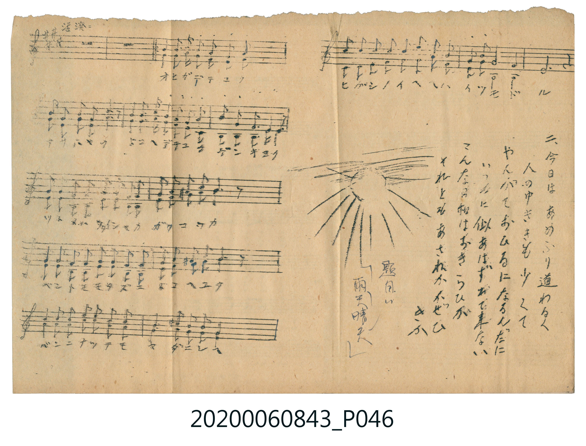

# 雨天晴天

<audio controls src="uten_seiten.mp3"></audio>

- 詞曲作者：未在 TMD metadata 中提供

## 說明

・調性與拍號：調號 ?= A，拍號 <2/4>，速度 != 108

## 歌詞

```text
title = 雨天晴天
?= A
!= 108
<2/4>
來源：『唱歌帖』(2020.006.0843) 第一冊 p.11 夾頁 (掃描頁 P046.jpg)
標記：左上註「活潑ニ」、下方註「題目ハ『雨天晴天』」
記譜：手抄五線譜（同譜表內含高音旋律與低音伴奏/二部）
歌詞：
一、オヒガ デテ ユク / アサ ハヤク ドコヘ デテユク ゲンキ ヨク
ツトメハ カイシャカ ガクコウカ / ベントモ モタズニ ドコヘ ユク
バンニ ナッテモ マダ ニシヘ / ヒガシノ イヘヘハ イツモ ドール
二、今日はあめふり道わるく / 人のゆききも少くて
やんがておひるになるんだに / いつもに似あはずおで来ない
そんなにお日様はおきらひか / それともあさねかおせひきか
```

## ABC

```abc
X:1
T:雨天晴天
M:2/4
L:1/16
Q:1/4=108
K:A
V:V1 name="Vocal1" snm="Voc"
V:V2 name="Vocal2" snm="Voc"
[V:V1]
z8 | z8 | E2 A2 B2 c2 | B2 A2 E4 |
A2 B2 c2 d2 | e4 z4 | f2 f2 e2 c2 | B2 c2 B2 E2 |
A2 A2 G3 G | A4 z4 | B2 B2 B2 B2 | c2 B2 A2 F2 |
B2 B2 ^B2 B2 | c4 z4 | c2 c2 c2 c2 | d2 c2 B4 |
A2 A2 G2 G2 | F4 z4 | E2 E2 A2 A2 | B2 c2 B4 |
A4 B2 A2 | G4 E4 | c2 c2 c2 c2 | d2 d2 d2 d2 |
c2 c2 B2 E2 | A8 | A4 z4 |
[V:V2]
z8 | z8 | A,2 A,2 A,2 A,2 | E,2 E,2 A,4 |
A2 G2 A2 B2 | c4 z4 | d2 d2 c2 A2 | E2 E2 E2 E2 |
D2 D2 E3 E | A,4 z4 | E2 E2 E2 E2 | A2 E2 F2 D2 |
F2 F2 F2 F2 | E4 z4 | A2 A2 A2 A2 | B2 A2 E4 |
C2 C2 E2 E2 | F4 z4 | C2 C2 C2 C2 | E2 E2 E4 |
F4 D2 D2 | E4 E,4 | A2 A2 A2 A2 | F2 F2 F2 F2 |
E2 E2 E2 E,2 | A,8 | A,4 z4 |
```

## TMD 檔案連結

- [主旋律 TMD 檔案](uten_seiten.tmd) [[在 TMD Studio 編輯](https://tmdlang.github.io/Tmd-TS/#tmd=s7IKdvYPcrWy4tLSUng5e8XTJSufzdwCJBW0tLgUbRUMDSy47G0VHLlsjPRN7Li49LUUbKkFuBQUFEoyS3JSFWxRrAaJg-0E0lAnAFkQBwAZT_a1Pds14f2eWY8b-p5O2fhsbc_THdMeN_RrGBkYGegZGJjpGViYGGsqPF-z5smOhqdtXQoFeoaGCk-X7Hu5oFFB41lf87P-fhAzwMDETC-rIF0TZOqzFTNfrJgBNPXp9mVPdnS9WLH7cUPPsy27n-2d-Li5-3FD7-OGxic7up9N2wmRermw5_nsdY-b-4GuQHY80CFAxSATgca9WDsHaOKzzu5nXS1Pdk15vn0WWKTj6YQeIOPFwhVPW5c_nbD65eoZL-dvfja9--m-7hcd7U_29gG5T_Zsebq0X__Jrp6XzSve7-kEO3Jtz4uV84BGgsNhRwPQTY-bVj1unvS4aY3C4-b2x81tQGrZ46b1CvoKj5sWPW7aCuT3P25eAhJ63Nz5uGnz4-YZUKVQlY-bNj1u3vy4aS1QeAVQAGT24-aWx80dj5sXAnUDFax-3AQ0Yfvj5sVANpC_BqgMZFQT0IDVIKuaZ4KMAOlYBOQA7d3_uGkXMNxQ7ATZBjF8Alg1SLbrcXMz2CkgffMeNzcAqW6wVTPA5oJ8Bub2Aa1dAhQFI5CbgBygG0HaOh8373ncvBocJrt6QPG0u-vZ9KWPG9c_bmx63NT4uHHr46aul42THzf1P27qftzYDzT6ya5djxvXPW5qe9zYC0JNTU83TARKPW5cBnZjU8vjpsmPG3uA_MeNXY8bN4F1rn7cuArEAEktAHJBbmxsedwIDJ0mIPfJnj0gK0EWzwLrWv5sLtAdq4BqwIY2zgXrBPKBBoHc-Gz5DLBqoFKgEzpB1jR2gw0FqgTaDYwPoHFANPVx41qgFFjlbLAyoKu7QYZSng-hQEFLn4srtCQ1Lzg1E0jGe-aVFOVbheUnJ-YYOtQY1ChUg6xTsDE00wLnQ4UaBQMFXRSIRYSrFpehRlQz1BGfK4ElFq48AvQwxErTeKCphkBsBMTGYDtBLJAIWApiKdw08vIVwjpkm0zAtplCLYH5tEbBDEiCMEgG4SIQC0SDXQUxCITNIY4EUhAxFKPg7iY2T4MkEY4FWYeMa-COANlkBnEIXIE6jIAow-EQYksLhCtAhiHjGnDAwVwCCTKU0AATwGCERR8WVxBXCqEmEnhKAWHUOEE4AgRhAVQDixysSYmU8o1QYCBjhBq01IKasTDTCtaMhSunGoIDA5UAhRMkoOBCCC9DbAQHCCwPYEkncF-AZCBhiAh7BAFUB6LABDRogRTUVZhRjssQeCYHJxWwadBkg0ZADcBmMixBoCYM1OJDwRjEBBPI1uNIoMjKEQSGH6BlBYyJCBAkx0JiAr9z8fgXmYCGGMw8pISE6QtgStK1U0Av-hVQxRxBfGUuAA)]
- [鋼琴伴奏 TMD 檔案](uten_seiten_piano.tmd) [[在 TMD Studio 編輯](https://tmdlang.github.io/Tmd-TS/#tmd=s7IKdvYPcrWy4tLSUng5e8XTJSufzdwCJN_v6XjZvef5hC1P9mx5urT_eWfH-z2dClpaXIq2CoYGFlz2tgqOXDZG-iZ2XFz6Wgq21AJcCgoKJZklOakKtoTdA1IMdgiQhroLyIK4Csh4sq_t2a4J7_fMetzQ93TKxmdre57umPa4oV_DyMDIQM_AwEzPwMLEWFPh-Zo1T3Y0PG3rUijQMzRUeLpk38sFjQoaz_qan_X3g5gBBiZmelkF6ZogUyn3IxQoaOlzcYWWpOYFp2YCyXjPvJKifKuw_OTEHIcagxqFapBtCjaGZlpg3yjUKBgo6KJALCJctVjMDMhMzMsP8sBhqmk8UKMhEBsBsTHYWBALJAKWImCuDy5zDWGajeO1EQYBzYSxzePjtY1w2eCINySIczPUHUjKTCBOgKqAhV6NghmQBGGQDMI4EAtEg42EGATC5hAbgBREDMUoqKUgbci4Bm4YSIcZxEC4AnUYAVGGzUCQODKuAfsFZijEFygOBBNAn8GCA91AsKfg4QjCqJ5GGAmCMJfXwHyPJaCxOxEZI9SgBStqqsYMVPS0gT9FIyc4IBtmHNB_SBLIbLgPEIpNgWkT4SBtY23MRGOobaINSjQgiKwCFLba5gj9qDxgqMRrm6FYBA9SqNPhcphxhs9ckEZtWPoBGoRkCSgdwFWCmKDEhuxWXMkOxUwUDsRIbVC0YnMMqv0Qb6H6E2fKRIs-pPAgFAKolkLCGSV8cCdeAh4FxjWUi8LB1IfuHiTXwyDuWMaazAkXsIbwIhW5eAWyMIpCJDm4DrggImWbwKXhkrhMRlKL31B4OGM1Ba7eDEkQXjkAawq4oDEuk7EGB9wIZMch7DDGKkqUyTg8gjDFiORYQTYeEaxAFkFbcUQspoeAKUzXTgG9JldAFXME8ZW5AA)]

## 分析

```text
================================================================================
📊 TMD Song Profile: [ 雨天晴天 ]
================================================================================
⏱  Duration:       0:30 (30.0s), 27 measures total
🎼 Key & Tempo:    首調基準 A, != 108.0 BPM, <2/4>
   - 分析範圍：      由實際發聲的音符與和弦推測調性；播放脈絡另行呈現
🎤 人聲音域:    E4 (MIDI 64) – F#5 (MIDI 78) [跨度: 14 個半音 / 1.2 個八度, 難度: moderate]
   - 最低音:  E4 in [UtenSeiten_Intro #1 @ m.3, 0:02]
   - 最高音: F#5 in [UtenSeiten_A #1 @ m.7, 0:06]
   - 適合: soprano, mezzo-soprano, tenor, baritone
🏛  結構:      UtenSeiten_Intro (2.2s) -> UtenSeiten_A (27.8s)
⚡ 編曲密度:        Peak 2 軌道同時演奏
🗝  調性診斷：       A 大調（純淨自然大調，未偵測到可信轉調）
   - 風格氣質:    純淨自然大調（陽光明朗、易唱易記，無明顯調外色彩）
   - 轉調歷程:    全曲維持單一推測調性（未偵測到可信轉調）
   - 核心骨幹音:  A, E, C#, B, F#
   - 調性數值:    A 大調 [相關度: 0.97, 穩定度: High, 自然音純度: 98.9%]
   - 候選調性 (K-S): A 大調 (0.97), E 大調 (0.73), C# 小調 (0.62)
   - 五度圈歷程:   +3 -> +3
   - 各段落調性細節:
     • [UtenSeiten_Intro #1]: ? 音樂資料不足 (r: 0.00, 自然音純度: 100.0%)
     • [UtenSeiten_A #1]: A 大調 (r: 0.97, 自然音純度: 98.9%, 調外音: C)

  [ 五度圈游移軌跡 ]
               C  
         F            G  
      Bb               D  
      Eb              [A ]*
         Ab           E  
            Db       B  
               F# 
     (* = active key center)

  [ 十二半音累積音高分佈 ]
     C  : █                          1.1%
     C# : ██████████████            15.6%
     D  : ███████                    7.2%
     D# :                            0.0%
     E  : ██████████████████████    23.9%
     F  :                            0.0%
     F# : █████████                 10.0%
     G  :                            0.0%
     G# : ████                       3.9%
     A  : ████████████████████████  26.7%
     A# :                            0.0%
     B  : ███████████               11.7%
--------------------------------------------------------------------------------
Assignment 軌道音域：
  - Vocal1        : E4 – F#5 (14 個半音 / 1.2 個八度, 76 個音符)
  - Vocal2        : E3 – D5 (22 個半音 / 1.8 個八度, 76 個音符)
================================================================================
```


## 原書掃描頁




