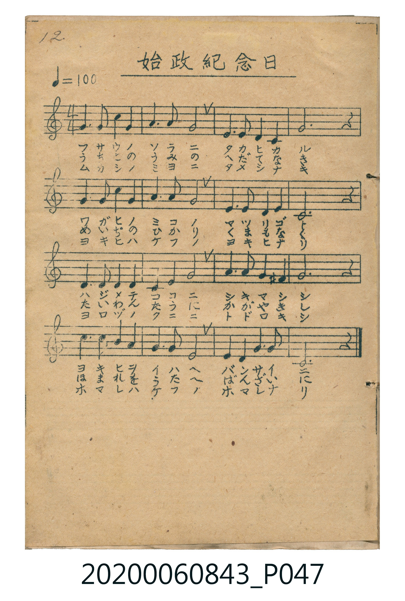

# 始政紀念日

<audio controls src="shisei_kinembi.mp3"></audio>

- 詞曲作者：未在 TMD metadata 中提供

## 說明

・調性與拍號：調號 ?= C，拍號 <4/4>，速度 != 100

## 跨冊／重複收錄參照

> 同曲（6月17日臺灣始政紀念日唱歌；收錄於《新定兒童唱歌》卷首及《唱歌帖》P047 五線譜版、P125 五線譜與簡譜對照版）

- **[同曲]** 《新定兒童唱歌》尋常科第一學年用（2020.006.0847.0001）：[**〈始政記念日〉**](../../../shintei_jido_shoka/grade_1_2020.006.0847.0001/0_07_shisei_kinenbi/index.md)（`C` / `4/4` — [原始 TMD](../../../shintei_jido_shoka/grade_1_2020.006.0847.0001/0_07_shisei_kinenbi/shisei_kinenbi.tmd)）
- **[同曲]** 楊金土手抄《唱歌帖》第 1 冊（2020.006.0843）：[**〈始政紀念日〉**](../../vol_01/p125_shisei_kinenbi/index.md)（`C` / `4/4` — [原始 TMD](../../vol_01/p125_shisei_kinenbi/shisei_kinenbi.tmd)）
- 總表：[跨冊重複與同名歌曲總索引](../../../duplicate_songs.md)

## 歌詞

```text
title = 始政紀念日
?= C
!= 100
<4/4>
來源：『唱歌帖』(2020.006.0843) 第一冊 p.12 (掃描頁 P047.jpg)
記譜：手抄五線譜（共16小節，譜下附三段歌詞）
歌詞：
(1) フサウノ ソラニ タカヒカル / ワガヒノミコノ マツリゴト
ハジメテ ココニ シキマシシ / ヨキヒヲ イハヘ バンザイニ
(2) うちとの うみの へだてなき / めぐみの つゆに うるほひて
たいわん たけに かがやきし / ほまれを うたへ ばんざいに
(3) ムカシノ エゾニ タメシナキ / ヨキトノ フリノ キモナビク
ヨロヅノ クニニ トドロキシ / ホマレハ ケフノ ホマレナリ
```

## ABC

```abc
X:1
T:始政紀念日
M:4/4
L:1/16
Q:1/4=100
K:C
V:V1 name="Vocal" snm="Voc"
[V:V1]
E6 F2 G4 G4 | A6 A2 G8 | E6 D2 C4 C4 | D12 z4 |
E6 F2 G4 G4 | A6 G2 E8 | D6 E2 D4 C4 | G,12 z4 |
D6 D2 E4 G4 | E4 G4 A8 | G6 A2 E4 ^D4 | E12 z4 |
A6 A2 G4 E4 | D6 D2 E8 | D4 E4 G6 G2 | C12 z4 |
```

## TMD 檔案連結

- [主旋律 TMD 檔案](shisei_kinembi.tmd) [[在 TMD Studio 編輯](https://tmdlang.github.io/Tmd-TS/#tmd=s7IKdvYPcrWy4tLSUni6vPvZlP3PtzQ83b_12fSlClpaXIq2CoYGBlz2tgrOXDYm-iZ2XFz6Wgq21AJcCgoKJZklOakKtui2g6TA1gJpqCuALIgbgIwn-9qe7Zrwfs-sxw19T6dsfLa25-mOaY8b-jWMDIwM9AwMzPQMLEyMNRWer1nzZEfD07YuhQI9QyMFjWd9zc_6-18uaFQIMDAx18sqSNcEGfdixYwXa-cAjXvW2f2sq-XJrinPt88Ci3Q8bd1oaPZ0Q__z9Q3v9_QAxZ7s6H45s-XJjs5n67YC7X2xct77PZ0gQ2CcWSCOhqGmwuPmqY-btj5uWva4uU_hcdPex80rHzd3A1n7Hzetftw8CUyuVtAHKlz_uGkNSKS573Hz_MdNm8E6muc9bm553LzqcdOWx80dIFMfN_c_btrxuHnh4-Y2oDmbwSpBJm5_3LQWpB7E2A42cQVYBGjiJqD0EpDG5hlA4QmPm4G6toGFusEONQI6tLHtcePCx40rHjeug3D2Q1g7HjcueNy47HHjqseNvSBjmxofN06ASy953ARUuxqspan7cePux42bgMrBLm2c_7ix5XET0L2TIZyJEJVAZT2Pm1qA5j1unA4yEqRr3-MmoOAkiN1AtTuArA1AnY8bp4FMaVwNdikwPh83LwCFGtCb4CAFenIfLEiBgQIS7gL6GykAOiAhORUUjGAtQLFFIFXNkx83rYeE6YrHzUDRVoj8eqB5YCNBWjtBMkAt0DCdDY4SYET1AxVuBJsKMhwuDDR1FchIynMGFCho6XNxBWdkFqdmemfmpeYmZVqF5Scn5jjUGNQoVIOsUrAxNNMCZwkFYM4EOgnosq1AvAzIBic6IL0SiMFhBMTAKGgGhjOYXg0yHqSzRsFYQRcOTYDYFMqG0TUKZkgqQGyYDAyimmEExIZQNoyuAYtigwYwFQh_rAe6cQ3EreAwng9K7lD2PCBuAeJVQLEtoIgi1x8gUWQdmK4EycL4CH-YxhPvEVBSASbn5oVADM6zUI-Acy0oPUI8BGZvR3gE2REgNsyZCI-giyB7DOpMJB5IFqbDSB3DECI8sgLqWFCMgMsUiOcgpQoQgzy2DSrejfAIrnQDsxm3VxEegalA9zKMXQOPG9z-qOXi0rVTQMlLCkABZS4A)]
- [鋼琴伴奏 TMD 檔案](shisei_kinembi_piano.tmd) [[在 TMD Studio 編輯](https://tmdlang.github.io/Tmd-TS/#tmd=s7IKdvYPcrWy4tLSUni6vPvZlP3PtzQ83b_12fSl7_d0vOze83zClid7tjxd2v-8s-P9nk4FLS0uRVsFQwMDLntbBWcuGxN9EzsuLn0tBVtqAS4FBYWSzJKcVAVbopwEUg92C5CGOg3IgjgMyHiyr-3Zrgnv98x63ND3dMrGZ2t7nu6Y9rihX8PIwMhAz8DATM_AwsRYU-H5mjVPdjQ8betSKNAzNFLQeNbX_Ky__-WCRoUAAxNzvayCdE2QcZT7DwoUtPS5uIIzMotTM70z81JzkzKtwvKTE3McagxqFKpBVinYGJppgf2gUKNgrKALhyZAbAplw-gaBTMkFSA2TAYGUc0wAmJDKBtG14BFsUEDmAqyXAMSRdaBaRdIFsZHuMY0nkjnIBsFYsMsQzgHXQTZeVDLkHggWZgOI3UMQwg5B1dMwPTjdjDCOTAV6A6HsWvg4YTbNbXoCSwgMzEvP8gDRxIz1IZZZqgNilQIy1gbZjUyG6TaRBvmUVQ2QhXCOwizTeO1zeO1Yd4D8mD-MEMwQVGPpgonDz3wKfEFiioMPwAdiOQEmDySqIk6hheQnYyFje54fB5FOAkkiOIHhI9R_YmZylG0IisBRQTcHJBHQP5CJH2IU1DjEDsPMz4IpxOEzcQGAcJHSOGPI4TQggvFp7g5hLKRD85sBItcTIYxjFGjYAJjmsRjKDOFCyGZhhCEC5khqUNIG2HqwIgT0pyIqQrZZiz2wYWMcLgQSQvurIDH51hDCO50hOsQgQtK-pjyCDEgC6HUGJswQhDdqQhbsEQmnEHAS6hBipDG1IIUaCDfYzMT06XARKxrp4CSjhWAAspcAA)]

## 分析

```text
================================================================================
📊 TMD Song Profile: [ 始政紀念日 ]
================================================================================
⏱  Duration:       0:38 (38.4s), 16 measures total
🎼 Key & Tempo:    首調基準 C, != 100.0 BPM, <4/4>
   - 分析範圍：      由實際發聲的音符與和弦推測調性；播放脈絡另行呈現
🎤 人聲音域:    G3 (MIDI 55) – A4 (MIDI 69) [跨度: 14 個半音 / 1.2 個八度, 難度: moderate]
   - 最低音:  G3 in [ShiseiKinembi #1 @ m.8, 0:16]
   - 最高音: A4 in [ShiseiKinembi #1 @ m.2, 0:02]
   - 適合: mezzo-soprano, contralto, tenor, baritone, bass
🏛  結構:      ShiseiKinembi (38.4s)
⚡ 編曲密度:        Peak 1 軌道同時演奏
🗝  調性診斷：       E 小調（純淨自然小調，未偵測到可信轉調）
   - 風格氣質:    純淨自然小調（陰鬱抒情、旋律集中，無明顯調外色彩）
   - 轉調歷程:    全曲維持單一推測調性（未偵測到可信轉調）
   - 核心骨幹音:  E, G, D, A, C
   - 調性數值:    E 小調 [相關度: 0.76, 穩定度: Moderate, 自然音純度: 96.7%]
   - 候選調性 (K-S): E 小調 (0.76), G 大調 (0.73), C 大調 (0.64)
   - 五度圈歷程:   +4
   - 各段落調性細節:
     • [ShiseiKinembi #1]: E 小調 (r: 0.76, 自然音純度: 96.7%, 調外音: D#, F)

  [ 五度圈游移軌跡 ]
               C  
         F            G  
      Bb               D  
      Eb               A  
         Ab          [E ]*
            Db       B  
               F# 
     (* = active key center)

  [ 十二半音累積音高分佈 ]
     C  : ████████                  10.0%
     C# :                            0.0%
     D  : ████████████████          18.3%
     D# : █                          1.7%
     E  : ████████████████████████  28.3%
     F  : █                          1.7%
     F# :                            0.0%
     G  : ███████████████████████   26.7%
     G# :                            0.0%
     A  : ███████████               13.3%
     A# :                            0.0%
     B  :                            0.0%
--------------------------------------------------------------------------------
Assignment 軌道音域：
  - Vocal         : G3 – A4 (14 個半音 / 1.2 個八度, 48 個音符)
================================================================================
```


## 原書掃描頁




