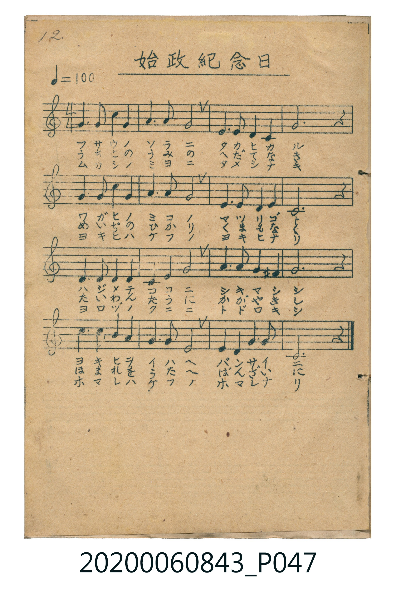

# 始政紀念日

> Re:Shōka 使用 AI 協助辨識與重建樂譜，可能會有錯誤。歡迎回報。

- **鋼琴伴奏版**：<br><audio controls src="shisei_kinembi.mp3"></audio>

- 曲：宮島慎三郎
- 出處：《唱歌帖》（2020.006.0843）第 3 冊 P047.jpg（頁頂標「12.」）

## 說明

> [!NOTE]
> **原件資訊與抄本考證**（對應《唱歌帖》第 3 冊 `P047.jpg`，頁頂編號 `12.`）：
> - **曲名**：始政紀念日
> - **調性與拍號**：ハ長調四分之四拍子（C 大調 4/4 拍，無升降記號 `?= C`），速度 `♩ = 100`
> - **作曲**：臺灣總督府國語學校助教授 宮島（一條）慎三郎
> - **版本與抄本比對**：
>   1. 楊金土手抄五線譜全 16 小節之音高與節奏，與大正 12 年（1923）一條慎三郎編《新編 小學校・公學校 唱歌教材集》尋常科三・四學年用（`P183.jpg`）完全一致：第 4 小節句尾記於第二線 `5`（G4，異於《唱歌帖》第 1 冊印刷單張 `P125.jpg` 之低八度 `5_` = G3）；第 7 小節記作 `3 - - 3 2 - 3 -`（末拍為第一線 E4 = `3`）；第 11 小節第 4 拍明確標註升記號 `#4`（`4'` = F♯4）；第 15 小節末八分音符亦記於第二線 `5`（G4，異於 `P125.jpg` 之 `5_`）。
>   2. 第 2、6、10、14 小節末小節線上方均抄有換氣記號 `∨`。
>   3. 譜下三段歌詞採「片假名（第 1 節）／平假名（第 2 節）／片假名（第 3 節）」三行並列抄寫，第 2 節第 5 小節明確標有濁點作「め い ぢ の」，歷史假名遣完整保留。
>
> **一、**
> フサウノソラニタカヒカル
> ワガヒノミコノマツリゴト
> ハジメテココニシキマシシ
> ヨキヒヲイハヘバンザイニ
>
> **二、**
> うちとのうみのへだてなき
> めいぢのひかりくまもなく
> たいわんたうにかがやきし
> ほまれをうたへばんざいに
>
> **三、**
> ムカシノミヨニタメシナキ
> ヨキヒハケフノヨキヒナリ
> ヨロヅノクニニトドロキシ
> ホマレハケフノホマレナリ


## 歌詞

```text
（TMD 檔案未包含歌詞註解）
```

## ABC

<div class="abc-score" data-abc-src="shisei_kinembi.abc" aria-label="五線譜載入中"></div>

[下載 ABC 原始檔](shisei_kinembi.abc)

## TMD 檔案連結

- [主旋律 TMD 檔案](shisei_kinembi.tmd) [[在 TMD Studio 編輯](https://tmdlang.github.io/Tmd-TS/#tmd=s7IKdvYPcrWy4qpTUCpJTLdSSM7PyUlNLsnMz7MqzsjPTkzOyFeCS5bl55TmploBqXgDY4RwcX5pUXJqfEFieqpVgIGJOboM3KT4vPyS1KT8_GyEioKi_LLUvMQ8oKrcxLzS4uSizIKS-OT8gkqEmtSyzJRUkIri5MS8-LLUosy0zNQUJGelFhWDHQxxR0lRYh7EHKAgQlV-UUlGfnpRYkFGpVVGZnFJflFmcmJOfHZiXiJCUUlGKtCDmbkFQEsSc9DF01KLSzLLMMWTU4tSc_PzUHQAjU_PzLMqScwsBzo6Py0tMxksr6Wl8HR597Mp-59vaXi6f-uz6UsVtLS4FG0VDA0MuOxtFZy5bEz0TexA5jybven9nllP1617unnbs9a-Jzs6Xzb3gW142r7rxcypQMnHDV1Pp2x8trbn6Y5pjxu63-_pMDIwMtAzMDDTM7AwMX6_p_P5mjUKxgpP27oUQFGjl1WQDlT0ckHjywVNz1bMfNzQY2ik97ihF6hSiYtLX0vBllqAS0FBwU4hWtHPP8Q1FsLR0nraN__J7m0vNre_WNH1oqP9WVfLszlrXjQ0v1jbqaUFdNjTDb3P2jvRfIXwQgLMDwnv9_RAPPF8-4oXM-crJAC9ARTsBIYJxC5doG3AAHw6oRdk8Cy0MEeoebFq_7OG5SC3dPcCDQIrftzc_3LqdqDM09mzn3a0PdnZDWQA5Z-unQB0o7PC0yXLgZIKwHhSAIoCnfK8ZeHT3vaXM3tfrJgBdg0oIiHO6XnZMP_prmUKCY9mrlQAx3ICwvIne-cA3Qi280X7rueNi5_v2Pt87uKnu-Y8ndP9YtW8p2t3PFuw8GnXymdTZz7r61CApAWgG57saHi2aC7QAni6QBj6vLMDFKiw0H22fgowVMF2QNQoKBjqKTxb2vWyfeLTOfOfdXYD1T3ZNeX59lkv1s552rpCwdBM4emG_ufrG4Aefzl_88vVM4CGAblPl_YD_QNkA_3_bO1iBUMjhac7twBdY2hpBEpqEEfBXQSMGWBEPpu2AcgAGQjxzOPm3U9b10DYCpBYBnlu7oSXs9uAcf10Q_fTHTueL58INAOkFBgBa3cAbXk-ZQXQooQAQwtjaPx3Pl3XA3Qt0NIX7UBHzAKlEhOow5_2L326YR8wMp5N2wMUf7KrB-g7hQRToLYOdxNQhE3dAJTCks4MQensae-Gpx3bn05b93TPVmCaMzQyBdupAAyPJ3v7nrauBkeoaXwCMELdQT5_v2c2SLM51HqgxcCYVUgwBsaHLjDpGoFJXZDtz-asBiaZ5027QM7a0QBylqsJ0JgEY0hyAZtjCHQF2CCIn4Aans3oe75oFzDDvlixG5jSYMlM2QRkZoKJOsglbo9mrgf6DW6IKdQQoJUgJ3e0AePy-ZplT3YtIxgwaJ4G-xVo8uOGJlgSMtJTAFli9Lih0QyIDQ1ABCz4QTZC3L991pMdwCSw8-lcSGrsfNY_-9mGxTD3P-pYkYBkqLGeAjAJPtnRDYz8Z-u2AiPmxcp5z_oWAkup553tTxvbgbkZ6FBIPAGNB3u2_-nOzShSRggpdF3GUClggQe04sXCnic7lj3tmA502tP1q0G-h2kHMeDhBwt7kPP3N77cPQ8YuUAnPW5qVHjc2ALEi4B4HbgQ7Xm2dvvT_k0QS182Lgam0WdTtzzZP_f5VGBZC_EorCwERj8w0ICFP5j_uHnq46atj5uWPW7ue9y093HzysfN3Y-b9j9uWv24eRKYXA1Tuf5x0xqQIFBl8_zHTZvBjHmPm1seN6963LTlcXMHTGX_46Ydj5uBma4NpAykEmjm9sdNa0HqQYztMJUrwIJAMzc9bloC0tg843HzhMfNQF3bwCLdqI7f1YPs-Ma2x40LHzeuAIUDiL0fzNjxuHHB48ZljxtXPW7shapsagSGGTDIwAo2PW4EuqfrcWP_48Z9j5uawCr7YWbOB6lsAnphMpgNNHY1SH0jMOSBJvQ-bpwOU7kbrB0oPgmsDKgYaPUGsMZpYOsgQYcIeWAKQAr5BaDgBYYGJDyBQQEJeWC4gQS7gCGDEUpAV20ERRlIC1ywCxj-CJXNQMFWcGyuBxkIQh2Pm4Gl2lqQekTIzwbHHTBCkc2EC8LMpLxChgIFLX0urmBgCyg10zszLzU3KdMqIDMxL9-hxqCmGmSTgo2FFjioFLA1B0DZHlTmLuxR0IDldx1420ITiwagfSDDaoAZClQcmioYxoEpXaCQGVjIDCoFEkEuMw3BIjA5EDQAiYCN8zGsAeUZsCgw4wDxMhCruQ-sB5iDIDLNK4G4G246MFqhOlYDxSdBWWCZZhCNxR4joFxjG0RX40IgXgFmrYPogsvsh4pB7WncARVfAMRglzWugsr0YrfHGOSGBQjXNW1H9k_zfKh_VmD3TzPQZVAdXVCZtRj24I_UXT10iVQQuwYctbgidT00ENbAogg9EJo2Q8WggdA8DxoIwMK4GRTMwEIQKtOB3R5QpAKLb0gUQYpw5EjdBJXpBqoCBScsUvuh4vuA4k1gFixSITLYIxWUYEBuWgv3D0g1yAUboe6eiuYfTB3QSAX7jpRIBddyJEcqKJ50gSSIBmFIfIFiDhGnyLFsog4WwpdToUHXtAOcVkFeAuUcUCBsBouDSZSUDUrNsEAARTBEBCGDNVIboUkEFKlNIDuBlQBEF1gGkl-B9QHCHmAkQ3T0ANW2gFm9UJnp2O1BjtRmkOtawSxYyQNKvhCfoPgHmhSBNQBYF8RnuPyDN1KBjWJyIhWcQ4GFahywnQqKOESMmUIzKCyrgqIcJoM_q2ImVFDWAflpCdS3_UA8AykUJoBFIXG-Dap7CVgGFlbYYnU3RCU44_WA9YBsQy5_58PLXIj4BrAqUNwD2wBQNS1gGRzlPDhWZ0NdPQ-I10Ddjz-rgnRA0ydYBySzYs-qtVxcunYKKHVvtI9hrAKmoBE2QWOwoDIXAA)]
- [鋼琴伴奏 TMD 檔案](shisei_kinembi_piano.tmd) [[在 TMD Studio 編輯](https://tmdlang.github.io/Tmd-TS/#tmd=s7IKdvYPcrWy4qpTUCpJTLdSyC8qychPL0osyKi0ysgsLskvykxOzInPTsxLVIIrKs4vLUpOjS9ITE-1CjAwMUfIlGSk5qZapaaUJieWZObnKXFpaSk8Xd79bMr-51sanu7f-mz60vd7Ol5273k-YcuTPVueLu1_3tnxfk-ngpYWl6KtgqGBAZe9rYIzl42JvokdyNRnsze93zPr6bp1Tzdve9ba92RH58vmPrB9T9t3vZg5FSj5uKHr6ZSNz9b2PN0x7XFDN9B8IwMjAz0DAzM9AwsTY6Dpz9esUTBWeNrWpQByrV5WQTrIEQsaXy5oerZi5uOGHkMjvccNvUCVSlxcwUBvp2Z6Z-al5iZlWgVkJublB3k41BjUVHMpAIGNhZYdmKGvpWCLDhSANj3Z0fBiYY-ChonC0w39z9c36MAt1cSiQUsfbFiNgqmCLhCaKhjGgSldoJAZWMgMKgUSMQbTxgpGQNIQLAKTA0EDkAjYOB_DGoXHzVPBoo-btgLxMhCruQ-s53HTXohM80og7oab_rhpP1THaqD4JCgLLNMMorHYYwSUa2yD6GpcCMQrwKx1EF1wmf1QMag9jTug4guAGOyyxlVQmV7s9hiD3LAA4bqm7cj-aZ4P9c8K7P5pBroMqqMLKrMWwx78kbqrhy6RCmLXgKMWV6SuhwbCGlgUoQdC02aoGDQQmudBA6EFiEHB_LhpC1SmA7s9oEhtaoToagTqalwEZsEidRNUphuoChScsEjth4rvA4o3gVmwSIXIYI9UUIIBuWkt3D8g1SAXbIS6eyqafzB1QCMV7DtSInVHJzmRCoonXSAJokEYEl-gmEPEKXIsm6iDhfDlVGjQNe0Ap1WQl0A5BxQIm8HiYBIlZYNSMywQQBEMEUHIYI3URmgSAUVqE8jOx02TIbrAMpD8-rgRltdB4hA7Hzf2ANW2gFm9UJnp2O1BjtRmkOtawSxYyQNKvhCfoPgHmhQfN3eCdUF8hss_eCP16ezZ5EQqOIcCC9U4BXMgBYo-RO6FZFBYVgVFOUwGf1bFTKigrAPy0xKob_uBeAZSKEwAi0LifBtU9xKwDCyssMXqbohKcMbrAesB2YZc_s6Hl7kQ8Q1gVaC4f9w4DaqmBSyDo5wHx-psqKvnAfEaqPvxZ1WQDmj6BOuAZFbsWbUWa9Xrg1z1miCq3hd9XS_be5-27ng5u_XJzm5grD_r7n26dsLTloane_qBjYGXDZuA6QDYfIA0M5BiOl4h2jBWwRhC1SiYABkmsTBhuLxpPEwAzDKNhwgZQEOEDHOgAoYopqAYDmZgmmwEZBjlxkJoc8JOAssCnYJkJZITsFsGcxUwFnTtFFAiItoHKI8paIRN0BgsqMwFAA)]

## 分析

```text
================================================================================
📊 TMD Song Profile: [ 始政紀念日 ]
================================================================================
⏱  Duration:       1:55 (115.2s), 48 measures total
🎼 Key & Tempo:    首調基準 C, != 100.0 BPM, <4/4>
   - 分析範圍：      由實際發聲的音符與和弦推測調性；播放脈絡另行呈現
🎤 人聲音域:    C4 (MIDI 60) – C5 (MIDI 72) [跨度: 12 個半音 / 1.0 個八度, 難度: easy]
   - 最低音:  C4 in [ShiseiKinembi[L1] #1 @ m.3, 0:06]
   - 最高音: C5 in [ShiseiKinembi[L1] #1 @ m.1, 0:01]
   - 適合: soprano, mezzo-soprano, contralto, tenor, baritone, bass
🏛  結構:      ShiseiKinembi[L1] (38.4s) -> ShiseiKinembi[L2] (38.4s) -> ShiseiKinembi[L3] (38.4s)
⚡ 編曲密度:        Peak 1 軌道同時演奏
🗝  調性診斷：       G 大調（純淨自然大調，未偵測到可信轉調）
   - 風格氣質:    純淨自然大調（陽光明朗、易唱易記，無明顯調外色彩）
   - 轉調歷程:    全曲維持單一推測調性（未偵測到可信轉調）
   - 核心骨幹音:  G, C, E, D, A
   - 調性數值:    G 大調 [相關度: 0.85, 穩定度: Moderate, 自然音純度: 100.0%]
   - 候選調性 (K-S): G 大調 (0.85), C 大調 (0.79), E 小調 (0.66)
   - 五度圈歷程:   +1 -> +1 -> +1
   - 各段落調性細節:
     • [ShiseiKinembi[L1] #1]: G 大調 (r: 0.85, 自然音純度: 100.0%)
     • [ShiseiKinembi[L2] #1]: G 大調 (r: 0.85, 自然音純度: 100.0%)
     • [ShiseiKinembi[L3] #1]: G 大調 (r: 0.85, 自然音純度: 100.0%)

  [ 五度圈游移軌跡 ]
               C  
         F           [G ]*
      Bb               D  
      Eb               A  
         Ab           E  
            Db       B  
               F# 
     (* = active key center)

  [ 十二半音累積音高分佈 ]
     C  : █████████████             20.0%
     C# :                            0.0%
     D  : ███████                   11.7%
     D# :                            0.0%
     E  : █████████                 15.0%
     F  :                            0.0%
     F# : █                          1.7%
     G  : ████████████████████████  38.3%
     G# :                            0.0%
     A  : ███████                   11.7%
     A# :                            0.0%
     B  : █                          1.7%
--------------------------------------------------------------------------------
Assignment 軌道音域：
  - Piano         : C4 – C5 (12 個半音 / 1.0 個八度, 144 個音符)
================================================================================
```


## 原書掃描頁




