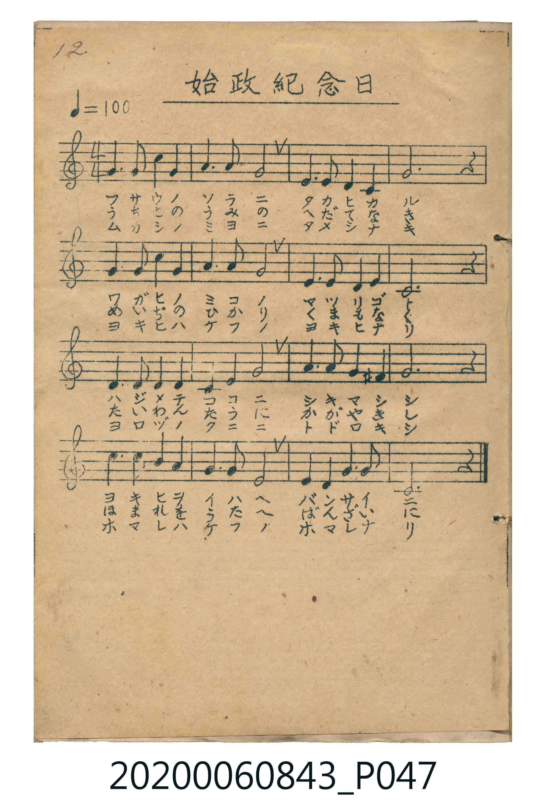

# 始政紀念日

> Re:Shōka 使用 AI 協助辨識與重建樂譜，可能會有錯誤。歡迎回報。

- **鋼琴伴奏版**：<br><audio controls src="shisei_kinembi.mp3"></audio>

- 詞曲作者：未在 TMD metadata 中提供

## 說明


- 調性與拍號：調號 ?= C，拍號 <4/4>，速度 != 100


## 歌詞

```text
title = 始政紀念日
?= C
!= 100
<4/4>
來源：『唱歌帖』(2020.006.0843) 第一冊 p.12 (掃描頁 P047.jpg)
記譜：手抄五線譜（共16小節，譜下附三段歌詞）
歌詞：
(1) フサウノ ソラニ タカヒカル / ワガヒノミコノ マツリゴト
ハジメテ ココニ シキマシシ / ヨキヒヲ イハヘ バンザイニ
(2) うちとの うみの へだてなき / めぐみの つゆに うるほひて
たいわん たけに かがやきし / ほまれを うたへ ばんざいに
(3) ムカシノ エゾニ タメシナキ / ヨキトノ フリノ キモナビク
ヨロヅノ クニニ トドロキシ / ホマレハ ケフノ ホマレナリ
```

## ABC

<div class="abc-score" data-abc-src="shisei_kinembi.abc" aria-label="五線譜載入中"></div>

[下載 ABC 原始檔](shisei_kinembi.abc)

## TMD 檔案連結

- [主旋律 TMD 檔案](shisei_kinembi.tmd) [[在 TMD Studio 編輯](https://tmdlang.github.io/Tmd-TS/#tmd=s7IKdvYPcrWy4qpTUCpJTLdSSM7PyUlNLsnMz7MqzsjPTkzOyFeCS5bl55TmploBqXgDY4RwcX5pUXJqfEFieqpVgIGJOboM3KT4vPyS1KT8_GyEioKi_LLUvMQ8oKrcxLzS4uSizIKS-OT8gkqEmtSyzJRUkIrUlMyS_KLMxBwkJ6UWFYMdC3FDSVFiHsQMoCBCVUlGKtDdmbkFqai6IeJpqcUlmWWY4smpRam5-XkoOoDWp2fmWZUkZpYn5sXnp6VlJoPltbQUni7vfjZl__MtDU_3b302famClhaXoq2CoYEBl72tgjOXjYm-iR0Xl76Wgi21AJeCgkJJZklOqoItuu0gKbC1QBrqCiAL4gYg48m-tme7JrzfM-txQ9_TKRufre15umPa44Z-DSMDIwM9AwMzPQMLE2NNhedr1jzZ0fC0rUuhQM_QSEHjWV_zs_7-lwsaFUARrZdVkK4JMu7Fihkv1s4BGvess_tZV8uTXVOeb58FFul42rrR0Ozphv7n6xve7-kBij3Z0f1yZsuTHZ3P1m0F2vti5bz3ezpBhsA4s0AcDUNNhcfNUx83bX3ctOxxc5_C46a9j5tXPm7uBrL2P25a_bh5EphcraAPVLj-cdMakEhz3-Pm-Y-bNoN1NM973NzyuHnV46Ytj5s7QKY-bu5_3LTjcfPCx81tQHM2g1WCTNz-uGktSD2IsR1s4gqwCNDETUDpJSCNzTOAwhMeNwN1bQMLdYMdagR0aGPb48aFjxtXPG5cB-Hsh7B2PG5c8Lhx2ePGVY8be0HGNjU-bpwAl17yuAmodjVYS1P348bdjxs3AZWDXdo4_3Fjy-MmoHsnQzgTISqBynoeN7UAzXvcOB1kJEjXvsdNQMFJELuBancAWRuAOh83TgOZ0rga7FJgfD5uXgAKNaA3wUEK9OQ-WJACAwUk3AX0N1IAdEBCciooGMFagGKLQKqaJz9uWg8J0xWPm4GirRD59UDzwEaCtHaCZIBaoGE6GxwlwIjqByrcCDYVZDhcGGjqKpCRlOcMKFDQ0ufiCs7ILE7N9M7MS81NyrQKy09OzHGoMaipBtmkYGOhBc4QCsB8CXQQ0F1bgXgZkA1OckB6JRCDQwiIgRHQDAxlML0aZDhIZ42CsYIuEJoomAJJEK5RMAOLmIF5IAhTY6RgCCRBuAbIhsiBoAFIBOGO9UA71kDsAofQfFBihbLnAXELEK8Cim0BBTNhd5hCZRC2GoNpiDtM43E7BBRRwMTUvBCIwTkG6hBwngGlBoiDwOztCIdALDECWwtxCIwFcRDYWmgQgWSM1JHCCKtDVkAtA4UIOEdCHAfJk0AMctg2qHg3wiHI8QAyHdVpiBCBOQ9E1oDDBdUdtVxcunYKKClJASigzAUA)]
- [鋼琴伴奏 TMD 檔案](shisei_kinembi_piano.tmd) [[在 TMD Studio 編輯](https://tmdlang.github.io/Tmd-TS/#tmd=s7IKdvYPcrWy4tLSUni6vPvZlP3PtzQ83b_12fSl7_d0vOze83zClid7tjxd2v-8s-P9nk4FLS0uRVsFQwMDLntbBWcuGxN9EzsuLn0tBVtqAS4FBYWSzJKcVAVbopwEUg92C5CGOg3IgjgMyHiyr-3Zrgnv98x63ND3dMrGZ2t7nu6Y9rihX8PIwMhAz8DATM_AwsRYU-H5mjVPdjQ8betSKNAzNFLQeNbX_Ky__-WCRoUAAxNzvayCdE2QcZT7DwoUtPS5uIIzMotTM70z81JzkzKtwvKTE3McagxqqkE2KdhYaIF9oFCjYKygC4QmCqZAEoRrFMzAImZgHgjC1BgpGAJJEK4BsiFyIGgAEiFgmilUBqHXGExDTDONx2EcRKkRWDPEOBgLYixYM9S5IBkjdST3YhqH7DOQGlQLEK6DWQIia8BuRDWtFj14AzIT8_KDPJAC2NAMHsKG2jDTDbVN4CxjbVj4IrNBqk20YZ5DZSNUwSCy2abx2ubx2rB4AfJgzjZDMEEhjaYKJw_kU7AeKvgCRRWGH4AORHICTB5J1EQdwwvITsbCRnc8Po8inAQSRPEDwseo_oT5DOEHFK3ISkARATcH5BGQv0CpFMkzaHGInYcZH4TTCcJmYoMA4SOk8McRQmjBheJT3ByEP7DnIh_kXGSCyETxUGQcD-SZxAMRmGsKpMCyIAaQMgPzQRwjiJgBIsTQjYDwIDqgqoGUEZIJYEFkM0DCUJvgNgONA5kBchAoIUB4IBqIQULGMCaIgTAKpB7qCSBCMRrmJBAHIgh2Bsg2mBqIScAg1LVTQAlFBaCAMhcA)]

## 分析

```text
================================================================================
📊 TMD Song Profile: [ 始政紀念日 ]
================================================================================
⏱  Duration:       0:38 (38.4s), 16 measures total
🎼 Key & Tempo:    首調基準 C, != 100.0 BPM, <4/4>
   - 分析範圍：      由實際發聲的音符與和弦推測調性；播放脈絡另行呈現
🎤 人聲音域:    G3 (MIDI 55) – A4 (MIDI 69) [跨度: 14 個半音 / 1.2 個八度, 難度: moderate]
   - 最低音:  G3 in [ShiseiKinembi #1 @ m.8, 0:16]
   - 最高音: A4 in [ShiseiKinembi #1 @ m.2, 0:02]
   - 適合: mezzo-soprano, contralto, tenor, baritone, bass
🏛  結構:      ShiseiKinembi (38.4s)
⚡ 編曲密度:        Peak 1 軌道同時演奏
🗝  調性診斷：       E 小調（純淨自然小調，未偵測到可信轉調）
   - 風格氣質:    純淨自然小調（陰鬱抒情、旋律集中，無明顯調外色彩）
   - 轉調歷程:    全曲維持單一推測調性（未偵測到可信轉調）
   - 核心骨幹音:  E, G, D, A, C
   - 調性數值:    E 小調 [相關度: 0.76, 穩定度: Moderate, 自然音純度: 96.7%]
   - 候選調性 (K-S): E 小調 (0.76), G 大調 (0.73), C 大調 (0.64)
   - 五度圈歷程:   +4
   - 各段落調性細節:
     • [ShiseiKinembi #1]: E 小調 (r: 0.76, 自然音純度: 96.7%, 調外音: D#, F)

  [ 五度圈游移軌跡 ]
               C  
         F            G  
      Bb               D  
      Eb               A  
         Ab          [E ]*
            Db       B  
               F# 
     (* = active key center)

  [ 十二半音累積音高分佈 ]
     C  : ████████                  10.0%
     C# :                            0.0%
     D  : ████████████████          18.3%
     D# : █                          1.7%
     E  : ████████████████████████  28.3%
     F  : █                          1.7%
     F# :                            0.0%
     G  : ███████████████████████   26.7%
     G# :                            0.0%
     A  : ███████████               13.3%
     A# :                            0.0%
     B  :                            0.0%
--------------------------------------------------------------------------------
Assignment 軌道音域：
  - Vocal         : G3 – A4 (14 個半音 / 1.2 個八度, 48 個音符)
================================================================================
```


## 原書掃描頁




