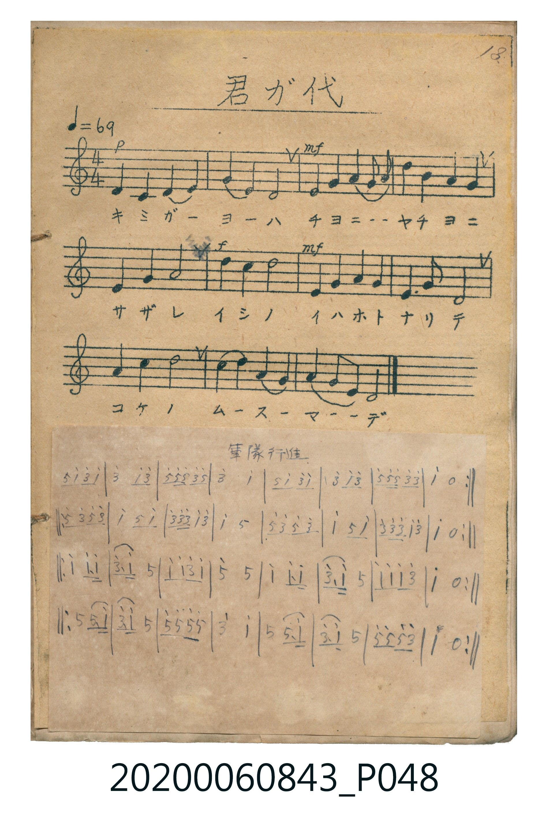

# 君が代

> Re:Shōka 使用 AI 協助辨識與重建樂譜，可能會有錯誤。歡迎回報。

- **鋼琴伴奏版**：<br><audio controls src="kimi_ga_yo.mp3"></audio>

- 詞曲作者：未在 TMD metadata 中提供

## 說明


- 調性與拍號：調號 ?= C，拍號 <4/4>，速度 != 69


## 歌詞

```text
title = 君が代
?= C
!= 69
<4/4>
來源：『唱歌帖』(2020.006.0843) 第一冊 p.13 上半頁 (掃描頁 P048.jpg)
記譜：手抄五線譜（共11小節，附強弱記號 p, mf, f）
歌詞：
キミガヨハ チヨニヤチヨニ サザレイシノ
イハホトナリテ コケノムスマデ
```

## ABC

<div class="abc-score" data-abc-src="kimi_ga_yo.abc" aria-label="五線譜載入中"></div>

[下載 ABC 原始檔](kimi_ga_yo.abc)

## TMD 檔案連結

- [主旋律 TMD 檔案](kimi_ga_yo.tmd) [[在 TMD Studio 編輯](https://tmdlang.github.io/Tmd-TS/#tmd=s7IKdvYPcrWy4qpTUCpJTLdSSM7PyUlNLsnMz7MqzsjPTkzOyFeCS5bl55TmploBqXgDY4RwcX5pUXJqfEFieqpVgIGJRSK6FNyo-Lz8ktSk_PxshIqCovyy1LzEPKCq3MS80uLkosyCkvjk_IJKhJrUssyUVJCK1JTMkvyizMQcJDelFhWDXQtxRElRYh7EDKAgQhVQU3pmnlVufl5SKdAxyBIlGfnpRYkFGZVWGZnFINOTE3PisxPzkHxRkpEK9HZqSmlyIsRYLS2FpxNmP27sebJ7sYKWFpeirYKZJZe9rYIzl42JvokdF5e-loIttQCXgoJCSWZJTqqCLcJakCDYQiANsR7IgFgOZDzZ1_Zs14T3e2Y9buh7OmXjs7U9T3dMe9zQr2FkYGSgZ2BgpmdgYWKsqfB8zZonOxqetnUpFOgZGis82dH1tLfr5YJGBY1nfc3P-vtBTFCU6mUVpGuCDH6xYsaLtXOABj_r7H7W1fJk15Tn22eBRTqetm40NHy6of_5-ob3e3pezmx5umf70z0bQTpmzlco0FHITdNRSHu_pxNkDtBFL1bOA5oD4jxuWvu4ef7jpjWPm1c8bu5XeNzcCGZ1P25eAmcDVW193LTtcfOax01LHjdtf9zcB9ELVNL_uHn24-aOx81dj5tXPW5uA4pufty0EajkcfOCx007HzfPe9zcDlJOeWxAgYKWPheXd2ZupntiZL5VQGZiXr5DjUFNNcgSBRtDMy1wPCgA0wHQd0AfzQfSa4D0CiAG-xDKBvqreQkKH2gwSGeNQnVBrYKRgi4YGkJpGN8YStcomKKJwFTAINCc3LRauDRMuRkSH8SuUTCKgwqZY1ECNgnho61AvA3oWqCPmoCub9oOZPdB2GDfzQbiDiDuAuJVQNyG8BUuhyC5F-hcQ5hj4K6Ci5DgMYgymApY6MBk4AYh_LUZiDdC_NK8AMjeCaTnAXE7wv0w8zFdiHAYphymq5BFQC7EiDeuWi4uXTsFWBpTALKVuQA)]
- [鋼琴伴奏 TMD 檔案](kimi_ga_yo_piano.tmd) [[在 TMD Studio 編輯](https://tmdlang.github.io/Tmd-TS/#tmd=s7IKdvYPcrWy4qpTUCpJTLdSyC8qychPL0osyKi0ysgsLskvykxOzInPTsxLVIIrKs4vLUpOjS9ITE-1CjAwsUDIlGSk5qZapaaUJieWZObnKXFpaSk8nTD7cWPPk92L3-_peNm95_mELU_2bHm6tP95Z8f7PZ0KWlpcirYKZpZc9rYKzlw2Jvomdlxc-loKttQCXAoKCiWZJTmpCrYE3AJSCXYFkIa4CciAuAjIeLKv7dmuCe_3zHrc0Pd0ysZna3ue7pj2uKFfw8jAyEDPwMBMz8DCxFhT4fmaNU92NDxt61Io0DM0Vniyo-tpb9fLBY0KGs_6mp_194OYoFDTyypI1wQZTLkXoUBBS5-LyzszN9M9MTLfKiAzMS_focagphpkiYKNoZkW2B8KNQrVBbUKRgq6YGgIpWF8Yyhdo2CKJgJTAYNAc3LTauHSMOVmSHwQu0bBKA4qZI5FCdgkqLtwGYVkI9BCQ5hxcHPhIiQ4DaIMpgLmP9N4dJOgToNpxbQcYSemHKaFyCIgyzEClasWPQ6DPHDHolm8NswE03htWFwiiRpqIyLUHCisDXMKQgKoESSD4R1wECKUoevWhgcJkI3wIFCNtrk2PATAXCyaUEyDBTIRliE5DxTB2mba8FBHsRdFhnQ_oToPHLZwTWBvgewDhRu6DQifwM3C7UiEu3CrweMqXJGAFP0Id2EkKx88ycoI5i9DGAMuYhYPY4GCBVMUrhAt0BEqELpM4Cy4PciGGmMxHiELz5lY5BBiSK7A4Qisagm7GMkhWEIJIQs3FOpchAnYzEc4gXjbsZmIGQugBKBrpwBLAwpAtjIXAA)]

## 分析

```text
================================================================================
📊 TMD Song Profile: [ 君が代 ]
================================================================================
⏱  Duration:       0:38 (38.3s), 11 measures total
🎼 Key & Tempo:    首調基準 C, != 69.0 BPM, <4/4>
   - 分析範圍：      由實際發聲的音符與和弦推測調性；播放脈絡另行呈現
🎤 人聲音域:    C4 (MIDI 60) – D5 (MIDI 74) [跨度: 14 個半音 / 1.2 個八度, 難度: moderate]
   - 最低音:  C4 in [KimiGaYo #1 @ m.1, 0:00]
   - 最高音: D5 in [KimiGaYo #1 @ m.4, 0:10]
   - 適合: soprano, mezzo-soprano, contralto, tenor, baritone, bass
🏛  結構:      KimiGaYo (38.3s)
⚡ 編曲密度:        Peak 1 軌道同時演奏
🗝  調性診斷：       G 大調（純淨自然大調，未偵測到可信轉調）
   - 風格氣質:    純淨自然大調（陽光明朗、易唱易記，無明顯調外色彩）
   - 轉調歷程:    全曲維持單一推測調性（未偵測到可信轉調）
   - 核心骨幹音:  D, G, A, E, C
   - 調性數值:    G 大調 [相關度: 0.82, 穩定度: Moderate, 自然音純度: 100.0%]
   - 候選調性 (K-S): G 大調 (0.82), D 大調 (0.70), C 大調 (0.63)
   - 五度圈歷程:   +1
   - 各段落調性細節:
     • [KimiGaYo #1]: G 大調 (r: 0.82, 自然音純度: 100.0%)

  [ 五度圈游移軌跡 ]
               C  
         F           [G ]*
      Bb               D  
      Eb               A  
         Ab           E  
            Db       B  
               F# 
     (* = active key center)

  [ 十二半音累積音高分佈 ]
     C  : █████████████             13.6%
     C# :                            0.0%
     D  : ████████████████████████  26.1%
     D# :                            0.0%
     E  : ███████████████           15.9%
     F  :                            0.0%
     F# :                            0.0%
     G  : █████████████████████     22.7%
     G# :                            0.0%
     A  : ██████████████████        19.3%
     A# :                            0.0%
     B  : ██                         2.3%
--------------------------------------------------------------------------------
Assignment 軌道音域：
  - Piano         : C4 – D5 (14 個半音 / 1.2 個八度, 40 個音符)
================================================================================
```


## 原書掃描頁




