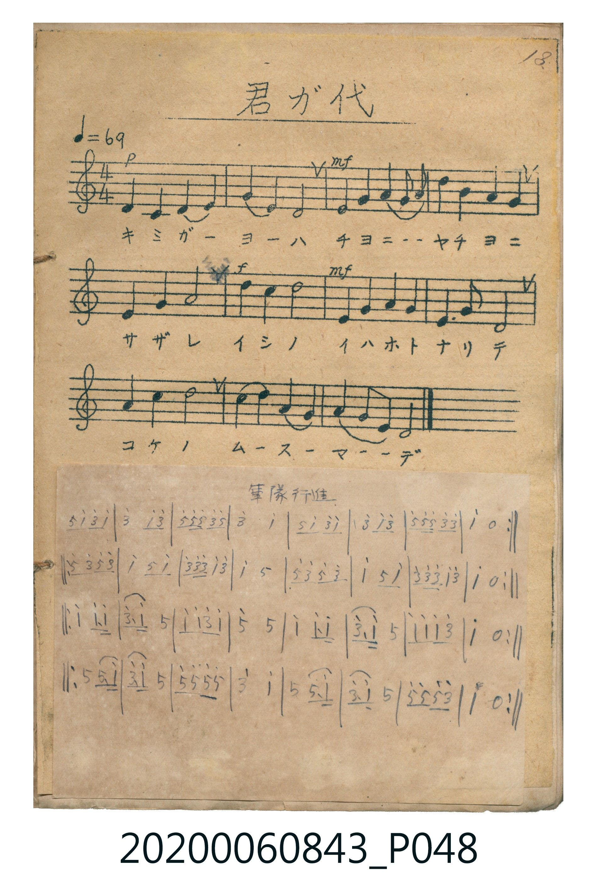

# 軍隊行進

> Re:Shōka 使用 AI 協助辨識與重建樂譜，可能會有錯誤。歡迎回報。

- **鋼琴伴奏版**：<br><audio controls src="guntai_koshin.mp3"></audio>

- 詞曲作者：未在 TMD metadata 中提供

## 說明


- 調性與拍號：調號 ?= C，拍號 <2/4>，速度 != 116


## 歌詞

```text
title = 軍隊行進
?= C
!= 116
<2/4>
來源：『唱歌帖』(2020.006.0843) 第一冊 p.13 下半頁貼紙 (掃描頁 P048.jpg)
記譜：手抄簡譜（器樂行進曲，共4段各8小節）
```

## ABC

<div class="abc-score" data-abc-src="guntai_koshin.abc" aria-label="五線譜載入中"></div>

[下載 ABC 原始檔](guntai_koshin.abc)

## TMD 檔案連結

- [主旋律 TMD 檔案](guntai_koshin.tmd) [[在 TMD Studio 編輯](https://tmdlang.github.io/Tmd-TS/#tmd=s7IKdvYPcrWy4qpTUCpJTLdSSM7PyUlNLsnMz7MqzsjPTkzOyFeCS5bl55TmploBqXgDY4RwcX5pUXJqfEFieqpVgIGJRRK6FNyo-Lz8ktSk_PxshIqCovyy1LzEPKCq3MS80uLkosyCkvjk_IJKhJrUssyUVJCK1JTMkvyizMQcJDelFhWDXQtxRElRYh7EDKAgQlVJRirQ4bmZOZkliUVIJgMNS8_MsyrNA1lQkpmWmZqCLFmSkZ9elFiQUWmVkVkMsjk5MSc-OzEvUYlLS0vhxe7el7O6XizsedmwSUFLi0vRVsHQ0IzL3lbBmcvGSN_EjotLX0vBllqAS0FBoSSzJCdVwRbFapA42E4gDXUCkAVxAJDxZF_bs10T3u-Z9bih7-mUjc_W9jzdMe1xQ7-GkYGRgZ6BgZmegYWJsabC8zVrnuxoeNrWpVCgZ2is8GRH99PerpcLGl9s2vN8y0wFjWd9zc_6-4ECCqA41ssqSNcEGf9ixYwXa-cAjX_W2f2sq-X5hoVgbsfTmSuerWiCuPDZ7E3v9_Q8bd1o8mzd1qcTWiyebuh_vr7h_Z5OkAmUhwwUKGjpc3G5l-aVJGZ65xdnZObFO1r5pubkp1Q61BjUVIPsUrAxNNMCB4tCjYKpgq6CYRyQ0FUwjoOwakAsqCiYBYJAlSAmkAAisCiYD1ULglBTgGIUGw0mahAmGsBNrkXznBN-zyHZAzMbaiyS4-DOAhIwh6K7AKQcxW9UMxm335zx-g1uAJQBpOCRAWTDHQyRR1gNjQewB7D5jAxzSfSXC8EEiXAXTtthSQaZIJQYSTcWr6d07RRQM5oCuogThogzhogLSESZCwA)]
- [鋼琴伴奏 TMD 檔案](guntai_koshin_piano.tmd) [[在 TMD Studio 編輯](https://tmdlang.github.io/Tmd-TS/#tmd=s7IKdvYPcrWy4qpTUCpJTLdSyC8qychPL0osyKi0ysgsLskvykxOzInPTsxLVIIrKs4vLUpOjS9ITE-1CjAwsUDIlGSk5qZa5WbmZJYkFlUqcWlpKbzY3ftyVteLhT0vGza939PxsnvP8wlbnuzZ8nRp__POjvd7OhW0tLgUbRUMDc247G0VnLlsjPRN7Li49LUUbKkFuBQUFEoyS3JSFWwJuwekGOwQIA11F5AFcRWQ8WRf27NdE97vmfW4oe_plI3P1vY83THtcUO_hpGBkYGegYGZnoGFibGmwvM1a57saHja1qVQoGdorPBkR_fT3q6XCxpfbNrzfMtMBY1nfc3P-vuBAgqgINTLKkjXBBlPuWehQEFLn4vLvTSvJDHTO784IzMv3tHKNzUnP6XSocagphpkl4KNoZkW2FMKNQqmCroKhnFAQlfBOA7CqgGxoKJgFggCVYKYQAKIwKJgPlQtCEJNAYpRbDSYqEGYaAA3uRbDcwGZiXn5QR7YfWeobawNcgbYfUhsKstQyTbzeG0jHFIEQ8AHOQRMEAEQr2AaH4_GMAbRpvEgJtzp2NTBGQZY7HXCn6yQYhgWq9AIRUoW8AQBJGBJBD3u0QOZeibjDlOngUpVqClgIJMVNAhITlYwAbLTlTPedAWPPCgDSMGLICAbyZeo5Qy09AEnHmypigxzSUxTzvRMUyhRPngSFTQMyCmrKEtULgTrQESiwBn1sFoKmSBU_5FuLPEpyoX6KQpPuqFJ7UesfQQDgegkBUtKhAsqZJXQNKVrp4Ba9yqgizhhiDhjiLiARJS5AA)]

## 分析

```text
================================================================================
📊 TMD Song Profile: [ 軍隊行進 ]
================================================================================
⏱  Duration:       0:33 (33.1s), 32 measures total
🎼 Key & Tempo:    首調基準 C, != 116.0 BPM, <2/4>
   - 分析範圍：      由實際發聲的音符與和弦推測調性；播放脈絡另行呈現
🎤 人聲音域:    G4 (MIDI 67) – G5 (MIDI 79) [跨度: 12 個半音 / 1.0 個八度, 難度: easy]
   - 最低音:  G4 in [GuntaiKoshin_A #1 @ m.1, 0:00]
   - 最高音: G5 in [GuntaiKoshin_A #1 @ m.3, 0:02]
   - 適合: soprano, mezzo-soprano, tenor, baritone
🏛  結構:      GuntaiKoshin_A (8.3s) -> GuntaiKoshin_B (8.3s) -> GuntaiKoshin_C (8.3s) -> GuntaiKoshin_D (8.3s)
⚡ 編曲密度:        Peak 1 軌道同時演奏
🗝  調性診斷：       C 大調（推測轉調經歷 1 次）
   - 風格氣質:    純淨自然大調（陽光明朗、易唱易記，無明顯調外色彩）
   - 轉調歷程:    C 大調起奏 ➔ [GuntaiKoshin_D] 轉至 G 大調 (+7 半音 / 五度圈 +1 步)
   - 核心骨幹音:  C, G, E
   - 調性數值:    C 大調 [相關度: 0.87, 穩定度: High, 自然音純度: 100.0%]
   - 候選調性 (K-S): C 大調 (0.87), E 小調 (0.69), G 大調 (0.56)
   - 五度圈歷程:   +0 -> +0 -> +0 -> +1
   - 各段落調性細節:
     • [GuntaiKoshin_A #1]: C 大調 (r: 0.80, 自然音純度: 100.0%)
     • [GuntaiKoshin_B #1]: C 大調 (r: 0.83, 自然音純度: 100.0%)
     • [GuntaiKoshin_C #1]: C 大調 (r: 0.88, 自然音純度: 100.0%)
     • [GuntaiKoshin_D #1]: G 大調 (r: 0.72, 自然音純度: 100.0%)

  [ 五度圈游移軌跡 ]
              [C ]*
         F           [G ]*
      Bb               D  
      Eb               A  
         Ab           E  
            Db       B  
               F# 
     (* = active key center)

  [ 十二半音累積音高分佈 ]
     C  : ████████████████████████  38.3%
     C# :                            0.0%
     D  :                            0.0%
     D# :                            0.0%
     E  : ██████████████████        28.3%
     F  :                            0.0%
     F# :                            0.0%
     G  : █████████████████████     33.3%
     G# :                            0.0%
     A  :                            0.0%
     A# :                            0.0%
     B  :                            0.0%
--------------------------------------------------------------------------------
Assignment 軌道音域：
  - Melody        : G4 – G5 (12 個半音 / 1.0 個八度, 100 個音符)
================================================================================
```


## 原書掃描頁




