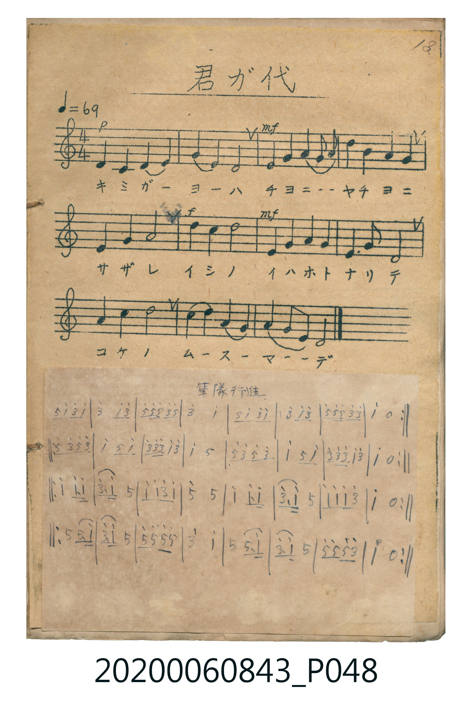

# 軍隊行進

<audio controls src="guntai_koshin.mp3"></audio>

- 詞曲作者：未在 TMD metadata 中提供

## 說明

・調性與拍號：調號 ?= C，拍號 <2/4>，速度 != 116

## 歌詞

```text
title = 軍隊行進
?= C
!= 116
<2/4>
來源：『唱歌帖』(2020.006.0843) 第一冊 p.13 下半頁貼紙 (掃描頁 P048.jpg)
記譜：手抄簡譜（器樂行進曲，共4段各8小節）
```

## ABC

```abc
X:1
T:軍隊行進
M:2/4
L:1/16
Q:1/4=116
K:C
V:V1 name="Melody" snm="Mel"
[V:V1]
G2 c3 e c2 | e2 c2 e4 | g2 g g e2 g2 | e4 c4 |
G2 c3 e c2 | e2 c2 e4 | g2 g g e2 e2 | c4 z4 |
g2 e3 g e2 | c2 G2 c4 | e2 e e c2 e2 | c4 G4 |
g2 e3 g e2 | c2 G2 c4 | e2 e e c2 e2 | c4 z4 |
c4 c3 c | e3 c G4 | c2 c2 e2 c2 | g4 G4 |
c4 c3 c | e3 c G4 | c2 c2 c2 e2 | c4 z4 |
G4 G3 c | e3 c G4 | g2 g2 g2 g2 | e4 c4 |
G4 G3 c | e3 c G4 | g2 g2 g2 e2 | c4 z4 |
```

## TMD 檔案連結

- [主旋律 TMD 檔案](guntai_koshin.tmd) [[在 TMD Studio 編輯](https://tmdlang.github.io/Tmd-TS/#tmd=s7IKdvYPcrWy4qpTUCpJTLdSSM7PyUlNLsnMz7MqzsjPTkzOyFeCS5bl55TmploBqXgDY4RwcX5pUXJqfEFieqpVgIGJRRK6FNyo-Lz8ktSk_PxshIqCovyy1LzEPKCq3MS80uLkosyCkvjk_IJKhJrUssyUVJCK1JTMkvyizMQcJDelFhWDXQtxRElRYh7EDKAgQlVJRirQ4bmZOZkliUVAk7W0FF7s7n05q-vFwp6XDZsUtLS4FG0VDA3NuOxtFZy5bIz0Tey4uPS1FGypBbgUFBRKMktyUhVsUawGiYPtBNJQJwBZEAcAGU_2tT3bNeH9nlmPG_qeTtn4bG3P0x3THjf0axgZGBnoGRiY6RlYmBhrKjxfs-bJjoanbV0KBXqGxgpPdnQ_7e16uaDxxaY9z7fMVNB41tf8rL8fKKAAiiG9rIJ0TZDxL1bMeLF2DtD4Z53dz7panm9YCOZ2PJ254tmKJogLn83e9H5Pz9PWjSbP1m19OqHF4umG_ufrG97v6QSZQHnIQIGClj4Xl3tpXklipnd-cUZmXryjlW9qTn5KpUONQY1CNcgyBRtDMy1wuCjUKJgq6CoYxgEJXQXjOAirBsSCioJZIAhUCWICCSACi4L5ULUgCDUFKEax0WCiBmGiAdzkWjTfORHwHZJFMMOh5iK5Du4uIAFzKboTQMpRPEc1k3F7zhm_5-AmQBlACh4dQDbcxRB5hN3QmAD7AJvXyDCXRI-5EE6TCIfhtB6WapAJQumRdGPx-krXTgE1symgizhhiDhjiLiARJS5AA)]
- [鋼琴伴奏 TMD 檔案](guntai_koshin_piano.tmd) [[在 TMD Studio 編輯](https://tmdlang.github.io/Tmd-TS/#tmd=s7IKdvYPcrWy4tLSUnixu_flrK4XC3teNmx6v6fjZfee5xO2PNmz5enS_uedHe_3dCpoaXEp2ioYGppx2dsqOHPZGOmb2HFx6Wsp2FILcCkoKJRkluSkKtgSdg9IMdghQBrqLiAL4iog48m-tme7JrzfM-txQ9_TKRufre15umPa44Z-DSMDIwM9AwMzPQMLE2NNhedr1jzZ0fC0rUuhQM_QWOHJju6nvV0vFzS-2LTn-ZaZChrP-pqf9fcDBRQCDEws9LIK0jVBxlPuWShQ0NLn4nIvzStJzPTOL87IzIt3tPJNzclPqXSoMahRqAZZpmBjaKYF9pVCjYKpgq6CYRyQ0FUwjoOwakAsqCiYBYJAlSAmkAAisCiYD1ULglBTgGIUGw0mahAmGsBNrsXwXUBmYl5-kAcO7xlqG2uD3AF2IBKbyjJUss08XtsIhxTBIPDBGQTxUK2m8TAWIUFjhJgpjAmXhHuWdHOxCuL2mROBpIuUimApB5pokJIePNEBCVgyRE9f6PFIPZPxeW6gUi5qKhvIpAsNAxolXWwK6ZZ2nfGnXXgCgTKAFLwoBbKRAhK1vISWouAECnYVusdIN5fEdOtM13SLkqwGT8KFBgKty9yBSLguhNsLYFPBJM7kBavRkQlCbQXSjSU-1brQINXiSZs0aSkQax_BUKBCssWWRKlT4OI3GcVvunYKqC0hBXQRJwwRZwwRF5CIMhcA)]

## 分析

```text
================================================================================
📊 TMD Song Profile: [ 軍隊行進 ]
================================================================================
⏱  Duration:       0:33 (33.1s), 32 measures total
🎼 Key & Tempo:    首調基準 C, != 116.0 BPM, <2/4>
   - 分析範圍：      由實際發聲的音符與和弦推測調性；播放脈絡另行呈現
🎤 人聲音域:    G4 (MIDI 67) – G5 (MIDI 79) [跨度: 12 個半音 / 1.0 個八度, 難度: easy]
   - 最低音:  G4 in [GuntaiKoshin_A #1 @ m.1, 0:00]
   - 最高音: G5 in [GuntaiKoshin_A #1 @ m.3, 0:02]
   - 適合: soprano, mezzo-soprano, tenor, baritone
🏛  結構:      GuntaiKoshin_A (8.3s) -> GuntaiKoshin_B (8.3s) -> GuntaiKoshin_C (8.3s) -> GuntaiKoshin_D (8.3s)
⚡ 編曲密度:        Peak 1 軌道同時演奏
🗝  調性診斷：       C 大調（推測轉調經歷 1 次）
   - 風格氣質:    純淨自然大調（陽光明朗、易唱易記，無明顯調外色彩）
   - 轉調歷程:    C 大調起奏 ➔ [GuntaiKoshin_D] 轉至 G 大調 (+7 半音 / 五度圈 +1 步)
   - 核心骨幹音:  C, G, E
   - 調性數值:    C 大調 [相關度: 0.87, 穩定度: High, 自然音純度: 100.0%]
   - 候選調性 (K-S): C 大調 (0.87), E 小調 (0.69), G 大調 (0.56)
   - 五度圈歷程:   +0 -> +0 -> +0 -> +1
   - 各段落調性細節:
     • [GuntaiKoshin_A #1]: C 大調 (r: 0.80, 自然音純度: 100.0%)
     • [GuntaiKoshin_B #1]: C 大調 (r: 0.83, 自然音純度: 100.0%)
     • [GuntaiKoshin_C #1]: C 大調 (r: 0.88, 自然音純度: 100.0%)
     • [GuntaiKoshin_D #1]: G 大調 (r: 0.72, 自然音純度: 100.0%)

  [ 五度圈游移軌跡 ]
              [C ]*
         F           [G ]*
      Bb               D  
      Eb               A  
         Ab           E  
            Db       B  
               F# 
     (* = active key center)

  [ 十二半音累積音高分佈 ]
     C  : ████████████████████████  38.3%
     C# :                            0.0%
     D  :                            0.0%
     D# :                            0.0%
     E  : ██████████████████        28.3%
     F  :                            0.0%
     F# :                            0.0%
     G  : █████████████████████     33.3%
     G# :                            0.0%
     A  :                            0.0%
     A# :                            0.0%
     B  :                            0.0%
--------------------------------------------------------------------------------
Assignment 軌道音域：
  - Melody        : G4 – G5 (12 個半音 / 1.0 個八度, 100 個音符)
================================================================================
```


## 原書掃描頁




