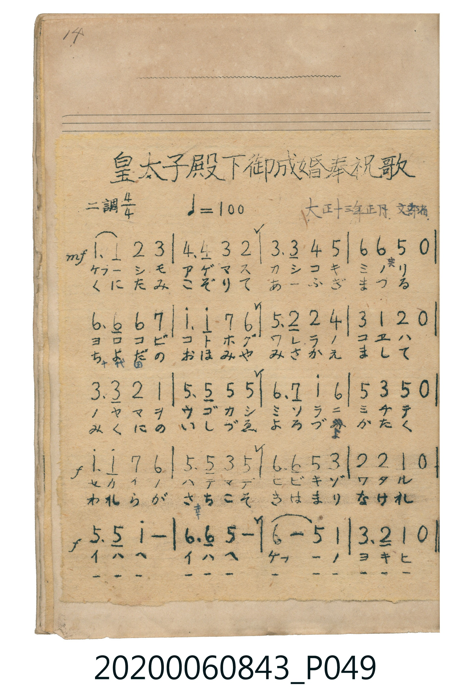

# 皇太子殿下御成婚奉祝歌

<audio controls src="kotaishi_denka_goseikon_hoshukuka.mp3"></audio>

- 曲：文部省 (大正十三年正月)

## 說明

皇太子殿下御成婚奉祝歌 (Kōtaishi Denka Goseikon Hōshukuka)
Source: 唱歌帖 (Shōkachō, NMTH 2020.006.0843) — P049.jpg (Notebook 1, p.14)
Notation: Handwritten numbered notation (Jianpu)
Annotations: ニ調 4/4, ♩= 100, 大正十三年正月 文部省

## 歌詞

```text
（TMD 檔案未包含歌詞註解）
```

## ABC

```abc
X:1
T:皇太子殿下御成婚奉祝歌
C:曲：文部省 (大正十三年正月)
M:4/4
L:1/16
Q:1/4=100
K:D
V:V1 name="Vocal" snm="Voc"
[V:V1]
!mf! D6 D2 E4 F4 | G6 G2 F4 E4 | F6 F2 G4 A4 | B4 B4 A4 z4 |
B6 B2 B4 c4 | d6 d2 c4 B4 | A6 E2 E4 G4 | F4 D4 E4 z4 |
F6 F2 E4 D4 | A6 A2 A4 A4 | B6 c2 d4 B4 | A4 F4 A4 z4 |
!f! d6 d2 c4 B4 | A6 A2 F4 A4 | B6 B2 A4 F4 | E4 E4 D4 z4 |
!f! A6 A2 d8 | B6 B2 A8 | B8 A4 D4 | F6 E2 D4 z4 |
```

## TMD 檔案連結

- [主旋律 TMD 檔案](kotaishi_denka_goseikon_hoshukuka.tmd) [[在 TMD Studio 編輯](https://tmdlang.github.io/Tmd-TS/#tmd=s7IKdvYPcrWy4tLSUng-q_3pklVP1054tm7_kx3dT_ctfNYx4enKWU-Xdj5fOvfZ2h4FLS0uRVsFQwMDLntbBRcuGxN9EzuuOgWlZ7M3vd8z69m09pfNK57PaVTQeLpk-bO1i5_2Nj7Z0fl05xYg-9mcDk0lLi59LQVbagEuBQUi3KzhfbS3JDGzOCNTwSU1LztRwT2_ODUzOz9PweNob3FGaXZpdqImyKjg_NKi5FQrhadTNgL1Pd0xTUEjOONob3ZiMpDUUfDzDfFQMDIwMtAzMDDTM7AwMdZUeNQwRSHAwMRSL6sgXUHDL78kNSk_P1vBUEehQM_QBGwqUDCxJDM_z0rBIzEvpbwos6QkNU8hrzQ3KbUoNUUhDyqtoOGVmZhXUArW45gHEy62Unjc3P1i1X4FYFDrKDyauRIc_DoKWANYAR4DIFMoD2AoUNDS5-LyBroIFIjgMIQFoUc-NACtwvKTE3McagxqFKpBdivYGJpp2YFZwBgHBueLlfOsQOZARQz1FB43bXzcPPVx0_bHzYuAnEWPmzY9bp73uGknkLMaJNy0-XHTWqD35z9u7nvcvEpBH8he8bh5LUiieTJQFZDqeNw8-3HTBqDM-sfNax43rwSqhcgADe9HshBsxhKQBc2bgAqWPW7aArEGbEHTXrDWbohtjY-b20C2Ne0GKwHqAprZ3A8UBetvB3ImAV0AdN3jpn1gq5v2P25ejWwbSBNQwwwUFti_YLNWgPQ2T0LSYQQMkMb-x42rHzfOf9y4H8iZ_LgRGBpdjxuXATlNjxu3Pm4Eam3c97hxyeOmbpD7Ghc-bup43LjgceM6IAeocjdQ5-OmFiBn_-PGqY8bux83dkC0TAcZg-Q-kAKIbSCtLWAFSx83TQS6suNxUy-YA9IKNAHonH5waPQ_bup53NT5uLEHKAE0fSHYjXOBHKD69SBrmrqAnFWPGycCVZIfGsAklJtWq2CooAuHILYRlG0MpWsUTJBUgNgwGZjKGrgITB9MhylchRmUBaNhMgYwFTBPOIBTODA7Nm0EOnkqkAYlHXDKBWJgmmqeB6TBiRci17QZiMHpF5T4gHgVUpDATQOGLTAagBioChLtQAwyCRSU4JgH4q1ADDJhDygygXgJUL4bEVwwt8P8AeObw31pGIccmCAOTA6mtgbuc1gIwkIRFmaI0ITFDEwF7rBqXgHEwDAAhQUkywJpYLpqng1kg3MtEK8B4pWQMALLg8IXOesiwmohKHkC6QVADE7yQLwbEm6QVA9KmKBUC8TghA_E08HhCA8r9BQB8wPMT6jhAGLD-JhpBhbG8NDFDEyYdYSTFTiJACMWlIwgRRQQb0EkJ1AyatoLDSpwQQXEjUDchjWoQEEBS1rgLA4NiqVAU8C5HIh7oXxwRocmQXjAA3MhKBOSmHBAbHQ_YyZQ9NCpgUcDenTgyYbAiAeHDSjMwOUzOCwg4QcuoqFJDpT8wKU0kAaGCko5jTANqBtYZgGLN2AYgMs3SHIDZ0dwEQfEQBNASQpSygExKBzh5RwkvNDDAiX88AcGdhXIAYlIo8ipGBRkRAQXKJhAQQQuhJHY0NIMUhBDSyzkiokCE2q5uHTtFPA3HBSAKpS5AA)]
- [鋼琴伴奏 TMD 檔案](kotaishi_denka_goseikon_hoshukuka_piano.tmd) [[在 TMD Studio 編輯](https://tmdlang.github.io/Tmd-TS/#tmd=s7IKdvYPcrWy4tLSUng-q_3pklVP1054tm7_kx3dT_ctfNYx4enKWU-Xdj5fOvfZ2h4FjcfNUx43LXrc3Pdkz5anS_uf7J6hqaClxaVoq2BoYMBlb6vgwmVjom9ix1WnoPRs9qb3e2Y9m9b-snnF8zmNChpPlyx_tnbx097GJzs6n-7cAmQ_m9OhqcTFpa-lYEstwKWgQIxHvI_2liRmFmdkKrik5mUnKrjnF6dmZufnKXgc7S3OKM0uzU7UVHjUMEUhIDMxL1_BMTk5P7cgMS8zNzWvBGRFcH5pUXKqlcLTKRuB5j3dMU1BIzjjaG92YjKQ1FHw8w3xUDAyMDLQMzAw0zOwMDGGmmZgYqmXVZCuoOGXX5KalJ-frWCoo1CgZ2iiCTKVcu9DgYKWPheXdz7Ei2AfwjzokQ_1nlVYfnJijkONQY1CNchuBRtDMy07MAsokptWq2CooAuHILYRlG0MpWsUTJBUgNgwGZjKGrgITB9MhylchRmUBaNhMgYwFWAnAZOIA9jBVkDO46aNCo-bpwLp7UB6EZAG4U1A9jwgvROIV0PkmjYD8Vqg-Hwg7gPiVaCAwTSvsR-IgXoageoa9wPxZCAGmdUFpJcBcRMQbwVikBl7gPQ-IF4ClO-GmYfwB8wvML453KeGccgBCuLA5GBqa-C-h4UiLCRh4YYIUVjswFSghhdmyMPUwfSh2gViw_iYcQPzB9wHmA6GWYc9-oApCpSgSAwAEBvdXMyARndBDdyr6F7G5iZ0-1DciN9C7CqQHYsIa-TYADkL00m1BDMsuCgK8sCZZQuAIaxtrA23HIltGq9tHq8NDw8kGaDj47UNtWHpC4WD2wRgYsZhE04D8FmEajh6NAHVacNCGBfbSNtUG5HTgLZqwyMShYOsDlk_MOFB3IDDw9h4iDwJ5AO9ipBE4eD1GTHRhWIgTodiNQg1AnAFmLG2GSKEUEMFzTAsxmLLVOSEPy5nY7cVX6rAphcebFA-nhDGWnLhcBxujxLtQBK9hJkYcCU2HJ4ispzxwVXOwEou03h0BqK0M0EXwtCExRwMTUjmwBlw1fiaB80rgBhY7YOq_2ZgVQ6mO4B4NpC9AUivB-I1QLwS0iwAy4OaFP04mgcLgWqA-hsXAPE6IAY1C3ZDmgpNLdAmA7A50tgNxCB1oObBdHDTAd48wPAdppcQYWKMIQdXDYpydEkkBjFm4Q06UAsH2LIBtaSagS2qJmDrp2kLokUFakk17YUGHdC74JZVIxC34Qg6UNDAWlegoAMFFyholgLNmQgJ1qZeKB8UdKAgBLXC4FGBzydIbRmcclhSE1yNGb7gxUigeFukwOQADiNQ2IHCEOhnYJhAwrEdiCdBkyIoWQKTBygJNgHDpnk19nBrAupv6gHiTmBYAGlw8gImQ3DLdC4Qg8IMaAYoqYFbqauAGBSePcSEG5J3MXyJoQtbNsSiCEsiNCQq5EAhBgqtGWhsaBsfHJrADA1ux0_CEVpkmUGp55EyLlwOnqLIDiFg-axrp4C_iFYAqlDmAgA)]

## 分析

```text
================================================================================
📊 TMD Song Profile: [ 皇太子殿下御成婚奉祝歌 ]
================================================================================
⏱  Duration:       0:48 (48.0s), 20 measures total
🎼 Key & Tempo:    首調基準 D, != 100.0 BPM, <4/4>
   - 分析範圍：      由實際發聲的音符與和弦推測調性；播放脈絡另行呈現
🎤 人聲音域:    D4 (MIDI 62) – D5 (MIDI 74) [跨度: 12 個半音 / 1.0 個八度, 難度: easy]
   - 最低音:  D4 in [KotaishiDenkaGoseikonHoshukuka #1 @ m.1, 0:00]
   - 最高音: D5 in [KotaishiDenkaGoseikonHoshukuka #1 @ m.6, 0:12]
   - 適合: soprano, mezzo-soprano, contralto, tenor, baritone, bass
🏛  結構:      KotaishiDenkaGoseikonHoshukuka (48.0s)
⚡ 編曲密度:        Peak 1 軌道同時演奏
🗝  調性診斷：       D 大調（純淨自然大調，未偵測到可信轉調）
   - 風格氣質:    純淨自然大調（陽光明朗、易唱易記，無明顯調外色彩）
   - 轉調歷程:    全曲維持單一推測調性（未偵測到可信轉調）
   - 核心骨幹音:  A, B, D, F#, E
   - 調性數值:    D 大調 [相關度: 0.84, 穩定度: Moderate, 自然音純度: 100.0%]
   - 候選調性 (K-S): D 大調 (0.84), A 大調 (0.75), B 小調 (0.74)
   - 五度圈歷程:   +2
   - 各段落調性細節:
     • [KotaishiDenkaGoseikonHoshukuka #1]: D 大調 (r: 0.84, 自然音純度: 100.0%)

  [ 五度圈游移軌跡 ]
               C  
         F            G  
      Bb              [D ]*
      Eb               A  
         Ab           E  
            Db       B  
               F# 
     (* = active key center)

  [ 十二半音累積音高分佈 ]
     C  :                            0.0%
     C# : █████                      4.7%
     D  : ██████████████████        18.7%
     D# :                            0.0%
     E  : ██████████                10.7%
     F  :                            0.0%
     F# : ███████████████           15.3%
     G  : █████                      5.3%
     G# :                            0.0%
     A  : ████████████████████████  24.7%
     A# :                            0.0%
     B  : ████████████████████      20.7%
--------------------------------------------------------------------------------
Assignment 軌道音域：
  - Vocal         : D4 – D5 (12 個半音 / 1.0 個八度, 72 個音符)
================================================================================
```


## 原書掃描頁




