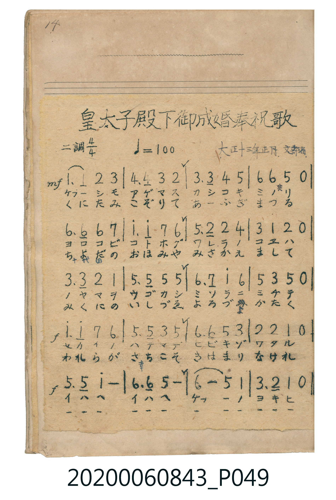

# 皇太子殿下御成婚奉祝歌

> Re:Shōka 使用 AI 協助辨識與重建樂譜，可能會有錯誤。歡迎回報。

- **鋼琴伴奏版**：<br><audio controls src="kotaishi_denka_goseikon_hoshukuka.mp3"></audio>

- 曲：文部省 (大正十三年正月)

## 說明

皇太子殿下御成婚奉祝歌 (Kōtaishi Denka Goseikon Hōshukuka)
Source: 唱歌帖 (Shōkachō, NMTH 2020.006.0843) — P049.jpg (Notebook 1, p.14)
Notation: Handwritten numbered notation (Jianpu)
Annotations: ニ調 4/4, ♩= 100, 大正十三年正月 文部省


## 歌詞

```text
（TMD 檔案未包含歌詞註解）
```

## ABC

<div class="abc-score" data-abc-src="kotaishi_denka_goseikon_hoshukuka.abc" aria-label="五線譜載入中"></div>

[下載 ABC 原始檔](kotaishi_denka_goseikon_hoshukuka.abc)

## TMD 檔案連結

- [主旋律 TMD 檔案](kotaishi_denka_goseikon_hoshukuka.tmd) [[在 TMD Studio 編輯](https://tmdlang.github.io/Tmd-TS/#tmd=s7IKdvYPcrWy4qpTUCpJTLdSSM7PyUlNLsnMz7MqzsjPTkzOyFeCS5bl55TmploBqXgDY4RwcX5pUXJqfEFieqpVgIGJJboM3KT4vPyS1KT8_GyEioKi_LLUvMQ8oKrcxLzS4uSizIKS-OT8gkqEmtSyzJRUkIrUlMyS_KLMxBwkJ6UWFYMdC3FDSVFiHsQMoCBCVUlGKtDdmbkFqai6IeJpqcUlmWXI4kBL0jPzrHLz85JKgY5HlijJyE8vSizIqLTKyCwGuSY5MSc-OzEvUYlLS0vh-az2p0tWPV074dm6_U92dD_dt_BZx4SnK2c9Xdr5fOncZ2t7FLS0uBRtFQwNDLjsbRVcuGxM9E3sQMY_m73p_Z5Zz6a1v2xe8XxOo4LG0yXLn61d_LS38cmOzqc7twDZz-Z0aCpxcelrKdhSC3ApKBDhZg3vo70liZnFGZkKLql52YkK7vnFqZnZ-XkKHkd7izNKs0uzEzVBRgVD4lvh6ZSNQH1Pd0xT0AjOONoLivyjvToKfr4hHgpGBkYGegYGZnoGFibGmgqPGqYogBKNXlZBuoKGHzSBKBjqKBToGZqATQUKJoJTpIJHYl5KeVFmSUlqnkJeaW5SalFqigIwUYGlFTS8MhPzCkrBehzzYMLFVgqPm7tfrNqvAAxqHYVHM1eCg19HAWsAK8BjAGQK5QEMBQpa-lxc3kAXgQIRHIawIPTIhwagVQDQ9fkONQY11SCrFWwMzbTswCxghAND88XKeVYgY6AihnoKj5s2Pm6e-rhp--PmRUDOosdNmx43z3vctBPIWQ0Sbtr8uGkt0PfzHzf3PW5epaAPZK943LwWJNE8GagKSHU8bp79uGkDUGb94-Y1j5tXAtVCZICG9yNZCDZjCciC5k1ABcseN22BWAO2oGkvWGs3xLbGx81tINuadoOVAHUBzWzuB4qC9bcDOZOALgC67nHTPrDVTfsfN69Gtg2kCahhBgoL7F-wWStAepsnIekwAgZIY__jxtWPG-c_btwP5Ex-3AgMja7HjcuAnKbHjVsfNwK1Nu573LjkcVM3yH2NCx83dTxuXPC4cR2QA1S5G6jzcVMLkLP_cePUx43djxs7IFqmg4xBch9IAcQ2kNYWsIKlj5smAl3Z8bipF8wBaQWaAHROPzg0-h839Txu6nzc2AOUAJq-EOzGuUAOUP16kDVNXUDOqseNE4EqyQ-NGoXq3LRaBUMFXTgEsY2gbGMoXaNggqQCxIbJwFTWwEVg-mA6TOEqzKAsGA2TMYCpgHnCISwfWFYCc2PTRqCTpwJpUNIBp1wgBqap5nlAGpx4IXJNm4EYnH5BiQ-IVyEFCdw0YNgCowGIgaog0Q7EIJNAQQmOeSDeCsQgE_aAIhOIlwDluxHBBXM7zB8wvjncl4ZxyIEJ4sDkYGpr4D6HhSAsFGFhhghNWMzAVOAOq-YVQAwMA1BYQLIskAamq-bZQDY41wLxGiBeCQkjsDwofJGzLiKsFoKSJ5BeAMTgJA_EuyHhBkn1oIQJSrVADE74QDwdHI7wsEJPETA_wPyEGg4gNoyPmWZgYQwPXczAhFlHOFmBkwgwYkHJCFJEAfEWRHICJaOmvdCgAhdUQNwIxG1YgwoUFLCkBc7i0KBYCjQFnMuBuBfKB2d0aBKEBzwwF4IyIYkJB8RG9zNmAkUPnRp4NKBHB55sCIx4cNiAwgxcPoPDAhJ-4CIamuRAyQ9cSgNpYKiglNMI04C6gWUWsHgDhgG4fIMkN3B2BBdxQAw0AZSkIKUcEIPCEV7OQcILPSxQwg9_YGBXgRyQiDSKnIpBQUZEcIGCCRRE4EIYiQ0tzSAFMbTEQq6YKDChlotL104Bf7tBAahCmQsA)]
- [鋼琴伴奏 TMD 檔案](kotaishi_denka_goseikon_hoshukuka_piano.tmd) [[在 TMD Studio 編輯](https://tmdlang.github.io/Tmd-TS/#tmd=s7IKdvYPcrWy4qpTUCpJTLdSyC8qychPL0osyKi0ysgsLskvykxOzInPTsxLVIIrKs4vLUpOjS9ITE-1CjAwsUTIlGSk5qZapaaUJieWZObnKXFpaSk8n9X-dMmqp2snPFu3_8mO7qf7Fj7rmPB05aynSzufL537bG2Pgsbj5imPmxY9bu57smfL06X9T3bP0FTQ0uJStFUwNDDgsrdVcOGyMdE3sQPZ82z2pvd7Zj2b1v6yecXzOY0KGk-XLH-2dvHT3sYnOzqf7twCZD-b06GpxMWlr6VgSy3ApaBAjEe8j_aWJGYWZ2QquKTmZScquOcXp2Zm5-cpeBztLc4ozS7NTtRUeNQwRSEgMzEvX8ExOTk_tyAxLzM3Na8EZEUwOGStFJ5O2Qg07-mOaQoawRlHe7MTk4GkjoKfb4iHgpGBkYGegYGZnoGFiTHUNGAk6GUVpCto-OWXpCbl52crGOooFOgZmmiCTKXc-1CgoKXPxeWdD_Ei2IcwD3rkQ71nBfaZQ41BTTXIagUbQzMtOzCrRqE6N61WwVBBFw5BbCMo2xhK1yiYIKkAsWEyMJU1cBGYPpgOU7gKMygLRsNkDGAqwE4CphCHsHxgArcCch43bVR43DwVSG8H0ouANAhvArLnAemdQLwaIte0GYjXAsXnA3EfEK8ChQumeY39QAzU0whU17gfiCcDMcisLiC9DIibgHgrEIPM2AOk9wHxEqB8N8w8hD9gfoHxzeE-NYxDDlAQByYHU1sD9z0sFGEhCQs3RIjCYgemAjW8MEMepg6mD9UuEBvGx4wbmD_gPsB0MMw67NEHTFGgBEViAIDY6OZiBjS6C2rgXkX3MjY3oduH4kb8FmJXgexYRFgjxwbIWZhOqiUuvwZ54MqxBcAA1jbWhtuNxDaN1zaP14YHB5IM0O3x2obasOSFwsFtAjAt47AJpwH4LEI1HD2WgOq0YQGMi22kbaqNyGhAW7Xh8YjCQVaHrB-Y7iBuwOFhbDxElgTygV5FSKJw8PqMmOhCMRCnQ7EahBoBuALMWNsMEUKooYJmGBZjseUpcsIfl7Ox24ovVWDTCw82KB9PCGMtuHA4DrdHiXYgiV7CTAy4EhsOTxFZzPggFzMm8FLGEGgsCBmCKn8QBRaAioMFwOJABOQbYK27m1cAMbBOBtXNzcB6Fkx3APFsIHsDkF4PxGuAeCWkzgbLg-r7fhx190KgGqD-xgVAvA6IQXX2bkg93tQCrc-BbYXGbiAGqQPV3dPB9Tq87ga7HOJokF-MwSwgHxTAcIQsh8NroOYBsFkAaoY0A5sjTcCmQ9MWRHME1Axp2gv1GtA54GZJIxC34fAayOmwpgnIayDvgJy-FGjORIi3m3qhfJDXQF4ENWHgQYVwMShmYHEHjSUg2wzhTXAUYvdXEzA4wX4A-Q3kR6CbgG6G-LMdiCdBoxIUrcDgBUVhE9Dtzaux-6sJqL-pB4g7gW4F0uDoAUYjuNk1F4hBfgKaAYoqcBNsFRCD_NuD6S-w88FuB4vAkh-UA404Q5w-A_kI5JsZaGxoAxPsW2CCBTciJ-HwDVlmYHc0OAECWcB4weoDYO7VtVPAn4EVgCqUuQA)]

## 分析

```text
================================================================================
📊 TMD Song Profile: [ 皇太子殿下御成婚奉祝歌 ]
================================================================================
⏱  Duration:       0:48 (48.0s), 20 measures total
🎼 Key & Tempo:    首調基準 D, != 100.0 BPM, <4/4>
   - 分析範圍：      由實際發聲的音符與和弦推測調性；播放脈絡另行呈現
🎤 人聲音域:    D4 (MIDI 62) – D5 (MIDI 74) [跨度: 12 個半音 / 1.0 個八度, 難度: easy]
   - 最低音:  D4 in [KotaishiDenkaGoseikonHoshukuka #1 @ m.1, 0:00]
   - 最高音: D5 in [KotaishiDenkaGoseikonHoshukuka #1 @ m.6, 0:12]
   - 適合: soprano, mezzo-soprano, contralto, tenor, baritone, bass
🏛  結構:      KotaishiDenkaGoseikonHoshukuka (48.0s)
⚡ 編曲密度:        Peak 1 軌道同時演奏
🗝  調性診斷：       D 大調（純淨自然大調，未偵測到可信轉調）
   - 風格氣質:    純淨自然大調（陽光明朗、易唱易記，無明顯調外色彩）
   - 轉調歷程:    全曲維持單一推測調性（未偵測到可信轉調）
   - 核心骨幹音:  A, B, D, F#, E
   - 調性數值:    D 大調 [相關度: 0.84, 穩定度: Moderate, 自然音純度: 100.0%]
   - 候選調性 (K-S): D 大調 (0.84), A 大調 (0.75), B 小調 (0.74)
   - 五度圈歷程:   +2
   - 各段落調性細節:
     • [KotaishiDenkaGoseikonHoshukuka #1]: D 大調 (r: 0.84, 自然音純度: 100.0%)

  [ 五度圈游移軌跡 ]
               C  
         F            G  
      Bb              [D ]*
      Eb               A  
         Ab           E  
            Db       B  
               F# 
     (* = active key center)

  [ 十二半音累積音高分佈 ]
     C  :                            0.0%
     C# : █████                      4.7%
     D  : ██████████████████        18.7%
     D# :                            0.0%
     E  : ██████████                10.7%
     F  :                            0.0%
     F# : ███████████████           15.3%
     G  : █████                      5.3%
     G# :                            0.0%
     A  : ████████████████████████  24.7%
     A# :                            0.0%
     B  : ████████████████████      20.7%
--------------------------------------------------------------------------------
Assignment 軌道音域：
  - Piano         : D4 – D5 (12 個半音 / 1.0 個八度, 72 個音符)
================================================================================
```


## 原書掃描頁




