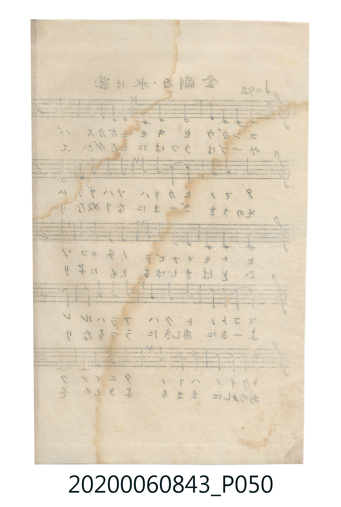
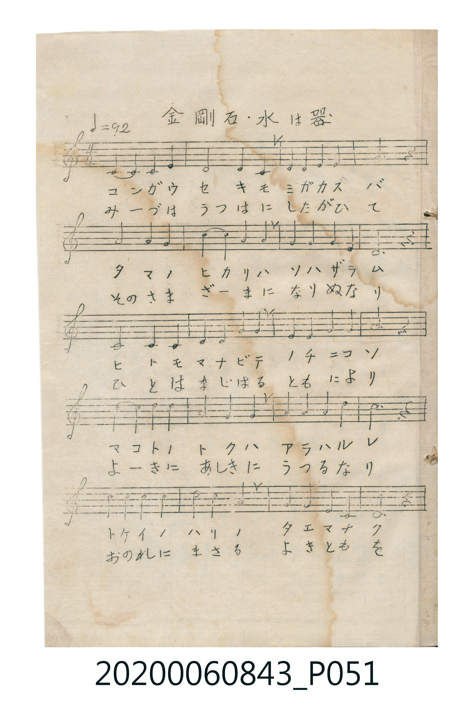
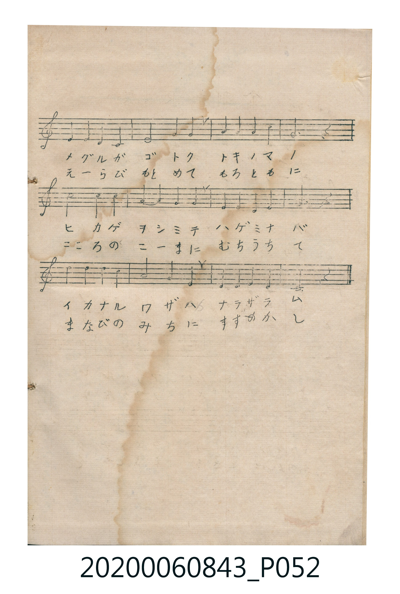

# 金剛石・水は器

> Re:Shōka 使用 AI 協助辨識與重建樂譜，可能會有錯誤。歡迎回報。

- **鋼琴伴奏版**：<br><audio controls src="kongoseki_mizu_wa_utsuwa.mp3"></audio>

- 詞：昭憲皇太后（御歌）
- 曲：奥好義
- 出處：《唱歌帖》（2020.006.0843）第 3 冊夾頁 P051.jpg–P052.jpg（P050.jpg 為紙背透印）

## 說明

> [!NOTE]
> **原件資訊與抄本考證**（對應《唱歌帖》第 3 冊夾頁 `P051.jpg`–`P052.jpg`；`P050.jpg` 為薄紙背面透印）：
> - **曲名**：金剛石・水は器（昭憲皇太后御歌二首同曲並載）
> - **調性與拍號**：ハ長調四分之四拍子（C 大調 4/4 拍，無升降記號 `?= C`，全曲 32 小節屬四七拔大調五聲音階），速度 `♩ = 92`
> - **作曲**：奥好義（明治 20 年〔1887〕5 月譜曲）
> - **校勘備註（依 Editorial Policy A 校訂）**：
>   1. **第 3 小節第 1 節濁點漏標**：第 3 小節「ミガカズ」之「ズ」於 `P051.jpg` 原抄漏標濁點作「ス」（第 4 小節「バ」則標有濁點），依 Policy A 復原為「ズ」。
>   2. **第 21 小節第 1 節片平假名混寫**：第 21 小節第 1 節片假名行「メグルガ」之末字於 `P052.jpg` 原抄混寫為平假名「が」（「メ グ ル が」），依 Policy A 統一復原為片假名「ガ」。
>   3. **第 30 小節第 1 節筆誤塗改**：第 30 小節第 1 節第 3 字「ワザカ」於 `P052.jpg` 原抄先誤寫「ハ」，其右再補寫「カ」，從改定之「カ」。
>   4. **雙詩節奏對位記法**：本曲將七五調御歌〈金剛石〉（上行片假名）與〈水は器〉（下行平假名）並列於同一五線譜下。凡〈金剛石〉為四字、〈水は器〉為三字處（第 1、6、13、21、26 小節），原抄於平假名首字後記長音符「ー」（「み ー づ は」「ざ ー ま に」「よ ー き に」「え ー ら び」「こ ー ま に」），TMD 歌詞層以延音符 `-` 對位；凡〈金剛石〉首二拍為二分音符唱一字、而〈水は器〉為二拍唱二字處（第 2、5、14、22、25 小節），原抄未加虛線連音線而直接將二平假名並書於二分音符下方（「うつ」「その」「あし」「もと」「ここ」），TMD 依原譜音符結構將並書二字記於同一音位。
>   5. 第 8、32 小節第 1 節句尾助動詞原抄均保留古風「ム」（「ソハザラム」「ナラザラム」）；每 4 小節樂句中第 2 小節末小節線上方均標有換氣記號 `∨`。
>
> **一、金剛石**
> コンガウセキモ　ミガカズバ
> タマノヒカリハ　ソハザラム
> ヒトモマナビテ　ノチニコソ
> マコトノトクハ　アラハルレ
> トケイノハリノ　タエマナク
> メグルガゴトク　トキノマノ
> ヒカゲヲシミテ　ハゲミナバ
> イカナルワザカ　ナラザラム
>
> **二、水は器**
> みづはうつはに　したがひて
> そのさまざまに　なりぬなり
> ひとはまじはる　ともにより
> よきにあしきに　うつるなり
> おのれにまさる　よきともを
> えらびもとめて　もろともに
> こころのこまに　むちうちて
> まなびのみちに　すすめかし


## 歌詞

```text
（TMD 檔案未包含歌詞註解）
```

## ABC

<div class="abc-score" data-abc-src="kongoseki_mizu_wa_utsuwa.abc" aria-label="五線譜載入中"></div>

[下載 ABC 原始檔](kongoseki_mizu_wa_utsuwa.abc)

## TMD 檔案連結

- [主旋律 TMD 檔案](kongoseki_mizu_wa_utsuwa.tmd) [[在 TMD Studio 編輯](https://tmdlang.github.io/Tmd-TS/#tmd=s7IKdvYPcrWy4qpTUCpJTLdSSM7PyUlNLsnMz7MqzsjPTkzOyFeCS5bl55TmploBqXgDY4RwcX5pUXJqfEFieqpVgIGpIboM3KT4vPyS1KT8_GyEioKi_LLUvMQ8oKrcxLzS4uSizIKS-OT8gkqEmtSyzJRUkIri5MS8-LLUosy0zNQUJGelFhWDHQxxR0lRYh7EHKAgQlV-UUlGfnpRYkFGpVVGZnFJflFmcmJOfHZiXiJCUUlGKtCD5YklqUXogsVADwA9npOZlooulVaUmZqXUpyRWYBsXWZ6Zp5Vbn5eUinQ_5gSqZlZmfElqRUlkADR0lJ42T7xaefs5_M3P27e_WzDlseN65_OXKGgpcWlaKtgacRlb6vgzGVjom9iBzLrxcp57_fMejZj7bO2Tc9ntT9dsurphL73ezqe7lv4bG3P-z2dYBufzd4EVPV06dKnS_c-37cSLPa0fdeLmVOBwo8bup5O2QhU_XTHtMcN3UDNRgZGBnoGBmZ6BhYmxkAznq9Zo2Cs8LSt6-mSfS8XNCqAYlcvqyD9UcNkINMIxATqAjINQEyF5027nm-Z-aK552VD_9PeDWBHcOlrKdhSC3ApKCjYKUQr-vmHuMZCOFpaT_vmP9m97cXm9hcrul50tD_rank2Z82LhuYXazu1tEAhsqH3WXsnmmfRfZYA81oC0G8gDthzCe_3zAZxwN5LAPnvxbQWqBfnLoL7EhiWEMfoAp0DDPKnE3pBNs_CGqFAF6HFGiTKnuzqebls2tMJPUADnuxY9gJkbCfC2Ber9j9rWA7yX3fvi5nzweY_bu5_OXU7UObp7NlPO9qe7OwGMoDyT9dOANrirPB0yXKgpAIwySgARd_v6XnesvBpb_vLmb0vVswAGqKQAEpTQE_2PG1dAbRWwdhI4emG_ufrG55uXAM06smO5mfdUyCmPNk15UXjppfzN7-cBUxmQLcBI3n-013LFBIezVypAEqgCQjHPtk7B2gc2I3wtAf2d9-zTbsVjAwUnu7c8rhhiqGFhfnjhqmmCs_mdLxYC9KC4uVnCxY-7Z7xtGnmixW7gbqf7Jur4JqSCcq4iTkKAfk5mcmVCo4KQFUvVjQBNYKtg-hWUDDUAxoAjWSwj0BsQwUg49n-xpe75z3b0_9sxUywFmRVjxt6HjfPf9y05nHT6sdNux439AIDFSQIZj-btgcpoSgAEx4osYFNgpgK9DdY8U6gYqCLQSabIJs8ASj-tLMdpH5OJ0QLJCxBfoP76Om-lUCjgYkNbvHjhiaYx4xgHjMyRPfZ8872pzs3P21sB6a_Z9u3P12_Gu4_7IrBKl8s7AG7beHjpg2Pm4G-XgPx9bM5q5-unQ7zMiQ7wLwMNhzoQLh1IBMageaAfA0xTQFonALQPAWYOIY3n2_d-GRHA9yzcAeBfQ1yBJKvjeHRCUw7aB5Z2_Zi1ZKnC6c_m7ITEZ-YyiCxvHY62HnrHzdtA0UxIk5RPPi0tQNk5nqgAqDifrD7gXlk29P-zU_bel8sngOVApsAkto3D2j703WzYKkFJI7kfBOQ81_Onvli5UpQ5lraDyyTnuwF5cJnm6eCHQ0sskAFx4Z2YJ4DZTVgngaXCo8bOhClSAMwDDue7OgCRhk8tIABCywUgMrgBQxMWTdQGTyCgMqAhcrTDlCEAssYYMADbXm-fRYw2wFVAp36tH0hml2g-AWWK6AQa0QzHyj1ZEcnUApckYDTuSFQlRkQGxoDCSMQz8gMGgeQuIcmHaD1MDeBiru105_u6wGGA7AcA5Ytz9csA4f4HkRKatwPTEV7gKloKRCvBwcrUHAaVHAfEEPCGhjoHVDBXiTBRqhgUydQEOgriOBkNO0QF4b4uigAgxxYsz7duOTJ7qVPd2-DuEkhQReYMsBRBqwQMEMK6BFg6Q0sYkHhsqsHWBRD9AErHFAKB4fgC6C9mIEI1gVSBtSFHJpGQB2moNA0AQUkiGdkii0056x62rXgxczZwJh82bAYZCswSht6ns_e8qxvKSg1Ac2FBTcw_p_N3gGMAGQnAiP_2bSdsLBue9y4BBZGcx83roOxmx43Av0ACWUgG-h6aDiCEHLwATM40GXARAUx_fnWCc-Wd4NTNchuqC-BqR6WCIHKgIGKlFNM9RRA_rcA-hheGcHz8NN-oJ_2Pe1a-bR7KiiWIHl1bvuT_XOfT535tH_Jy0VApwHTzwJE-mnaC8rAwNzevBIiDlbQBeIiCYJ9MPvZ-n54ef1sRRPQuic71oKjAyYILBMhTto-C5gPgSEHtB1amvfPfrZhMaxefdSxIgHmK1g7BehdoK_g6QbYrgNLPG4CNg82g6ucZY-bdj9uWvu4edHjhgaUeqh5Akzx_sfN8x439z1ungSSal4FLp4a0LwJVQxU09wBMg2kBejlyY-b28AmA7U3Pm7uBlndtBemeB7YJUD1QNmOx03rYSYDtQPN7AfVDc1rYIqBCjY-bloCVgyUAjqjD6x4_-OmFVDrmtbDFCNVLU1boIaDnAFkAD0LNAHkI4SbQV7e9Lh50-Om7aBAgLoZ6DugIJAL9Ag8NJaAAwEoAiThZTpQMUr8osbCLmA-bITnQ3gsNO4HFjGgEgaSCUAMsFHAhN84H1SHNW563LgMphicORqnAksQYFkEJiGKVz1u6nrcuAbCgCkGalwBNhCobAaI0QQscIGKV4AzE9CzwHCAKQayG3tBgpA8B2GDFINdBdSIYjLQrnWPm4BuA6oHGj4VajLUELD5TZNgioG2dILKQEgObmoEegesGKgGprhxNUwxOGeDxIHeBLJhHmwCumQh2DFAEh4aQNlVIJNBioHBCJSCuHkmCIEsAjp7Okgx5T0AKFDQ0ufi8s7PS88vTs3O9M2sKg1PDC0pLi1PtArLB3brHGoMaqpBNirYmGiB414BWz8EVNYAs-X7vfOAyQJYXSpoWEBzug68r6OJRRvQdpCRNcBiCQSNgSwjYJPVCMgGsYyAIqZAlhlQTFfBQKEGrNrHsAaU2YFJHIib1gDxMqAaYJYHqgFmBKD4IhC_eT5UFth0atoFFpmAao4RUAxYLQJ1QSpFkBpw-gALrQfVaWCh6UAMNKyxB5QGwSLL4AZB3W8K5JqB3WoYB0JmQAgSNQX6AOIXTB-AbW6eB8R9YNdNgri1eRUQ94N9tBfMAuY_IL0SrGYBFh-A8hDYxVPBNTFIaBqYD66VwXygkU1dQBoYHEA2yOguVB_gjtROYKQCmy_kRaouOFohUQkKjBpgcICiFEekAoMAFCSgpgYkCkGBA3R3M6id0QYW6QPiRiDuBicBSCBhBskmsP9XwCMVFBIzIHHa1A0WAco1NYHDB9TewRIisJg0AiOIc2EOB0GwIFAe0xNAR4NTJ8gbkJjtAKdMoOXQeF0Ejk9w3AIb9iAVazA9AXQWyBPgRhjYyaCCDE2oDYiXgP1EarzumgKK19a1OOIVaWACfxSDwwiCgNEMCg5w6ieQ9kFh07QRVO_Aw6gfHPWgtA_mA3MHsAaEJwGQyHosEQ1K1OuAcqCsCQmSfbCsAIloUGMWHGCQCAeJgBIZSkSD0iSkyDFGi2Swr0B5G939SN0yYBkDMnULLOkC3QnzIagsAiXYedCki-l-SMoAt6nBpoCqFLAQMI0DSxmwEBCjeADoUSLzbjM4jldjxjFREQuOSnAIgIICkX1BpTL2UAFnX3B5Cy4mmzcBWdshJTE0-4JKM6AoWAQcq1jLZFClCTYK5O91YD-D-YgSrakByAJGAjgHLMReJkNyLhBB_QCKWkgNA_KBEbSAQi-VQdkJVAqDih1I3gSlO3AZDBQH8UEywNxLoFQGORWYmoHxCvMCpKYBORqSUmdCMDiqIYUSKHtDzKnl4tK1U8BaMUf7GMYq4JY0AksqcwEA)]
- [鋼琴伴奏 TMD 檔案](kongoseki_mizu_wa_utsuwa_piano.tmd) [[在 TMD Studio 編輯](https://tmdlang.github.io/Tmd-TS/#tmd=s7IKdvYPcrWy4tLSUnjZPvFp5-zn8zc_bt79bMOWx43rn85c8X5Px8vuPc8nbHmyZ8vTpf3POzve7-lU0NLiUrRVsDTisrdVcOayMdE3seOqU1B6sXLe-z2zns1Y-6xt0_NZ7U-XrHo6oQ9owtN9C5-t7QFqVAKpejZ7E1DV06VLny7d-3zfSrDY0_ZdL2ZOBQo_buh6OmUjUPXTHdMeN3QDNRsZGBnoGRiY6RlYmBgDzXi-Zo2CscLTtq6nS_a9XNCoEGBgaqiXVZD-qGEykGkEYipxcXnn56XnF6dmZ_pmVpWGJ4aWFJeWJ1oFZCbm5Qd5ONQY1FRzKQCBjYmWHZihr6Vgiw4UgFY92dHwfu-8J7t6XizsUdCwUHi6of_5-gYduK2aWLRp6YONrFEwBENjIMtIQReIDcEsI6CIKZBlBhTTVTBQqAGr9jGsUXjctFnhcTMQN60B4mVANY-bdgPVPG5aCxRfBOI3z4fKrgbiXWCRCajmGAHFGveDdDUuBeL1IDWNbY8bl4CF1gPxarDQdCAGGtbYA8SbwCLL4AZB3W8K5JqB3WoYB0JmQAgSNQX6AOIXTB-AbW6eB8R9YNdNgri1eRUQ94N9tBfMety0DUivBKtZgMUHcx83rgO7eCoQ7wO7bxqYvw_uA6CRTV1AGhgcQDbI6C5UH-CO1E5gpD6dPZu8SNUFRyskKkGBUQMMDlCU4ohUYBCAgqQDHoWgwAG6u3kyELeBRfqAuBGIu8FJABJImEGyCez_FfBIBYXEDEicNnWDRYByTU3g8Hnc1IEtRGAxaQRGEOfCHA6CYEGgPKYngI4Gp06QNyAx2wFOmUDLofG6CByf4LhtBkdQ8xpMTwCdBfJELzwSm0ApEVWoDYiXgP1EarzumgKK19a1OOIVqYjAH8XgMIIgYDSDggOc-gmkfVDYNG0EYqDjoWHUD456UNoH84G543ETMJKgSQAksh5LRIMS9TqgHChrQoJkHywrQCIaGIqQAINEOEgElMhQIhqUJiFFjjFaJIN9Bcrb6O5fCDRnAzj2QGUMyNQtsKQLdCfMh6CyCJRg50GTLqb7ISmjE8iCJGZgHK8ACwHTOLCUAQsBMYoHgB4lMu82g-N4NWYcExWx4KgEhwAoKBDZF1QqYw8VcPYFl7fgYrJ5E5C1HVISQ7MvqDQDioJFwLGKtUyeDERgo0D-Xgf2M5iPKNGaGoAsYCSAc8BC7GUyJOcCEdQPoKiF1DAgHxhBCyj0UhmUnUClMKjYgeRNULoDl8FAcRAfJAPMvQRKZZBTgakZGK8wL0BqGpCjISl1JgSDoxpSKIGyN8ScWrz1sg-OevnZrtVPJ_U8X73-RV_Xk53dwGL7WXfv07UTnm5f9qyzG9Iueb-n53nzjGedM57N6Hu2aTekwQEsDl40bno5f_PLWX3Ppnc_3deNlBLiFaINY2EUMOLjgSzT-FgIA1UIrsgEyDCJBVLx8GCBmwSSQ1UEpgjYhGEMDgeBGHA1xsS4B0kbVBm6N4zQzTXEZg7cMriBZPoMEbA4vYFuLj7noHsKwxYcrsES0ehGoUQ81hACJmRdOwWsaTnaB6gOt6QRWFKZCwA)]

## 分析

```text
================================================================================
📊 TMD Song Profile: [ 金剛石・水は器 ]
================================================================================
⏱  Duration:       2:46 (167.0s), 64 measures total
🎼 Key & Tempo:    首調基準 C, != 92.0 BPM, <4/4>
   - 分析範圍：      由實際發聲的音符與和弦推測調性；播放脈絡另行呈現
🎤 人聲音域:    C4 (MIDI 60) – D5 (MIDI 74) [跨度: 14 個半音 / 1.2 個八度, 難度: moderate]
   - 最低音:  C4 in [KongosekiMizuWaUtsuwa[L1] #1 @ m.1, 0:00]
   - 最高音: D5 in [KongosekiMizuWaUtsuwa[L1] #1 @ m.13, 0:32]
   - 適合: soprano, mezzo-soprano, contralto, tenor, baritone, bass
🏛  結構:      KongosekiMizuWaUtsuwa[L1] (83.5s) -> KongosekiMizuWaUtsuwa[L2] (83.5s)
⚡ 編曲密度:        Peak 1 軌道同時演奏
🗝  調性診斷：       C 大調（純淨自然大調，未偵測到可信轉調）
   - 風格氣質:    純淨自然大調（陽光明朗、易唱易記，無明顯調外色彩）
   - 轉調歷程:    全曲維持單一推測調性（未偵測到可信轉調）
   - 核心骨幹音:  C, D, G, A, E
   - 調性數值:    C 大調 [相關度: 0.81, 穩定度: Moderate, 自然音純度: 100.0%]
   - 候選調性 (K-S): C 大調 (0.81), G 大調 (0.74), A 小調 (0.66)
   - 五度圈歷程:   +0 -> +0
   - 各段落調性細節:
     • [KongosekiMizuWaUtsuwa[L1] #1]: C 大調 (r: 0.81, 自然音純度: 100.0%)
     • [KongosekiMizuWaUtsuwa[L2] #1]: C 大調 (r: 0.81, 自然音純度: 100.0%)

  [ 五度圈游移軌跡 ]
              [C ]*
         F            G  
      Bb               D  
      Eb               A  
         Ab           E  
            Db       B  
               F# 
     (* = active key center)

  [ 十二半音累積音高分佈 ]
     C  : ████████████████████████  26.7%
     C# :                            0.0%
     D  : ████████████████████      21.7%
     D# :                            0.0%
     E  : ███████████               12.5%
     F  :                            0.0%
     F# :                            0.0%
     G  : ███████████████████       20.8%
     G# :                            0.0%
     A  : █████████████████         18.3%
     A# :                            0.0%
     B  :                            0.0%
--------------------------------------------------------------------------------
Assignment 軌道音域：
  - Vocal         : C4 – D5 (14 個半音 / 1.2 個八度, 192 個音符)
================================================================================
```


## 原書掃描頁








