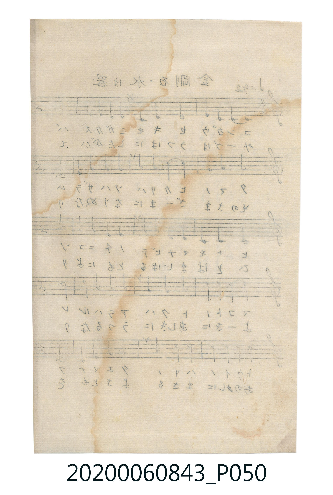
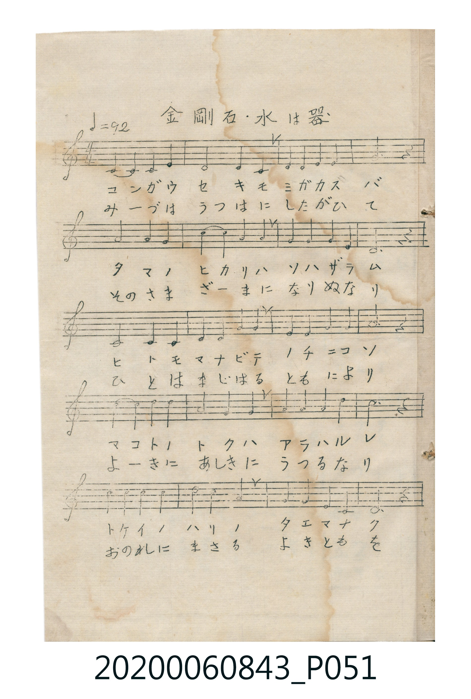
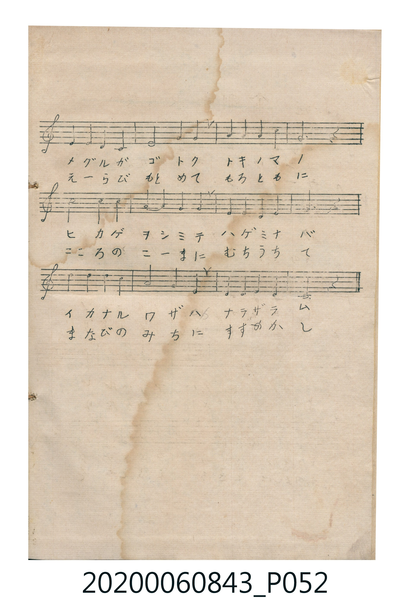

# 金剛石・水は器

> Re:Shōka 使用 AI 協助辨識與重建樂譜，可能會有錯誤。歡迎回報。

- **鋼琴伴奏版**：<br><audio controls src="kongoseki_mizu_wa_utsuwa.mp3"></audio>

- 曲：奥好義 (昭憲皇太后御歌)

## 說明

金剛石・水は器 (Kongōseki / Mizu wa Utsuwa)
Source: 唱歌帖 (Shōkachō, NMTH 2020.006.0843) — P051.jpg – P052.jpg (Insert)
Notation: Handwritten 5-line staff (1 sharp = G major, 4/4 time, 32 bars)


## 歌詞

```text
（TMD 檔案未包含歌詞註解）
```

## ABC

<div class="abc-score" data-abc-src="kongoseki_mizu_wa_utsuwa.abc" aria-label="五線譜載入中"></div>

[下載 ABC 原始檔](kongoseki_mizu_wa_utsuwa.abc)

## TMD 檔案連結

- [主旋律 TMD 檔案](kongoseki_mizu_wa_utsuwa.tmd) [[在 TMD Studio 編輯](https://tmdlang.github.io/Tmd-TS/#tmd=s7IKdvYPcrWy4qpTUCpJTLdSSM7PyUlNLsnMz7MqzsjPTkzOyFeCS5bl55TmploBqXgDY4RwcX5pUXJqfEFieqpVgIGpIboM3KT4vPyS1KT8_GyEioKi_LLUvMQ8oKrcxLzS4uSizIKS-OT8gkqEmtSyzJRUkIrUlMyS_KLMxBwkJ6UWFYMdC3FDSVFiHsQMoCBCVUlGKtDd5YklqUUIQaBJ6Zl5Vrn5eUmlQBdiSqRmZmXGl6RWlECcrKWl8LJ94tPO2c_nb37cvPvZhi2PG9c_nblCQUuLS9FWwdKIy95WwZ3LxkTfxA5k1rPZm97vmfV06dKnS_c-37dSQePZjLXP2jY9n9X-dMmqpxP6nu5b-Gxtj6YSF5e-loIttQCXggIOZ2p45-elH-0tTs3OVNBX8M2sKlUoT1QILSkuLU_UBGkLhsSWwtMpG4EOe7pjmoJGcMbRXlDUHe3VUfDzDfFQMDIwMtAzMDDTM7AwMdZUeNQwRQEU5XpZBelAzmQQxwjM0fDMK04tKgEb7JdfkghOUgoeiXkp5UWZJSWpeQqmujmZeakKxSWJaWkKGoYKxRmJRQUKwCBUyE3Myi_SUQAGpEJJZm6qjoKxkUJSYlEx2DDKgwgKFLT0ubhAYZIPChJQeIQnQkLDKiw_OTHHocagphpko4KNoZmWHZgFjClg0LxYOc8KpBsqYqigAQ9xTSuFx03AcN_8uGnN46ZlQM7ux01rHzcvUnjcPB8stvpx067HzROAUfC4af_j5nmPm_uAcpNAEs2rHjf3A4X3AqnHTdseN6983LwApBAo3dwBMQSovutx8-THzW1ATt_j5sbHzd0gG5v2ghXOA9sOVAsytONx03qIiYvAZvU_bgZasgbJ6WA1Gx83LYFoACoAOgHIArqsaQXUsqb1YJMXPm7aANLftAYovQViOEQ_0HtAh4A9AnEryI-bgKxNj5u2g7wNdivQR5vAHKDzIb5fAvYzkLsaKL0e5OEmEAsosBLhe4RbjYA5CJaYQcHcuP9x41IgF8hqe9y4BMh63AjU3zj9ceP8x409jxs3PW5cBrKoce7jxnWPG6c-btwH5EwDUhCFqx43dT1uXANhgBUCdayAmAhUMgNkYlM3kLPicVMTUMvjJqBnwQqBjMZeiCFACaCFUA7YHU3dUBORgrkRaNG6x01AR4GUAQ2fCjYZag7Y_KZJYCcAreh83LgZKAc0GSjRCPIEWB6mEGgESOFkEAIJroNwIJ5qanjcuBDsECAJ8T1QYhXQRIhCYJgBJUCOmAlCIOOBzp0Oc2uNQnVuWq2CabyCLhhiMgyhdA2cZYZHjRGUBaON0fgIU9ChAUwFLAwdwJkSnL2AiQQUQKCECM5hQLwWKAbOY1BxUFDsAvInIMUC3ITG_UCZPUB6KRCD0w8QL4GywUkIiIEmNfaA0gQQL0OED8wH6D6B8WsUTGHBgSaDUEE4VOBBSUKwgDw1D1QogPIgJAiaV4EyHqhEgdLbgPRKIEbOV4hgmQvEoEQyFZRqQFkFGkwgNjjDAE3oAtLAAIay4cGCJ8XA00eNgjmMCWegBwUiQcBozACGiRAfNqDwaO6AJhFQGAF90TwZiMGFKBA3AjEoP4KS1V6sYQNKBiugSQQUHjMgbEj5AMqgkDBqAtqCHC7okY-eOGoUzNBU4PYvugqEGTAZEkIEGArgjAQKFXBdAeSDynNwbQFNJUA2uGxGrjEQ6Q2kE5Q6eqGpAxQCoIwD40MzFTiE0FMLjtDADBX0TIS7aMEojsjKReBw2AiqnKDhAgoDUC4CV4pADIxrWAoChhe2lALKIcBc1AQqPMClPSRHQcp7aPhAUwywzMfMQZjlqTEWLxHOHugBg8hiZCSXhUDHboAkB0gDACnJgGhQ-QsKLkgBhC1YoMmlqRPIBldv0GAAZj1IDQfESEEDDDqcyQV3LYKvLsKUw1NhkRA00LIW0uIB0tsh1RCk0QMVB_FBZQ726ghYEoEw2Pvg2hy13G1qANLACADnKBBNRHWE6SPCOQkzBcKLabLqaVDmBzfooMUIqLgEVkBwMWARQ6BCAgUAMPOB0guk9QINAHD7BYLB6QdUxIDbMLVcXLp2Clgb9QpACWUuAA)]
- [鋼琴伴奏 TMD 檔案](kongoseki_mizu_wa_utsuwa_piano.tmd) [[在 TMD Studio 編輯](https://tmdlang.github.io/Tmd-TS/#tmd=s7IKdvYPcrWy4tLSUnjZPvFp5-zn8zc_bt79bMOWx43rn85coaDxuHnK46ZFj5v7nuzZ8nRp_5PdMzQVtLS4FG0VLI247G0V3LlsTPRN7LjqFJSezd70fs-sp0uXPl269_m-lQoaz2asfda26fms9qdLVj2d0Pd038Jna3s0lbi49LUUbKkFuBQUcLndOz8v_WhvcWp2poK-gm9mValCeaJCaElxaXmipsKjhikKAZmJefkKjsnJ-bkFiXmZual5JSDjgvNLi5JTrRSeTtkIdPDTHdMUNIIzjvZmJyYDSR0FP98QDwUjAyMDPQMDMz0DCxNjqGkGpoZ6WQXpQM5kEMcIzNHwzCtOLSrRBBlMuW-hQEFLn4sL5L18kO9AXgtPhHjMKiw_OTHHocagphpko4KNoZmWHZhVo1Cdm1arYBqvoAuGmAxDKF0DZ5nhUWMEZcFoYzQ-whR0aABTAXYXMDE4gB1tBeQ8btqs8LgZiJvWAPEyIN4NxGuBYouAeD5UfDUQ7wLyJ4DCAdOMxv1AuT1AeikQrwfiNiBeAmUD9TZOB2KgWY09QLwJiJfBzKmB-wLdNzB-jYIpLEjQZBAqCIcMPDjxBw2SQkwGPG5qFMxhTDgD3QmIyIDRmB6DiRByE7qH0QOkRsEMTQVuu9BVIMyAyRByDbrtuF2DHmG4kzJG8icnxjDzjjEW4whHB7qjEFFKbhDhzqn48jumHJ5CgZCTcGUzTJMIxxpmiMOzATFlUC2ukhRcOwR54CpLC2qBEaqNFLnY2abx2ggnm8RrmyH4YB4hLUCOebw2wq9oPENteDZEkQIGMchEuEH4eJhJGNVYXHagSAGDWttYGxZbyGzcxoESFdw0JCaKIhN1cKAhPGYEdjyiqMPLRfcbWBpZKRY2crxAIwDZ_7jCAiX0kYIXlYk7_AjENBKP-AjDFSeg2DLRhpeMRMcx0ekPxESyDW-SQnDQPYbL-cR5C2ciRE3-uFIhNOHBcyuYC9dDUSpEzu24SgHDeG2kCgNH-UBJgsJuBtXjCm8hheQMokpDXIrILT7JylQ4QxLdOpRMQGwKxFUSIacn8kp3_DWdD3JNZwKv6AxB9ashqO0CCn0QgnKAwmAZIAFTFQ-0DGujHtQgnwfEfUA8CdKAb14FxP1A9l4ovQ1IrwTiBTga9XOBeB0QTwXifUA8DdrIB7FBjXqgeU1dQBrYQYCy4Y16sIvBjoWyDUFtBVAeBiGzeDAF9hGQNgVysXsD5PTmDmhfBOQdoHXNk4EY2L8Ae60RiLshfRigt7B7A9TfWAHti4CcPgPCbgLqA4k3NUG80wS0B9kLMLeBIgCJBw18hPcI-gHobnAfC-QPkJtB9gDtB0cByF-gKACym0FRtAa7H0BuAwd9LzToQW4G9algfGh_C-wnjKhASU5QLtjdYDYRqQns5I1ADLQC7AWQc0GpCcgGpbQmYDDCogfoNezRAEopwNTUBOoCgpwMigpgygI5GeQ9sFeg0dE0CY_zUVISBBERCQuBpm6ABDK4Q7sFKSJANKjDC_IZJM9g9wE0Epo6gWxQggNFAsjFwEQI7NBCXI7kC6AvkXwBcTuWxENsloZl4yZgem4G4qbtkP45OC-A0hJIHMQH5RFc_XRg3gFhsDNBWRuUl5CydFMDkAYGFTg9gWikfjo0G4NdCowBRLEEjRVYEYU3HkApCFwWgRwJokEZEVgOwcWAmYFguQRyLDD1geIA7AlgCgQ7FpSqZkIwOE5AmWE6ZpkETj6wgAdzgD6A5HOMaAAW4Lp2CljLcAWghDIXAA)]

## 分析

```text
================================================================================
📊 TMD Song Profile: [ 金剛石・水は器 ]
================================================================================
⏱  Duration:       1:23 (83.5s), 32 measures total
🎼 Key & Tempo:    首調基準 G, != 92.0 BPM, <4/4>
   - 分析範圍：      由實際發聲的音符與和弦推測調性；播放脈絡另行呈現
🎤 人聲音域:    B3 (MIDI 59) – E5 (MIDI 76) [跨度: 17 個半音 / 1.4 個八度, 難度: challenging]
   - 最低音:  B3 in [KongosekiMizuWaUtsuwa #1 @ m.21, 0:54]
   - 最高音: E5 in [KongosekiMizuWaUtsuwa #1 @ m.14, 0:33]
   - 適合: soprano, mezzo-soprano, contralto, tenor, baritone, bass
🏛  結構:      KongosekiMizuWaUtsuwa (83.5s)
⚡ 編曲密度:        Peak 1 軌道同時演奏
🗝  調性診斷：       D 大調（純淨自然大調，未偵測到可信轉調）
   - 風格氣質:    純淨自然大調（陽光明朗、易唱易記，無明顯調外色彩）
   - 轉調歷程:    全曲維持單一推測調性（未偵測到可信轉調）
   - 核心骨幹音:  D, A, B, G, E
   - 調性數值:    D 大調 [相關度: 0.86, 穩定度: High, 自然音純度: 100.0%]
   - 候選調性 (K-S): D 大調 (0.86), G 大調 (0.72), B 小調 (0.69)
   - 五度圈歷程:   +2
   - 各段落調性細節:
     • [KongosekiMizuWaUtsuwa #1]: D 大調 (r: 0.86, 自然音純度: 100.0%)

  [ 五度圈游移軌跡 ]
               C  
         F            G  
      Bb              [D ]*
      Eb               A  
         Ab           E  
            Db       B  
               F# 
     (* = active key center)

  [ 十二半音累積音高分佈 ]
     C  :                            0.0%
     C# :                            0.0%
     D  : ████████████████████████  27.5%
     D# :                            0.0%
     E  : ███████                    7.5%
     F  :                            0.0%
     F# : ██                         2.5%
     G  : ███████████████           16.7%
     G# :                            0.0%
     A  : █████████████████████     24.2%
     A# :                            0.0%
     B  : ███████████████████       21.7%
--------------------------------------------------------------------------------
Assignment 軌道音域：
  - Vocal         : B3 – E5 (17 個半音 / 1.4 個八度, 104 個音符)
================================================================================
```


## 原書掃描頁








