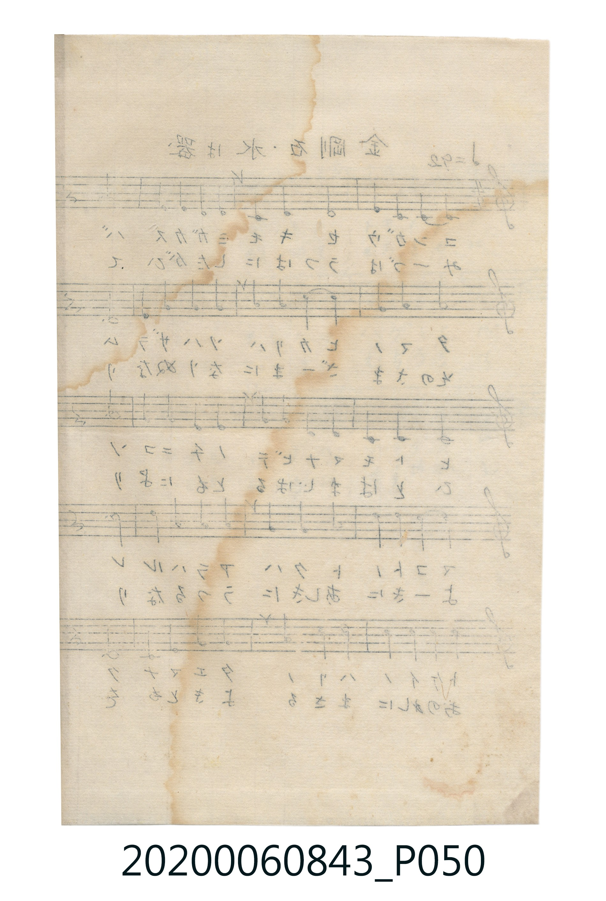
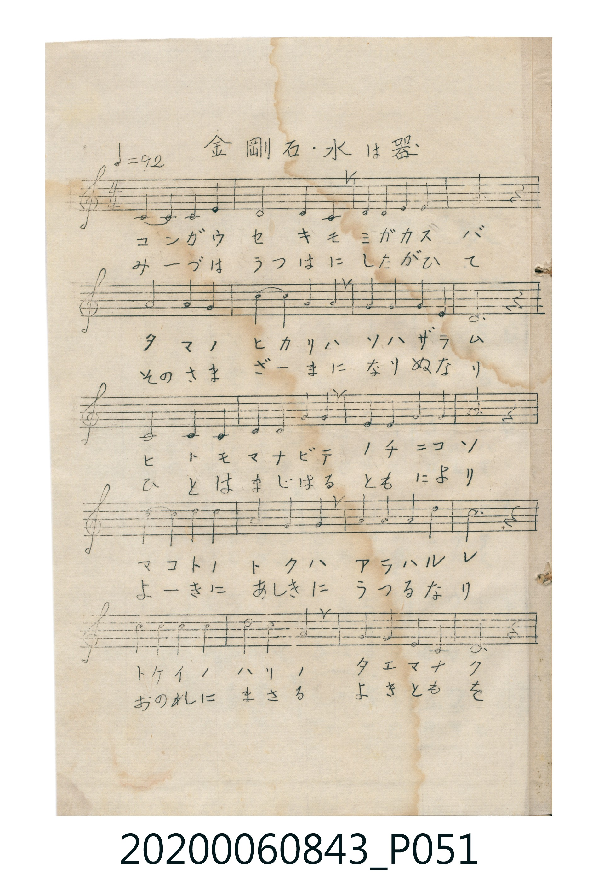
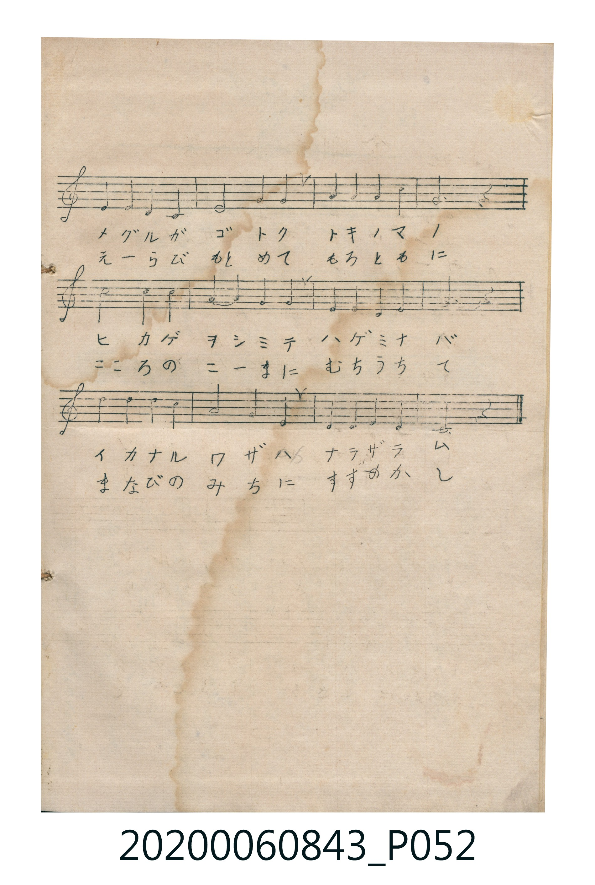

# 金剛石・水は器

> Re:Shoka 使用 AI 辨識樂譜，可能會有錯誤。歡迎回報。

<audio controls src="kongoseki_mizu_wa_utsuwa.mp3"></audio>

- 曲：奥好義 (昭憲皇太后御歌)

## 說明

金剛石・水は器 (Kongōseki / Mizu wa Utsuwa)
Source: 唱歌帖 (Shōkachō, NMTH 2020.006.0843) — P051.jpg – P052.jpg (Insert)
Notation: Handwritten 5-line staff (1 sharp = G major, 4/4 time, 32 bars)

## 跨冊／重複收錄參照

> 同曲（昭憲皇太后御歌、奧好義作曲〈金剛石〉；收錄於《新定兒童唱歌》卷首與《唱歌帖》P051–P052 夾頁）

- **[同曲]** 《新定兒童唱歌》尋常科第一學年用（2020.006.0847.0001）：[**〈金剛石〉**](../../../shintei_jido_shoka/grade_1_2020.006.0847.0001/0_09_kongoseki/index.md)（`C` / `4/4` — [原始 TMD](../../../shintei_jido_shoka/grade_1_2020.006.0847.0001/0_09_kongoseki/kongoseki.tmd)）
- 總表：[跨冊重複與同名歌曲總索引](../../../duplicate_songs.md)

## 歌詞

```text
（TMD 檔案未包含歌詞註解）
```

## ABC

```abc
X:1
T:金剛石・水は器
C:曲：奥好義 (昭憲皇太后御歌)
M:4/4
L:1/16
Q:1/4=92
K:G
V:V1 name="Vocal" snm="Voc"
[V:V1]
!mf! D4 D4 D4 G4 | G4 E4 D4 G4 | A4 A4 B4 A4 | G12 z4 |
B4 B4 A4 B4 | d4 d4 B4 B4 | A4 A4 B4 A4 | D12 z4 |
D4 D4 D4 E4 | F4 F4 A4 A4 | G4 G4 A4 B4 | A12 z4 |
B4 B4 d4 d4 | e4 B4 A4 B4 | A4 B4 A4 d4 | B12 z4 |
d4 d4 d4 d4 | e4 d4 B4 G4 | A4 A4 G4 E4 | D12 z4 |
D4 E4 D4 B,4 | D4 G4 A4 B4 | A4 A4 G4 A4 | B12 z4 |
d4 d4 B4 A4 | G4 E4 D4 G4 | E4 D4 D4 G4 | A12 z4 |
B4 B4 A4 G4 | A4 d4 B4 G4 | A4 D4 E4 F4 | G12 z4 |
```

## TMD 檔案連結

- [主旋律 TMD 檔案](kongoseki_mizu_wa_utsuwa.tmd) [[在 TMD Studio 編輯](https://tmdlang.github.io/Tmd-TS/#tmd=s7IKdvYPcrWy4qpTUCpJTLdSSM7PyUlNLsnMz7MqzsjPTkzOyFeCS5bl55TmploBqXgDY4RwcX5pUXJqfEFieqpVgIGpIboM3KT4vPyS1KT8_GyEioKi_LLUvMQ8oKrcxLzS4uSizIKS-OT8gkqEmtSyzJRUkIrUlMyS_KLMxBwkJ6UWFYMdC3FDSVFiHsQMoCBCVUlGKtDd5YklqUVKXFpaCi_bJz7tnP18_ubHzbufbdjyuHH905krFLS0uBRtFSyNuOxtFdy5bEz0TexAJjybven9nllPly59unTv830rFTSezVj7rG3T81ntT5esejqh7-m-hc_W9mgqcXHpaynYUgtwKSjgcKaGd35e-tHe4tTsTAV9Bd_MqlKF8kSF0JLi0vJETZC2YEioKzydshHosKc7piloBGcc7QVFwdFeHQU_3xAPBSMDIwM9AwMzPQMLE2NNhUcNUxRAUaeXVZAO5EwGcYzAHA3PvOLUohKwwX75JYngpKHgkZiXUl6UWVKSmqdgqpuTmZeqUFySmJamoGGoUJyRWFSgAAxChdzErPwiHQVgQCqUZOam6igYGykkJRYVgw2jPIigQEFLn4sLFCb5oCABhUd4IiQ0rMLykxNzHGoMahSqQVYq2BiaadmBWcCoAobNi5XzrEDaoSKGChrwINe0UnjcBAz4zY-b1jxuWgbk7H7ctPZx8yKFx83zwWKrHzftetw8ARgHj5v2P26e97i5Dyg3CSTRvOpxcz9QeC-Qety07XHzysfNC0AKgdLNHRBDgOq7HjdPftzcBuT0PW5ufNzcDbKxaS9Y4Tyw7UC1IEM7Hjeth5i4CGxW_-NmoCVrkJwOVrPxcdMSiAagAqATgCygy5pWQC1rWg82eeHjpg0g_U1rgNJbIIZD9AO9B3QI2CMQt4L8uAnI2vS4aTvI22C3An20CcwBOh_i-yVgPwO5q4HS60EebgKxgAIrEb5HuNUImIVgqRkUzI37HzcuBXKBrLbHjUuArMeNQP2N0x83zn_c2PO4cdPjxmUgixrnPm5c97hx6uPGfUDONCAFUbjqcVPX48Y1EAZYIVDHCoiJQCUzQCY2dQM5Kx43NQG1PG4CehasEMho7IUYApQAWgjlgN3R1A01ESmYG4EWrXvcBHQUSBnQ8Klgk6HmgM1vmgR2AtCKzseNm4FyQJOBEo0gT4DlYQqBRoAUTgYhkOA6CAfiqaaGx40LwQ4BkhDfAyVWAU2EKASGGVAC5IiZIAQyHujc6TC3AlN8blqtgmm8gi4YYjIMoXQNnGWGR40RlAWjjdH4CFPQoQFMBSwMHcC5Epy9gIkEFECghAjOYUC8FigGzmNQcVBQ7ALyJyDFAtyExv1AmT1AeikQg9MPEC-BssFJCIiBJjX2gNIEEC9DhA_MB-g-gfFrFExhwYEmg1BBOFTgQUlCsIA8NQ9UKIDyICQImleBMh6oRIHS24D0SiBGzleIYJkLxKBEMhWUakBZBRpMIDY4wwBN6ALSwACGsuHBgifFwNNHjYI5jAlnoAcFIkHAaMwAhokQHzag8GjugCYRUBgBfdE8GYjBhSgQNwIxKD-CktVerGEDSgYroEkEFB4zIGxI-QDKoJAwagLaghwu6JGPnjhqFMzQVOD2L7oKhBkwGRJCBBgK4IwEChVwXQHkg8pzcG0BTSVANrhsRq4xEOkNpBOUOnqhqQMUAqCMA-NDMxU4hNBTC47QwAwV9EyEu2jBKI7IykXgcNgIqpyg4QIKA1AuAleKQAyMa1gKAoYXtpQCyiHAXNQEKjzApT0kR0HKe2j4QFMMsMzHzEGY5akxFi8Rzh7oAYPIYmQkl4VAx26AJAdIAwApyYBoUPkLCi5IAYQtWKDJpakTyAZXb9BgAGY9SA0HxEhBAww6nMkFdy2Cry7ClMNTYZEQNNCyFtLiAdLbIdUQpNEDFQfxQWUO9uoIWBKBMNj74NoctdxtagDSwAgA5ygQTUR1hOkjwjkJMwXCi2my6mlQ5gc36KDFCKi4BFZAcDFgEUOgQgIFADDzgdILpPUCDQBw-wWCwekHVMSA2zC1XFy6dgpYW_UKQAllLgA)]
- [鋼琴伴奏 TMD 檔案](kongoseki_mizu_wa_utsuwa_piano.tmd) [[在 TMD Studio 編輯](https://tmdlang.github.io/Tmd-TS/#tmd=s7IKdvYPcrWy4tLSUnjZPvFp5-zn8zc_bt79bMOWx43rn85coaDxuHnK46ZFj5v7nuzZ8nRp_5PdMzQVtLS4FG0VLI247G0V3LlsTPRN7LjqFJSezd70fs-sp0uXPl269_m-lQoaz2asfda26fms9qdLVj2d0Pd038Jna3s0lbi49LUUbKkFuBQUcLndOz8v_WhvcWp2poK-gm9mValCeaJCaElxaXmipsKjhikKAZmJefkKjsnJ-bkFiXmZual5JSDjgvNLi5JTrRSeTtkIdPDTHdMUNIIzjvZmJyYDSR0FP98QDwUjAyMDPQMDMz0DCxNjqGkGpoZ6WQXpQM5kEMcIzNHwzCtOLSrRBBlMuW-hQEFLn4sL5L18kO9AXgtPhHjMKiw_OTHHocagRqEaZKWCjaGZlh2YBRTJTatVMI1X0AVDTIYhlK6Bs8zwqDGCsmC0MRofYQo6NICpALsLmBocwK62AnIeN21WeNwMxE1rgHgZEO8G4rVAsUVAPB8qvhqIdwH5E0ABgWlG436g3B4gvRSI1wNxGxAvgbKBehunAzHQrMYeIN4ExMtg5tTAfYHuGxi_RsEUFiRoMggVhEMGHpz4gwZJISYDHjc1CuYwJpyB7gREZMBoTI_BRAi5Cd3D6AFSo2CGpgK3XegqEGbAZAi5Bt123K5BjzDcSRkj-ZMTY5h5xxiLcYSjA91RiCglN4hw51R8-R1TDk-hQMhJuLIZpkmEYw0zxOHZgJgyqBZXUQquHoI8cBamBbXAGNVGil3sbNN4bYSbTeK1zRB8MI-QFiDHPF4b4Vk0nqE2PB-iSAHDGGQi3CB8PMw0jGosLjtQpIBhrW2sDYsuZDZu40CpCm4aEhNFkYk6ONAQHjMCOx5R1uHlovsNLI2sFAsbOV6gEYDsf1xhgRL6SMGLysQdfgRiGolHfIThihNQbJlow4tGouOY6PQHYiLZhjdJITjoHsPlfOK8hTMRoiZ_XKkQmvDguRXMheuhKBUi53ZcpYBhvDZSjYGjfKAkQWE3g-pxhbeQQnIGUaUhLkXkFp9kZSqcIYluHUomIDYF4iqJkNMTeaU7_qrOB1dVh0gnUAbCHrhzTBAuxq0Id8sBLoDNNuyZCK3fAGrzzwPiPiCeBOkjNK8C4n4gey-U3gakVwLxAhz9hrlAvA6IpwLxPiCeBu1HgNigfgPQvKYuIA3sg0DZ8H4Dhm_x9KrgarC0M40QBQhcEkMIKSThYqZwZfiCCRQ0zR3Q7hQouIDeaZ4MxMAuEjjoGoG4G9INAwYb9mACdZlWQLtToKCZAWE3AfWBxJuaIMHVBLQHOYiwuRnKgCcavKqwJBJ8wU12GAHDBdwNBYUTKExA_gD6D5yEQOEGSkJAdjMoia3BHkYgv4OTTi806YDCBNTthPGhXVJwmOFISkRlN5yKsfQx8AUkabkNHCQbgRjoBXAQgYIDlNuAbFBObAImA1jyAgYd9mQEyknA3NYE6oWDggSUlIA5DxQkoOADBxU0OTVNojB4iMppmAwKEtFCoKs3QBIJeMxiC1JCAtGgMQ1QyEHKLOwhBE1ETZ1ANihDghIRKESAmRQ4ZgEJGaRQAoYiRihhhgSZmYj6RTasmG4ClifNQNy0HTLEAy6LQHkNJA7ig8ooXEM9wLILhMHBACq6QWUZUpHd1ACkgVEBzm8gGmmoB2dxjOQzeHrBV63hTG3Yqj4S0xEoh4HrMlAggGhQQQusx-BiwMKIYL0GCgxg7gSlIXAgAXMoODBAuW4mBIPTFKgwmk5MnYZtYAQjgSApgocQZolPYjICNmF07RSwtmIUgBLKXAA)]

## 分析

```text
================================================================================
📊 TMD Song Profile: [ 金剛石・水は器 ]
================================================================================
⏱  Duration:       1:23 (83.5s), 32 measures total
🎼 Key & Tempo:    首調基準 G, != 92.0 BPM, <4/4>
   - 分析範圍：      由實際發聲的音符與和弦推測調性；播放脈絡另行呈現
🎤 人聲音域:    B3 (MIDI 59) – E5 (MIDI 76) [跨度: 17 個半音 / 1.4 個八度, 難度: challenging]
   - 最低音:  B3 in [KongosekiMizuWaUtsuwa #1 @ m.21, 0:54]
   - 最高音: E5 in [KongosekiMizuWaUtsuwa #1 @ m.14, 0:33]
   - 適合: soprano, mezzo-soprano, contralto, tenor, baritone, bass
🏛  結構:      KongosekiMizuWaUtsuwa (83.5s)
⚡ 編曲密度:        Peak 1 軌道同時演奏
🗝  調性診斷：       D 大調（純淨自然大調，未偵測到可信轉調）
   - 風格氣質:    純淨自然大調（陽光明朗、易唱易記，無明顯調外色彩）
   - 轉調歷程:    全曲維持單一推測調性（未偵測到可信轉調）
   - 核心骨幹音:  D, A, B, G, E
   - 調性數值:    D 大調 [相關度: 0.86, 穩定度: High, 自然音純度: 100.0%]
   - 候選調性 (K-S): D 大調 (0.86), G 大調 (0.72), B 小調 (0.69)
   - 五度圈歷程:   +2
   - 各段落調性細節:
     • [KongosekiMizuWaUtsuwa #1]: D 大調 (r: 0.86, 自然音純度: 100.0%)

  [ 五度圈游移軌跡 ]
               C  
         F            G  
      Bb              [D ]*
      Eb               A  
         Ab           E  
            Db       B  
               F# 
     (* = active key center)

  [ 十二半音累積音高分佈 ]
     C  :                            0.0%
     C# :                            0.0%
     D  : ████████████████████████  27.5%
     D# :                            0.0%
     E  : ███████                    7.5%
     F  :                            0.0%
     F# : ██                         2.5%
     G  : ███████████████           16.7%
     G# :                            0.0%
     A  : █████████████████████     24.2%
     A# :                            0.0%
     B  : ███████████████████       21.7%
--------------------------------------------------------------------------------
Assignment 軌道音域：
  - Vocal         : B3 – E5 (17 個半音 / 1.4 個八度, 104 個音符)
================================================================================
```


## 原書掃描頁








