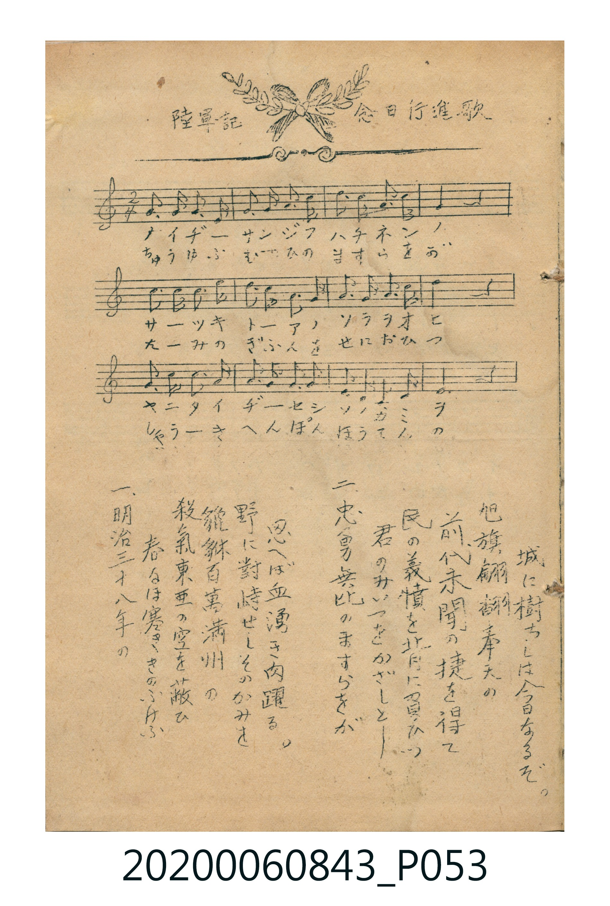

# 陸軍記念日行進歌

> Re:Shōka 使用 AI 協助辨識與重建樂譜，可能會有錯誤。歡迎回報。

- **鋼琴伴奏版**：<br><audio controls src="rikugun_kinembi_koshinka.mp3"></audio>

- 曲：不詳

## 說明

陸軍記念日行進歌 (Rikugun Kinembi Kōshinka)
Source: 唱歌帖 (Shōkachō, NMTH 2020.006.0843) — P053.jpg – P054.jpg (Insert)
Notation: Handwritten 5-line staff (C major, 2/4 time, 24 bars) + 4-verse lyrics


## 歌詞

```text
（TMD 檔案未包含歌詞註解）
```

## ABC

<div class="abc-score" data-abc-src="rikugun_kinembi_koshinka.abc" aria-label="五線譜載入中"></div>

[下載 ABC 原始檔](rikugun_kinembi_koshinka.abc)

## TMD 檔案連結

- [主旋律 TMD 檔案](rikugun_kinembi_koshinka.tmd) [[在 TMD Studio 編輯](https://tmdlang.github.io/Tmd-TS/#tmd=s7IKdvYPcrWy4qpTUCpJTLdSSM7PyUlNLsnMz7MqzsjPTkzOyFeCS5bl55TmploBqXgDY4RwcX5pUXJqfEFieqpVgIEphgzcpPi8_JLUpPz8bISKgqL8stS8xDygqtzEvNLi5KLMgpL45PyCSoSa1LLMlFSQitSUzJL8oszEHCQnpRYVgx0LcUNJUWIexAygIEJVSUYq0N25mTmZJYlFSCZDxNNSi0syy5BNhYgnpxal5ubnodgHtD49M8-qNA_kpJLMtMzUFGTJkoz89KLEgoxKq4zMYpBbkxNz4rMT8xKVuLS0FF7O3PFid--LFTOe7t_6bPrSFwt7XjZsera2R0FLi0vRVsHQ0IjL3lbBmcvGSN_EDmTqs9mb3u-Z9WRH74uVm5W4uPS1FGypBbgUFHC7RyMoM7s0vTRPwTszLzU3KVPB-2hvcUZmXnaiJkhfMCRaFZ5O2QhU_XTHNAWN4IyjvaA4Ptqro-DnG-KhYGRgZKBnYGCmZ2BhYqyp8KhhigIobehlFaQDOZNBHBMwR8Mzrzi1qARssF9-SSI47Sl4JOallBdllpSk5imY6uYAnaFQXJKYlqag4ayQm5iVX6SjAAwkhZLM3FQgy0QhKbGoWFNBW8FEF5QiUhVyKoFhXwwyk_KgggIFLX0uLmjAQMPFOx8SKlZh-cCIdqgxqKkGWalgY2imZQdmAaMMGEQvVs6zAmmHijzZ0fC4ofHZjL5nm3Y_2dH5tLfxaevqpzu3PG5cp6Cv8GzG0seNqx437n66ftLjxl4wWve4cevjxolAEqRg3a5nGxY_m7vxya45QKnnK3c9bpr0Ysrex42bgLIvNk15san1-cx9Lyasebar4en2eRBjX7b3PW5c_XRD79PNMx83zn7cOP1x41ywyd2PG_cDTQCZ3AAU2fG4ccOLhQ3Pdi4HWv2iqfPFrt7HTd2PG5qQfbCrB-iDp_sXPO1uf96y8Nn6KWCT9j1unPm4qRNo2OPGHpB5G4BOXvd838pnbUtAbmzuATrhxaYFQJc-blwCVPB0AtAhQI37Hze2AEXAGoHOmQZ23QogCVLT2ftk9-Jnc1a9aAR55VnvdqCyp_uACpaBrJi-9tn06c_3r3y-f_fTpZ1Pl6yEePfpfJB3n63Y-bhxIdi09U92dwETOShogb4BGoXqoR2dQA-BLe9_3NQEVP64seNxYxNQLUzfOhAJDqbnS4HBtPVxE1BlD8i7jeteNIGsfbKjC2gnUAHInKa5QL0v23ufdgODZNLz-UC9QMGWpxNArgZ7bjdQ8fOl057OAYpPeja58cXa7WCXgr3VMREo_hJkDjBIWh43dQANfLoHaGk3WPtkkNVATyC54cnu3SC7IP5D8dzT2bNB6W3tEpBLl8161jQf7MVljxuB7p38uBHIBRowCxRq-5uBFr7sBcbKjid7gZZMer59y-OmLpCdQCcAXdfU8mJm34t2YHjMBKaoF_t2gb2yDGgg2F3zwdxNLzdMACeFhmfbgekWWcEmcOgDE8osYFnzuKkR5IPGnqf9QI92gBzQ3Q5ODcswZZH8VKNQnVarYKqgC4RmUNoYKIoqYhgHFDKOA7ON4kBciCxMna6CAZSugYWUAzgjWwE92wh0awsQLwLiqUD-ZCA9A4i3AvF6IF4IxGuh4uuQwhpuAkhFU9vjxjYQBeSC6AZQAIA1AIMAiGcCxTqBeBKQDawFYJ4zgzkfwjAFCkEdj_AG2HNALopKZEF8vgP5AJiQgGkFiHdDfQhyXC8UgxwI8ulEMI3Nd_OBeD9UZR9ENSgswF6ZDcSrgbgL6t0lCK_hiQ7kiDSCsiC0IVwEr6eAngBaBfHACkiINzZBnTgXKaRBzgLmvU1Y_QXSDPMXiAalAaChYI2gEJsGxNOhFkxH-AvTC4YQjwLZsDiExBFK6iScEMEBCHQUNCmBuE3AorIfkoLAyQ9GA50FU4U9Rc6BKlwA9RfQf8BcCUvDEP-BUi3Irx1AvAzhP2iiAkYfIs3BfGSKnPrIzG9g-0FpBpSuYPkOlI5AYQ2MPLj7QG6ehCvmQEUUKGRAkbgD6rG9UBqUzEFBsww90xIZVRghYI7Ilnh9BkxuoFAGOahxAzSEYY4E-RjEBiXJleA8ic1noIiFqQaFD6jsAYULqByC5FBwTgbn6HkgE2q5uHTtFLC3VRSAMspcAA)]
- [鋼琴伴奏 TMD 檔案](rikugun_kinembi_koshinka_piano.tmd) [[在 TMD Studio 編輯](https://tmdlang.github.io/Tmd-TS/#tmd=s7IKdvYPcrWy4qpTUCpJTLdSyC8qychPL0osyKi0ysgsLskvykxOzInPTsxLVIIrKs4vLUpOjS9ITE-1CjAwNdYFEiYI6ZKM1NxUq9zMnMySxKJKJS4tLYWXM3e82N37YsWMp_u3Ppu-9MXCnpcNm56t7VHQeNw85XHTosfNfU_2bHm6tP_J7hmaClpaXIq2CoaGRlz2tgrOXDZG-iZ2INOfzd70fs-sJzt6X6zcrMTFpa-lYEstwKWggMeRQZnZpemleQremXmpuUmZCt5He4szMvOyEzUVHjVMUQjITMzLV3BMTs7PLUjMy8xNzSsBmRcMDiYrhadTNgJNebpjmoJGcMbR3uzEZCCpo-DnG-KhYGRgZKBnYGCmZ2BhYgw1DRiielkF6UDOZBDHBMzR8MwrTi0q0QQZTLl3oUBBS5-LC-o5qN-88yE-swrLB0a8Q41BTTXISgUbQzMtOzCrRqE6rVbBVEEXCM2gtDFQFFXEMA4oZBwHZhvFgbgQWZg6XQUDKF0DNhUYmQ5gK62AnMdNjQqPG1uAeBEQTwXyJwPpGUC8FYjXA_FCIF4LFV8H8gamGSA1TW2PG9tAFJALohuA9CawlseN-4B4JlCsE4gnAdk9MGNqgM6EegHCMAUKQT2A8ArYg0AuikpkQXQf4g0O5IA0grIgtCFcBNNATL2GEBuAbJjDIQ5DiRbsMQB3ONCZCH_BDDBF9iEJ8UqkkzCsNkeEObKRtTjTKzgTBnngSLG5wCRrqG2sDXMkMhtoERIPyNKGWwz0KjLXUNtEG-J4dF0YnkZSiWoXioFolhlpm2nDUw_QCHUk24yASs1x2EakI03jtYFcuBSQax6vDUtbeCUxvYfPVAQXPZgRLkPzOb6wRPY5hjbkYEb2N5nxRp7rkV2IzEZzBtHJ2Ac5GZvAU7Eh0HlgyhhCmUAoA6xFKKiYbOoG0quAeDe0GAWVf71QDCoDQcXpRDCNvQidD8T7oWr7IOpBRS64vJwNxKuBuAtapi5BlJ9Ah4GKLUMFM5ALjeJBCBS2uJwKdBpQO8RZKyBFdWMT1Nq5SEU0yKrdINuwuxakHeZaEA2qQIDGgrWCQmIaEE-HWjEd4Vp4QIKDFehKkNtxOxbkV6BN0KoFxG1qedzYD6lRwBUSjAbaBVOFq46aA1W6AOpcoLObgD6H1msQZ4PqMZAXOoB4GbKzkVMDNMhxOxtkGii6QFEKq1lBUQgKEGAYw20DuWAS7gBu6oD4FRTWO6AO3QulQakM5Nll6BUzPFSBroSGNZjC7VpgTIPCAWRF4wZoGMCsBfkCxAalhpXgRI7dtaDgh6kH-RrUZgD5FtR-gCR6cOYAZ5J5yOGKFqCm8WAnQ9wKzLm6dgrYM68CUEaZCwA)]

## 分析

```text
================================================================================
📊 TMD Song Profile: [ 陸軍記念日行進歌 ]
================================================================================
⏱  Duration:       0:25 (25.7s), 24 measures total
🎼 Key & Tempo:    首調基準 C, != 112.0 BPM, <2/4>
   - 分析範圍：      由實際發聲的音符與和弦推測調性；播放脈絡另行呈現
🎤 人聲音域:    C4 (MIDI 60) – E5 (MIDI 76) [跨度: 16 個半音 / 1.3 個八度, 難度: moderate]
   - 最低音:  C4 in [RikugunKinembiKoshinka #1 @ m.11, 0:11]
   - 最高音: E5 in [RikugunKinembiKoshinka #1 @ m.3, 0:02]
   - 適合: soprano, mezzo-soprano, contralto, tenor, baritone, bass
🏛  結構:      RikugunKinembiKoshinka (25.7s)
⚡ 編曲密度:        Peak 1 軌道同時演奏
🗝  調性診斷：       G 大調（純淨自然大調，未偵測到可信轉調）
   - 風格氣質:    純淨自然大調（陽光明朗、易唱易記，無明顯調外色彩）
   - 轉調歷程:    全曲維持單一推測調性（未偵測到可信轉調）
   - 核心骨幹音:  G, C, D, A, E
   - 調性數值:    G 大調 [相關度: 0.83, 穩定度: Moderate, 自然音純度: 100.0%]
   - 候選調性 (K-S): G 大調 (0.83), C 大調 (0.78), A 小調 (0.57)
   - 五度圈歷程:   +1
   - 各段落調性細節:
     • [RikugunKinembiKoshinka #1]: G 大調 (r: 0.83, 自然音純度: 100.0%)

  [ 五度圈游移軌跡 ]
               C  
         F           [G ]*
      Bb               D  
      Eb               A  
         Ab           E  
            Db       B  
               F# 
     (* = active key center)

  [ 十二半音累積音高分佈 ]
     C  : ██████████████████        20.8%
     C# :                            0.0%
     D  : ██████████████████        20.8%
     D# :                            0.0%
     E  : ███████████               12.5%
     F  :                            0.0%
     F# :                            0.0%
     G  : ████████████████████████  27.4%
     G# :                            0.0%
     A  : ████████████████          17.9%
     A# :                            0.0%
     B  : █                          0.6%
--------------------------------------------------------------------------------
Assignment 軌道音域：
  - Vocal         : C4 – E5 (16 個半音 / 1.3 個八度, 78 個音符)
================================================================================
```


## 原書掃描頁




