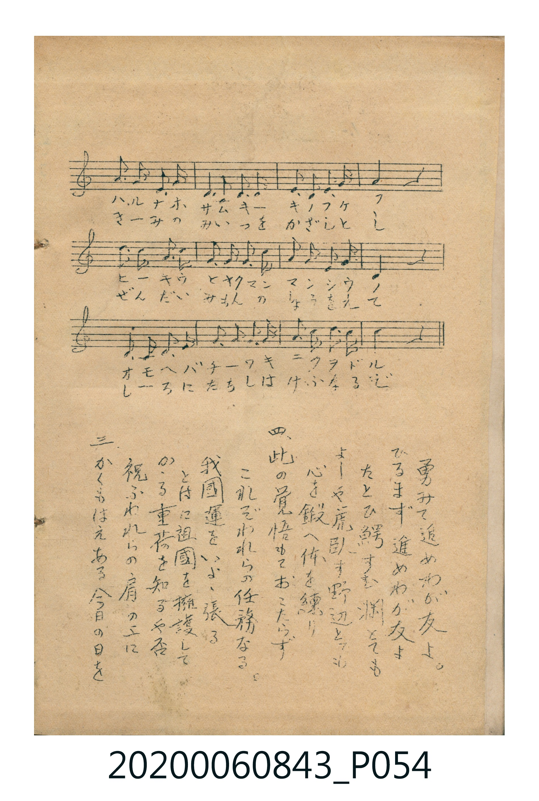

# 陸軍記念日行進歌

> Re:Shōka 使用 AI 協助辨識與重建樂譜，可能會有錯誤。歡迎回報。

- **鋼琴伴奏版**：<br><audio controls src="rikugun_kinembi_koshinka.mp3"></audio>

- 曲：不詳

## 說明

陸軍記念日行進歌 (Rikugun Kinembi Kōshinka)
Source: 唱歌帖 (Shōkachō, NMTH 2020.006.0843) — P053.jpg – P054.jpg (Insert)
Notation: Handwritten 5-line staff (C major, 2/4 time, 24 bars) + 4-verse lyrics


## 歌詞

```text
（TMD 檔案未包含歌詞註解）
```

## ABC

<div class="abc-score" data-abc-src="rikugun_kinembi_koshinka.abc" aria-label="五線譜載入中"></div>

[下載 ABC 原始檔](rikugun_kinembi_koshinka.abc)

## TMD 檔案連結

- [主旋律 TMD 檔案](rikugun_kinembi_koshinka.tmd) [[在 TMD Studio 編輯](https://tmdlang.github.io/Tmd-TS/#tmd=s7IKdvYPcrWy4qpTUCpJTLdSSM7PyUlNLsnMz7MqzsjPTkzOyFeCS5bl55TmploBqXgDY4RwcX5pUXJqfEFieqpVgIEphgzcpPi8_JLUpPz8bISKgqL8stS8xDygqtzEvNLi5KLMgpL45PyCSoSa1LLMlFSQitSUzJL8oszEHCQnpRYVgx0LcUNJUWIexAygIEJVSUYq0N25mTmZJYlFSCZDxNNSi0syy5BNhYgnpxal5ubnodgHtD49M8-qNA_kpJLMtMzUFGTJkoz89KLEgoxKq4zMYpBbkxNz4rMT8xKVuLS0FF7O3PFid--LFTOe7t_6bPrSFwt7XjZsera2R0FLi0vRVsHQ0IjL3lbBmcvGSN_EDmTqs9mb3u-Z9WRH74uVm5W4uPS1FGypBbgUFHC7RyMoM7s0vTRPwTszLzU3KVPB-2hvcUZmXnaiJkhfMCRaFZ5O2QhU_XTHNAWN4IyjvaA4Ptqro-DnG-KhYGRgZKBnYGCmZ2BhYqyp8KhhigIobehlFaQDOZNBHBMwR8Mzrzi1qARssF9-SSI47Sl4JOallBdllpSk5imY6uYAnaFQXJKYlqag4ayQm5iVX6SjAAwkhZLM3FQgy0QhKbGoWFNBW8FEF5QiUhVyKoFhXwwyk_KgggIFLX0uLmjAQMPFOx8SKlYBmYl5-Q41BjXVICsVbAzNtOzALGCUAYPoxcp5ViDtUJEnOxoeNzQ-m9H3bNPuJzs6n_Y2Pm1d_XTnlseN6xT0FZ7NWPq4cdXjxt1P10963NgLRuseN2593DgRSIIUrNv1bMPiZ3M3Ptk1Byj1fOWux02TXkzZ-7hxE1D2xaYpLza1Pp-578WENc92NTzdPg9i7Mv2vseNq59u6H26eebjxtmPG6c_bpwLNrn7ceN-oAkgkxuAIjseN254sbDh2c7lQKtfNHW-2NX7uKn7cUMTsg929QB98HT_gqfd7c9bFj5bPwVs0r7HjTMfN3UCDXvc2AMybwPQyeue71v5rG0JyI3NPUAnvNi0AOjSx41LgAqeTgA6BKhx_-PGFqAIWCPQOdPArlsBJEFqOnuf7F78bM6qF40grzzr3Q5U9nQfUMEykBXT1z6bPv35_pXP9-9-urTz6ZKVEO8-nQ_y7rMVOx83LgSbtv7J7i5gIgcFLdA3QKNQPbSjE-ghsOX9j5uagMofN3Y8bmwCqoXpWwciwcH0fCkwmLY-bgKq7AF5t3HdiyaQtU92dAHtBCoAmdM0F6j3ZXvv025gkEx6Ph-oFyjY8nQCyNVgz-0GKn6-dNrTOUDxSc8mN75Yux3sUrC3OiYCxV-CzAEGScvjpg6ggU_3AC3tBmufDLIa6AkkNzzZvRtkF8R_KJ57Ons2KL2tXQJy6bJZz5rmg7247HEj0L2THzcCuUADZoFCbX8z0MKXvcBY2fFkL9CSSc-3b3nc1AWyE-gEoOuaWl7M7HvRDgyPmcAU9WLfLrBXlgENBLtrPpi76eWGCeCk0PBsOzDdIivYBA59YEKZBSxrHjc1gnzQ2PO0H-jRDpADutvBqWEZpiySn2oUqtNqFUwVdIHQDEobA0VRRQzjgELGcWC2URyIC5GFqdNVMIDSNbCQcgjLB5bYVkDPNgLd2gLEi4B4KpA_GUjPAOKtQLweiBcC8Vqo-DqksIabAFLR1Pa4sQ1EAbkgugEUAGANwCAA4plAsU4gngRkA2sBmOfMYM6HMEyBQlDHI7wB9hyQi6ISWRCf70A-ACYkYFoB4t1QH4Ic1wvFIAeCfDoRTGPz3Xwg3g9V2QdRDQoLsFdmA_FqIO6CencJwmt4ogM5Io2gLAhtCBfB6ymgJ4BWQTywAhLijU1QJ85FCmmQs4B5bxNWf4E0w_wFokFpAGgoWCMoxKYB8XSoBdMR_sL0giHEo0A2LA4hcYSSOgknRHAAAh0FTUogbhOwqOyHpCBw8oPRQGfBVGFPkXOgChdA_QX0HzBXwtIwxH-gVAvyawcQL0P4D5qogNGHSHMwH5kipz4y8xvYflCaAaUrWL4DpSNQWAMjD-4-kJsn4Yo5UBEFChlQJO6AemwvlAYlc1DQLEPPtERGFUYImCOyJV6fAZMbKJRBDmrcAA1hmCNBPgaxQUlyJThPYvMZKGJhqkHhAyp7QOECKocgORSck8E5eh7IhFouLl07BextFQWgjDIXAA)]
- [鋼琴伴奏 TMD 檔案](rikugun_kinembi_koshinka_piano.tmd) [[在 TMD Studio 編輯](https://tmdlang.github.io/Tmd-TS/#tmd=s7IKdvYPcrWy4qpTUCpJTLdSyC8qychPL0osyKi0ysgsLskvykxOzInPTsxLVIIrKs4vLUpOjS9ITE-1CjAwNdYFEiYI6ZKM1NxUq9zMnMySxKJKJS4tLYWXM3e82N37YsWMp_u3Ppu-9MXCnpcNm56t7VHQeNw85XHTosfNfU_2bHm6tP_J7hmaClpaXIq2CoaGRlz2tgrOXDZG-iZ2INOfzd70fs-sJzt6X6zcrMTFpa-lYEstwKWggMeRQZnZpemleQremXmpuUmZCt5He4szMvOyEzUVHjVMUQjITMzLV3BMTs7PLUjMy8xNzSsBmRcMDiYrhadTNgJNebpjmoJGcMbR3uzEZCCpo-DnG-KhYGRgZKBnYGCmZ2BhYgw1DRiielkF6UDOZBDHBMzR8MwrTi0q0QQZTLl3oUBBS5-LC-o5qN-88yE-swJ7yqHGoKYaZKWCjaGZlh2YVaNQnVarYKqgC4RmUNoYKIoqYhgHFDKOA7ON4kBciCxMna6CAZSuAZsKjEyHsHxgWrMCch43NSo8bmwB4kVAPBXInwykZwDxViBeD8QLgXgtVHwdyBuYZoDUNLU9bmwDUUAuiG4A0pvAWh437gPimUCxTiCeBGT3wIypAToT6gUIwxQoBPUAwitgDwK5KCqRBdF9iDc4kAPSCMqC0IZwEUwDMfUaQmwAsmEOhzgMJVqwxwDc4UBnIvwFM8AU2YckxCuRTsKw2hwR5shG1uJPr0EeOFJsLjDJGmoba8McicwGWoTEA7K04RYDvYrMNdQ20YY4Hl0XhqeRVKLahWIgmmVG2mba8NQDNEIdyTYjoFJzHLYR6UjTeG0gFy4F5JrHa8PSFl5JTO_hMxXBRQ9mhMvQfI4vLJF9jqENOZiR_U1mvJHnemQXIrPRnEF0MvZBTsYm8FRsCHQemDKGUCYQygBrEQoqJpu6gfQqIN4NLUZB5V8vFIPKQFBxOhFMYy9C5wPxfqjaPoh6UJELLi9nA_FqIO6ClqlLEOUn0GGgYstQwQzkQqN4EAKFLS6nAp0G1A5x1gpIUd3YBLV2LlIRDbJqN8g27K4FaYe5FkSDKhCgsWCtoJCYBsTToVZMR7gWHpDgYAW6EuR23I4F-RVoE7RqAXGbWh439kNqFHCFBKOBdsFU4aqj5kCVLoA6F-jsJqDPofUaxNmgegzkhQ4gXobsbOTUAA1y3M4GmQaKLlCUwmpWUBSCAgQYxnDbQC6YhDuAmzogfgWF9Q6oQ_dCaVAqA3l2GXrFDA9VoCuhYQ2mcLsWGNOgcABZ0bgBGgYwa0G-ALFBqWElOJFjdy0o-GHqQb4GtRlAvgW1HyCJHpw5wJlkHnK4ogWoaTzYyRC3AnOurp0C9syrAJRR5gIA)]

## 分析

```text
================================================================================
📊 TMD Song Profile: [ 陸軍記念日行進歌 ]
================================================================================
⏱  Duration:       0:25 (25.7s), 24 measures total
🎼 Key & Tempo:    首調基準 C, != 112.0 BPM, <2/4>
   - 分析範圍：      由實際發聲的音符與和弦推測調性；播放脈絡另行呈現
🎤 人聲音域:    C4 (MIDI 60) – E5 (MIDI 76) [跨度: 16 個半音 / 1.3 個八度, 難度: moderate]
   - 最低音:  C4 in [RikugunKinembiKoshinka #1 @ m.11, 0:11]
   - 最高音: E5 in [RikugunKinembiKoshinka #1 @ m.3, 0:02]
   - 適合: soprano, mezzo-soprano, contralto, tenor, baritone, bass
🏛  結構:      RikugunKinembiKoshinka (25.7s)
⚡ 編曲密度:        Peak 1 軌道同時演奏
🗝  調性診斷：       G 大調（純淨自然大調，未偵測到可信轉調）
   - 風格氣質:    純淨自然大調（陽光明朗、易唱易記，無明顯調外色彩）
   - 轉調歷程:    全曲維持單一推測調性（未偵測到可信轉調）
   - 核心骨幹音:  G, C, D, A, E
   - 調性數值:    G 大調 [相關度: 0.83, 穩定度: Moderate, 自然音純度: 100.0%]
   - 候選調性 (K-S): G 大調 (0.83), C 大調 (0.78), A 小調 (0.57)
   - 五度圈歷程:   +1
   - 各段落調性細節:
     • [RikugunKinembiKoshinka #1]: G 大調 (r: 0.83, 自然音純度: 100.0%)

  [ 五度圈游移軌跡 ]
               C  
         F           [G ]*
      Bb               D  
      Eb               A  
         Ab           E  
            Db       B  
               F# 
     (* = active key center)

  [ 十二半音累積音高分佈 ]
     C  : ██████████████████        20.8%
     C# :                            0.0%
     D  : ██████████████████        20.8%
     D# :                            0.0%
     E  : ███████████               12.5%
     F  :                            0.0%
     F# :                            0.0%
     G  : ████████████████████████  27.4%
     G# :                            0.0%
     A  : ████████████████          17.9%
     A# :                            0.0%
     B  : █                          0.6%
--------------------------------------------------------------------------------
Assignment 軌道音域：
  - Piano         : C4 – E5 (16 個半音 / 1.3 個八度, 78 個音符)
================================================================================
```


## 原書掃描頁





