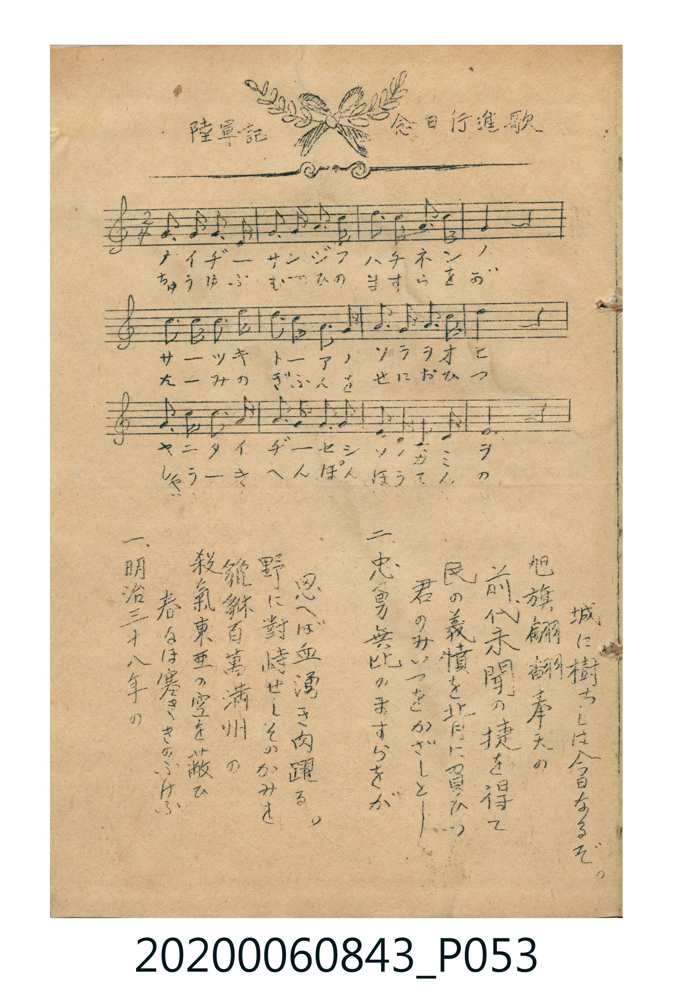
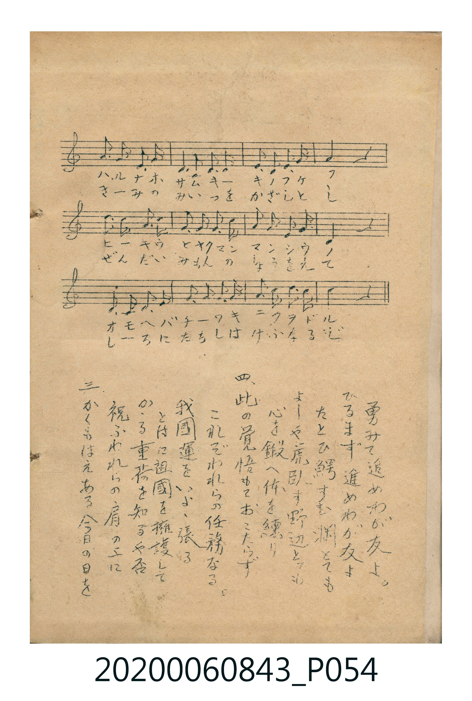

# 陸軍記念日行進歌

> Re:Shōka 使用 AI 協助辨識與重建樂譜，可能會有錯誤。歡迎回報。

- **鋼琴伴奏版**：<br><audio controls src="rikugun_kinembi_koshinka.mp3"></audio>

- 曲：不詳

## 說明

陸軍記念日行進歌 (Rikugun Kinembi Kōshinka)
Source: 唱歌帖 (Shōkachō, NMTH 2020.006.0843) — P053.jpg – P054.jpg (Insert)
Notation: Handwritten 5-line staff (C major, 2/4 time, 24 bars) + 4-verse lyrics


## 歌詞

```text
（TMD 檔案未包含歌詞註解）
```

## ABC

<div class="abc-score" data-abc-src="rikugun_kinembi_koshinka.abc" aria-label="五線譜載入中"></div>

[下載 ABC 原始檔](rikugun_kinembi_koshinka.abc)

## TMD 檔案連結

- [主旋律 TMD 檔案](rikugun_kinembi_koshinka.tmd) [[在 TMD Studio 編輯](https://tmdlang.github.io/Tmd-TS/#tmd=s7IKdvYPcrWy4qpTUCpJTLdSSM7PyUlNLsnMz7MqzsjPTkzOyFeCS5bl55TmploBqXgDY4RwcX5pUXJqfEFieqpVgIEphgzcpPi8_JLUpPz8bISKgqL8stS8xDygqtzEvNLi5KLMgpL45PyCSoSa1LLMlFSQitSUzJL8oszEHCQnpRYVgx0LcUNJUWIexAygIEJVSUYq0N25mTmZJYlFSCZDxNNSi0syy5BNhYgnpxal5ubnodgHtD49M8-qNA_kpJLMtMzUFCUuLS2FlzN3vNjd-2LFjKf7tz6bvvTFwp6XDZuere1R0NLiUrRVMDQ04rK3VXDmsjHSN7EDmfZs9qb3e2Y92dH7YuVmJS4ufS0FW2oBLgUF3O7RCMrMLk0vzVPwzsxLzU3KVPA-2luckZmXnagJ0hcMiTGFp1M2AlU_3TFNQSM442gvKPqO9uoo-PmGeCgYGRgZ6BkYmOkZWJgYayo8apiiAIp2vayCdCBnMohjAuZoeOYVpxaVgA32yy9JBCcrBY_EvJTyosySktQ8BVPdHKAzFIpLEtPSFDScFXITs_KLdBSAgaRQkpmbCmSZKCQlFhVrKmgrmOiCIjtVIaeyKDO5GGQm5UEFBQpa-lxc0ICBhot3PiRUrMLykxNzHGoMahSqQXYq2BiaadmBWcA4A4bRi5XzrED6oSJPdjQ8bmh8NqPv2abdT3Z0Pu1tfNq6-unOLY8b1ynoKzybsfRx46rHjbufrp_0uLEXjNY9btz6uHEikAQpWLfr2YbFz-ZufLJrDlDq-cpdj5smvZiy93HjJqDsi01TXmxqfT5z34sJa57tani6fR7E2JftfY8bVz_d0Pt088zHjbMfN05_3DgXbHL348b9QBNAJjcARXY8btzwYmHDs53LgVa_aOp8sav3cVP344YmZB_s6gH64On-BU-725-3LHy2fgrYpH2PG2c-buoEGva4sQdk3gagk9c937fyWdsSkBube4BOeLFpAdCljxuXABU8nQB0CFDj_seNLUARsEagc6aBXbcCSILUdPY-2b342ZxVLxpBXnnWux2o7Ok-oIJlICumr302ffrz_Suf79_9dGnn0yUrId59Oh_k3Wcrdj5uXAg2bf2T3V3AVA4KWqBvgEahemhHJ9BDYMv7Hzc1AZU_bux43NgEVAvTtw5EgoPp-VJgMG193ARU2QPybuO6F00ga5_s6ALaCVQAMqdpLlDvy_bep93AIJn0fD5QL1Cw5ekEkKvBntsNVPx86bSnc4Dik55NbnyxdjvYpWBvdUwEir8EmQMMkpbHTR1AA5_uAVraDdY-GWQ10BNIbniyezfILoj_UDz3dPZsUHpbuwTk0mWznjXNB3tx2eNGoHsnP24EcoEGzAKF2v5moIUve4GxsuPJXqAlk55v3_K4qQtkJ9AJQNc1tbyY2feiHRgeM4Ep6sW-XWCvLAMaCHbXfDB308sNE8BJoeHZdmC6RVawCRz6wIQyC1jYPG5qBPmgsedpP9CjHSAHdLeDU8MyTFkkPwHzWVqtgqmCLhCaQWljoCiqiGEcUMg4Dsw2igNxIbIwdboKBlC6BhZSDuCcbAX0bCPQrS1AvAiIpwL5k4H0DCDeCsTrgXghEK-Fiq9DCmu4CSAVTW2PG9tAFJALohtAAQDWAAwCIJ4JFOsE4klANrAagHnODOZ8CMMUKAR1PMIbYM8BuSgqkQXx-Q7kA2BCAqYVIN4N9SHIcb1QDHIgyKcTwTQ2380H4v1QlX0Q1aCwAHtlNhCvBuIuqHeXILyGJzqQI9IIyoLQhnARvJ4CegJoFcQDKyAh3tgEdeJcpJAGOQuY9zZh9RdIM8xfIBqUBoCGgjWCQmwaEE-HWjAd4S9MLxhCPApkw-IQEkcoqZNwQgQHINBR0KQE4jYBi8p-SAoCJz8YDXQWTBX2FDkHqnAB1F9A_wFzJSwNQ_wHSrUgv3YA8TKE_6CJChh9iDQH85EpcuojM7-B7QelGVC6guU7UDoChTUw8uDuA7l5Eq6YAxVRoJABReIOqMf2QmlQMgcFzTL0TEtkVGGEgDkiW-L1GTC5gUIZ5KDGDdAQhjkS5GMQG5QkV4LzJDafgSIWphoUPqCyBxQuoHIIkkPBORmco-eBTKjl4tK1U8DeWFEAyihzAQA)]
- [鋼琴伴奏 TMD 檔案](rikugun_kinembi_koshinka_piano.tmd) [[在 TMD Studio 編輯](https://tmdlang.github.io/Tmd-TS/#tmd=s7IKdvYPcrWy4tLSUng5c8eL3b0vVsx4un_rs-lLXyzsedmw6dnaHgWNx81THjctetzc92TPlqdL-5_snqGpoKXFpWirYGhoxGVvq-DMZWOkb2LHVaeg9Gz2pvd7Zj3Z0fti5WYlLi59LQVbagEuBQU8jgzKzC5NL81T8M7MS81NylTwPtpbnJGZl52oqfCoYYpCQGZiXr6CY3Jyfm5BYl5mbmpeCci84PzSouRUK4WnUzYCTXm6Y5qCRnDG0d7sxGQgqaPg5xvioWBkYGSgZ2BgpmdgYWIMNc3A1FgvqyAdyJkM4piAORqeecWpRSWaIIMp9y4UKGjpc3FBPQf1m3c-xGdWYfnJiTkONQY1CtUgOxVsDM207MAsoEharYKpgi4QmkFpY6AoqohhHFDIOA7MNooDcSGyMHW6CgZQugZsKjA2HcB2WgE5j5saFR43tgDxIiCeCuRPBtIzgHgrEK8H4oVAvBYqvg7kD0wzQGqa2h43toEoIBdENwDpTWAtjxv3AfFMoFgnEE8CsntgxtQAnQn1AoRhChSCegDhFbAHgVwUlciC6D7EGxzIAWkEZUFoQ7gIpoGYeg0hNgDZMIdDHIYSLdhjAO5woDMR_oIZYIrsQxLilUgnYVhtjghzZCNrcSZYcC4M8sCVZHOBadZQ21gb5kpkNtAmJB6QpQ23GehXZK6htok2xPXoujB8jaQS1S4UA9EsM9I204YnH6AR6ki2GQGVmuOwjUhHmsZrA7lwKSDXPF4blrjwSmJ6D5-pCC56MCNchuZzfGGJ7HMMbcjBjOxvMuONPNcjuxCZjeYMotOxD650DMlMoDBHOAvmJEwhE0whfKUuqGRt6gbSq4B4N7TkBRWZvVAMKjZBJfBEMI291J0PxPuhavsg6kGlNLiInQ3Eq4G4C1oML0EUuXCnwhyKcLIZwhdGMCacAYoxYrwG9ArQOog3VkBqg8YmqDPnItUCIKftBrkOu-9A2mG-A9GgOgpoLFgrKOSmAfF0qBXTEb7DEyFI0Qb3CSIMiPMcKCyBLoPWdiBuU8vjxn5IJQeuI2E00G0wVbiqzTlQpQug3gN6swkYUtCqFuJNUNUK8nIHEC_D9Cb-1IklqonzJsh2UPIBJTFY4wCUpEABDoxDuOtALp6EOwKbOiBhA4rLHVCP7YXSoFQPCpxl6G0LrLED9wmWeEUSIs53wJQHCmeQkxo3QMMY5kyQr0FsUOpcCc6k2H0Hil6YelAogZpJoNABNZkgmRacucGZfB5mvBEZSabxSN7F9BuwbNO1U8BevCkAZZS5AA)]

## 分析

```text
================================================================================
📊 TMD Song Profile: [ 陸軍記念日行進歌 ]
================================================================================
⏱  Duration:       0:25 (25.7s), 24 measures total
🎼 Key & Tempo:    首調基準 C, != 112.0 BPM, <2/4>
   - 分析範圍：      由實際發聲的音符與和弦推測調性；播放脈絡另行呈現
🎤 人聲音域:    C4 (MIDI 60) – E5 (MIDI 76) [跨度: 16 個半音 / 1.3 個八度, 難度: moderate]
   - 最低音:  C4 in [RikugunKinembiKoshinka #1 @ m.11, 0:11]
   - 最高音: E5 in [RikugunKinembiKoshinka #1 @ m.3, 0:02]
   - 適合: soprano, mezzo-soprano, contralto, tenor, baritone, bass
🏛  結構:      RikugunKinembiKoshinka (25.7s)
⚡ 編曲密度:        Peak 1 軌道同時演奏
🗝  調性診斷：       G 大調（純淨自然大調，未偵測到可信轉調）
   - 風格氣質:    純淨自然大調（陽光明朗、易唱易記，無明顯調外色彩）
   - 轉調歷程:    全曲維持單一推測調性（未偵測到可信轉調）
   - 核心骨幹音:  G, C, D, A, E
   - 調性數值:    G 大調 [相關度: 0.83, 穩定度: Moderate, 自然音純度: 100.0%]
   - 候選調性 (K-S): G 大調 (0.83), C 大調 (0.78), A 小調 (0.57)
   - 五度圈歷程:   +1
   - 各段落調性細節:
     • [RikugunKinembiKoshinka #1]: G 大調 (r: 0.83, 自然音純度: 100.0%)

  [ 五度圈游移軌跡 ]
               C  
         F           [G ]*
      Bb               D  
      Eb               A  
         Ab           E  
            Db       B  
               F# 
     (* = active key center)

  [ 十二半音累積音高分佈 ]
     C  : ██████████████████        20.8%
     C# :                            0.0%
     D  : ██████████████████        20.8%
     D# :                            0.0%
     E  : ███████████               12.5%
     F  :                            0.0%
     F# :                            0.0%
     G  : ████████████████████████  27.4%
     G# :                            0.0%
     A  : ████████████████          17.9%
     A# :                            0.0%
     B  : █                          0.6%
--------------------------------------------------------------------------------
Assignment 軌道音域：
  - Vocal         : C4 – E5 (16 個半音 / 1.3 個八度, 78 個音符)
================================================================================
```


## 原書掃描頁






