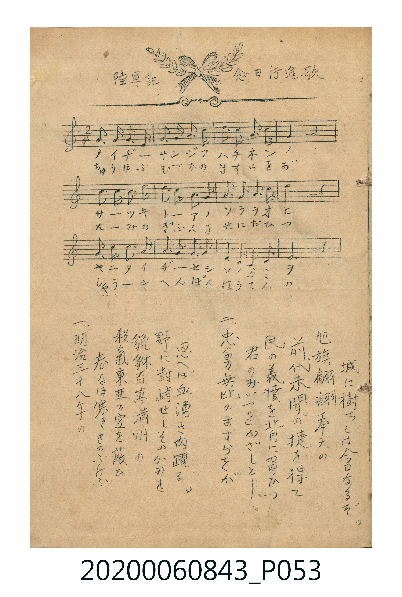
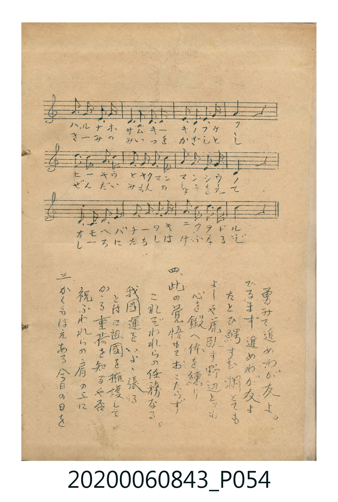

# 陸軍記念日行進歌

> Re:Shoka 使用 AI 協助辨識與重建樂譜，可能會有錯誤。歡迎回報。

<audio controls src="rikugun_kinembi_koshinka.mp3"></audio>

- 曲：不詳

## 說明

陸軍記念日行進歌 (Rikugun Kinembi Kōshinka)
Source: 唱歌帖 (Shōkachō, NMTH 2020.006.0843) — P053.jpg – P054.jpg (Insert)
Notation: Handwritten 5-line staff (C major, 2/4 time, 24 bars) + 4-verse lyrics

## 歌詞

```text
（TMD 檔案未包含歌詞註解）
```

## ABC

```abc
X:1
T:陸軍記念日行進歌
C:曲：不詳
M:2/4
L:1/16
Q:1/4=112
K:C
V:V1 name="Vocal" snm="Voc"
[V:V1]
!f! G3 A G3 E | G3 A G3 c | e3 d c3 A | G4 z4 |
A3 c A3 G | c3 d c3 c | d3 c A3 c | d4 z4 |
e3 d c3 A | G3 A G3 E | D3 E D3 C | D4 z4 |
G3 A G3 E | C3 D E3 G | A3 A G3 c | G4 z4 |
d3 e d3 c | A3 G A3 c | e3 d c3 A | G4 z4 |
C3 D E3 G | A3 A G3 c | d3 e d3 B | c4 z4 |
```

## TMD 檔案連結

- [主旋律 TMD 檔案](rikugun_kinembi_koshinka.tmd) [[在 TMD Studio 編輯](https://tmdlang.github.io/Tmd-TS/#tmd=s7IKdvYPcrWy4qpTUCpJTLdSSM7PyUlNLsnMz7MqzsjPTkzOyFeCS5bl55TmploBqXgDY4RwcX5pUXJqfEFieqpVgIEphgzcpPi8_JLUpPz8bISKgqL8stS8xDygqtzEvNLi5KLMgpL45PyCSoSa1LLMlFSQitSUzJL8oszEHCQnpRYVgx0LcUNJUWIexAygIEJVSUYq0N25mTmZJYlFSCZDxNNSi0syy5BNhYgnpxal5ubnge3T0lJ4OXPHi929L1bMeLp_67PpS18s7HnZsOnZ2h4FLS0uRVsFQ0MjLntbBWcuGyN9EzuQUc9mb3q_Z9aTHb0vVm5W4uLS11KwpRbgUlDA7R6NoMzs0vTSPAXvzLzU3KRMBe-jvcUZmXnZiZogfcGQSFF4OmUjUPXTHdMUNIIzjvaCYuhor46Cn2-Ih4KRgZGBnoGBmZ6BhYmxpsKjhikKoJjVyypIB3ImgzgmYI6GZ15xalEJ2GC__JJEcMpR8EjMSykvyiwpSc1TMNXNATpDobgkMS1NQcNZITcxK79IRwEYSAolmbmpQJaJQlJiUbGmgraCiS4oPlMVciqLMpOLQWZSHlRQoKClz8UFDRhouHjnQ0LFKiw_OTHHocagRqEaZKeCjaGZlh2YBYwzYBi9WDnPCqQfKvJkR8PjhsZnM_qebdr9ZEfn097Gp62rn-7c8rhxnYK-wrMZSx83rnrcuPvp-kmPG3vBaN3jxq2PGycCSZCCdbuebVj8bO7GJ7vmAKWer9z1uGnSiyl7HzduAsq-2DTlxabW5zP3vZiw5tmuhqfb50GMfdne97hx9dMNvU83z3zcOPtx4_THjXPBJnc_btwPNAFkcgNQZMfjxg0vFjY827kcaPWLps4Xu3ofN3U_bmhC9sGuHqAPnu5f8LS7_XnLwmfrp4BN2ve4cebjpk6gYY8be0DmbQA6ed3zfSuftS0BubG5B-iEF5sWAF36uHEJUMHTCUCHADXuf9zYAhQBawQ6ZxrYdSuAJEhNZ--T3YufzVn1ohHklWe924HKnu4DKlgGsmL62mfTpz_fv_L5_t1Pl3Y-XbIS4t2n80HefbZi5-PGhWDT1j_Z3QVM5aCgBfoGaBSqh3Z0Aj0Etrz_cVMTUPnjxo7HjU1AtTB960AkOJieLwUG09bHTUCVPSDvNq570QSy9smOLqCdQAUgc5rmAvW-bO992g0MkknP5wP1AgVbnk4AuRrsud1Axc-XTns6Byg-6dnkxhdrt4NdCvZWx0Sg-EuQOcAgaXnc1AE08OkeoKXdYO2TQVYDPYHkhie7d4PsgvgPxXNPZ88Gpbe1S0AuXTbrWdN8sBeXPW4Eunfy40YgF2jALFCo7W8GWviyFxgrO57sBVoy6fn2LY-bukB2Ap0AdF1Ty4uZfS_ageExE5iiXuzbBfbKMqCBYHfNB3M3vdwwAZwUGp5tB6ZbZAWbwKEPTCizgIXN46ZGkA8ae572Az3aAXJAdzs4NSzDlEXyEzCfpdUqmCroAqEZlDYGiqKKGMYBhYzjwGyjOBAXIgtTp6tgAKVrYCHlAM7JVkDPNgLd2gLEi4B4KpA_GUjPAOKtQLweiBcC8Vqo-DqksIabAFLR1Pa4sQ1EAbkgugEUAGANwCAA4plAsU4gngRkA6sBmOfMYM6HMEyBQlDHI7wB9hyQi6ISWRCf70A-ACYkYFoB4t1QH4Ic1wvFIAeCfDoRTGPz3Xwg3g9V2QdRDQoLsFdmA_FqIO6CencJwmt4ogM5Io2gLAhtCBfB6ymgJ4BWQTywAhLijU1QJ85FCmmQs4B5bxNWf4E0w_wFokFpAGgoWCMoxKYB8XSoBdMR_sL0giHEo0A2LA4hcYSSOgknRHAAAh0FTUogbhOwqOyHpCBw8oPRQGfBVGFPkXOgChdA_QX0HzBXwtIwxH-gVAvyawcQL0P4D5qogNGHSHMwH5kipz4y8xvYflCaAaUrWL4DpSNQWAMjD-4-kJsn4Yo5UBEFChlQJO6AemwvlAYlc1DQLEPPtERGFUYImCOyJV6fAZMbKJRBDmrcAA1hmCNBPgaxQUlyJThPYvMZKGJhqkHhAyp7QOECKocgORSck8E5eh7IhFouLl07BeyNFQWgjDIXAA)]
- [鋼琴伴奏 TMD 檔案](rikugun_kinembi_koshinka_piano.tmd) [[在 TMD Studio 編輯](https://tmdlang.github.io/Tmd-TS/#tmd=s7IKdvYPcrWy4tLSUng5c8eL3b0vVsx4un_rs-lLXyzsedmw6dnaHgWNx81THjctetzc92TPlqdL-5_snqGpoKXFpWirYGhoxGVvq-DMZWOkb2LHVaeg9Gz2pvd7Zj3Z0fti5WYlLi59LQVbagEuBQU8jgzKzC5NL81T8M7MS81NylTwPtpbnJGZl52oqfCoYYpCQGZiXr6CY3Jyfm5BYl5mbmpeCci84PzSouRUK4WnUzYCTXm6Y5qCRnDG0d7sxGQgqaPg5xvioWBkYGSgZ2BgpmdgYWIMNc3A1FgvqyAdyJkM4piAORqeecWpRSWaIIMp9y4UKGjpc3FBPQf1m3c-xGdWYfnJiTkONQY1CtUgOxVsDM207MAsoEharYKpgi4QmkFpY6AoqohhHFDIOA7MNooDcSGyMHW6CgZQugZsKjA2HcB2WgE5j5saFR43tgDxIiCeCuRPBtIzgHgrEK8H4oVAvBYqvg7kD0wzQGqa2h43toEoIBdENwDpTWAtjxv3AfFMoFgnEE8CsntgxtQAnQn1AoRhChSCegDhFbAHgVwUlciC6D7EGxzIAWkEZUFoQ7gIpoGYeg0hNgDZMIdDHIYSLdhjAO5woDMR_oIZYIrsQxLilUgnYVhtjghzZCNrcSZYcC4M8sCVZHOBadZQ21gb5kpkNtAmJB6QpQ23GehXZK6htok2xPXoujB8jaQS1S4UA9EsM9I204YnH6AR6ki2GQGVmuOwjUhHmsZrA7lwKSDXPF4blrjwSmJ6D5-pCC56MCNchuZzfGGJ7HMMbcjBjOxvMuONPNcjuxCZjeYMotOxD650DMlMoDBHOAvmJEwhE0whfKUuqGRt6gbSq4B4N7TkBRWZvVAMKjZBJfBEMI291J0PxPuhavsg6kGlNLiInQ3Eq4G4C1oML0EUuXCnwhyKcLIZwhdGMCacAYoxYrwG9ArQOog3VkBqg8YmqDPnItUCIKftBrkOu-9A2mG-A9GgOgpoLFgrKOSmAfF0qBXTEb7DEyFI0Qb3CSIMiPMcKCyBLoPWdiBuU8vjxn5IJQeuI2E00G0wVbiqzTlQpQug3gN6swkYUtCqFuJNUNUK8nIHEC_D9Cb-1IklqonzJsh2UPIBJTFY4wCUpEABDoxDuOtALp6EOwKbOiBhA4rLHVCP7YXSoFQPCpxl6G0LrLED9wmWeEUSIs53wJQHCmeQkxo3QMMY5kyQr0FsUOpcCc6k2H0Hil6YelAogZpJoNABNZkgmRacucGZfB5mvBEZSabxSN7F9BuwbNO1U8BevCkAZZS5AA)]

## 分析

```text
================================================================================
📊 TMD Song Profile: [ 陸軍記念日行進歌 ]
================================================================================
⏱  Duration:       0:25 (25.7s), 24 measures total
🎼 Key & Tempo:    首調基準 C, != 112.0 BPM, <2/4>
   - 分析範圍：      由實際發聲的音符與和弦推測調性；播放脈絡另行呈現
🎤 人聲音域:    C4 (MIDI 60) – E5 (MIDI 76) [跨度: 16 個半音 / 1.3 個八度, 難度: moderate]
   - 最低音:  C4 in [RikugunKinembiKoshinka #1 @ m.11, 0:11]
   - 最高音: E5 in [RikugunKinembiKoshinka #1 @ m.3, 0:02]
   - 適合: soprano, mezzo-soprano, contralto, tenor, baritone, bass
🏛  結構:      RikugunKinembiKoshinka (25.7s)
⚡ 編曲密度:        Peak 1 軌道同時演奏
🗝  調性診斷：       G 大調（純淨自然大調，未偵測到可信轉調）
   - 風格氣質:    純淨自然大調（陽光明朗、易唱易記，無明顯調外色彩）
   - 轉調歷程:    全曲維持單一推測調性（未偵測到可信轉調）
   - 核心骨幹音:  G, C, D, A, E
   - 調性數值:    G 大調 [相關度: 0.83, 穩定度: Moderate, 自然音純度: 100.0%]
   - 候選調性 (K-S): G 大調 (0.83), C 大調 (0.78), A 小調 (0.57)
   - 五度圈歷程:   +1
   - 各段落調性細節:
     • [RikugunKinembiKoshinka #1]: G 大調 (r: 0.83, 自然音純度: 100.0%)

  [ 五度圈游移軌跡 ]
               C  
         F           [G ]*
      Bb               D  
      Eb               A  
         Ab           E  
            Db       B  
               F# 
     (* = active key center)

  [ 十二半音累積音高分佈 ]
     C  : ██████████████████        20.8%
     C# :                            0.0%
     D  : ██████████████████        20.8%
     D# :                            0.0%
     E  : ███████████               12.5%
     F  :                            0.0%
     F# :                            0.0%
     G  : ████████████████████████  27.4%
     G# :                            0.0%
     A  : ████████████████          17.9%
     A# :                            0.0%
     B  : █                          0.6%
--------------------------------------------------------------------------------
Assignment 軌道音域：
  - Vocal         : C4 – E5 (16 個半音 / 1.3 個八度, 78 個音符)
================================================================================
```


## 原書掃描頁






