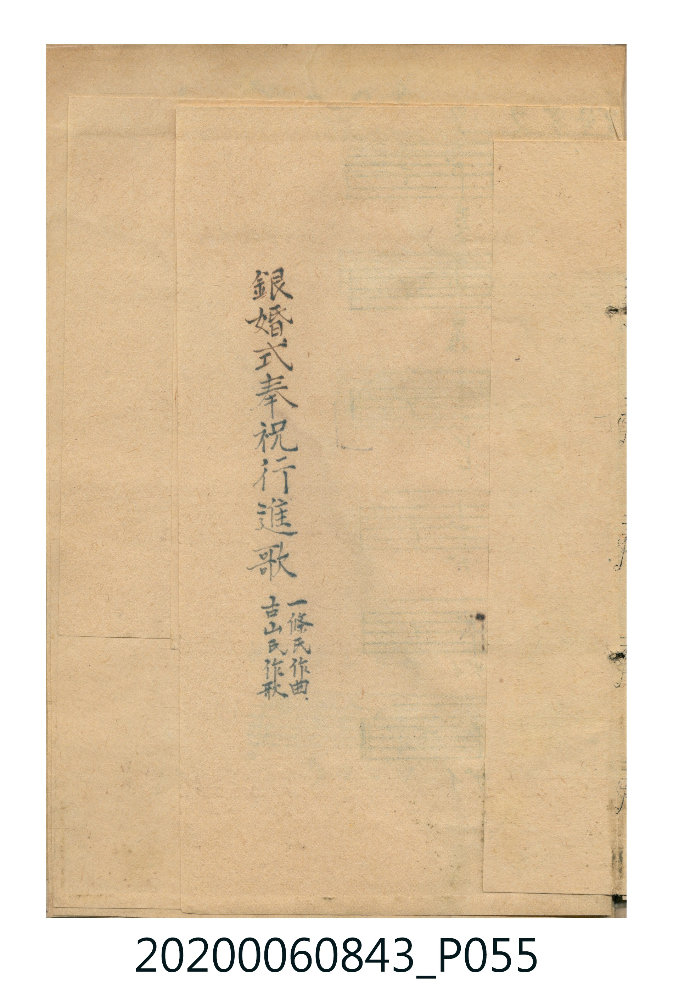
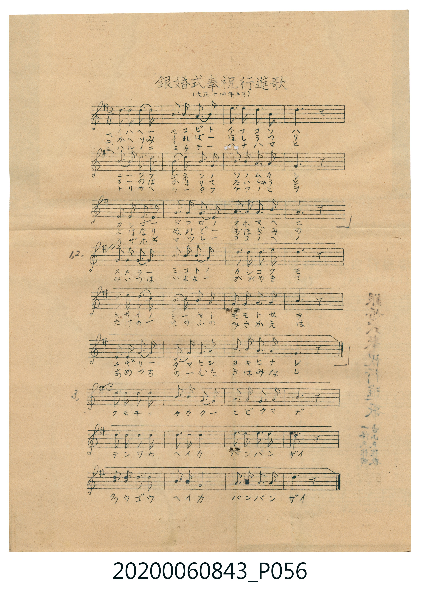

# 銀婚式奉祝行進歌

> Re:Shōka 使用 AI 協助辨識與重建樂譜，可能會有錯誤。歡迎回報。

- **鋼琴伴奏版**：<br><audio controls src="ginkonshiki_hoshuku_koshinka.mp3"></audio>

- 曲：一條氏
- 詞：古山氏

## 說明

銀婚式奉祝行進歌 (Ginkonshiki Hōshuku Kōshinka)
Source: 唱歌帖 (Shōkachō, NMTH 2020.006.0843) — P055.jpg – P056.jpg (Insert)
Notation: Handwritten 5-line staff (1 sharp = G major, 2/4 time)
Annotations: (大正十四年五月), 古山氏作歌 / 一條氏作曲
Note: Staves 1–3 ([A], 12 bars) are followed by Staves 4–6 ([B1], 12 bars)
for Verses 1 & 2, and Staves 7–9 ([B2], 12 bars) for Verse 3.


## 歌詞

```text
（TMD 檔案未包含歌詞註解）
```

## ABC

<div class="abc-score" data-abc-src="ginkonshiki_hoshuku_koshinka.abc" aria-label="五線譜載入中"></div>

[下載 ABC 原始檔](ginkonshiki_hoshuku_koshinka.abc)

## TMD 檔案連結

- [主旋律 TMD 檔案](ginkonshiki_hoshuku_koshinka.tmd) [[在 TMD Studio 編輯](https://tmdlang.github.io/Tmd-TS/#tmd=s7IKdvYPcrWy4qpTUCpJTLdSSM7PyUlNLsnMz7MqzsjPTkzOyFeCS5bl55TmploBqXgDY4RwcX5pUXJqfEFieqpVgIGpGboM3KT4vPyS1KT8_GyEioKi_LLUvMQ8oKrcxLzS4uSizIKS-OT8gkqEmtSyzJRUkIrUlMyS_KLMxBwkJ6UWFYMdC3FDSVFiHsQMoCBCVUlGKtDduZk5mSWJRUgmQ8TTUotLMsuQTYWIJ6cWpebm56HYB7Q-PTPPqiQxszwxLz4_LS0zGSyvpaXwsqvh6cpZT_f0P13a-Xzp3BcLe142bHq2tkdBS4tL0VbB0NCIy95WwZ3LxkjfxA5k4LPZm97vmfVkR8OzRXOfbegHW_Ji5Tyg2NP-JU83bgSLcelrKdhSC3ApKOB2poZ7Zl52fl5xRmZ2poLH0d7ijNLsUgVvEAMokagJ0hwMiVCFp1M2ArU83TFNQSM442gvKHaP9uoo-PmGeCgYGRgZ6BkYmOkZWJgYayo8apiiAEwVpnpZBelAzmQQxwzM0fDMK04tKgEb7JdfkghOdQoeiXkp5UWZJSWpeQqmujmZeakKxSWJaWkKGoYKxRmJRQUKwEBUyE3Myi_SUQAGpUJJZm4q2AzHPGD6AptSbKWg8XTJ8mdrFz_tbXw6e_bTnVue7JrybE6Hpo4CPGyf7J0D8ra-AjwGQCKzN0GdA_RlcEliWWqxgiHQ1cYKGtGOsToKhkYKSYlFxZoKiUWpCmnAzJJfnpqikFQJU2sCVGsGVOtkiKQYZGJafpFCGDCxgsxTUFMw0lEA-hOmyxyoyxKkywjZCrgWBWM9kBGUxz8UKGjpc3EhxbZHPjiuvYEUKKbjHa3C8pMTcxxqDGqqQRYr2BiaadmBWcDUCAw0YCq1AhkCFQEG4OOGxsdNSx439z9unqHwuHnR4-a1j5snP27uUHjctPFx89THzX1A4RWPm4DCk4Bh_ri5-3HTDqAEUH7L4-bex82bwUqa9gKpx80LgKzVj5u2g1SCGY-bNgP1dAIpsMkglaseN89-3DwPKDwDaBqyc3b1gJzT2P24ccfjpm6Fx40zHzfuf9zUA2TtBqGmiUDW_seNy8DGAx3S9bhxHVBo_eNGoNkgJ4EEHjeugLDWg5V1gOVXAUWAKtcATXvcuBLIanrcuPVxI9A9IBs6UAKlE-QKUIisBrnvcfP8x81AfhuQBRTrety0Few3aHB0PG4Gmr0VHHxNyx437Yc4BGgoMPhgAQN2yJLHTdtAXm8COrl53uPmlsfNa4DCm8FhAwplYHD0wRxSo1Cdm1arYBqvoAuGhlC6RsEYTBshiRhBWRAZkIgplAWCBiARmOccwAnECuQakHdAloJiHYjXAvFkkH-QggKuuhEUGTtAYQ6KFFCYAdnAaGneg0012NzVoKQCCjwgbgRiUPDBVdcomEFdB3MpPn_BaKC_YMGBx2MbgRYBYwCSboF8kMcmYfXUbgiGpCogXobTM8CkA4l1ZLNq4E41BznLDEQgOREkCXI5zGfI_oBpxO0NUNg1AUMcktGAdC8Qg7ISPIWgeBqkGpS-wbkBiEGenorVO8CM3bwK4h1IkgUlVpjqWrzFi5MhRvligShenq9ZAypPmncDs_Hzqaue7ut52tsFrGaQyldNbIUP2QUHSOXOx80LHzcD8zMwk4JUAnMjSCXcgKb1oNQNUrkWlElBJR0oXQBzNJAFCgpggQdEoNJu9-PmTeAcDXTTOkgYAfMyMJ9OAjkLUQaCigBgxsUotsgve4AqQaVay-PGJZDYawHpBEqAi8Kex00tQFYvtNhrnP-4cSIkoueCLQSaBOIADZgKyacgS8Eqmx43AUtToJkLQSnjcVMDUDPEJKCjQAl-1ePG6YjUDEqeRsDEWqNggpJ0TcFikMRrgC3H7YXmNnAcAjEwtOA0OBKhNChRYk--sKQLDjxIEgZ7HxQYoIgABx-kyAEGINzF4LwGyksQh4LKDmDJghCE5kWsjgYa2zwbVBBDy0BQDtoJpIFhBUlPUEeDEglWRzc2ATEwF0HiEepgUKiCYgtYukJiEiKOqGAgeR8SzKCyzwxIwlyPKBmwuRhUioKrDnDKhLocmBwhiRNe0IELK5T0ieLiJqApYNeB0wSQ3wBKUqBUAXUxOF0AMThhECgPjPC2N8AFQidmUQBuNKEVBeAql_xKE6QSlNMfN2-AxCTQJGAZAPQPMPcCmzNgFlB3OziDt4EbLevBZR9QP8gOUME-ASwMIoEGbAPVkFBjQSpBrR2C6hF1N7DqxlJ7QVmIehoiZwylQakXXJUQqOFAiQ1Uy4EDCkoDo7RpGyRJQ4IKiIGJD5EQEJUOvgoW5DSQPCTfE9mUAPkfUjVBshLIPaAABzUrNkCzFsjNoDJhPWYTAEbjCiAQRs8geKvONmhVCSpFwFEGDR9wpEHloDQozCARB0zqunYK-BrXCvjlnYAuw68A6AE7BWUuAA)]
- [鋼琴伴奏 TMD 檔案](ginkonshiki_hoshuku_koshinka_piano.tmd) [[在 TMD Studio 編輯](https://tmdlang.github.io/Tmd-TS/#tmd=s7IKdvYPcrWy4tLSUnjZ1fB05ayne_qfLu18vnTui4U9Lxs2PVvbo6DxuHnK46ZFj5v7nuzZ8nRp_5PdMzQVtLS4FG0VDA2NuOxtFdy5bIz0Tey46hSUns3e9H7PrCc7Gp4tmvtsQ78SSOzFynlAsaf9S55u3AgW49LXUrClFuBSUMDjdvfMvOz8vOKMzOxMBY-jvcUZpdmlCt4gBlAiUVPhUcMUhYDMxLx8Bcfk5PzcgsS8zNzUvBKQocH5pUXJqVYKT6dsBBr1dMc0BY3gjKO92YnJQFJHwc83xEPByMDIQM_AwEzPwMLEGGqagampXlZBOpAzGcQxA3M0PPOKU4tKNEEGU-5nKFDQ0ufiQvKhRz7Yf95ACuS7eEersPzkxByHGoOaapDFCjaGZlp2YFaNQnVuWq2CabyCLhgaQukaBWMwbYQkYgRlQWRAIqZQFggagETAZgJj1QFsoRWQ87hpicLj5n4gngHEi4B4LRBPBuIOkLMx1Td2A_EOoD4QPROI9wPZPUD1e7CrB5u9GoiB6pvnA3EjELchq69RMIO6EeZefL6D0UDfwQIF1Xs1cE3mIAVmIAJJMUgSZAbMDmQTYRoRBtYSiDhwmgzywBV1BbUKxvHacLtN47URHgJxtGFuQJcxj9eGOQtFXQ3QU9pG2rCAAjkSLAzzubaJNiwwgZrg6vDZZqIer22GsA6NCwx4kAeADsJhJZJZJiCdcH1EexzJr1BdcMUIy4iKCB_kiDCBx4Mh0FRIEjBEoQywZ4iNwMQ5FYj7gHgFkA_KEJNwZIbdENw0EZIRGpfhyQRdQHVbgRiUGeDmAcMfxVlG8SCEx3mgfNQEzH8gJzZtAdK9QLwZ7FysVoPyaRPQ6sZ1QLweiEHemYrDmR1AvAriTFB50LQMiIHeQqgHBSbQwchhahoP5kPciz-anAwxSjoLeCyB0oARMFMCQwTMgmVRU7AYJIXgiLG90NhaAAndpu1INChoOqE0yOu4ggkWRKAYB7GBQdUEDA5wkIGCBCS2BlLUNa5EBAc4iYOSK8SxoBILWJ4hBKFZAOZwSBkD8SYoc5oBSZhORAlEVEjiLXowihCUTAbhg4IZhyxqUYFU-qCqRS8LyCjrkMsMMBtJDtk4PMUOmhORyz3k8pAmBQ8sHnCUPODsgUQbEih6gAmteTYQz4PWx6C8uxNILwTilZD6E5yQQfkUR0JubAJiYP5tBGYIcN0MSsSgoqkFiIF1PThBA9kgcSBGytfIhSQwj0OzOY5SCFiLNwGzC7i0AJUQIBdPgmQ5pEITXOg1r8Ht0iagOWBXAX0Iyn5NDUAa6MtGYKkGdinI5UA7GqdjuBRaEJFYAhnhbWsBm1pY2hlQFiKJQeSMoTQovODVIyzxYI1eUHSAahdg1MDKLFDzq2kbJNrBAQoKSGD0IAIN0SzB1xgCOQ4kDykxcTf-EI0tpHyB1YMgjF4wIZtGMKDxt43ArVp8hRRyPkbL4tRrsuBvd-EuFlEbVyS0yZDLIzw-xO8UMssqaJQQKKsgZRTBdgioHAKXRaCKF1RWgRIzMMeC-xAboGUXKMGDKuL12MoZYkpEcE8BZAuoOga2RsCtElCWATWiJkDloDQoGwHlkBtWBJoqunYK-BqVCvjlnYARgF8BMMbsFJS5AA)]

## 分析

```text
================================================================================
📊 TMD Song Profile: [ 銀婚式奉祝行進歌 ]
================================================================================
⏱  Duration:       0:38 (38.6s), 36 measures total
🎼 Key & Tempo:    首調基準 G, != 112.0 BPM, <2/4>
   - 分析範圍：      由實際發聲的音符與和弦推測調性；播放脈絡另行呈現
🎤 人聲音域:    D4 (MIDI 62) – E5 (MIDI 76) [跨度: 14 個半音 / 1.2 個八度, 難度: moderate]
   - 最低音:  D4 in [GinkonshikiHoshukuKoshinka_A #1 @ m.1, 0:00]
   - 最高音: E5 in [GinkonshikiHoshukuKoshinka_A #1 @ m.5, 0:04]
   - 適合: soprano, mezzo-soprano, contralto, tenor, baritone, bass
🏛  結構:      GinkonshikiHoshukuKoshinka_A (12.9s) -> GinkonshikiHoshukuKoshinka_B1 (12.9s) -> GinkonshikiHoshukuKoshinka_B2 (12.9s)
⚡ 編曲密度:        Peak 1 軌道同時演奏
🗝  調性診斷：       D 大調（推測轉調經歷 1 次）
   - 風格氣質:    純淨自然大調（陽光明朗、易唱易記，無明顯調外色彩）
   - 轉調歷程:    D 大調起奏 ➔ [GinkonshikiHoshukuKoshinka_B2] 轉至 D 大調 (-5 半音 / 五度圈 +1 步)
   - 核心骨幹音:  A, G, D, B, E
   - 調性數值:    D 大調 [相關度: 0.82, 穩定度: Moderate, 自然音純度: 98.5%]
   - 候選調性 (K-S): D 大調 (0.82), G 大調 (0.77), B 小調 (0.56)
   - 五度圈歷程:   +1 -> +1 -> +2
   - 各段落調性細節:
     • [GinkonshikiHoshukuKoshinka_A #1]: G 調性不明確 (r: 0.84, 自然音純度: 100.0%)
     • [GinkonshikiHoshukuKoshinka_B1 #1]: G 大調 (r: 0.78, 自然音純度: 100.0%)
     • [GinkonshikiHoshukuKoshinka_B2 #1]: D 大調 (r: 0.82, 自然音純度: 100.0%)

  [ 五度圈游移軌跡 ]
               C  
         F           [G ]*
      Bb              [D ]*
      Eb               A  
         Ab           E  
            Db       B  
               F# 
     (* = active key center)

  [ 十二半音累積音高分佈 ]
     C  : █                          1.5%
     C# :                            0.0%
     D  : ███████████████████       21.5%
     D# :                            0.0%
     E  : ███████                    7.4%
     F  :                            0.0%
     F# : ███                        3.0%
     G  : ████████████████████      22.6%
     G# :                            0.0%
     A  : ████████████████████████  26.7%
     A# :                            0.0%
     B  : ████████████████          17.4%
--------------------------------------------------------------------------------
Assignment 軌道音域：
  - Vocal         : D4 – E5 (14 個半音 / 1.2 個八度, 78 個音符)
================================================================================
```


## 原書掃描頁






