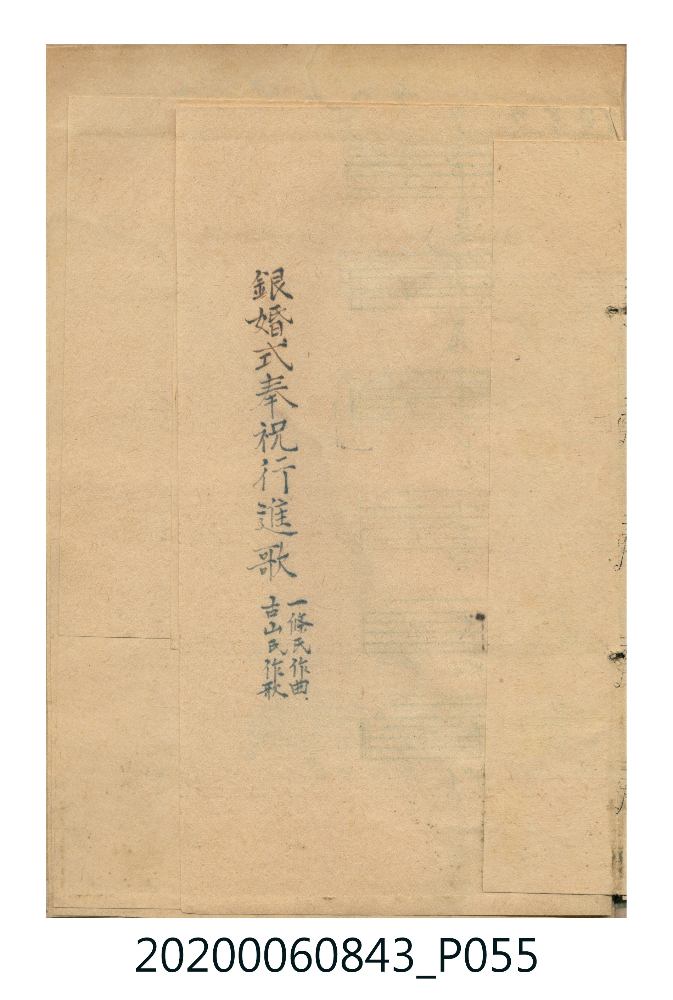
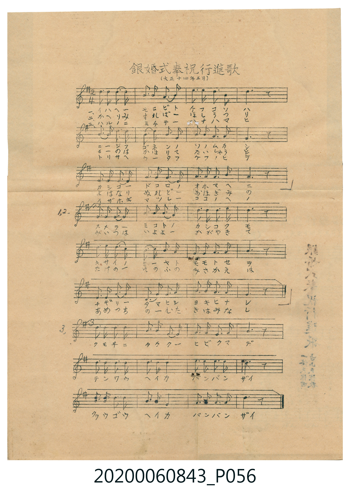

# 銀婚式奉祝行進歌

> Re:Shōka 使用 AI 協助辨識與重建樂譜，可能會有錯誤。歡迎回報。

- **鋼琴伴奏版**：<br><audio controls src="ginkonshiki_hoshuku_koshinka.mp3"></audio>

- 曲：一條氏
- 詞：古山氏

## 說明

銀婚式奉祝行進歌 (Ginkonshiki Hōshuku Kōshinka)
Source: 唱歌帖 (Shōkachō, NMTH 2020.006.0843) — P055.jpg – P056.jpg (Insert)
Notation: Handwritten 5-line staff (1 sharp = G major, 2/4 time)
Annotations: (大正十四年五月), 古山氏作歌 / 一條氏作曲
Note: Staves 1–3 ([A], 12 bars) are followed by Staves 4–6 ([B1], 12 bars)
for Verses 1 & 2, and Staves 7–9 ([B2], 12 bars) for Verse 3.


## 歌詞

```text
（TMD 檔案未包含歌詞註解）
```

## ABC

<div class="abc-score" data-abc-src="ginkonshiki_hoshuku_koshinka.abc" aria-label="五線譜載入中"></div>

[下載 ABC 原始檔](ginkonshiki_hoshuku_koshinka.abc)

## TMD 檔案連結

- [主旋律 TMD 檔案](ginkonshiki_hoshuku_koshinka.tmd) [[在 TMD Studio 編輯](https://tmdlang.github.io/Tmd-TS/#tmd=s7IKdvYPcrWy4qpTUCpJTLdSSM7PyUlNLsnMz7MqzsjPTkzOyFeCS5bl55TmploBqXgDY4RwcX5pUXJqfEFieqpVgIGpGboM3KT4vPyS1KT8_GyEioKi_LLUvMQ8oKrcxLzS4uSizIKS-OT8gkqEmtSyzJRUkIrUlMyS_KLMxBwkJ6UWFYMdC3FDSVFiHsQMoCBCVUlGKtDduZk5mSWJRUgmQ8TTUotLMsuQTYWIJ6cWpebm56HYB7Q-PTPPqiQxszwxLz4_LS0zGU2-JCM_vSixIKPSKiOzGOTc5MSc-OzEvEQlLi0thZddDU9Xznq6p__p0s7nS-e-WNjzsmHTs7U9ClpaXIq2CoaGRlz2tgruXDZG-iZ2IFOfzd70fs-sJzsani2a-2xDP9imFyvnAcWe9i95unEjWIxLX0vBllqAS0EBtzM13DPzsvPzijMyszMVPI72FmeUZpcqeIMYQIlETZDmYEisKzydshGo5emOaQoawRlHe0FJ4GivjoKfb4iHgpGBkYGegYGZnoGFibGmwqOGKQrApGOql1WQDuRMBnHMwBwNz7zi1KISsMF--SWJ4KSp4JGYl1JelFlSkpqnYKqbk5mXqlBckpiWpqBhqFCckVhUoAAMRIXcxKz8Ih0FYFAqlGTmpoLNcMwDJkKwKcVWChpPlyx_tnbx097Gp7NnP9255cmuKc_mdGjqKMDD9sneOSBv6yvAYwAkMnsT1DlAXwaXJJalFisYAl1trKAR7Riro2BopJCUWFSsqZBYlKqQBsxR-eWpKQpJlTC1JkC1ZkC1ToZIikEmpuUXKYQBUzTIPAU1BSMdBaA_YbrMgbosQbqMkK2Aa1Ew1gMZQXn8Q4GClj4XF1Jse-SD49obSIFiOt7RKiwfmLQdagxqqkEWK9gYmmnZgVnA1AgMNGAqtQIZAhUBBuDjhsbHTUseN_c_bp6h8Lh50ePmtY-bJz9u7lB43LTxcfPUx819QOEVj5uAwpOAYf64uftx0w6gBFB-y-Pm3sfNm8FKmvYCqcfNC4Cs1Y-btoNUghmPmzYD9XQCKbDJIJWrHjfPftw8Dyg8A2gasnN29YCc09j9uHHH46ZuhceNMx837n_c1ANk7QahpolA1v7HjcvAxgMd0vW4cR1QaP3jRqDZICeBBB43roCw1oOVdYDlVwFFgCrXAE173LgSyGp63Lj1cSPQPSAbOlACpRPkClCIrAa573Hz_MfNQH4bkAUU63rctBXsN2hwdDxuBpq9FRx8TcseN-2HOARoKDD4YAEDdsiSx03bQF5vAjq5ed7j5pbHzWuAwpvBYQMKZWBw9MEcUqNQnZtWq2Aar6ALhoZQukbBGEwbIYkYQVkQGZCIKZQFggYgEZjnHMAJxArkGpB3QJaCYh2I1wLxZJB_kIICrroRFBk7QGEOihRQmAHZwGhp3oNNNdjc1aCkAgo8IG4EYlDwwVXXKJhBXQdzKT5_wWigv2DBgcdjG4EWAWMAkm6BfJDHJmH11G4IhqQqIF6G0zPApAOJdWSzauBONQc5ywxEIDkRJAlyOcxnyP6AacTtDVDYNQFDHJLRgHQvEIOyEjyFoHgapBqUvsG5AYhBnp6K1TvAjN28CuIdSJIFJVaY6lq8xYuTIUb5YoEoXp6vWQMqT5p3A7Px86mrnu7redrbBaxmkMpXTWyFD9kFB0jlzsfNCx83A_MzMJOCVAJzI0gl3ICm9aDUDVK5FpRJQSUdKF0AczSQBQoKYIEHRKDSbvfj5k3gHA100zpIGAHzMjCfTgI5C1EGgooAYMbFKLbIL3uAKkGlWsvjxiWQ2GsB6QRKgIvCnsdNLUBWL7TYa5z_uHEiJKLngi0EmgTiAA2YCsmnIEvBKpseNwFLU6CZC0Ep43FTA1AzxCSgo0AJftXjxumI1AxKnkbAxFqjYIKSdE3BYpDEa4Atx-2F5jZwHAIxMLTgNDgSoTQoUWJPvrCkCw48SBIGex8UGKCIAAcfpMgBBiDcxeC8BspLEIeCyg5gyYIQhOZFrI4GGts8G1QQQ8tAUA7aCaSBYQVJT1BHgxIJVkc3NgExMBdB4hHqYFCogmILWLpCYhIijqhgIHkfEsygss8MSMJcjygZsLkYVIqCqw5wyoS6HJgcIYkTXtCBCyuU9Ini4iagKWDXgdMEkN8ASlKgVAF1MThdADE4YRAoD4zwtjfABUInZlEAbjShFQXgKpf8ShOkEpTTHzdvgMQk0CRgGQD0DzD3ApszYBZQdzs4g7eBGy3rwWUfUD_IDlDBPgEsDCKBBmwD1ZBQY0EqQa0dguoRdTew6sZSe0FZiHoaImcMpUGpF1yVEKjhQIkNVMuBAwpKA6O0aRskSUOCCoiBiQ-REBCVDr4KFuQ0kDwk3xPZlAD5H1I1QbISyD2gAAc1KzZAsxbIzaAyYT1mEwBG4wogEEbPIHirzjZoVQkqRcBRBg0fcKRB5aA0KMwgEQdM6rp2Cvga1wr45Z2ALsOvAOgBOwVlLgA)]
- [鋼琴伴奏 TMD 檔案](ginkonshiki_hoshuku_koshinka_piano.tmd) [[在 TMD Studio 編輯](https://tmdlang.github.io/Tmd-TS/#tmd=s7IKdvYPcrWy4qpTUCpJTLdSyC8qychPL0osyKi0ysgsLskvykxOzInPTsxLVIIrKs4vLUpOjS9ITE-1CjAwNdUFEmYI6ZKM1NxUq9SU0uTEksz8PCUuLS2Fl10NT1fOerqn_-nSzudL575Y2POyYdOztT0KGo-bpzxuWvS4ue_Jni1Pl_Y_2T1DU0FLi0vRVsHQ0IjL3lbBncvGSN_EDmT8s9mb3u-Z9WRHw7NFc59t6Adb-WLlPKDY0_4lTzduBItx6Wsp2FILcCko4HG7e2Zedn5ecUZmdqaCx9He4ozS7FIFbxADKJGoqfCoYYpCQGZiXr6CY3Jyfm5BYl5mbmpeCcjQYHAYWik8nbIRaNTTHdMUNIIzjvZmJyYDSR0FP98QDwUjAyMDPQMDMz0DCxNjqGnA4NbLKkgHciaDOGZgjoZnXnFqUYkmyGDK_QwFClr6XFxIPvTIB_vPG0iBfBfvaBWWD0wbDjUGNdUgixVsDM207MCsGoXq3LRaBdN4BV0wNITSNQrGYNoIScQIyoLIgERMoSwQNACJgM0ExqoD2EIrIOdx0xKFx839QDwDiBcB8VogngzEHSBnY6pv7AbiHUB9IHomEO8HsnuA6vdgVw82ezUQA9U3zwfiRiBuQ1Zfo2AGdSPMvfh8B6OBvoMFCqr3auCazEEKzEAEkmKQJMgMmB3IJsI0IgysJRBx4DQZ5IEr6gpqFYzjteF2m8ZrIzwE4mjD3IAuYx6vDXMWiroaoKe0jbRhAQVyJFgY5nNtE21YYAI1wdXhs81EPV7bDGEdGhcY8CAPAB2Ew0oks0xAOuH6iPY4kl-huuCKEZYRFRE-yBFhAo8HQ6CpkCRgiEIZYM8QG4GJcyoQ9wHxCiAflCEm4cgMuyG4aSIkIzQuw5MJuoDqtgIxKDPAzQOGP4qzjOJBCI_zQPmoCZj_QE5s2gKke4F4M9i5WK0G5dMmoNWN64B4PRCDvDMVhzM7gHgVxJmg8qBpGRADvYVQDwpMoIORw9Q0HsyHuBd_NDkZYpR0FvBYAqUBI2CmBIYImAXLoqZgMUgKwRFje6GxtQASuk3bkWhQ0HRCaZDXcQUTLIhAMQ5iA4OqCRgc4CADBQlIbA2kqGtciQgOcBIHJVeIY0ElFrA8QwhCswDM4ZAyBuJNUOY0A5IwnYgSiKiQxFv0YBQhKJkMwgcFMw5Z1KICqfRBVYteFpBR1iGXGWA2khyycXiKHTQnIpd7yOUhTQoeWDzgKHnA2QOJNiRQ9AATWvNsIJ4HrY9BeXcnkF4IxCsh9Sc4IYPyKY6E3NgExMD82wjMEOC6GZSIQUVTCxAD63pwggayQeJAjJSvkQtJYB6HZnMcpRCwFm8CZhdwaQEqIUAungTJckiFJrjQa16D26VNQHPArgL6EJT9mhqANNCXjcBSDexSkMuBdjROx3AptCAisQQywtvWAja1sLQzoCxEEoPIGUNpUHjBq0dY4sEavaDoANUuwKiBlVmg5lfTNki0gwMUFJDA6EEEGqJZgq8xBHIcSB5SYuJu_CEaW0j5AqsHQRi9YEI2jWBA428bgVu1-Aop5HyMlsWp12TB3-7CXSyiNq5IaJMhl0d4fIjfKWSWVdAoIVBWQcoogu0QUDkELotAFS-orAIlZmCOBfchNkDLLlCCB1XE67GVM8SUiOCeAsgWUHUMbI2AWyWgLANqRE2AykFpUDYCyiE3rAg0VXTtFPA1KhXwyzsBIwC_AmCM2SkocwEA)]

## 分析

```text
================================================================================
📊 TMD Song Profile: [ 銀婚式奉祝行進歌 ]
================================================================================
⏱  Duration:       0:38 (38.6s), 36 measures total
🎼 Key & Tempo:    首調基準 G, != 112.0 BPM, <2/4>
   - 分析範圍：      由實際發聲的音符與和弦推測調性；播放脈絡另行呈現
🎤 人聲音域:    D4 (MIDI 62) – E5 (MIDI 76) [跨度: 14 個半音 / 1.2 個八度, 難度: moderate]
   - 最低音:  D4 in [GinkonshikiHoshukuKoshinka_A #1 @ m.1, 0:00]
   - 最高音: E5 in [GinkonshikiHoshukuKoshinka_A #1 @ m.5, 0:04]
   - 適合: soprano, mezzo-soprano, contralto, tenor, baritone, bass
🏛  結構:      GinkonshikiHoshukuKoshinka_A (12.9s) -> GinkonshikiHoshukuKoshinka_B1 (12.9s) -> GinkonshikiHoshukuKoshinka_B2 (12.9s)
⚡ 編曲密度:        Peak 1 軌道同時演奏
🗝  調性診斷：       D 大調（推測轉調經歷 1 次）
   - 風格氣質:    純淨自然大調（陽光明朗、易唱易記，無明顯調外色彩）
   - 轉調歷程:    D 大調起奏 ➔ [GinkonshikiHoshukuKoshinka_B2] 轉至 D 大調 (-5 半音 / 五度圈 +1 步)
   - 核心骨幹音:  A, G, D, B, E
   - 調性數值:    D 大調 [相關度: 0.82, 穩定度: Moderate, 自然音純度: 98.5%]
   - 候選調性 (K-S): D 大調 (0.82), G 大調 (0.77), B 小調 (0.56)
   - 五度圈歷程:   +1 -> +1 -> +2
   - 各段落調性細節:
     • [GinkonshikiHoshukuKoshinka_A #1]: G 調性不明確 (r: 0.84, 自然音純度: 100.0%)
     • [GinkonshikiHoshukuKoshinka_B1 #1]: G 大調 (r: 0.78, 自然音純度: 100.0%)
     • [GinkonshikiHoshukuKoshinka_B2 #1]: D 大調 (r: 0.82, 自然音純度: 100.0%)

  [ 五度圈游移軌跡 ]
               C  
         F           [G ]*
      Bb              [D ]*
      Eb               A  
         Ab           E  
            Db       B  
               F# 
     (* = active key center)

  [ 十二半音累積音高分佈 ]
     C  : █                          1.5%
     C# :                            0.0%
     D  : ███████████████████       21.5%
     D# :                            0.0%
     E  : ███████                    7.4%
     F  :                            0.0%
     F# : ███                        3.0%
     G  : ████████████████████      22.6%
     G# :                            0.0%
     A  : ████████████████████████  26.7%
     A# :                            0.0%
     B  : ████████████████          17.4%
--------------------------------------------------------------------------------
Assignment 軌道音域：
  - Vocal         : D4 – E5 (14 個半音 / 1.2 個八度, 78 個音符)
================================================================================
```


## 原書掃描頁






