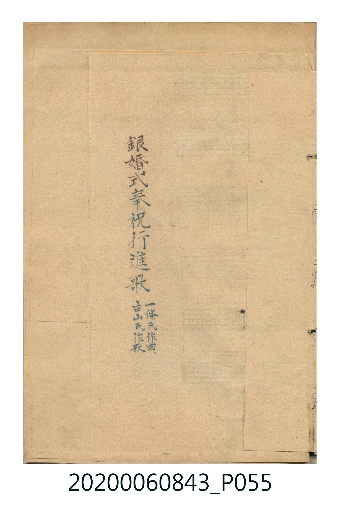
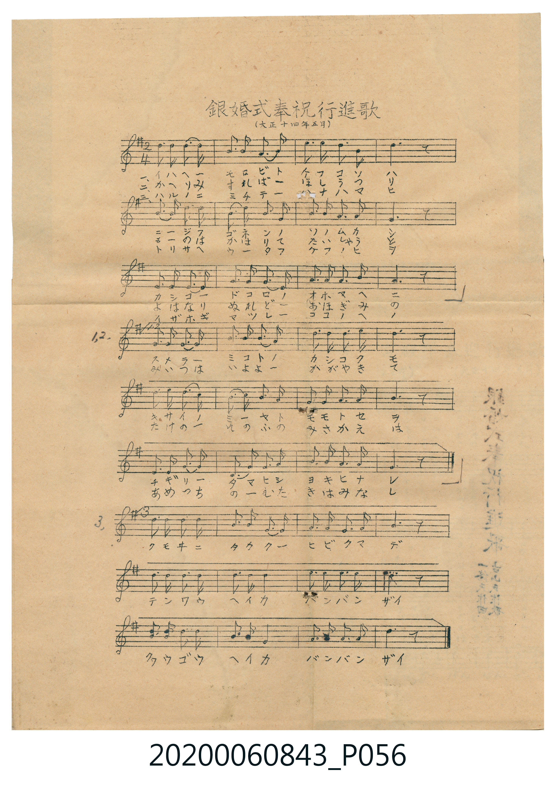

# 銀婚式奉祝行進歌

> Re:Shoka 使用 AI 辨識樂譜，可能會有錯誤。歡迎回報。

<audio controls src="ginkonshiki_hoshuku_koshinka.mp3"></audio>

- 曲：一條氏
- 詞：古山氏

## 說明

銀婚式奉祝行進歌 (Ginkonshiki Hōshuku Kōshinka)
Source: 唱歌帖 (Shōkachō, NMTH 2020.006.0843) — P055.jpg – P056.jpg (Insert)
Notation: Handwritten 5-line staff (1 sharp = G major, 2/4 time)
Annotations: (大正十四年五月), 古山氏作歌 / 一條氏作曲
Note: Staves 1–3 ([A], 12 bars) are followed by Staves 4–6 ([B1], 12 bars)
for Verses 1 & 2, and Staves 7–9 ([B2], 12 bars) for Verse 3.

## 歌詞

```text
（TMD 檔案未包含歌詞註解）
```

## ABC

```abc
X:1
T:銀婚式奉祝行進歌
C:曲：一條氏
M:2/4
L:1/16
Q:1/4=112
K:G
V:V1 name="Vocal" snm="Voc"
[V:V1]
!mf! D4 G4 | B3 A G4 | A4 B4 | d6 z2 |
e4 d4 | B3 A G4 | A4 A4 | D6 z2 |
G4 F2 E2 | D4 G2 A2 | B4 A4 | G6 z2 |
A4 A2 B2 | c4 A4 | B4 d2 B2 | A6 z2 |
D4 G4 | B4 A2 G2 | E4 G4 | D6 z2 |
G4 A2 B2 | d4 e2 d2 | B4 A4 | G6 z2 |
!f! A4 A4 | d4 B4 | A3 B A3 G | F6 z2 |
G4 G4 | A4 A4 | B2 G2 B2 d2 | d6 z2 |
e4 e4 | d4 B4 | A2 A2 B2 A2 | G6 z2 |
```

## TMD 檔案連結

- [主旋律 TMD 檔案](ginkonshiki_hoshuku_koshinka.tmd) [[在 TMD Studio 編輯](https://tmdlang.github.io/Tmd-TS/#tmd=s7IKdvYPcrWy4qpTUCpJTLdSSM7PyUlNLsnMz7MqzsjPTkzOyFeCS5bl55TmploBqXgDY4RwcX5pUXJqfEFieqpVgIGpGboM3KT4vPyS1KT8_GyEioKi_LLUvMQ8oKrcxLzS4uSizIKS-OT8gkqEmtSyzJRUkIrUlMyS_KLMxBwkJ6UWFYMdC3FDSVFiHsQMoCBCVUlGKtDduZk5mSWJRUgmQ8TTUotLMsuQTYWIJ6cWpebm54Ht09JSeNnV8HTlrKd7-p8u7Xy-dO6LhT0vGzY9W9ujoKXFpWirYGhoxGVvq-DOZWOkb2IHMurZ7E3v98x6sqPh2aK5zzb0g41_sXIeUOxp_5KnGzeCxbj0tRRsqQW4FBRwO1PDPTMvOz-vOCMzO1PB42hvcUZpdqmCN4gBlEjUBGkOhkSYwtMpG4Fanu6YpqARnHG0FxR7R3t1FPx8QzwUjAyMDPQMDMz0DCxMjDUVHjVMUQDGuqleVkE6kDMZxDEDczQ884pTi0rABvvllySCU5WCR2JeSnlRZklJap6CqW5OZl6qQnFJYlqagoahQnFGYlGBAjAQFXITs_KLdBSAQalQkpmbCjbDMQ-YfsCmFFspaDxdsvzZ2sVPexufzp79dOeWJ7umPJvToamjAA_bJ3vngLytrwCPAZDI7E1Q5wB9GVySWJZarGAIdLWxgka0Y6yOgqGRQlJiUbGmQmJRqkIaMDPkl6emKCRVwtSaANWaAdU6GSIpBpmYll-kEAZMjCDzFNQUjHQUgP6E6TIH6rIE6TJCtgKuRcFYD2QE5fEPBQpa-lxcSLHtkQ-Oa28gBYrpeEersPzkxByHGoMahWqQzQo2hmZadmAWMDkCQw2YTK1ApkBFgCH4uKHxcdOSx839j5tnKDxuXvS4ee3j5smPmzsUHjdtfNw89XFzH1B4xeMmoPAkYKA_bu5-3LQDKAGU3_K4ufdx82awkqa9QOpx8wIga_Xjpu0glWDG46bNQD2dQApsMkjlqsfNsx83zwMKzwCahuycXT0g5zR2P27c8bipW-Fx48zHjfsfN_UAWbtBqGkikLX_ceMysPFAh3Q9blwHFFr_uBFoNshJIIHHjSsgrPVgZR1g-VVAEaDKNUDTHjeuBLKaHjdufdwIdA_Ihg6UQOkEuQIUIqtB7nvcPP9xM5DfBmQBxboeN20F-w0aHB2Pm4FmbwUHX9Oyx037IQ4BGgoMPljAgB2y5HHTNpDXm4BObp73uLnlcfMaoPBmcNiAQhkYHH0whwBjMDetVsE0XkEXDA2hdI2CMZg2QhIxgrIgMiARUygLBA1AIjDPOYBTiBXINSDvgCwFxToQrwXiySD_IAUFXHUjKDJ2gMIcFCmgMAOygdHSvAebarC5q0FJBRR4QNwIxKDgg6uuUTCDug7mUnz-gtFAf8GCA4_HNgItAsYAJN0C-SCPTcLqqd0QDElVQLwMp2eASQcS68hm1cCdag5ylhmIQHIiSBLkcpjPkP0B04jbG6CwawKGOCSjAeleIAZlJXgKQfE0SDUofYNzAxCDPD0Vq3eAGbt5FcQ7kCQLSqww1bV4yxcnQ_wFzPM1a0AlSvNuYEZ-PnXV0309T3u7gDUNUhGria34IbvoAKnc-bh54eNmYI4GZlOQSmB-BKmEG9C0HpS-QSrXgrIpqKwDpQxgngayQIEBLPKACFTe7X7cvAmcp4FuWgcJJWBuBubUSSBnIUpBUCEAzLoYBRf5pQ9QJahca3ncuAQSfy0gnUAJcGHY87ipBcjqhRZ8jfMfN06ERPVcsIVAk0AcoAFTITkVZClYZdPjJmB5CjRzIShtPG5qAGqGmAR0FCjJr3rcOB2RnpEzHCjR1iiYYCRdWGIGZVyIGpgcnjy5F5ofwXEMxMDQhNPgSIbSoGSLPYHDEjc4cCGJHBw8oMACRRQ4eCGFEjCA4T7CWX5CvAQSBZZFmIqIKWiA1jbPBhXl0FIUlAd3AmlgWEPSI9RToESG1VONTUAMzIeQdAD1EChWQLENLJ8hKQEijqiiEKUHIppgpSioVAWxySxzgOU0uHICp3yoz4DJHZL44UUpuDhESf8oPmoCmgJ2PTjNAfkNoCQLSnVQH4HTHRCDEx6BEseIiBKnE7OsATfM0MoacK1Ofr0MUgkqSh43b4BENdAkYCED9BCweAC2mMAsoO52cAnSBm4XrQcXr0D9IDtAdccEsDCIBBqwDVQJQ40FqQQ1qAiqRzQPgK0DLBUklIVoCkDkjKG0IVAEXFsRSNug1AiqSMEBBaWBcdq0DZLmIUEFxMDUiUgJiDSGrw4HOQ0kD6IhaZWI1grI_5DaD5LXQO4BBTio5bIBmvdAbgYVKusxWxkwGlcAwXISpL4mIqe0QWtjUDEEjjJo-IAjDSoHpUFhBok4YFrXtVPA14BXwC_vBHQZfgVAD9gpKHMBAA)]
- [鋼琴伴奏 TMD 檔案](ginkonshiki_hoshuku_koshinka_piano.tmd) [[在 TMD Studio 編輯](https://tmdlang.github.io/Tmd-TS/#tmd=s7IKdvYPcrWy4tLSUnjZ1fB05ayne_qfLu18vnTui4U9Lxs2PVvbo6DxuHnK46ZFj5v7nuzZ8nRp_5PdMzQVtLS4FG0VDA2NuOxtFdy5bIz0Tey46hSUns3e9H7PrCc7Gp4tmvtsQ78SSOzFynlAsaf9S55u3AgW49LXUrClFuBSUMDjdvfMvOz8vOKMzOxMBY-jvcUZpdmlCt4gBlAiUVPhUcMUhYDMxLx8Bcfk5PzcgsS8zNzUvBKQocH5pUXJqVYKT6dsBBr1dMc0BY3gjKO92YnJQFJHwc83xEPByMDIQM_AwEzPwMLEGGqagampXlZBOpAzGcQxA3M0PPOKU4tKNEEGU-5nKFDQ0ufiQvKhRz7Yf95ACuS7eEersPzkxByHGoMahWqQzQo2hmZadmAWUCQ3rVbBNF5BFwwNoXSNgjGYNkISMYKyIDIgEVMoCwQNQCJgM4HR6gC20QrIedy0ROFxcz8QzwDiRUC8FognA3EHyN2Y6hu7gXgHUB-IngnE-4HsHqD6PdjVg81eDcRA9c3zgbgRiNuQ1dcomEHdCHMvPt_BaKDvYIGC6r0auCZzkAIzEIGkGCQJMgNmB7KJMI0IA2sJxBw4UQZ54Iy7gloF43htuOWm8doIH4E42jBHoMuYx2vD3IWirgboK20jbVhIgVwJFoZ5XdtEGxaaQE1wdfhsM1GP1zZDWIfGBYY8yANAB-GwEsksE5BOuD6iPY7kV6guuGKEZUTFhA-umICZZ4xwHpY8hU8I1dtoeWgjMD1PBeI-IF4B5IPy0CQc-Wc3BDdNhOSdxmV48k0XUN1WIAblH7h5wBgjyulGMCE4g0jvgLJqEzCLg7zUtAVI9wLxZrD3sDoVVBQ0AZ3auA6I1wMxyPtTcXirA4hXQbwFKnKalgExMBgQ6hGRBfcm_vgzjUdSh-k__AnHyRBv6Ytc6oBSLDDskUSgKRbmDrgamBzMIVjTzF5oelkAid-m7Ug0KLA7oTQoMHEFPCzQQWkOxAYGfhMwgMGRAApkkNgaSPncuBIRwDirE4i3QKLAQhlPIkP1GCJ6EMEEK3hAhRGITY3iFhhX-MtbjHITpWSB8GHxh0UWtXxEKnJR1aIXgGQU8MgFJZiNJIdsHJ6yFs2JyIU9ciVAk9IWFhE4i1uk8EByB6YYzGJSy1tg2m6eDcTzoO0WUAG0E0gvBOKVkHYGOO-AChsceaexCYiBhVAjMA-C2zCgfAMqj1uAGNgmAuchIBskDsQYhRP-mgRedGEpw_AWvcDWURMwR4OLSFCxCPLhJEipgFSzgGuG5jW4fdYENAfsC2CIgEqIpgYgDQyVRmBRDvYZyKdAOxqn4_UZlpKYSsWuEf5GL7DNi6XBB3MgXAQiZwylDcGtI6gkzDVY0w8ovkF1NjDuYeUwqB3ctA2SrsAxAAp5YPwjQhlbcsV0JMhxIHkQDSn4sLfCEa1epKyK1YOwQhXSaiW50DQi1EgF9y_wFZzIZQtasUO9tiP-BjDuohq1lUtC4xi5jMTjQ_xOIbP8hMYJSeUnlsRHbgMPVDaCy0dQ-wNUfoLSP7BUAPf_NkDLU1AeAbVH1hNX9lFeqoN7hSBXgVoxwGYhuHkIypWg1u8EqByUBuVUoBxmi5hqbUZdOwV8_Q0F_PJOQMvxKwCmITsFZS4A)]

## 分析

```text
================================================================================
📊 TMD Song Profile: [ 銀婚式奉祝行進歌 ]
================================================================================
⏱  Duration:       0:38 (38.6s), 36 measures total
🎼 Key & Tempo:    首調基準 G, != 112.0 BPM, <2/4>
   - 分析範圍：      由實際發聲的音符與和弦推測調性；播放脈絡另行呈現
🎤 人聲音域:    D4 (MIDI 62) – E5 (MIDI 76) [跨度: 14 個半音 / 1.2 個八度, 難度: moderate]
   - 最低音:  D4 in [GinkonshikiHoshukuKoshinka_A #1 @ m.1, 0:00]
   - 最高音: E5 in [GinkonshikiHoshukuKoshinka_A #1 @ m.5, 0:04]
   - 適合: soprano, mezzo-soprano, contralto, tenor, baritone, bass
🏛  結構:      GinkonshikiHoshukuKoshinka_A (12.9s) -> GinkonshikiHoshukuKoshinka_B1 (12.9s) -> GinkonshikiHoshukuKoshinka_B2 (12.9s)
⚡ 編曲密度:        Peak 1 軌道同時演奏
🗝  調性診斷：       D 大調（推測轉調經歷 1 次）
   - 風格氣質:    純淨自然大調（陽光明朗、易唱易記，無明顯調外色彩）
   - 轉調歷程:    D 大調起奏 ➔ [GinkonshikiHoshukuKoshinka_B2] 轉至 D 大調 (-5 半音 / 五度圈 +1 步)
   - 核心骨幹音:  A, G, D, B, E
   - 調性數值:    D 大調 [相關度: 0.82, 穩定度: Moderate, 自然音純度: 98.5%]
   - 候選調性 (K-S): D 大調 (0.82), G 大調 (0.77), B 小調 (0.56)
   - 五度圈歷程:   +1 -> +1 -> +2
   - 各段落調性細節:
     • [GinkonshikiHoshukuKoshinka_A #1]: G 調性不明確 (r: 0.84, 自然音純度: 100.0%)
     • [GinkonshikiHoshukuKoshinka_B1 #1]: G 大調 (r: 0.78, 自然音純度: 100.0%)
     • [GinkonshikiHoshukuKoshinka_B2 #1]: D 大調 (r: 0.82, 自然音純度: 100.0%)

  [ 五度圈游移軌跡 ]
               C  
         F           [G ]*
      Bb              [D ]*
      Eb               A  
         Ab           E  
            Db       B  
               F# 
     (* = active key center)

  [ 十二半音累積音高分佈 ]
     C  : █                          1.5%
     C# :                            0.0%
     D  : ███████████████████       21.5%
     D# :                            0.0%
     E  : ███████                    7.4%
     F  :                            0.0%
     F# : ███                        3.0%
     G  : ████████████████████      22.6%
     G# :                            0.0%
     A  : ████████████████████████  26.7%
     A# :                            0.0%
     B  : ████████████████          17.4%
--------------------------------------------------------------------------------
Assignment 軌道音域：
  - Vocal         : D4 – E5 (14 個半音 / 1.2 個八度, 78 個音符)
================================================================================
```


## 原書掃描頁






