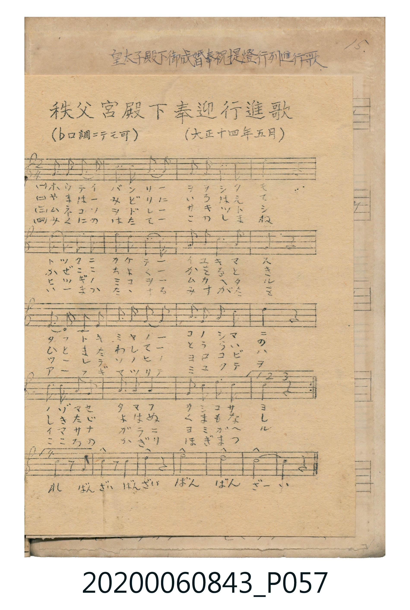
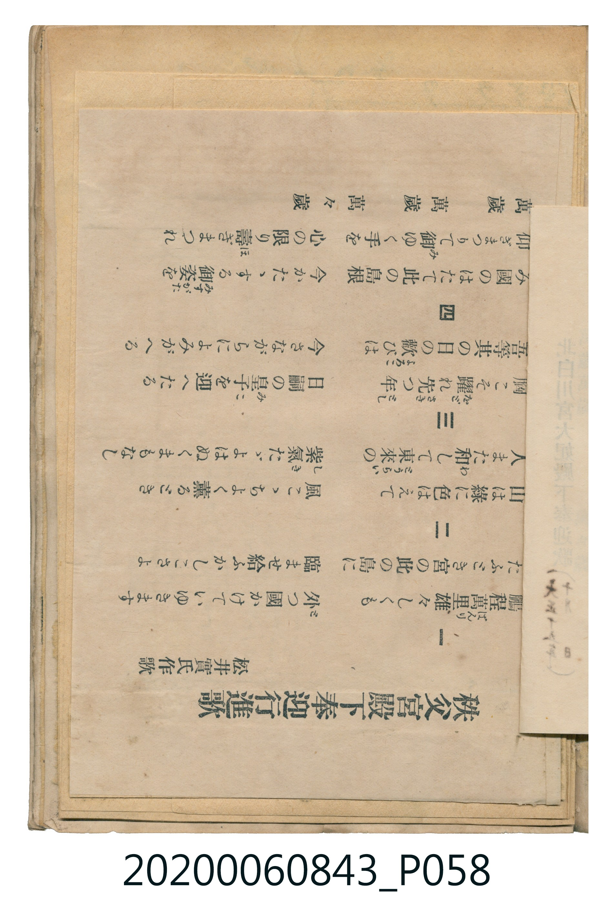

# 秩父宮殿下奉迎行進歌

> Re:Shoka 使用 AI 辨識樂譜，可能會有錯誤。歡迎回報。

<audio controls src="chichibunomiya_denka_hogei_koshinka.mp3"></audio>

- 曲：不詳 (大正十四年五月)
- 詞：松井實

## 說明

秩父宮殿下奉迎行進歌 (Chichibunomiya Denka Hōgei Kōshinka)
Source: 唱歌帖 (Shōkachō, NMTH 2020.006.0843) — P057.jpg – P058.jpg (Notebook 1, p.15)
Notation: Handwritten 5-line staff (1 flat = F major, 2/4 time) + mimeographed lyrics
Annotations: (♭ロ調ニテモ可), (大正十四年五月), 松井實氏作歌

## 歌詞

```text
（TMD 檔案未包含歌詞註解）
```

## ABC

```abc
X:1
T:秩父宮殿下奉迎行進歌
C:曲：不詳 (大正十四年五月)
M:2/4
L:1/16
Q:1/4=112
K:F
V:V1 name="Vocal" snm="Voc"
[V:V1]
!mf! F3 G A2 F2 | c4 A4 | G2 F2 G2 A2 | F4 z4 |
d2 d2 c2 A2 | c4 f4 | d2 c2 A2 c2 | G4 z4 |
G3 A G2 F2 | D2 F2 G2 A2 | c2 d2 c2 A2 | f4 z4 |
d3 f c2 A2 | G4 c4 | A2 G2 A2 G2 | F4 z4 |
!f! F4 z2 C2 | F4 z2 A2 | c4 c4 | f8 |
```

## TMD 檔案連結

- [主旋律 TMD 檔案](chichibunomiya_denka_hogei_koshinka.tmd) [[在 TMD Studio 編輯](https://tmdlang.github.io/Tmd-TS/#tmd=s7IKdvYPcrWy4qpTUCpJTLdSSM7PyUlNLsnMz7MqzsjPTkzOyFeCS5bl55TmploBqXgDY4RwcX5pUXJqfEFieqpVgIGpOboM3KT4vPyS1KT8_GyEioKi_LLUvMQ8oKrcxLzS4uSizIKS-OT8gkqEmtSyzJRUkIrUlMyS_KLMxBwkJ6UWFYMdC3FDSVFiHsQMoCBCVUlGKtDduZk5mSWJRUgmQ8STU4tSc_PzwOZqaSk8X77yece2p-vWPVu3_8mO7qdLO1_s73uxsOdlw6Zna3sUtLS4FG0VDA2NuOxtFdy4bIz0TexABj6bven9nllPdvS-WLlZQePpkuXP1i5-2tv4dPbspzu3PNk15dmcDk2wzS9WzgMqfDZ335NdU5-uX6bExaWvpWBLLcCloEDIBxrOGZnJGZlJpXn5uZmViQouqXnZiQoeR3vTUzMVvI_2FmdkAgU0QSYFQyJQ4emUjUCdT3dMU9AIzjjaC4rNo706Cn6-IR4KRgZGBnoGBmZ6BhYmxpoKjxqmKIBSgV5WQTqQMxnEsQBzNPyg0a9gqKNQoGdoCrYCKJgITm8KHol5KeVFmSUlqXkKpro5mXmpCsUliWlpChqGCmk5iSUKwPBWyE3Myi_SUQCGukJJZm6qpoK2Qi6Qzk8vSizISE1RyKksykwuBhnsmAdMbmCji60UNB7NXPu4ee2LVfsfN3c_bm573Lzoaf96TR1cMaWjAI-gZxv6n-ydA_Q-yFDKIwgKFLT0ubhQIwIcDx75wFjwzofEQbyjVVh-cmKOQ41BjUI1yH4FG0MzLTswC5hqgI4CpiYrkFlQkSc7Gh43NL7cuub5iu4XE9a8bO951jjzceOqx439CvoKT5eserpz87Mt3Y-bJj1uXPe4qetx4-THjR2PG5cBZV90b3y-cfOLZd1P1-543Lj6cVPD48bux43rHzcB1XcDFUDSFVAjMGkBTQAmqseNQJX7HjfORnbCrh6gE55u3AjS2rj_ceNKsD2rXy5aATIPaHNTF9CwZ1u3gxUAnQY0Zj7QBkjQP5u5BeTS-btezmoDuRFkAlANUO_qp_sWPu1f86IT5Ngnuzc8bpzwuKn_cVPP87WdYJVtQPbjxumPG6c-bupACZROkIv2LQT68OlyoHnrXs5uedzQilALtBAou6LhxUSwSU0tIHEk2ZerZzxf0PR0M9Dzq4EuetraCfbTOqAUOIx6wFp6Qc4BewUsCNQODFw0twBTGdAtIDPmAJUAHQ0MgvnA8H82fSmQ-2zOGoipL_uArgAqW_F8NVDZMqCRz6ZtALoCKgti9IK8AopHoIfmgsMIGFM9oHicsObZ2s1wEuhRIAPmBGA6yk2rVTBU0AVCIwVjIAli1yiYgkV0wSIgWAOUhciBaJBoDVSXroIBTA3MVw7gZGoFDIzdQNwGxMuAuAWINyg8bpoMxF1A9hIo7gHiVUDcjxQucBOaQLr2AfF6IN4PxCuhuleDghqI50DopklgcSwmNAJVg-xs7IC6YbrC4-Y9QHodVBcQg8QapwLZyHGDMAFkbz_UTqAusFvmQ321CWpSE5BeAWbDg9YMGCYgDApLSIjBQtUwDh6syApANCSgCQQryHKQV3ZAaHAgAYMZ7BWQY0ABBPPyMqxeAkUKyFsgr4ACvw9iKjBjgwMCHDG90AgD1nJ4ghWEQR4HqoQHK8g9IFPwBytIdilQthFqAjRIwW4ABTUoaEFiID5SsELCxxieIIFhGI-RNkFBiRr28DDHE66wJLITSk-E-hFYjkDjv6kB6iBgwIEcCsTYvAYMOlBggFWADAClGlBwg4Ia5FWQ90ABCPI6KBgg6rCZBAsAUHBOAeIZ0GAG5QmQKSBTQQEFMgEU7fCAQjcFrAtkEihaZ4I8BY1yUKIBmTIX6j6Qz8BRXktEleRkiL9Oer5mDbgSmgMsdZ9PXfV864SnG_YBmw3gmtxEE15ZQTICOGcgogyWE2DZpgYsDotkEE1UIbQQirchIgKUQsGZHxadoJwEClLkqgthAihzbwXiCUAdwIQADJ7HTZ1Q00D5DhSU-NM6yA6QLlCqAkYAyBR4fgNhkG5QQoGbQFTgGxEMfGAFgxHspsjBXg0v_iFhaArKS6jBilp2ISIDnqNgEDPswSEDLfQbp6HUAY3ToJkMQkO8rGunQLgVpECMKiegD4hRBkxFdgrKXAA)]
- [鋼琴伴奏 TMD 檔案](chichibunomiya_denka_hogei_koshinka_piano.tmd) [[在 TMD Studio 編輯](https://tmdlang.github.io/Tmd-TS/#tmd=s7IKdvYPcrWy4tLSUni-fOXzjm1P1617tm7_kx3dT5d2vtjf92Jhz8uGTc_W9ihoPG6e8rhp0ePmvid7tjxd2v9k9wxNBS0tLkVbBUNDIy57WwU3LhsjfRM7rjoFpWezN73fM-vJjt4XKzcraDxdsvzZ2sVPexufzp79dOeWJ7umPJvToakEUvhi5Tygwmdz9z3ZNfXp-mVKXFz6Wgq21AJcCgoEveWckZmckZlUmpefm1mZqOCSmpedqOBxtDc9NVPB-2hvcUYmUEBT4VHDFIWAzMS8fAXH5OT83ILEvMzc1LwSkA3B-aVFyalWCk-nbASa-HTHNAWN4IyjvdmJyUBSR8HPN8RDwcjAyEDPwMBMz8DCxBhqmoGpuV5WQTqQMxnEsQBzNPzyS1KT8vOzFQx1FAr0DE01QVZQHhRQoKClz8WF6mWwjz3ygf71zof4Nt7RKiw_OTHHocagRqEaZL-CjaGZlh2YBRTJTatVMFTQBUIjBWMgCWLXKJiCRXTBIiBYA5SFyIFokGgNVJeuggFMDdhIYJQ7gC20AnIeN-4G4jYgXgbELUC8QeFx02Qg7gKyl0BxDxCvAuJ-kIcwzWgC6dsHxOuBeD8Qr4TqXw3E3UA8B0I3TQKLYzWjEageZG9jB9Qd0xUeN-8B0uug-oAYJNY4FcjuwGEGyO5-qL1AfWD3zIf6bRPUrCYgvQLMhppRo2AGDBsQBoUpJORgoWsYBw9eZAUgGhLgmMELEzeGRwhQbzxG3ICMQLUTbhfCvFqiUg84owR54Ew_BbUKpvHahtqwpILCAdqrbawN8y-aFJBrHq8N8ycqDyyLUIweCIbaJtog_4FDEckGVPuALG2kMMatCdVudMsw3AlL-TUKJvHaZgg-uheQLUG1EMVlZMWID64YQTgG4Q5YeCCE4LKm8UjqYEy8WRqU5EFZaAeEBmdPYBYHZyFQFgBlTVhWW4YjK4GKBFB2AmUhUNbvg5jbBMrOwCwILhZ6ocVFD4EsDcKgLAdUC8_SIDeBzCGUpUHyS4HyjVAzoNkZ7A5QNgdla5AYiI-UpU1gAYVICVjCGIsqeLDjDWFYIbUTSk-E-rQHXv40NUAdBQxAkGOBGLsHgYEIChSwGpARoHILFPCgQAd5GORJUECCAgAUGBB12M2CBQQoYKcA8QxogIPKZpA5IHNBAQYyA5QI4AGGaQ5YH8gsUCTPBHkNmgBAiQhkzlyoG0H-gycApPBDzoK4EzwWIdIym5Mh3toTUpoAMzKinIUXE3CbQeKwkhlEE1lzLoTibYhYAyVrcG0Fi31QFgSF_mwcIQ2qjbYC8QSgHmDKAYbk46ZOqHmgLAsKdUJZBGQPSB8oIQJjC2QOPKuCMEg_KGXBzSAyXPHXK8SW1SAmqiRKTURMjUKKe3GWuvjyOtaEibfUJcpJRvgbdvB2HcRgsCNQkx5qYwSpCoVVTDCILX2C0w60Ndc4DaVx1zgNWm5BaGKThBGhpgbQRyhRaByvjRS0xDZC8FTECP-S4mCa1sQoTtK1UyDcPFAgRpUT0CHEKANmHjsFZS4A)]

## 分析

```text
================================================================================
📊 TMD Song Profile: [ 秩父宮殿下奉迎行進歌 ]
================================================================================
⏱  Duration:       0:21 (21.4s), 20 measures total
🎼 Key & Tempo:    首調基準 F, != 112.0 BPM, <2/4>
   - 分析範圍：      由實際發聲的音符與和弦推測調性；播放脈絡另行呈現
🎤 人聲音域:    C4 (MIDI 60) – F5 (MIDI 77) [跨度: 17 個半音 / 1.4 個八度, 難度: challenging]
   - 最低音:  C4 in [ChichibunomiyaDenkaHogeiKoshinka_B2 #1 @ m.17, 0:17]
   - 最高音: F5 in [ChichibunomiyaDenkaHogeiKoshinka_A #1 @ m.6, 0:05]
   - 適合: soprano, mezzo-soprano, contralto, tenor, baritone, bass
🏛  結構:      ChichibunomiyaDenkaHogeiKoshinka_A (12.9s) -> ChichibunomiyaDenkaHogeiKoshinka_B1 (4.3s) -> ChichibunomiyaDenkaHogeiKoshinka_B2 (4.3s)
⚡ 編曲密度:        Peak 1 軌道同時演奏
🗝  調性診斷：       F 大調（推測轉調經歷 2 次）
   - 風格氣質:    純淨自然大調（陽光明朗、易唱易記，無明顯調外色彩）
   - 轉調歷程:    F 大調起奏 ➔ [ChichibunomiyaDenkaHogeiKoshinka_B1] 轉至 C 大調 (-5 半音 / 五度圈 +1 步) ➔ [ChichibunomiyaDenkaHogeiKoshinka_B2] 轉至 F 大調 (+5 半音 / 五度圈 -1 步)
   - 核心骨幹音:  F, C, A, G, D
   - 調性數值:    F 大調 [相關度: 0.90, 穩定度: High, 自然音純度: 100.0%]
   - 候選調性 (K-S): F 大調 (0.90), C 大調 (0.73), A 小調 (0.58)
   - 五度圈歷程:   -1 -> +0 -> -1
   - 各段落調性細節:
     • [ChichibunomiyaDenkaHogeiKoshinka_A #1]: F 大調 (r: 0.86, 自然音純度: 100.0%)
     • [ChichibunomiyaDenkaHogeiKoshinka_B1 #1]: C 大調 (r: 0.78, 自然音純度: 100.0%)
     • [ChichibunomiyaDenkaHogeiKoshinka_B2 #1]: F 大調 (r: 0.86, 自然音純度: 100.0%)

  [ 五度圈游移軌跡 ]
              [C ]*
        [F ]*          G  
      Bb               D  
      Eb               A  
         Ab           E  
            Db       B  
               F# 
     (* = active key center)

  [ 十二半音累積音高分佈 ]
     C  : ███████████████████       24.3%
     C# :                            0.0%
     D  : ███████                    9.3%
     D# :                            0.0%
     E  :                            0.0%
     F  : ████████████████████████  31.4%
     F# :                            0.0%
     G  : █████████████             17.1%
     G# :                            0.0%
     A  : ██████████████            17.9%
     A# :                            0.0%
     B  :                            0.0%
--------------------------------------------------------------------------------
Assignment 軌道音域：
  - Vocal         : C4 – F5 (17 個半音 / 1.4 個八度, 53 個音符)
================================================================================
```


## 原書掃描頁






