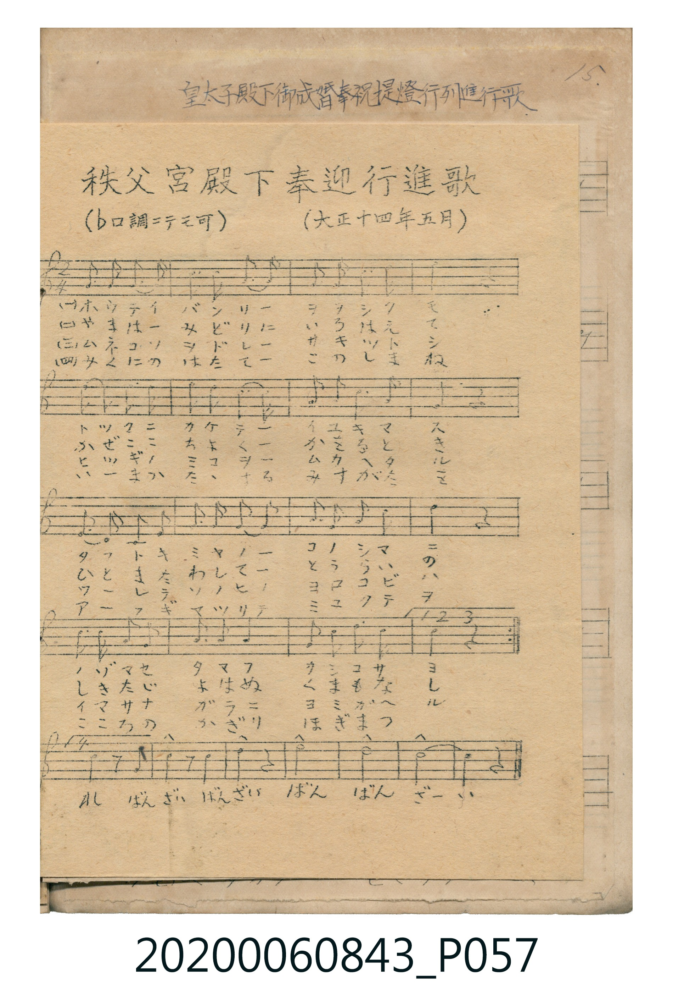

# 秩父宮殿下奉迎行進歌

> Re:Shōka 使用 AI 協助辨識與重建樂譜，可能會有錯誤。歡迎[回報](https://github.com/TMDLang/reshoka/issues)。

- **鋼琴伴奏版**：<br><audio controls src="chichibunomiya_denka_hogei_koshinka.mp3"></audio>

- 曲：不詳 (大正十四年五月)
- 詞：松井實

## 說明

秩父宮殿下奉迎行進歌 (Chichibunomiya Denka Hōgei Kōshinka)
Source: 唱歌帖 (Shōkachō, NMTH 2020.006.0843) — P057.jpg – P058.jpg (Notebook 1, p.15)
Notation: Handwritten 5-line staff (1 flat = F major, 2/4 time) + mimeographed lyrics
Annotations: (♭ロ調ニテモ可), (大正十四年五月), 松井實氏作歌


## 歌詞

```text
（TMD 檔案未包含歌詞註解）
```

## ABC

<div class="abc-score" data-abc-src="chichibunomiya_denka_hogei_koshinka.abc" aria-label="五線譜載入中"></div>

[下載 ABC 原始檔](chichibunomiya_denka_hogei_koshinka.abc)

## TMD 檔案連結

- [主旋律 TMD 檔案](chichibunomiya_denka_hogei_koshinka.tmd) [[在 TMD Studio 編輯](https://tmdlang.github.io/Tmd-TS/#tmd=s7IKdvYPcrWy4qpTUCpJTLdSSM7PyUlNLsnMz7MqzsjPTkzOyFeCS5bl55TmploBqXgDY4RwcX5pUXJqfEFieqpVgIGpOboM3KT4vPyS1KT8_GyEioKi_LLUvMQ8oKrcxLzS4uSizIKS-OT8gkqEmtSyzJRUkIrUlMyS_KLMxBwkJ6UWFYMdC3FDSVFiHsQMoCBCVUlGKtDduZk5mSWJRUgmQ8STU4tSc_PzUMwFWpOemWdVkphZnpgXn5-WlpmMJl-SkZ9elFiQUWmVkVkMclZyYk58dmJeohKXlpbC8-Urn3dse7pu3bN1-5_s6H66tPPF_r4XC3teNmx6trZHQUuLS9FWwdDQiMveVsGNy8ZI38QOZPaz2Zve75n1ZEfvi5WbFTSeLln-bO3ip72NT2fPfrpzy5NdU57N6dAEO-LFynlAhc_m7nuya-rT9cuUuLj0tRRsqQW4FBQI-UDDOSMzOSMzqTQvPzezMlHBJTUvO1HB42hvemqmgvfR3uKMTKCAJsikYEgqUHg6ZSNQ59Md0xQ0gjOO9oKSxNFeHQU_3xAPBSMDIwM9AwMzPQMLE2NNhUcNUxRASUkvqyAdyJkM4liAORp-0DSkYKijUKBnaAq2AiiYCE60Ch6JeSnlRZklJal5Cqa6OZl5qQrFJYlpaQoahgppOYklCsDwVshNzMov0lEAhrpCSWZuqqaCtkIukIZEaGqKQk4lMDqLQQY75gHTLNjoYisFjUcz1z5uXvti1f7Hzd2Pm9seNy962r9eUwdXTOkowCPo2Yb-J3vnAL0PMpTyCIICBS19Li7UiADHg0c-MBa88yFxEO9oFZCZmJfvUGNQUw2yXsHG0EzLDswCJhqgm4CJyQpkFFTkyY6Gxw2NL7eueb6i-8WENS_be541znzcuOpxY7-CvsLTJaue7tz8bEv346ZJjxvXPW7qetw4-XFjx-PGZUDZF90bn2_c_GJZ99O1Ox43rn7c1PC4sftx4_rHTUD13UAFkGQF1AhMWUATgGnqcSNQ5b7HjbORnbCrB-iEpxs3grQ27n_cuBJsz-qXi1aAzAPa3NQFNOzZ1u1gBUCnAY2ZD7QBEvLPZm4BuXT-rpez2kBuBJkAVAPUu_rpvoVP-9e86AQ59snuDY8bJzxu6n_c1PN8bSdYZRuQ_bhx-uPGqY-bOlACpRPkon0LgT58uhxo3rqXs1seN7Qi1AItBMquaHgxEWxSUwtIHEn25eoZzxc0Pd0M9PxqoIuetnaC_bQOKAUOox6wll6Qc8BeAQsCtQMDF80twEQGdAvIjDlAJUBHA4NgPjD8n01fCuQ-m7MGYurLPqArgMpWPF8NVLYMaOSzaRuAroDKghi9IK-A4hHoobngMALGVA8oHiesebZ2M5wEehTIgDmhRqE6N61WwVBBFwiNFIyBJIhdo2AKFtEFi4BgDVAWIgeiQaI1UF26CgYwNTBfOYTlA4tQK2Bg7AbiNiBeBsQtQLxB4XHTZCDuArKXQHEPEK8C4n6kcIGb0ATStQ-I1wPxfiBeCdW9GhTUQDwHQjdNAotjMaERqBpkZ2MH1A3TFR437wHS66C6gBgk1jgVyEaOG4QJIHv7oXYCdYHdMh_qq01Qk5qA9AowGx60ZsAwAWFQWEJCDBaqhnHwYEVWAKIhAU0gWEGWg7yyA0KDAwkYzGCvgBwDCiCYl5dh9RIoUkDeAnkFFPh9EFOBGRscEOCI6YVGGLCSwxOsIAzyOFAlPFhB7gGZgj9YQbJLgbKNUBOgQQp2AyioQUELEgPxkYIVEj7G8AQJDMN4jLQJCkrUsIeHOZ5whSWRnVB6ItSPwHIEGv9NDVAHAQMO5FAgxuY1YNCBAgOsAmQAKNWAghsU1CCvgrwHCkCQ10HBAFGHzSRYAICCcwoQz4AGMyhPgEwBmQoKKJAJoGiHBxS6KWBdIJNA0ToT5ClolIMSDciUuVD3gXwGjvJaImokJ0O8VdLzNWvAddAcYKH7fOqq51snPN2wD9hoANfjJprwugqSD8AZAxFjsIwAyzU1YHFYHINoosqghVC8DREPoAQKzvuw2ARlJFCIItdcCBNAeXsrEE8A6gCmA2DoPG7qhJoGynagkMSf1EF2gHSBEhUw_EGmwLMbCIN0g9IJ3ASiwt6IUNgDqxeMUDdFDvVqeOEPCUJTUE5CDVXUkgsRF_D8BIOYQQ8OGGiR3zgNpQZonAbNYhAa4mNdOwXCTSAFYlQ5AX1AjDJgIrJTUOYCAA)]
- [鋼琴伴奏 TMD 檔案](chichibunomiya_denka_hogei_koshinka_piano.tmd) [[在 TMD Studio 編輯](https://tmdlang.github.io/Tmd-TS/#tmd=s7IKdvYPcrWy4qpTUCpJTLdSyC8qychPL0osyKi0ysgsLskvykxOzInPTsxLVIIrKs4vLUpOjS9ITE-1CjAwNdcFEhYI6ZKM1NxUq9SU0uTEksz8PCUuLS2F58tXPu_Y9nTdumfr9j_Z0f10aeeL_X0vFva8bNj0bG2Pgsbj5imPmxY9bu57smfL06X9T3bP0FTQ0uJStFUwNDTisrdVcOOyMdI3sQNZ8mz2pvd7Zj3Z0fti5WYFjadLlj9bu_hpb-PT2bOf7tzyZNeUZ3M6NMGuebFyHlDhs7n7nuya-nT9MiUuLn0tBVtqAS4FBYLecs7ITM7ITCrNy8_NrExUcEnNy05U8Djam56aqeB9tLc4IxMooKnwqGGKQkBmYl6-gmNycn5uQWJeZm5qXgnIhmBwWFspPJ2yEWji0x3TFDSCM472ZicmA0kdBT_fEA8FIwMjAz0DAzM9AwsTY6hpwGjRyypIB3ImgzgWYI6GX35JalJ-fraCoY5CgZ6hqSbICsqDAgoUtPS5uFC9DPaxRz7Qv975EN_GO1qBvepQY1BTDbJewcbQTMsOzKpRqM5Nq1UwVNAFQiMFYyAJYtcomIJFdMEiIFgDlIXIgWiQaA1Ul66CAUwN2EhgjDuE5QPTsBWQ87hxNxC3AfEyIG4B4g0Kj5smA3EXkL0EinuAeBUQ94P8g2lGE0jfPiBeD8T7gXglVP9qIO4G4jkQumkSWByrGY1A9SB7Gzug7piu8Lh5D5BeB9UHxCCxxqlAdgcOM0B290PtBeoDu2c-1G-boGY1AekVYDbUjBoFM2DYgDAoTCEhBwtdwzh48CIrANGQAMcMXpi4MTxCgHrjMeIGZASqnXC7EObVEp94gjxwJZ-CWgXTeG1DbVhKQeEArdU21oZ5F00KyDWP14Z5E5UHlkUoRg8DQ20TbZD3wIGIZAOqfUCWNlIQ49aEaje6ZRjuhCX8GgWTeG0zBB_dC8iWoFqI4jKyIsQHOUJM4PFhCHQEmDIGUUC2aTyYHw-0BWv-BKVfUH7YAaHBeQ2YX8H5AZSeQfkMlm-W4cgXoPwNyhug_ADKx30Qc5tAeROYn8B5vBea93sI5E8QBuUfoFp4_gS5CWQOofwJkl8KlG-EmgHNm2B3gPIsKI-CxEB8pPxpEg8ML3iYQXnAoMMRYrASZCeUngh1eQ-8cGhqgFoCDBCQ5UCM3cHAQAF5EqwGZASoUAEFJCgQQR4AORoUMCAPgTwHUYfdLJjHQAE1BYhnQAMQVHCCzAGZCwoAkBmgSIUHAKY5YH0gs0CRNhPkNWiEghIFyJy5UDeC_AePUHCYgYIOGILQRAilQAFJTNJ2MsRXU0GyLjDXIMo0eJ5EZCwgCSsFQTSRtdRCKN6GiARQqgPXDLDIBOUQUGDOxhFwoJJ_KxBPAOoBJgRgwDxu6oSaB8pRoEAklIJB9oD0gdIVMPBB5sBzEgiD9IMSCtwMUoIVVxlObLkIYqJKopT6xJTepDgXRwmHyJ_wRIZUwhFlgRHeBhG8PQRxONAW9GSEWokj1T2wEh0GsaU1cDqAtoIap6E0ihqnQYsUCE1s9EK9g7OKBnoIJTqM47XBnsIejbgqbzwVGMK7pLiX5BoMaoGunQLhSlKBGFVOwEglRhkwWdspKHMBAA)]

## 分析

```text
================================================================================
📊 TMD Song Profile: [ 秩父宮殿下奉迎行進歌 ]
================================================================================
⏱  Duration:       0:21 (21.4s), 20 measures total
🎼 Key & Tempo:    首調基準 F, != 112.0 BPM, <2/4>
   - 分析範圍：      由實際發聲的音符與和弦推測調性；播放脈絡另行呈現
🎤 人聲音域:    C4 (MIDI 60) – F5 (MIDI 77) [跨度: 17 個半音 / 1.4 個八度, 難度: challenging]
   - 最低音:  C4 in [ChichibunomiyaDenkaHogeiKoshinka_B2 #1 @ m.17, 0:17]
   - 最高音: F5 in [ChichibunomiyaDenkaHogeiKoshinka_A #1 @ m.6, 0:05]
   - 適合: soprano, mezzo-soprano, contralto, tenor, baritone, bass
🏛  結構:      ChichibunomiyaDenkaHogeiKoshinka_A (12.9s) -> ChichibunomiyaDenkaHogeiKoshinka_B1 (4.3s) -> ChichibunomiyaDenkaHogeiKoshinka_B2 (4.3s)
⚡ 編曲密度:        Peak 1 軌道同時演奏
🗝  調性診斷：       F 大調（推測轉調經歷 2 次）
   - 風格氣質:    純淨自然大調（陽光明朗、易唱易記，無明顯調外色彩）
   - 轉調歷程:    F 大調起奏 ➔ [ChichibunomiyaDenkaHogeiKoshinka_B1] 轉至 C 大調 (-5 半音 / 五度圈 +1 步) ➔ [ChichibunomiyaDenkaHogeiKoshinka_B2] 轉至 F 大調 (+5 半音 / 五度圈 -1 步)
   - 核心骨幹音:  F, C, A, G, D
   - 調性數值:    F 大調 [相關度: 0.90, 穩定度: High, 自然音純度: 100.0%]
   - 候選調性 (K-S): F 大調 (0.90), C 大調 (0.73), A 小調 (0.58)
   - 五度圈歷程:   -1 -> +0 -> -1
   - 各段落調性細節:
     • [ChichibunomiyaDenkaHogeiKoshinka_A #1]: F 大調 (r: 0.86, 自然音純度: 100.0%)
     • [ChichibunomiyaDenkaHogeiKoshinka_B1 #1]: C 大調 (r: 0.78, 自然音純度: 100.0%)
     • [ChichibunomiyaDenkaHogeiKoshinka_B2 #1]: F 大調 (r: 0.86, 自然音純度: 100.0%)

  [ 五度圈游移軌跡 ]
              [C ]*
        [F ]*          G  
      Bb               D  
      Eb               A  
         Ab           E  
            Db       B  
               F# 
     (* = active key center)

  [ 十二半音累積音高分佈 ]
     C  : ███████████████████       24.3%
     C# :                            0.0%
     D  : ███████                    9.3%
     D# :                            0.0%
     E  :                            0.0%
     F  : ████████████████████████  31.4%
     F# :                            0.0%
     G  : █████████████             17.1%
     G# :                            0.0%
     A  : ██████████████            17.9%
     A# :                            0.0%
     B  :                            0.0%
--------------------------------------------------------------------------------
Assignment 軌道音域：
  - Piano         : C4 – F5 (17 個半音 / 1.4 個八度, 53 個音符)
================================================================================
```


## 原書掃描頁




