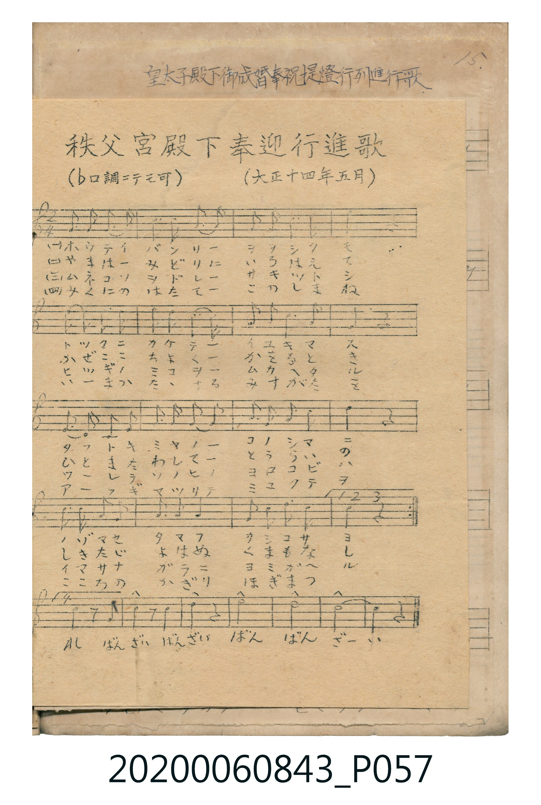
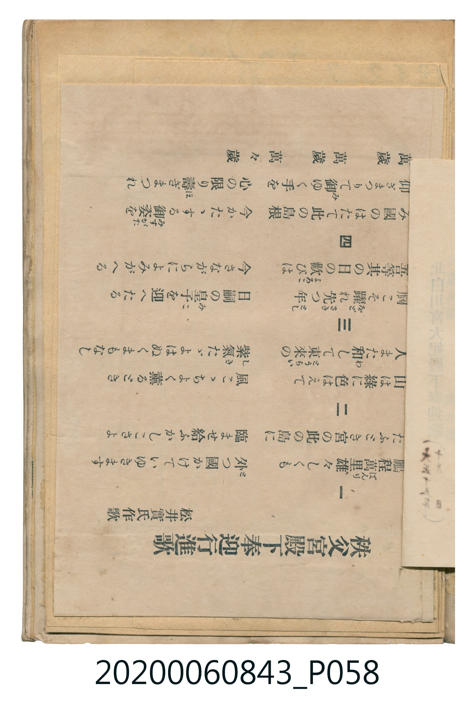

# 秩父宮殿下奉迎行進歌

> Re:Shōka 使用 AI 協助辨識與重建樂譜，可能會有錯誤。歡迎回報。

- **鋼琴伴奏版**：<br><audio controls src="chichibunomiya_denka_hogei_koshinka.mp3"></audio>

- 曲：不詳 (大正十四年五月)
- 詞：松井實

## 說明

秩父宮殿下奉迎行進歌 (Chichibunomiya Denka Hōgei Kōshinka)
Source: 唱歌帖 (Shōkachō, NMTH 2020.006.0843) — P057.jpg – P058.jpg (Notebook 1, p.15)
Notation: Handwritten 5-line staff (1 flat = F major, 2/4 time) + mimeographed lyrics
Annotations: (♭ロ調ニテモ可), (大正十四年五月), 松井實氏作歌


## 歌詞

```text
（TMD 檔案未包含歌詞註解）
```

## ABC

<div class="abc-score" data-abc-src="chichibunomiya_denka_hogei_koshinka.abc" aria-label="五線譜載入中"></div>

[下載 ABC 原始檔](chichibunomiya_denka_hogei_koshinka.abc)

## TMD 檔案連結

- [主旋律 TMD 檔案](chichibunomiya_denka_hogei_koshinka.tmd) [[在 TMD Studio 編輯](https://tmdlang.github.io/Tmd-TS/#tmd=s7IKdvYPcrWy4qpTUCpJTLdSSM7PyUlNLsnMz7MqzsjPTkzOyFeCS5bl55TmploBqXgDY4RwcX5pUXJqfEFieqpVgIGpOboM3KT4vPyS1KT8_GyEioKi_LLUvMQ8oKrcxLzS4uSizIKS-OT8gkqEmtSyzJRUkIrUlMyS_KLMxBwkJ6UWFYMdC3FDSVFiHsQMoCBCVUlGKtDduZk5mSWJRUgmQ8STU4tSc_PzUMwFWpOemWdVkphZnpgXn5-WlpkMltfSUni-fOXzjm1P1617tm7_kx3dT5d2vtjf92Jhz8uGTc_W9ihoaXEp2ioYGhpx2dsquHHZGOmb2IGMfTZ70_s9s57s6H2xcrOCxtMly5-tXfy0t_Hp7NlPd255smvKszkdmmD7X6ycB1T4bO6-J7umPl2_TImLS19LwZZagEtBgZAPNJwzMpMzMpNK8_JzMysTFVxS87ITFTyO9qanZip4H-0tzsgECmiCTAqGRLDC0ykbgTqf7pimoBGccbQXFNtHe3UU_HxDPBSMDIwM9AwMzPQMLEyMNRUeNUxRAKUSvayCdCBnMohjAeZo-EGTh4KhjkKBnqEp2AqgYCI4PSp4JOallBdllpSk5imY6uZk5qUqFJckpqUpaBgqpOUkligAw1shNzErv0hHARjqCiWZuamaCtoKuUA6P70osSAjNUUhp7IoM7kYZLBjHjA5go0utlLQeDRz7ePmtS9W7X_c3P24ue1x86Kn_es1dXDFlI4CPIKebeh_sncO0PsgQymPIChQ0NLn4kKNCHA8eOQDY8E7HxIH8Y5WYfnJiTkONQY11SDrFWwMzbTswCxgogG6CZiYrEBGQUWe7Gh43ND4cuua5yu6X0xY87K951njzMeNqx439ivoKzxdsurpzs3PtnQ_bpr0uHHd46aux42THzd2PG5cBpR90b3x-cbNL5Z1P12743Hj6sdNDY8bux83rn_cBFTfDVQASVZAjcCUBTQBmKYeNwJV7nvcOBvZCbt6gE54unEjSGvj_seNK8H2rH65aAXIPKDNTV1Aw55t3Q5WAHQa0Jj5QBsgIf9s5haQS-fvejmrDeRGkAlANUC9q5_uW_i0f82LTpBjn-ze8LhxwuOm_sdNPc_XdoJVtgHZjxunP26c-ripAyVQOkEu2rcQ6MOny4HmrXs5u-VxQytCLdBCoOyKhhcTwSY1tYDEkWRfrp7xfEHT081Az68GuuhpayfYT-uAUuAw6gFr6QU5B-wVsCBQOzBw0dwCTGRAt4DMmANUAnQ0MAjmA8P_2fSlQO6zOWsgpr7sA7oCqGzF89VAZcuARj6btgHoCqgsiNEL8gooHoEemgsOI2BM9YDiccKaZ2s3w0mgR4EMmBNqFKpz02oVDBV0gdBIwRhIgtg1CqZgEV2wCAjWAGUhciAaJFoD1aWrYABTA_OVAziVWgEDYzcQtwHxMiBuAeINCo-bJgNxF5C9BIp7gHgVEPcjhQvchCaQrn1AvB6I9wPxSqju1aCgBuI5ELppElgciwmNQNUgOxs7oG6YrvC4eQ-QXgfVBcQgscapQDZy3CBMANnbD7UTqAvslvlQX22CmtQEpFeA2fCgNQOGCQiDwhISYrBQNYyDByuyAhANCWgCwQqyHOSVHRAaHEjAYAZ7BeQYUADBvLwMq5dAkQLyFsgroMDvg5gKzNjggABHTC80woCVHJ5gBWGQx4Eq4cEKcg_IFPzBCpJdCpRthJoADVKwG0BBDQpakBiIjxSskPAxhidIYBjGY6RNUFCihj08zPGEKyyJ7ITSE6F-BJYj0PhvaoA6CBhwIIcCMTavAYMOFBhgFSADQKkGFNygoAZ5FeQ9UACCvA4KBog6bCbBAgAUnFOAeAY0mEF5AmQKyFRQQIFMAEU7PKDQTQHrApkEitaZIE9BoxyUaECmzIW6D-QzcJTXElEjORnirZKer1kDroPmAAvd51NXPd864emGfcBGA7geN9GE11WQfADOGIgYg2UEWK6pAYvD4hhEE1UGLYTibYh4ACVQcN6HxSYoI4FCFLnmQpgAyttbgXgCUAcwHQBD53FTJ9Q0ULYDhST-pA6yA6QLlKiA4Q8yBZ7dQBikG5RO4CYQFfZGhMIeWL1ghLopcqhXwwt_SBCagnISaqiillyIuIDnJxjEDHpwwECL_MZpKDVA4zRoFoPQEB_r2ikQbgIpEKPKCegDYpQBE5GdgjIXAA)]
- [鋼琴伴奏 TMD 檔案](chichibunomiya_denka_hogei_koshinka_piano.tmd) [[在 TMD Studio 編輯](https://tmdlang.github.io/Tmd-TS/#tmd=s7IKdvYPcrWy4tLSUni-fOXzjm1P1617tm7_kx3dT5d2vtjf92Jhz8uGTc_W9ihoPG6e8rhp0ePmvid7tjxd2v9k9wxNBS0tLkVbBUNDIy57WwU3LhsjfRM7rjoFpWezN73fM-vJjt4XKzcraDxdsvzZ2sVPexufzp79dOeWJ7umPJvToakEUvhi5Tygwmdz9z3ZNfXp-mVKXFz6Wgq21AJcCgoEveWckZmckZlUmpefm1mZqOCSmpedqOBxtDc9NVPB-2hvcUYmUEBT4VHDFIWAzMS8fAXH5OT83ILEvMzc1LwSkA3B-aVFyalWCk-nbASa-HTHNAWN4IyjvdmJyUBSR8HPN8RDwcjAyEDPwMBMz8DCxBhqmoGpuV5WQTqQMxnEsQBzNPzyS1KT8vOzFQx1FAr0DE01QVZQHhRQoKClz8WF6mWwjz3ygf71zof4Nt7RKiw_OTHHocagphpkvYKNoZmWHZhVo1Cdm1arYKigC4RGCsZAEsSuUTAFi-iCRUCwBigLkQPRINEaqC5dBQOYGrCRwBh3ANtnBeQ8btwNxG1AvAyIW4B4g8LjpslA3AVkL4HiHiBeBcT9IP9gmtEE0rcPiNcD8X4gXgnVvxqIu4F4DoRumgQWx2pGI1A9yN7GDqg7pis8bt4DpNdB9QExSKxxKpDdgcMMkN39UHuB-sDumQ_12yaoWU1AegWYDTWjRsEMGDYgDApTSMjBQtcwDh68yApANCTAMYMXJm4MjxCg3niMuAEZgWon3C6EebVEJR5wPgnywJV8CmoVTOO1DbVhKQWFA7RW21gb5l00KSDXPF4b5k1UHlgWoRg9DAy1TbRB3gMHIpINqPYBWdpIQYxbE6rd6JZhuBOW8GsUTOK1zRB8dC8gW4JqIYrLyIoQH-QIMYHHhyHQEWDKGEQB2abxYH480Bas-ROUfkH5YQeEBuc1YH4F5wdQegblM1i-WYYjX4DyNyhvgPIDKB_3QcxtAuVNYH4C5_FeaN7vIZA_QRiUf4Bq4fkT5CaQOYTyJ0h-KVC-EWoGNG-C3QHKs6A8ChID8ZHyp0k8MLzgYQblAYMOR4jBSpCdUHoi1OU98MKhqQFqCTBAQJYDMXYHAwMF5EmwGpARoEIFFJCgQAR5AORoUMCAPATyHEQddrNgHgMF1BQgngENQFDBCTIHZC4oAEBmgCIVHgCY5oD1gcwCRdpMkNegEQpKFCBz5kLdCPIfPELBYQYKOmAIQhMhlAIFJDFJ28kQX00FybrAXIMo0-B5EpGxgCSsFATRRNZSC6F4GyISQKkOXDPAIhOUQ0CBORtHwIFK_q1APAGoB5gQgAHzuKkTah4oR4ECkVAKBtkD0gdKV8DAB5kDz0kgDNIPSihwM4gMVrxlOLHlIoiJKolS6hNTepPiXBwlHCJ_whMZUglHlAVGeBtE8PYQxOFAW9CTEWoljlT3wEp0GMSW1sDpANoKapyG0ihqnAYtUiA0sdFrRKCKBnoIJTqM47XBnsIejbgqbzwVGMK7pLiX5BoMaoGunQLhSlKBGFVOwEglRhkwWdspKHMBAA)]

## 分析

```text
================================================================================
📊 TMD Song Profile: [ 秩父宮殿下奉迎行進歌 ]
================================================================================
⏱  Duration:       0:21 (21.4s), 20 measures total
🎼 Key & Tempo:    首調基準 F, != 112.0 BPM, <2/4>
   - 分析範圍：      由實際發聲的音符與和弦推測調性；播放脈絡另行呈現
🎤 人聲音域:    C4 (MIDI 60) – F5 (MIDI 77) [跨度: 17 個半音 / 1.4 個八度, 難度: challenging]
   - 最低音:  C4 in [ChichibunomiyaDenkaHogeiKoshinka_B2 #1 @ m.17, 0:17]
   - 最高音: F5 in [ChichibunomiyaDenkaHogeiKoshinka_A #1 @ m.6, 0:05]
   - 適合: soprano, mezzo-soprano, contralto, tenor, baritone, bass
🏛  結構:      ChichibunomiyaDenkaHogeiKoshinka_A (12.9s) -> ChichibunomiyaDenkaHogeiKoshinka_B1 (4.3s) -> ChichibunomiyaDenkaHogeiKoshinka_B2 (4.3s)
⚡ 編曲密度:        Peak 1 軌道同時演奏
🗝  調性診斷：       F 大調（推測轉調經歷 2 次）
   - 風格氣質:    純淨自然大調（陽光明朗、易唱易記，無明顯調外色彩）
   - 轉調歷程:    F 大調起奏 ➔ [ChichibunomiyaDenkaHogeiKoshinka_B1] 轉至 C 大調 (-5 半音 / 五度圈 +1 步) ➔ [ChichibunomiyaDenkaHogeiKoshinka_B2] 轉至 F 大調 (+5 半音 / 五度圈 -1 步)
   - 核心骨幹音:  F, C, A, G, D
   - 調性數值:    F 大調 [相關度: 0.90, 穩定度: High, 自然音純度: 100.0%]
   - 候選調性 (K-S): F 大調 (0.90), C 大調 (0.73), A 小調 (0.58)
   - 五度圈歷程:   -1 -> +0 -> -1
   - 各段落調性細節:
     • [ChichibunomiyaDenkaHogeiKoshinka_A #1]: F 大調 (r: 0.86, 自然音純度: 100.0%)
     • [ChichibunomiyaDenkaHogeiKoshinka_B1 #1]: C 大調 (r: 0.78, 自然音純度: 100.0%)
     • [ChichibunomiyaDenkaHogeiKoshinka_B2 #1]: F 大調 (r: 0.86, 自然音純度: 100.0%)

  [ 五度圈游移軌跡 ]
              [C ]*
        [F ]*          G  
      Bb               D  
      Eb               A  
         Ab           E  
            Db       B  
               F# 
     (* = active key center)

  [ 十二半音累積音高分佈 ]
     C  : ███████████████████       24.3%
     C# :                            0.0%
     D  : ███████                    9.3%
     D# :                            0.0%
     E  :                            0.0%
     F  : ████████████████████████  31.4%
     F# :                            0.0%
     G  : █████████████             17.1%
     G# :                            0.0%
     A  : ██████████████            17.9%
     A# :                            0.0%
     B  :                            0.0%
--------------------------------------------------------------------------------
Assignment 軌道音域：
  - Vocal         : C4 – F5 (17 個半音 / 1.4 個八度, 53 個音符)
================================================================================
```


## 原書掃描頁






