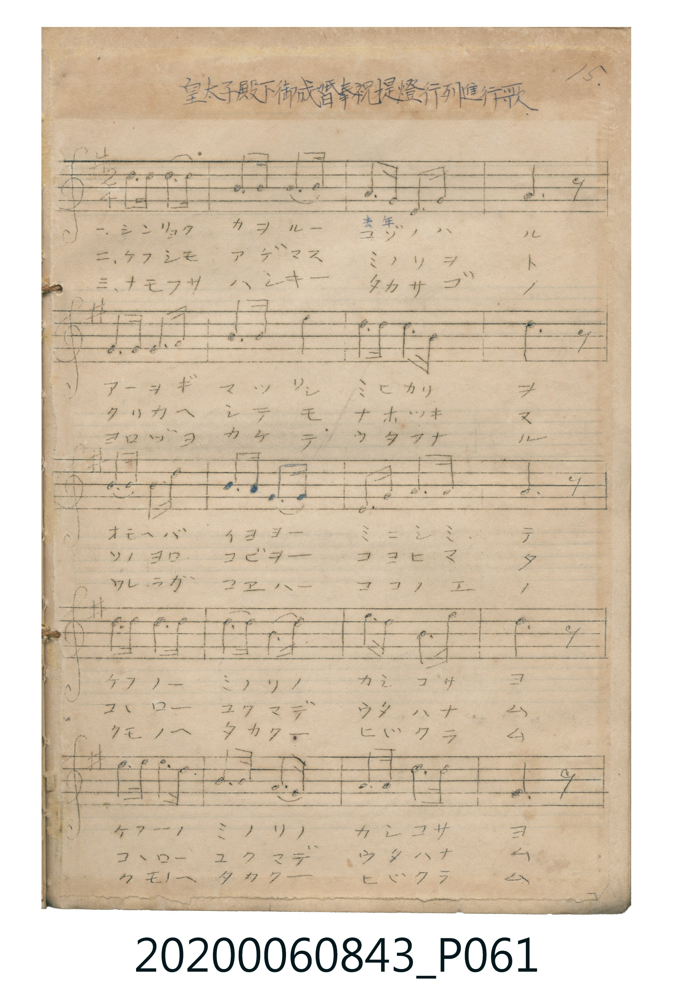

# 皇太子殿下御成婚奉祝提燈行列進行歌

> Re:Shōka 使用 AI 協助辨識與重建樂譜，可能會有錯誤。歡迎回報。

- **鋼琴伴奏版**：<br><audio controls src="kotaishi_denka_chochin_gyoretsu_shinkoka.mp3"></audio>

- 曲：不詳 (大正十三年)

## 說明

皇太子殿下御成婚奉祝提燈行列進行歌 (Kōtaishi Denka Goseikon Hōshuku Chōchin Gyōretsu Shinkōka)
Source: 唱歌帖 (Shōkachō, NMTH 2020.006.0843) — P061.jpg (Notebook 1, p.15)
Notation: Handwritten 5-line staff (1 sharp = G major, 2/4 time, 20 bars)


## 歌詞

```text
（TMD 檔案未包含歌詞註解）
```

## ABC

<div class="abc-score" data-abc-src="kotaishi_denka_chochin_gyoretsu_shinkoka.abc" aria-label="五線譜載入中"></div>

[下載 ABC 原始檔](kotaishi_denka_chochin_gyoretsu_shinkoka.abc)

## TMD 檔案連結

- [主旋律 TMD 檔案](kotaishi_denka_chochin_gyoretsu_shinkoka.tmd) [[在 TMD Studio 編輯](https://tmdlang.github.io/Tmd-TS/#tmd=s7IKdvYPcrWy4qpTUCpJTLdSSM7PyUlNLsnMz7MqzsjPTkzOyFeCS5bl55TmploBqXgDY4RwcX5pUXJqfEFieqpVgIGZIboM3KT4vPyS1KT8_GyEioKi_LLUvMQ8oKrcxLzS4uSizIKS-OT8gkqEmtSyzJRUkIrUlMyS_KLMxBwkJ6UWFYMdC3FDSVFiHsQMoCBCVUlGKtDdmbkFqai6IeJpqcUlmWXI4kBL0jPzrErzQBaXZKZlpqYocWlpKTyf1f50yaqnayc8W7f_yY7up_sWPuuY8HTlrKdLO58vnfusf8Lz9o4XC3uedkx_2bAJyHi2tkdBS4tL0VbB0NCIy95WwZ3LxkjfxA5k0bPZm97vmfVkR--LlZsVNJ4uWf5s7eKnvY1PdnQ-3blFU4mLS19LwZZagEtBgSzHa3gf7S1JzCzOyFRwSc3LTlRwzy9OzczOz1PwONpbnFGaXargnHG0NzkjM0_BvfJob1FqSXGpQjCQm320NztRE2RvMCQRKDydshFo5NMd0xQ0goF6QCniaK-Ogp9viIeCkYGRgZ6BgZmegYWJsabCo4YpCqCUpJdVkK6g4QdNNQqGOgoFeoamYFOBgongZKrgkZiXUl6UWVKSmqdgqpuTmZeqUFySmJamoGGoUJyRWFSgAAx3hdzErPwiHQVg6CuUZOamAlkGCkmJRcVgwygPYChQ0NLn4vIGOg0UZOAQc87IB4WOe2U-OGzAQQPMDVZh-cmJOQ41BjXVIAco2BiaadmBWcBoBwbTi5XzrECGQUWe7Gh43ND4uGn74-bNj5tXPW5e_rhpvcLjptWPmzc9bl4NZG1-3LTvcXPf4-Z-EF8fKLIIJNe0TuFx87zHzS0gXU3bgZz5j5sngTUCTdkEVghkANXOeNw8AchZ8rh5BRBBFHaDbQQy2sAKNz5ungq0AyIHtAqoEcgBmgVUBXLAVpBGohUi-W5XD9h3YG0gGxeBnd8E9Nq8x007kY0BCnWArVgP9hDQGzOAHKCWNrCu5q7HzbNBvm1a-7i5B6xwL1gr0E9rwaHUPBnkbTALKDYJbMN-sEKgCFAtUFXzMrDxwFBrBwoDOfvBoQo0egHxCpHjrhPkO5AwMJiBHtwK1NkPDgqQk_aDw2Xr46YtoEACmg926-PmVog7gXLAYGmDmw8MV6BB4BhuBtq95nHzysdNayAJAKixH8ICOrEPzAebCHIk0GpgMIACC2IhMPWAfD8ZLLkS5jWiFEK9VqNQnZtWq2CqoIuCaxSMoSxDIAaxaxSMoDyzeCijRsEUxIRBA5AQLLwcwFnDChStQKs3AzEovYMcBwoOIBcYLKAk37wH5Fcg3gdkg9Ia0O9AcUTAIwzaCJSZCjUQnLaAGGTKPCANTl5QE1ZBTe_AZkpzF0Q32CRwHEJMBMUi2C37Ie4DyTVtAZsIDymQn2EYFBiQQIIFFAjWKJiBAggqAgk2mByeIAK5B5RMwNkciFsgvoDkdFDMQcMM4jNsYQOKX5AOkCpwXgLSwOQGyU1APBtiKtiXwNoMS7iACguQbCvULaAwAIU4ONFCwgUUZmDT4PEDCQFYwkANE5goMExgCQYkBFEEIgkECsizIOcDvQMp06COBGFgRIEDphspkNqwBsxeaKKAeg-U1JonQxMINOmB5YBBDE5I-7EGDih4gdmzeSVQBTibAjFIFyixwhIwyCRQ-QgSx5JoEH5HTTRm0CQCCzJE7iMQPtDsAPYdLDxgyR9cTkMTNshtoISOXFYjTIG5HJr8m0FRDfItKBmCy0No1IN8Cop65DIRNfmB4gpkP7jQgdoPEgeZCgpdYKiD-cAwRCl-gKUPZqbBUtbAAhAWUJCgJTKQQI4A12RDLZBqubh07RSIaYwoANUpcwEA)]
- [鋼琴伴奏 TMD 檔案](kotaishi_denka_chochin_gyoretsu_shinkoka_piano.tmd) [[在 TMD Studio 編輯](https://tmdlang.github.io/Tmd-TS/#tmd=s7IKdvYPcrWy4tLSUng-q_3pklVP1054tm7_kx3dT_ctfNYx4enKWU-Xdj5fOvdZ_4Tn7R0vFvY87Zj-smETkPFsbY-CxuPmKY-bFj1u7nuyZ8vTpf1Pds_QVNDS4lK0VTA0NOKyt1Vw57Ix0jex46pTUHo2e9P7PbOe7Oh9sXKzgsbTJcufrV38tLfxyY7Opzu3aCpxcelrKdhSC3ApKJDlo0cNUxQCMhPz8hUck5PzcwsS8zJzU_NKQMYF55cWJadaKTydshGo8umOaQoawRlHe7MTk4GkjoKfb4iHgpGBkYGegYGZnoGFibEmxDQDM0O9rIJ0BQ2__JLUpPz8bAVDHYUCPUNTTZCplHsVChS09Lm4vPNLEjOLMzJdUvOyE50z8pMzMvPcK_OLUkuKS4OB7Oz87ESrsPzkxByHGoOaapADFGwMzbTswKwaherctFoFUwVdFFyjYAxlGQIxiF2jYATlmcVDGTUKpiAmDBqAhMCGAmPVAWyjFZDzuGm7wuPmzUC86nHzciB3PRCvBnI3ATGI3gPkA6Wb9gHZfUDcDxYHeg2LURuBclOhRi4C0iAMMmcekN4JpOdDzVgFNb8DuznNXRD9YLO2QuwEmdm0Fuqe_RA3guSatoDNhJpTA_Y5DIOCBBJUsOACwRoFM1AwQUUggQeTQw0oiF5YwKKaBhMFmgYLcJAQRBGIxGYcssOwOc4M6hSYBYi4xmZaNTBlYHoFSzqAWQczFuIQVCNriUyq4KwY5IErsRbUKhhqG2vDwhOZDUqP2kABKBeFU6Ngoh6vbRavDQs5KBfmTqAf4rWBOsxhKRrkaLAE1GaQaQiDzREGodmK6iBDbRNtUOhhyoBMgHOxWYbsD9zWITkL6EUUL6F5GKwRySBqeRDBw6sN3TpQ2sIdOsgRhRZPqLag22kMjkWYaoSlJKU-H-TUZwJPfIag8g5EGYMoo3gQApeBBtjLPVABAyyEmtZBCqjmFkjBBC68QAXVJGhBCCmssBd4wMISrAekbgZUbxu08AIVYrMh5oILrh4chd0KIAbJt0LdAyrYQAUp0JymZZDCDlQQgs2DF7zo3jWJB7Lw-RbkC5CrgK5sngDkL4HaDMLAIhXs424k37fh8PFeaBEOdTWoamieDC3OoVUFWA4YeuBifz8OX4NCbg0QrwSqAdLgKgakD1S9wKockFlAu8DiKEU8ms8JRDS0VgI7G-ZVWC0EMh4U4KDaBWQlqLZZgcPrMCdBa6FmUOSAvAFKPO1IkQXyAiiyFuBJNKCoALkBlGhgtRlIHGQuKOiAQQrmA4MHYQ6614FsKJeAz0Gmgmwbwj6HJnBgVANZUK-D_Q6JdmABomunQEwZogBUp8wFAA)]

## 分析

```text
================================================================================
📊 TMD Song Profile: [ 皇太子殿下御成婚奉祝提燈行列進行歌 ]
================================================================================
⏱  Duration:       0:21 (21.4s), 20 measures total
🎼 Key & Tempo:    首調基準 G, != 112.0 BPM, <2/4>
   - 分析範圍：      由實際發聲的音符與和弦推測調性；播放脈絡另行呈現
🎤 人聲音域:    D4 (MIDI 62) – E5 (MIDI 76) [跨度: 14 個半音 / 1.2 個八度, 難度: moderate]
   - 最低音:  D4 in [KotaishiDenkaChochinGyoretsuShinkoka #1 @ m.4, 0:03]
   - 最高音: E5 in [KotaishiDenkaChochinGyoretsuShinkoka #1 @ m.7, 0:06]
   - 適合: soprano, mezzo-soprano, contralto, tenor, baritone, bass
🏛  結構:      KotaishiDenkaChochinGyoretsuShinkoka (21.4s)
⚡ 編曲密度:        Peak 1 軌道同時演奏
🗝  調性診斷：       D 調性不明確（純淨自然大調，未偵測到可信轉調）
   - 風格氣質:    純淨自然大調（陽光明朗、易唱易記，無明顯調外色彩）
   - 轉調歷程:    全曲維持單一推測調性（未偵測到可信轉調）
   - 核心骨幹音:  D, A, G, B, E
   - 調性數值:    D 調性不明確 [相關度: 0.80, 穩定度: Ambiguous, 自然音純度: 100.0%]
   - 候選調性 (K-S): D 大調 (0.80), G 大調 (0.79), B 小調 (0.64)
   - 五度圈歷程:   +2
   - 各段落調性細節:
     • [KotaishiDenkaChochinGyoretsuShinkoka #1]: D 調性不明確 (r: 0.80, 自然音純度: 100.0%)

  [ 五度圈游移軌跡 ]
               C  
         F            G  
      Bb              [D ]*
      Eb               A  
         Ab           E  
            Db       B  
               F# 
     (* = active key center)

  [ 十二半音累積音高分佈 ]
     C  :                            0.0%
     C# :                            0.0%
     D  : ████████████████████████  24.7%
     D# :                            0.0%
     E  : ██████████                10.0%
     F  :                            0.0%
     F# :                            0.0%
     G  : █████████████████████     21.3%
     G# :                            0.0%
     A  : ██████████████████████    22.7%
     A# :                            0.0%
     B  : █████████████████████     21.3%
--------------------------------------------------------------------------------
Assignment 軌道音域：
  - Vocal         : D4 – E5 (14 個半音 / 1.2 個八度, 64 個音符)
================================================================================
```


## 原書掃描頁




