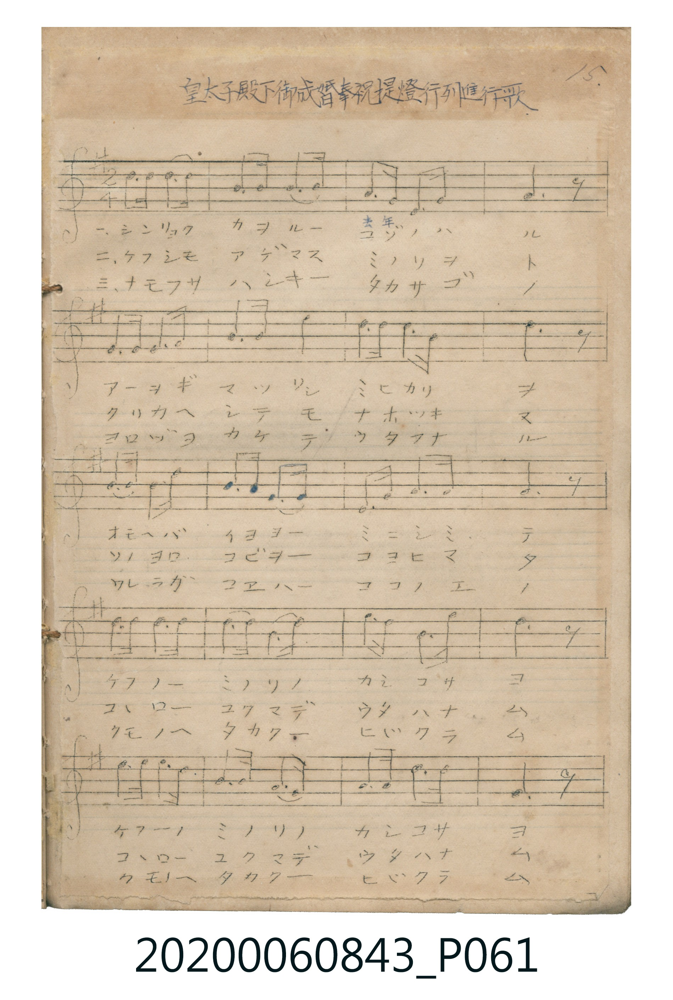

# 皇太子殿下御成婚奉祝提燈行列進行歌

> Re:Shōka 使用 AI 協助辨識與重建樂譜，可能會有錯誤。歡迎回報。

- **鋼琴伴奏版**：<br><audio controls src="kotaishi_denka_chochin_gyoretsu_shinkoka.mp3"></audio>

- 曲：不詳 (大正十三年)

## 說明

皇太子殿下御成婚奉祝提燈行列進行歌 (Kōtaishi Denka Goseikon Hōshuku Chōchin Gyōretsu Shinkōka)
Source: 唱歌帖 (Shōkachō, NMTH 2020.006.0843) — P061.jpg (Notebook 1, p.15)
Notation: Handwritten 5-line staff (1 sharp = G major, 2/4 time, 20 bars)


## 歌詞

```text
（TMD 檔案未包含歌詞註解）
```

## ABC

<div class="abc-score" data-abc-src="kotaishi_denka_chochin_gyoretsu_shinkoka.abc" aria-label="五線譜載入中"></div>

[下載 ABC 原始檔](kotaishi_denka_chochin_gyoretsu_shinkoka.abc)

## TMD 檔案連結

- [主旋律 TMD 檔案](kotaishi_denka_chochin_gyoretsu_shinkoka.tmd) [[在 TMD Studio 編輯](https://tmdlang.github.io/Tmd-TS/#tmd=s7IKdvYPcrWy4qpTUCpJTLdSSM7PyUlNLsnMz7MqzsjPTkzOyFeCS5bl55TmploBqXgDY4RwcX5pUXJqfEFieqpVgIGZIboM3KT4vPyS1KT8_GyEioKi_LLUvMQ8oKrcxLzS4uSizIKS-OT8gkqEmtSyzJRUkIrUlMyS_KLMxBwkJ6UWFYMdC3FDSVFiHsQMoCBCVUlGKtDdmbkFqai6IeJpqcUlmWXI4kBL0jPzrErzQBaXZKZlpqYgS5Zk5KcXJRZkVFplZBaDXJScmBOfnZiXqMSlpaXwfFb70yWrnq6d8Gzd_ic7up_uW_isY8LTlbOeLu18vnTus_4Jz9s7Xizsedox_WXDJiDj2doeBS0tLkVbBUNDIy57WwV3LhsjfRM7kIXPZm96v2fWkx29L1ZuVtB4umT5s7WLn_Y2PtnR-XTnFk0lLi59LQVbagEuBQWyHK_hfbS3JDGzOCNTwSU1LztRwT2_ODUzOz9PweNob3FGaXapgnPG0d7kjMw8BffKo71FqSXFpQrBQG720d7sRE2QvcGQlKLwdMpGoJFPd0xT0AgG6gElm6O9Ogp-viEeCkYGRgZ6BgZmegYWJsaaCo8apiiAkpteVkG6goYfNGkpGOooFOgZmoJNBQomgtOygkdiXkp5UWZJSWqegqluTmZeqkJxSWJamoKGoUJxRmJRgQIw3BVyE7Pyi3QUgKGvUJKZmwpkGSgkJRYVgw2jPIChQEFLn4vLG-g0UJCBQ8w5Ix8UOu6V-eCwAQcNMMtYBWQm5uU71BjUVIMcoGBjaKZlB2YBox0YTC9WzrMCGQYVebKj4XFD4-Om7Y-bNz9uXvW4efnjpvUKj5tWP27e9Lh5NZC1-XHTvsfNfY-b-0F8faDIIpBc0zqFx83zHje3gHQ1bQdy5j9ungTWCDRlE1ghkAFUO-Nx8wQgZ8nj5hVABFHYDbYRyGgDK9z4uHkq0A6IHNAqoEYgB2gWUBXIAVtBGolWiOS7XT1g34G1gWxcBHZ-E9Br8x437UQ2BijUAbZiPdhDQG_MAHKAWtrAupq7HjfPBvm2ae3j5h6wwr1grUA_rQWHUvNkkLfBLKDYJLAN-8EKgSJAtUBVzcvAxgNDrR0oDOTsB4cq0OgFxCtEjrtOkO9AwsBgBnpwK1BnPzgoQE7aDw6XrY-btoACCWg-2K2Pm1sh7gTKAYOlDW4-MFyBBoFjuBlo95rHzSsfN62BJACgxn4IC-jEPjAfbCLIkUCrgcEACiyIhcDUA_L9ZLDkSpjXiFII9VqNQnVuWq2CqYIuCq5RMIayDIEYxK5RMILyzOKhjBoFUxATBg1AQrDwcgjLBxa6VqBoBVq9GYhB6R3kOFBwALnAYAEl-eY9IL8C8T4gG5TWgH4HiiMCHmHQRqDMVKiB4LQFxCBT5gFpcPKCmrAKanoHNlOauyC6wSaB4xBiIigWwW7ZD3EfSK5pC9hEeEiB_AzDoMCABBIsoECwRsEMFEBQEUiwweTwBBHIPaBkAs7mQNwC8QUkp4NiDhpmEJ9hCxtQ_IJ0gFSB8xKQBiY3SG4C4tkQU8G-BNZmWMIFVFiAZFuhbgGFASjEwYkWEi6gMAObBo8fSAjAEgZqmMBEgWECSzAgIYgiEEkgUECeBTkf6B1ImQZ1JAgDIwocMN1IgdSGNWD2QhMF1HugpNY8GZpAoEkPLAcMYnBC2o81cEDBC8yezSuBKsDZFIhBukCJFZaAQSaBykeQOJZEg_A7aqIxgyYRWJAhch-B8IFmB7DvYOEBS_7gchqasEFuAyV05LIaYQrM5dDk3wyKapBvQckQXB5Cox7kU1DUI5eJqMkPFFcg-8GFDtR-kDjIVFDoAkMdzAeGIUrxAyx9MDMNlrIGFoCwgIIELZGBBHIEuCYbaoFUy8Wla6dATGNEAahOmQsA)]
- [鋼琴伴奏 TMD 檔案](kotaishi_denka_chochin_gyoretsu_shinkoka_piano.tmd) [[在 TMD Studio 編輯](https://tmdlang.github.io/Tmd-TS/#tmd=s7IKdvYPcrWy4qpTUCpJTLdSyC8qychPL0osyKi0ysgsLskvykxOzInPTsxLVIIrKs4vLUpOjS9ITE-1CjAwM0TIlGSk5qZapaaUJieWZObnKXFpaSk8n9X-dMmqp2snPFu3_8mO7qf7Fj7rmPB05aynSzufL537rH_C8_aOFwt7nnZMf9mwCch4trZHQeNx85THTYseN_c92bPl6dL-J7tnaCpoaXEp2ioYGhpx2dsquHPZGOmb2IFsfjZ70_s9s57s6H2xcrOCxtMly5-tXfy0t_HJjs6nO7doKnFx6Wsp2FILcCkokOWjRw1TFAIyE_PyFRyTk_NzCxLzMnNT80pAxgWDg9NK4emUjUCVT3dMU9AIzjjam52YDCR1FPx8QzwUjAyMDPQMDMz0DCxMjDUhpgFDXi-rIF1Bwy-_JDUpPz9bwVBHoUDP0FQTZCrlXoUCBS19Li7v_JLEzOKMTJfUvOxE54z85IzMPPfK_KLUkuLSYCA7Oz870QrsP4cag5pqkAMUbAzNtOzArBqF6ty0WgVTBV0UXKNgDGUZAjGIXaNgBOWZxUMZNQqmICYMGoCEwIYCY9UhLB-YOq2AnMdN2xUeN28G4lWPm5cDueuBeDWQuwmIQfQeIB8o3bQPyO4D4n6wONBrWIzaCJSbCjVyEZAGYZA584D0TiA9H2rGKqj5HdjNae6C6AebtRViJ8jMprVQ9-yHuBEk17QFbCbUnBqwz2EYFCSQoIIFFwjWKJiBggkqAgk8mBxqQEH0wgIW1TSYKNA0WICDhCCKQCQ245Adhs1xZlCnwCxAxDU206qBKQPTK1jSAcw6mLEQh6AaWUtKUg3ywJVYC2oVDLWNtWHhicwGpUdtoACUi8KpUTBRj9c2i9eGhRyUC3Mn0A_x2kAd5rAUDXI0WAJqM8g0hMHmCIPQbEV1kKG2iTYo9DBlQCbAudgsQ_YHbuuQnAX0IoqX0DwM1ohkELU8iODh1YZuHSht4Q4d5IhCiydUW9DtNAbHIkw1wlKSUp8PcuozgSc-Q1B5B6KMQZRRPAiBy0AD7OUeqIABFkJN6yAFVHMLpGACF16ggmoStCCEFFbYCzxgYQnWA1I3A6q3DVp4gQqx2RBzwQVXD47CbgUQg-Rboe4BFWygghRoTtMySGEHKgjB5sELXnTvmsQDWfh8C_IFyFVAVzZPAPKXQG0GYWCRCvZxN5Lv23D4eC-0CIe6GlQ1NE-GFufQqgIsBww9cLG_H4evQSG3BohXAtUAaXAVA9IHql5gVQ7ILKBdYHGUIh7N5wQiGlorgZ0N8yqsFgIZDwpwUO0CshJU26zA4XWYk6C1UDMockDeACWedqTIAnkBFFkL8CQaUFSA3ABKNLDaDCQOMhcUdMAgBfOBwYMwB93rQDaUS8DnIFNBtg1hn0MTODCqgSyo18F-h0Q7sADRtVMgpgxRAKpT5gIA)]

## 分析

```text
================================================================================
📊 TMD Song Profile: [ 皇太子殿下御成婚奉祝提燈行列進行歌 ]
================================================================================
⏱  Duration:       0:21 (21.4s), 20 measures total
🎼 Key & Tempo:    首調基準 G, != 112.0 BPM, <2/4>
   - 分析範圍：      由實際發聲的音符與和弦推測調性；播放脈絡另行呈現
🎤 人聲音域:    D4 (MIDI 62) – E5 (MIDI 76) [跨度: 14 個半音 / 1.2 個八度, 難度: moderate]
   - 最低音:  D4 in [KotaishiDenkaChochinGyoretsuShinkoka #1 @ m.4, 0:03]
   - 最高音: E5 in [KotaishiDenkaChochinGyoretsuShinkoka #1 @ m.7, 0:06]
   - 適合: soprano, mezzo-soprano, contralto, tenor, baritone, bass
🏛  結構:      KotaishiDenkaChochinGyoretsuShinkoka (21.4s)
⚡ 編曲密度:        Peak 1 軌道同時演奏
🗝  調性診斷：       D 調性不明確（純淨自然大調，未偵測到可信轉調）
   - 風格氣質:    純淨自然大調（陽光明朗、易唱易記，無明顯調外色彩）
   - 轉調歷程:    全曲維持單一推測調性（未偵測到可信轉調）
   - 核心骨幹音:  D, A, G, B, E
   - 調性數值:    D 調性不明確 [相關度: 0.80, 穩定度: Ambiguous, 自然音純度: 100.0%]
   - 候選調性 (K-S): D 大調 (0.80), G 大調 (0.79), B 小調 (0.64)
   - 五度圈歷程:   +2
   - 各段落調性細節:
     • [KotaishiDenkaChochinGyoretsuShinkoka #1]: D 調性不明確 (r: 0.80, 自然音純度: 100.0%)

  [ 五度圈游移軌跡 ]
               C  
         F            G  
      Bb              [D ]*
      Eb               A  
         Ab           E  
            Db       B  
               F# 
     (* = active key center)

  [ 十二半音累積音高分佈 ]
     C  :                            0.0%
     C# :                            0.0%
     D  : ████████████████████████  24.7%
     D# :                            0.0%
     E  : ██████████                10.0%
     F  :                            0.0%
     F# :                            0.0%
     G  : █████████████████████     21.3%
     G# :                            0.0%
     A  : ██████████████████████    22.7%
     A# :                            0.0%
     B  : █████████████████████     21.3%
--------------------------------------------------------------------------------
Assignment 軌道音域：
  - Piano         : D4 – E5 (14 個半音 / 1.2 個八度, 64 個音符)
================================================================================
```


## 原書掃描頁




