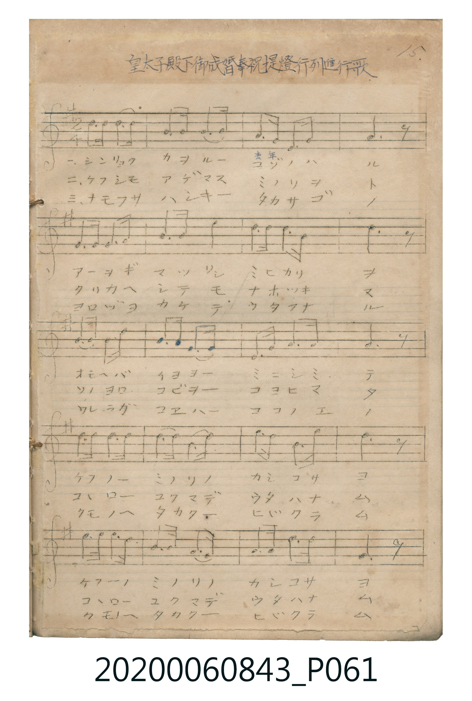

# 皇太子殿下御成婚奉祝提燈行列進行歌

> Re:Shoka 使用 AI 協助辨識與重建樂譜，可能會有錯誤。歡迎回報。

<audio controls src="kotaishi_denka_chochin_gyoretsu_shinkoka.mp3"></audio>

- 曲：不詳 (大正十三年)

## 說明

皇太子殿下御成婚奉祝提燈行列進行歌 (Kōtaishi Denka Goseikon Hōshuku Chōchin Gyōretsu Shinkōka)
Source: 唱歌帖 (Shōkachō, NMTH 2020.006.0843) — P061.jpg (Notebook 1, p.15)
Notation: Handwritten 5-line staff (1 sharp = G major, 2/4 time, 20 bars)

## 歌詞

```text
（TMD 檔案未包含歌詞註解）
```

## ABC

```abc
X:1
T:皇太子殿下御成婚奉祝提燈行列進行歌
C:曲：不詳 (大正十三年)
M:2/4
L:1/16
Q:1/4=112
K:G
V:V1 name="Vocal" snm="Voc"
[V:V1]
!mf! d2 d2 d2 d2 | B2 d2 G2 B2 | A2 G2 E2 G2 | D6 z2 |
G2 G2 G2 A2 | B2 B2 d4 | e2 e2 d2 B2 | d6 z2 |
B2 A2 G2 A2 | B2 B2 A2 G2 | E2 G2 A2 A2 | A6 z2 |
G2 G2 A2 A2 | B2 B2 d3 e | d2 B2 A2 d2 | B6 z2 |
!f! e2 e2 d2 B2 | A2 G2 E2 G2 | A2 A2 B2 A2 | G6 z2 |
```

## TMD 檔案連結

- [主旋律 TMD 檔案](kotaishi_denka_chochin_gyoretsu_shinkoka.tmd) [[在 TMD Studio 編輯](https://tmdlang.github.io/Tmd-TS/#tmd=s7IKdvYPcrWy4qpTUCpJTLdSSM7PyUlNLsnMz7MqzsjPTkzOyFeCS5bl55TmploBqXgDY4RwcX5pUXJqfEFieqpVgIGZIboM3KT4vPyS1KT8_GyEioKi_LLUvMQ8oKrcxLzS4uSizIKS-OT8gkqEmtSyzJRUkIrUlMyS_KLMxBwkJ6UWFYMdC3FDSVFiHsQMoCBCVUlGKtDdmbkFqai6IeJpqcUlmWUgcS0theez2p8uWfV07YRn6_Y_2dH9dN_CZx0Tnq6c9XRp5_Olc5_1T3je3vFiYc_TjukvGzYBGc_W9ihoaXEp2ioYGhpx2dsquHPZGOmb2IHseDZ70_s9s57s6H2xcrOCxtMly5-tXfy0t_HJjs6nO7doKnFx6Wsp2FILcCkokOV4De-jvSWJmcUZmQouqXnZiQru-cWpmdn5eQoeR3uLM0qzSxWcM472Jmdk5im4Vx7tLUotKS5VCAZys4_2ZidqguwNhsSzwtMpG4FGPt0xTUEjGKgHFOlHe3UU_HxDPBSMDIwM9AwMzPQMLEyMNRUeNUxRACUWvayCdAUNP2jCUDDUUSjQMzQFmwoUTASnRAWPxLyU8qLMkpLUPAVT3ZzMvFSF4pLEtDQFDUOF4ozEogIFYLgr5CZm5RfpKABDX6EkMzcVyDJQSEosKgYbRnkAQ4GClj4XlzfQaaAgA4eYc0Y-KHTcK_PBYQMOGmCCtwrLT07McagxqFGoBrlAwcbQTMsOzALGOzCcXqycZwUyDSryZEfD44bGx03bHzdvfty86nHz8sdN6xUeN61-3LzpcfNqIGvz46Z9j5v7Hjf3g_j6QJFFILmmdQqPm-c9bm4B6WraDuTMf9w8CawRaMomsEIgA6h2xuPmCUDOksfNK4AIorAbbCOQ0QZWuPFx81SgHRA5oFVAjUAO0CygKpADtoI0Eq0QyXe7esC-A2sD2bgI7PwmoNfmPW7aiWwMUKgDbMV6sIeA3pgB5AC1tIF1NXc9bp4N8m3T2sfNPWCFe8FagX5aCw6l5skgb4NZQLFJYBv2gxUCRYBqgaqal4GNB4ZaO1AYyNkPDlWg0QuIV4gcd50g34GEgcEM9OBWoM5-cFCAnLQfHC5bHzdtAQUS0HywWx83t0LcCZQDBksb3HxguAINAsdwM9DuNY-bVz5uWgNJAECN_RAW0Il9YD7YRJAjgVYDgwEUWBALgakH5PvJYMmVMK8RpRDqNWDSzU2rVTBV0EXBNQrGUJYhEIPYNQpGUJ5ZPJRRo2AKYsKgAUgIFl4O4LxhBYpWoNWbgRiU3kGOAwUHkAsMFlCSb94D8isQ7wOyQWkN6HegOCLgEQZtBMpMhRoITltADDJlHpAGJy-oCaugpndgM6W5C6IbbBI4DiEmgmIR7Jb9EPeB5Jq2gE2EhxTIzzAMCgxIIMECCgRrFMxAAQQVgQQbTA5PEIHcA0om4GwOxC0QX0ByOijmoGEG8Rm2sAHFL0gHSBU4LwFpYHKD5CYgng0xFexLYHWGJVxAhQVIthXqFlAYgEIcnGgh4QIKM7Bp8PiBhAAsYaCGCUwUGCawBAMSgigCkQQCBeRZkPOB3oGUaVBHgjAwosAB040USG1YA2YvNFFAvQdKas2ToQkEmvTAcsAgBiek_VgDBxS8wOzZvBKoApxNgRikC5RYYQkYZBKofASJY0k0CL-jJhozaBKBBRki9xEIH2h2APsOFh6w5A8up6EJG-Q2UEJHLqsRpsBcDk3-zaCoBvkWlAzB5SE06kE-BUU9cpmImvxAcQWyH1zoQO0HiYNMBYUuMNTBfGAYohQ_wNIHM9NgKWtgAQgLKEjQEhlIIEeAa7KhFki1XFy6dgrEtEYUgOqUuQA)]
- [鋼琴伴奏 TMD 檔案](kotaishi_denka_chochin_gyoretsu_shinkoka_piano.tmd) [[在 TMD Studio 編輯](https://tmdlang.github.io/Tmd-TS/#tmd=s7IKdvYPcrWy4tLSUng-q_3pklVP1054tm7_kx3dT_ctfNYx4enKWU-Xdj5fOvdZ_4Tn7R0vFvY87Zj-smETkPFsbY-CxuPmKY-bFj1u7nuyZ8vTpf1Pds_QVNDS4lK0VTA0NOKyt1Vw57Ix0jex46pTUHo2e9P7PbOe7Oh9sXKzgsbTJcufrV38tLfxyY7Opzu3aCpxcelrKdhSC3ApKJDlo0cNUxQCMhPz8hUck5PzcwsS8zJzU_NKQMYF55cWJadaKTydshGo8umOaQoawRlHe7MTk4GkjoKfb4iHgpGBkYGegYGZnoGFibEmxDQDM0O9rIJ0BQ2__JLUpPz8bAVDHYUCPUNTTZCplHsVChS09Lm4vPNLEjOLMzJdUvOyE50z8pMzMvPcK_OLUkuKS4OB7Oz87ESrsPzkxByHGoMahWqQCxRsDM207MAsoEhuWq2CqYIuCq5RMIayDIEYxK5RMILyzOKhjBoFUxATBg1AQmBDgdHqALbSCsh53LRd4XHzZiBe9bh5OZC7HohXA7mbgBhE7wHygdJN-4DsPiDuB4sD_YbFqI1AualQIxcBaRAGmTMPSO8E0vOhZqyCmt-B3ZzmLoh-sFlbIXaCzGxaC3XPfogbQXJNW8BmQs2pAfschkFBAgkqWHCBYI2CGSiYoCKQwIPJoQYURC8sYFFNg4kCTYMFOEgIoghEYjMO2WHYHGcGdQrMAkRcYzOtGpgyML2CJR3ArIMZC3EIqpG1RKZVcF4M8sCZWgtqFQy1jbVhAYrMBiVIbaAAlIvCqVEwUY_XNovXhgUdlAtzKNAT8dpAHeawJA1yNVgCajPINITB5giD0GxFdZChtok2KPgwZUAmwLnYLEP2B27rkJwF9CKKl9A8DNaIZBC1PIjg4dWGbh0oceEOHeSIQosnVFvQ7TQGxyJMNcJSkpKfD67khwggRABAWcYIISMYE85AKipRwwGtfAOVScByq2kdpExrboGUZeDyDlS2TYKWnZDyDXsZCSxfwXpA6mZA9bZByztQuTcbYi64rOvBUT6uAGKQfCvUPaCyEFT2As1pWgYpH0FlJ9g8eFlNbPCYwJjIcUpM6IB8DfIF0FfNE4D8JVCXgjCw1AaHUDdSaLXhCKG90FoC6ktQ7dM8GVpjQGsjsBwwtME1y34coQQK6TVAvBKoBkiDazGQPlANBqvVQGYB7QKLo9UiJIQUyQkJWlGCvQkLGljFCHIOKEJBFR7IiaAKcAWOoIJ5AVoxNoMiH-RtUOJsR0oMIC-DEsMCPIkSFHUgN4ASJayCBYmDzAUFNTAKwHxgcCLMITao4LJYlBEVUiBXgFw3hEMKS8aCJxy4HEpQIYUVZrICFpm6dgrElJoKQHXKXAA)]

## 分析

```text
================================================================================
📊 TMD Song Profile: [ 皇太子殿下御成婚奉祝提燈行列進行歌 ]
================================================================================
⏱  Duration:       0:21 (21.4s), 20 measures total
🎼 Key & Tempo:    首調基準 G, != 112.0 BPM, <2/4>
   - 分析範圍：      由實際發聲的音符與和弦推測調性；播放脈絡另行呈現
🎤 人聲音域:    D4 (MIDI 62) – E5 (MIDI 76) [跨度: 14 個半音 / 1.2 個八度, 難度: moderate]
   - 最低音:  D4 in [KotaishiDenkaChochinGyoretsuShinkoka #1 @ m.4, 0:03]
   - 最高音: E5 in [KotaishiDenkaChochinGyoretsuShinkoka #1 @ m.7, 0:06]
   - 適合: soprano, mezzo-soprano, contralto, tenor, baritone, bass
🏛  結構:      KotaishiDenkaChochinGyoretsuShinkoka (21.4s)
⚡ 編曲密度:        Peak 1 軌道同時演奏
🗝  調性診斷：       D 調性不明確（純淨自然大調，未偵測到可信轉調）
   - 風格氣質:    純淨自然大調（陽光明朗、易唱易記，無明顯調外色彩）
   - 轉調歷程:    全曲維持單一推測調性（未偵測到可信轉調）
   - 核心骨幹音:  D, A, G, B, E
   - 調性數值:    D 調性不明確 [相關度: 0.80, 穩定度: Ambiguous, 自然音純度: 100.0%]
   - 候選調性 (K-S): D 大調 (0.80), G 大調 (0.79), B 小調 (0.64)
   - 五度圈歷程:   +2
   - 各段落調性細節:
     • [KotaishiDenkaChochinGyoretsuShinkoka #1]: D 調性不明確 (r: 0.80, 自然音純度: 100.0%)

  [ 五度圈游移軌跡 ]
               C  
         F            G  
      Bb              [D ]*
      Eb               A  
         Ab           E  
            Db       B  
               F# 
     (* = active key center)

  [ 十二半音累積音高分佈 ]
     C  :                            0.0%
     C# :                            0.0%
     D  : ████████████████████████  24.7%
     D# :                            0.0%
     E  : ██████████                10.0%
     F  :                            0.0%
     F# :                            0.0%
     G  : █████████████████████     21.3%
     G# :                            0.0%
     A  : ██████████████████████    22.7%
     A# :                            0.0%
     B  : █████████████████████     21.3%
--------------------------------------------------------------------------------
Assignment 軌道音域：
  - Vocal         : D4 – E5 (14 個半音 / 1.2 個八度, 64 個音符)
================================================================================
```


## 原書掃描頁




