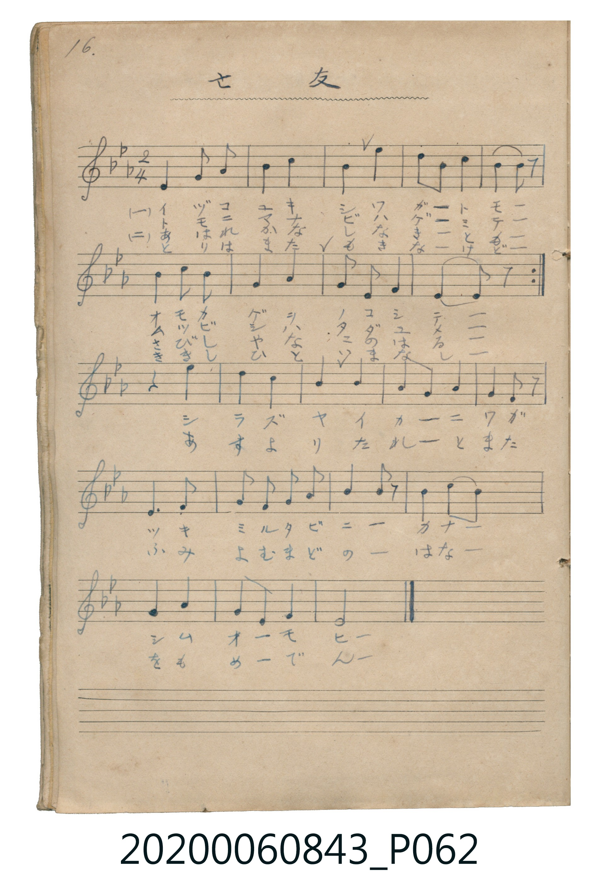

# 亡友

<audio controls src="boyu.mp3"></audio>

- 曲：不詳

## 說明

亡友 (Bōyū)
Source: 唱歌帖 (Shōkachō, NMTH 2020.006.0843) — P062.jpg (Notebook 1, p.16)
Notation: Handwritten 5-line staff (3 flats = Eb major, 2/4 time, 19 bars)

## 歌詞

```text
（TMD 檔案未包含歌詞註解）
```

## ABC

```abc
X:1
T:亡友
C:曲：不詳
M:2/4
L:1/16
Q:1/4=76
K:Eb
V:V1 name="Vocal" snm="Voc"
[V:V1]
!mp! E4 F2 G2 | B4 c4 | B4 e4 | c2 B2 c2 B2 |
c4 c2 c2 | B4 e4 | B2 G2 F2 G2 | E6 z2 |
z2 c2 c2 c2 | B4 G4 | B4 c4 | B2 G2 F2 z2 |
E6 F2 | G2 B2 c2 B2 | G4 F2 z2 | B4 c2 B2 |
G4 B4 | F2 E2 F4 | E8 |
```

## TMD 檔案連結

- [主旋律 TMD 檔案](boyu.tmd) [[在 TMD Studio 編輯](https://tmdlang.github.io/Tmd-TS/#tmd=s7IKdvYPcrWy4tLSUniya-HT_m4FLS0uRVsFczMue1sFVx0uGyN9EzuuOgWlZ7M3vd8z68mO3hcrNytxcelrKdhSC3ApKMBs13A62lt5dLUmSCg4v7QoOdVK4emUjc_W9jzdMU1BIzjjaG92YjKQ1FHw8w3xUDAyMDLQMzAw0zOwMDHWVHjUMEUhwMDMSC-rIF1Bwy-_JDUpPz9bwVBHoUDP0AxsKlAwsSQzP89KwSMxL6W8KLOkJDVPwVQ3JzMvVaG4JDEtTUHDWCEtJ7GkWAEYAkkKuYlZ-UU6CsBwUCjJzE3VUTC0VEhKLCoGm0a556FAQUufi8spv7I03tEqLD85McehxqBGoRpkh4KNoZmWHZgFDHVgULxYOc8KpB4qovFkR4OmwuOmJY-bOx43L1J43LzscdPqx03bHzetBXLWP25aA6TAUvpAZauADLD8JqBo3-Pm-WCqaTNQavvj5jYkg8ECKx837XrcvARifitQ3ePmboSpLSA7gKY2z3_cDDRy_-PmyUAOUAHQguYuiAkLoJYCJSahOHtXD9DZjUseN6593LgeyNr3uHHV48bNjxvXATmrIWJAgV6QBY1NjxtXPG6cCuKC1fQ-bpwOZK0HKgFS68B2z0N2PEjHzMdNHY-bgO5onP-4qQdoAsQWoJcbtz5u3A8OD6CCBrDoSpA5cCObJj1uagJSjY8blwOpyTCjgZGSW1CrYKigC4ZGQGwMxDUKplARMyiNEDGMgwuBJEHCMLoG5lwHcKRbgYIZFFlADI5IUECCQhGIwXEJpMGRCZXfg-RhuAmNQBMagaohYQoKQ1CIQT0HNA0SrmDdoNCE-wvmcBANwlg9ABIC-Rfhb1hIgKABdi-BLAM6F-wVcKoDJRgIDUl3QDZywkN4BRgD4EibCnYqxBsgGhz1UK8hxX0tNA854clDNWBXwjyJ6lGQj1DjDjU2YT7H4U-QP4CpqGkXkAbnGCDdCvEjJNNAo68Fp19nghIkEIOTLJDugfofFI3gVAvE-xFRhhz2IHfVgF2IksDgfoK7G8VvOBIhKLGBYggUY_uBNDxXA2lwtgbSwHyNPQGCfdAAdTU0V4ETGzTGmiYBMdC3CN0IV8LcVgN2L8h_IBoiguxbsAjOlAayDVjYQGjsbmwEugWYsUEqgJkbSSUwDenaKUCKYgUYywnEUuYCAA)]
- [鋼琴伴奏 TMD 檔案](boyu_piano.tmd) [[在 TMD Studio 編輯](https://tmdlang.github.io/Tmd-TS/#tmd=s7IKdvYPcrWy4tLSUniya-HT_m4FjcfNUx43LXrc3Pdkz5anS_uf7J6hqaClxaVoq2BuxmVvq-Cqw2VjpG9ix1WnoPRs9qb3e2Y92dH7YuVmJS4ufS0FW2oBLgUFuJOcjvZWHl2tqfCoYYpCQGZiXr6CY3Jyfm5BYl5mbmpeCUhpcH5pUXKqlcLTKRufre15umOagkZwxtHe7MRkIKmj4Ocb4qFgZGBkoGdgYKZnYGFiDDXNwMxIL6sgXUHDL78kNSk_P1vBUEehQM_QTBNkKuXegAIFLX0uLqf8ytJ4R6uw_OTEHIcagxqFapAdCjaGZlp2YBZQJLegVsFQQRcMjYDYGIhrFEyhImZQGiFiGAcXAkmChGF0DdhMYJw4gG20AnIeNy1ReNzcAcSLgHgZkL8aiLcD8Vogfz2QXoMkvwfkakwzGoFmNALVNwLVN-4D4lVAvBmI1wEx0DywOFAMqP9xYy_MDIj7YJ4AYayeAAmB_IzwOyw0QNAA7K1aeFCCE0OQB67ABIalaby2oTbIIBAEcszjtUFGQywDymjD3aBtoo0IXmQZIEsbyYXICpGVQYIbXZ5oQxFS6K5E8QIoBCC2oYWCD65QgIWfaTzCNijLBFPIGCEEl4XJYU1QoIgGJhZwQtoEZPcB8XwI3QRMFKDE1dyGIyE1AfEKIJ4KTiiQRASipyMSUeO6x037HzfPQyQjuLOwuN4MIQT3rmk8kjoYEzMYnfDmS5B6WLpFTbuwiMGVSWGJGZJ0sQQgKIBWAuldQBqYs8A5tBUSeM3dSLmyBU8gzgSqAebapi4gGxj4TT3QgAXlTiC_cSsQ70cEIXKWArmtBuxKlLID7i-421H8hyhfECrhGQGsB2QHUk5DshE93PFnYuKyE0oeITZjo2U0qIV4SwwUSVSTyStpsFmKUqoA0zRQCmYSXvfgDFycZQO-vIRUEmApL7BlL2ypG1SvgIoDUPGwH0hPhqRqUHHRDEyt4NS_AHddA07VDdCUDMwloDoGXK9Ai4emSUAMzAEI_cQWeNjLBwx1eIo8kDuagfaDaVzubwS6czlETRPI7yhq8Re7yO6HMVGiWNdOAVIDKMBYTiCWMhcA)]

## 分析

```text
================================================================================
📊 TMD Song Profile: [ 亡友 ]
================================================================================
⏱  Duration:       0:30 (30.0s), 19 measures total
🎼 Key & Tempo:    首調基準 E,, != 76.0 BPM, <2/4>
   - 分析範圍：      由實際發聲的音符與和弦推測調性；播放脈絡另行呈現
🎤 人聲音域:    D#4 (MIDI 63) – D#5 (MIDI 75) [跨度: 12 個半音 / 1.0 個八度, 難度: easy]
   - 最低音:  D#4 in [Boyu_A #1 @ m.1, 0:00]
   - 最高音: D#5 in [Boyu_A #1 @ m.3, 0:03]
   - 適合: soprano, mezzo-soprano, contralto, tenor, baritone, bass
🏛  結構:      Boyu_A (12.6s) -> Boyu_B (17.4s)
⚡ 編曲密度:        Peak 1 軌道同時演奏
🗝  調性診斷：       D# 大調（純淨自然大調，未偵測到可信轉調）
   - 風格氣質:    純淨自然大調（陽光明朗、易唱易記，無明顯調外色彩）
   - 轉調歷程:    全曲維持單一推測調性（未偵測到可信轉調）
   - 核心骨幹音:  A#, D#, C, G, F
   - 調性數值:    D# 大調 [相關度: 0.83, 穩定度: Moderate, 自然音純度: 100.0%]
   - 候選調性 (K-S): D# 大調 (0.83), A# 大調 (0.74), C 小調 (0.66)
   - 五度圈歷程:   -3 -> -3
   - 各段落調性細節:
     • [Boyu_A #1]: D# 大調 (r: 0.82, 自然音純度: 100.0%)
     • [Boyu_B #1]: D# 調性不明確 (r: 0.80, 自然音純度: 100.0%)

  [ 五度圈游移軌跡 ]
               C  
         F            G  
      Bb               D  
     [Eb]*              A  
         Ab           E  
            Db       B  
               F# 
     (* = active key center)

  [ 十二半音累積音高分佈 ]
     C  : █████████████████         20.8%
     C# :                            0.0%
     D  :                            0.0%
     D# : ███████████████████       23.6%
     E  :                            0.0%
     F  : █████████                 11.1%
     F# :                            0.0%
     G  : █████████████             15.3%
     G# :                            0.0%
     A  :                            0.0%
     A# : ████████████████████████  29.2%
     B  :                            0.0%
--------------------------------------------------------------------------------
Assignment 軌道音域：
  - Vocal         : D#4 – D#5 (12 個半音 / 1.0 個八度, 48 個音符)
================================================================================
```


## 原書掃描頁




