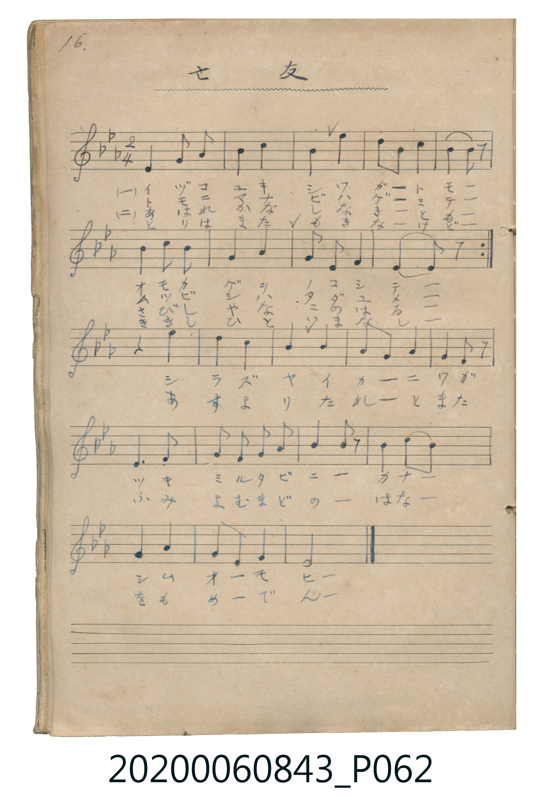

# 亡友

> Re:Shōka 使用 AI 協助辨識與重建樂譜，可能會有錯誤。歡迎回報。

- **鋼琴伴奏版**：<br><audio controls src="boyu.mp3"></audio>

- 曲：不詳

## 說明

亡友 (Bōyū)
Source: 唱歌帖 (Shōkachō, NMTH 2020.006.0843) — P062.jpg (Notebook 1, p.16)
Notation: Handwritten 5-line staff (3 flats = Eb major, 2/4 time, 19 bars)


## 歌詞

```text
（TMD 檔案未包含歌詞註解）
```

## ABC

<div class="abc-score" data-abc-src="boyu.abc" aria-label="五線譜載入中"></div>

[下載 ABC 原始檔](boyu.abc)

## TMD 檔案連結

- [主旋律 TMD 檔案](boyu.tmd) [[在 TMD Studio 編輯](https://tmdlang.github.io/Tmd-TS/#tmd=s7IKdvYPcrWy4qpTUCpJTLdSSM7PyUlNLsnMz7MqzsjPTkzOyFeCS5bl55TmploBqXgDY4RwcX5pUXJqfEFieqpVgIGZEboM3KT4vPyS1KT8_GyEioKi_LLUvMQ8oKrcxLzS4uSizIKS-OT8gkqEmtSyzJRUkIrUlMyS_KLMxBwkJ6UWFYMdC3FDSVFiHsQMoCBCFVBTemaeVWkeyKCSzLTM1BQlLi0thSe7Fj7t71bQ0uJStFUwN-Oyt1Vw1eGyMdI3sQPpfTZ70_s9s57s6H2xcrMSF5e-loIttQCXggLMdg2no72VR1drgoSCIQGm8HTKxmdre57umKagEZxxtBcUekd7dRT8fEM8FIwMjAz0DAzM9AwsTIw1FR41TFEAhbpeVkG6goYfNIQVDHUUCvQMzcCmAgUTwVGq4JGYl1JelFlSkpqnYKqbk5mXqlBckpiWpqBhrJCWk1hSrAAMgSSF3MSs_CIdBWA4KJRk5qbqKBhaKiQlFhWDTaPc81CgoKXPxeWUX1ka72gVlp-cmONQY1BTDbJCwcbQTMsOzAIGOjAkXqycZwVSDhXReLKjQVPhcdOSx80dj5sXKTxuXva4afXjpu2Pm9YCOesfN60BUmApfaCyVUAGWH4TULTvcfN8MNW0GSi1_XFzG5LBYIGVj5t2PW5eAjG_FajucXM3wtQWkB1AU5vnP24GGrn_cfNkIAeoAGhBcxfEhAVQS4ESk1CcvasH6OzGJY8b1z5uXA9k7XvcuOpx4-bHjeuAnNUQMaBAL8iCxqbHjSseN04FccFqeh83Tgey1gOVAKl1YLvnITsepGPm46aOx01AdzTOf9zUAzQBYgvQy41bHzfuB4cHUEEDWHQlyBy4kU2THjc1AanGx43LgdRkmNE1CtW5BbUKhgq6YGgExMZAXKNgChUxg9IIEcM4uBBIEiQMo2tgznUAx7kVKJhBkQXE4IgEBSQoFIEYHJdAGhyZUPk9SB6Gm9AINKERqBoSpqAwBIUY1HNA0yDhCtYNCk24v2AOB9EgjNUDICGQfxH-hoUECBpg9xLIMqBzwV4BpzpQgoHQkHQHZCMnPIRXgDEAjrSpYKdCvAGiwVEP9RpS3NdCs5ATRhaygOagGqAbzcAQ4RcIC-ZlY6DfDLD5AuRKYBpp2gWkwfkBSLdCfADJEtDIacHpk5mg5AbE4AQJpHugvgNFEjhNAvF-RIRAQtYIyDIGussMiEEskAjQfVA3A8UwXQpKKqDwBYX3fiANz5NAGpwpgTQwV2JPPmAXNkBdBc0T4KQCDe-mSUAM9A1CN8RV4OQMdJshOG0g0gXu9AAyFVgkQGjsbmkE2gnMfiAVwCyIpBIY07p2CpDyUgHGcgKxlLkA)]
- [鋼琴伴奏 TMD 檔案](boyu_piano.tmd) [[在 TMD Studio 編輯](https://tmdlang.github.io/Tmd-TS/#tmd=s7IKdvYPcrWy4tLSUniya-HT_m4FjcfNUx43LXrc3Pdkz5anS_uf7J6hqaClxaVoq2BuxmVvq-Cqw2VjpG9ix1WnoPRs9qb3e2Y92dH7YuVmJS4ufS0FW2oBLgUFuJOcjvZWHl2tqfCoYYpCQGZiXr6CY3Jyfm5BYl5mbmpeCUhpcH5pUXKqlcLTKRufre15umOagkZwxtHe7MRkIKmj4Ocb4qFgZGBkoGdgYKZnYGFiDDXNwMxIL6sgXUHDL78kNSk_P1vBUEehQM_QTBNkKuXegAIFLX0uLqf8ytJ4R6uw_OTEHIcag5pqkBUKNoZmWnZgVo1CdW5BrYKhgi4YGgGxMRDXKJhCRcygNELEMA4uBJIECcPoGrCZwChxAFtoBeQ8blqi8Li5A4gXAfEyIH81EG8H4rVA_nogvQZJfg_I0ZhmNALNaASqbwSqb9wHxKuAeDMQrwNioHlgcaAYUP_jxl6YGRD3wTwBwlg9ARIC-Rnhd1hogKAB2Fu18JAEp4UgDxxhCQxK03htQ22QOSAI5JjHa4NMhtgFlNGGO0HbRBsRusgyQJY2kgORFSIrg4Q2ujzRhiKk0F2J4gVQAEBsQwsEH-RAMIGHgSFQO5gygVDGIArINsSeOkCxBox5cKrYBGT3AfF8CN0EjGFQSmluw5EqmoB4BRBPBcc6JEWA6OmIFNG47nHT_sfN8xBpAugUqMvMQBTQsabxYH480KsITzph5BkLuBcNgIkJBBFpB8KCJTFjYFoCmYXFuyDvrATSu4A0MFGDM0crxKvN3UgZogWPl2cC1QAzTFMXkA0MqqYeaDCAMgaQ37gViPcjPAxJzUZAljHQbWZADGKBRIBuhLobKAZVDZIBZ2WgvCE4TyDyA3Lo4M0HxKVIlGRGbN5AS6tQC_FmOhRJVJPJy6zYLEXJmMCkBZSCmYTXPTCIEbY4shci-YIzFjSbwVIxtiQHKmdBOQqUw_YD6cmQpAbKcc3AJAROkgtwl73gpNYATV7ApAsqc8HlLDSHNU0CYmCyROhHLwMQWQzMx1MKgMxtBpoHpnG5pxFo73KImiaQX1DUIpc4EDfEwwJX104BUnwpwFhOIJYyFwA)]

## 分析

```text
================================================================================
📊 TMD Song Profile: [ 亡友 ]
================================================================================
⏱  Duration:       0:30 (30.0s), 19 measures total
🎼 Key & Tempo:    首調基準 E,, != 76.0 BPM, <2/4>
   - 分析範圍：      由實際發聲的音符與和弦推測調性；播放脈絡另行呈現
🎤 人聲音域:    D#4 (MIDI 63) – D#5 (MIDI 75) [跨度: 12 個半音 / 1.0 個八度, 難度: easy]
   - 最低音:  D#4 in [Boyu_A #1 @ m.1, 0:00]
   - 最高音: D#5 in [Boyu_A #1 @ m.3, 0:03]
   - 適合: soprano, mezzo-soprano, contralto, tenor, baritone, bass
🏛  結構:      Boyu_A (12.6s) -> Boyu_B (17.4s)
⚡ 編曲密度:        Peak 1 軌道同時演奏
🗝  調性診斷：       D# 大調（純淨自然大調，未偵測到可信轉調）
   - 風格氣質:    純淨自然大調（陽光明朗、易唱易記，無明顯調外色彩）
   - 轉調歷程:    全曲維持單一推測調性（未偵測到可信轉調）
   - 核心骨幹音:  A#, D#, C, G, F
   - 調性數值:    D# 大調 [相關度: 0.83, 穩定度: Moderate, 自然音純度: 100.0%]
   - 候選調性 (K-S): D# 大調 (0.83), A# 大調 (0.74), C 小調 (0.66)
   - 五度圈歷程:   -3 -> -3
   - 各段落調性細節:
     • [Boyu_A #1]: D# 大調 (r: 0.82, 自然音純度: 100.0%)
     • [Boyu_B #1]: D# 調性不明確 (r: 0.80, 自然音純度: 100.0%)

  [ 五度圈游移軌跡 ]
               C  
         F            G  
      Bb               D  
     [Eb]*              A  
         Ab           E  
            Db       B  
               F# 
     (* = active key center)

  [ 十二半音累積音高分佈 ]
     C  : █████████████████         20.8%
     C# :                            0.0%
     D  :                            0.0%
     D# : ███████████████████       23.6%
     E  :                            0.0%
     F  : █████████                 11.1%
     F# :                            0.0%
     G  : █████████████             15.3%
     G# :                            0.0%
     A  :                            0.0%
     A# : ████████████████████████  29.2%
     B  :                            0.0%
--------------------------------------------------------------------------------
Assignment 軌道音域：
  - Vocal         : D#4 – D#5 (12 個半音 / 1.0 個八度, 48 個音符)
================================================================================
```


## 原書掃描頁




