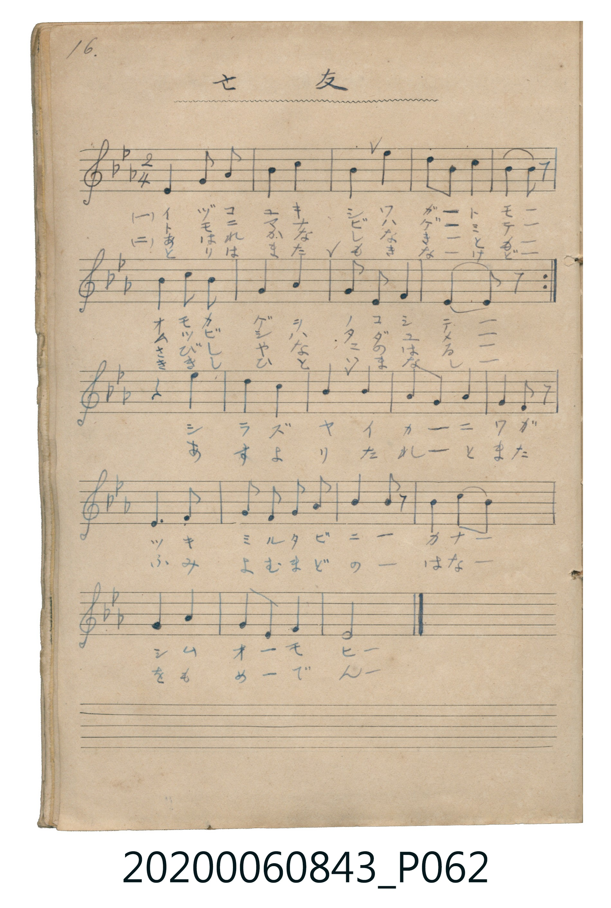

# 亡友

> Re:Shōka 使用 AI 協助辨識與重建樂譜，可能會有錯誤。歡迎回報。

- **鋼琴伴奏版**：<br><audio controls src="boyu.mp3"></audio>

- 曲：不詳

## 說明

亡友 (Bōyū)
Source: 唱歌帖 (Shōkachō, NMTH 2020.006.0843) — P062.jpg (Notebook 1, p.16)
Notation: Handwritten 5-line staff (3 flats = Eb major, 2/4 time, 19 bars)


## 歌詞

```text
（TMD 檔案未包含歌詞註解）
```

## ABC

<div class="abc-score" data-abc-src="boyu.abc" aria-label="五線譜載入中"></div>

[下載 ABC 原始檔](boyu.abc)

## TMD 檔案連結

- [主旋律 TMD 檔案](boyu.tmd) [[在 TMD Studio 編輯](https://tmdlang.github.io/Tmd-TS/#tmd=s7IKdvYPcrWy4qpTUCpJTLdSSM7PyUlNLsnMz7MqzsjPTkzOyFeCS5bl55TmploBqXgDY4RwcX5pUXJqfEFieqpVgIGZEboM3KT4vPyS1KT8_GyEioKi_LLUvMQ8oKrcxLzS4uSizIKS-OT8gkqEmtSyzJRUkIrUlMyS_KLMxBwkJ6UWFYMdC3FDSVFiHsQMoCBCFVBTemaeVWkeyKCSzLTM1BRkyZKM_PSixIKMSquMzGKQDcmJOfHZiXmJCEUlGalAn6emlCYnQozW0lJ4smvh0_5uBS0tLkVbBXMzLntbBVcdLhsjfRM7kL5nsze93zPryY7eFys3K3Fx6Wsp2FILcCkowGzXcDraW3l0tSZIKBgS3ApPp2x8trbn6Y5pChrBGUd7QWF_tFdHwc83xEPByMDIQM_AwEzPwMLEWFPhUcMUBVCc6WUVpCto-EHjR8FQR6FAz9AMbCpQEOxnKwWPxLyU8qLMkpLUPAVT3ZzMvFSF4pLEtDQFDWOFtJzEkmIFYAgkKeQmZuUX6SgAw0GhJDM3VUfB0FIhKbGoGGwa5Z6HAgUtfS4up_zK0nhHq7B8YIw51BjUVIOsULAxNNOyA7OAgQ4MiRcr51mBlENFNJ7saNBUeNy05HFzx-PmRQqPm5c9blr9uGn746a1QM76x01rgBRYSh-obBWQAZbfBBTte9w8H0w1bQZKbX_c3IZkMFhg5eOmXY-bl0DMbwWqe9zcjTC1BWQH0NTm-Y-bgUbuf9w8GcgBKgBa0NwFMWEB1FKgxCQUZ-_qATq7ccnjxrWPG9cDWfseN6563Lj5ceM6IGc1RAwo0AuyoLHpceOKx41TQVywmt7HjdOBrPVAJUBqHdjueciOB-mY-bip43ET0B2N8x839QBNgNgC9HLj1seN-8HhAVTQABZdCTIHbmTTpMdNTUCq8XHjciA1GWZ0jUJ1bkGtgqGCLhgaAbExENcomEJFzKA0QsQwDi4EkgQJw-gamHMdwHFuBQpmUGQBMTgiQQEJCkUgBsclkAZHJlR-D5KH4SY0Ak1oBKqGhCkoDEEhBvUc0DRIuIJ1g0IT7i-Yw0E0CGP1AEgI5F-Ev2EhAYIG2L0EsgzoXLBXwKkOlGAgNCTdAdnICQ_hFWAMgCNtKtipEG-AaHDUQ72GFPe10CzkhJGFLKA5qAboRjMwRPgFwoJ52RjoNwNsvgC5EphGmnYBaXB-ANKtEB9AsgQ0clpw-mQmKLkBMThBAukeqO9AkQROk0C8HxEhkJA1ArKMge4yA2IQCyQCdB_UzUAxTJeCkgoofEHhvR9Iw_MkkAZnSiANzJXYkw_YhQ1QV0HzBDipQMO7aRIQA32D0A1xFTg5A91mCE4biHSBOz2ATAUWCRAau1sagXYCsx9IBTALIqkExrSunQKkvFSAsZxALGUuAA)]
- [鋼琴伴奏 TMD 檔案](boyu_piano.tmd) [[在 TMD Studio 編輯](https://tmdlang.github.io/Tmd-TS/#tmd=s7IKdvYPcrWy4qpTUCpJTLdSyC8qychPL0osyKi0ysgsLskvykxOzInPTsxLVIIrKs4vLUpOjS9ITE-1CjAwM0LIlGSk5qZapaaUJieWZObnKXFpaSk82bXwaX-3gsbj5imPmxY9bu57smfL06X9T3bP0FTQ0uJStFUwN-Oyt1Vw1eGyMdI3sQMZ9mz2pvd7Zj3Z0fti5WYlLi59LQVbagEuBQW4k5yO9lYeXa2p8KhhikJAZmJevoJjcnJ-bkFiXmZual4JSGkw2K9WCk-nbHy2tufpjmkKGsEZR3uzE5OBpI6Cn2-Ih4KRgZGBnoGBmZ6BhYkx1DRgsOhlFaQraPjll6Qm5ednKxjqKBToGZppgkyl3BtQoKClz8XllF9ZGu9oFZYPjCqHGoOaapAVCjaGZlp2YFaNQnVuQa2CoYIuGBoBsTEQ1yiYQkXMoDRCxDAOLgSSBAnD6BqwmcAocQBbaAXkPG5aovC4uQOIFwHxMiB_NRBvB-K1QP56IL0GSX4PyNGYZjQCzWgEqm8Eqm_cB8SrgHgzEK8DYqB5YHGgGFD_48ZemBkQ98E8AcJYPQESAvkZ4XdYaICgAdhbtfCQBKeFIA8cYQkMStN4bUNtkDkgCOSYx2uDTIbYBZTRhjtB20QbEbrIMkCWNpIDkRUiK4OENro80YYipNBdieIFUABAbEMLBB_kQDCBh4EhUDuYMoFQxiAKyDbEnjpAsQaMeXCq2ARk9wHxfAjdBIxhUEppbsORKpqAeAUQTwXHOiRFgOjpiBTRuO5x0_7HzfMQaQLoFKjLzEAU0LGm8WB-PNCrCE86YeQZC7gXDYCJCQQRaQfCgiUxY2BaApmFxbsg76wE0ruANDBRgzNHK8Srzd1IGaIFj5dnAtUAM0xTF5ANDKqmHmgwgDIGkN-4FYj3IzwMSc1GQJYx0G1mQAxigUSAboS6GygGVQ2SAWdloLwhOE8g8gNy6ODNB8SlSJRkRmzeQEurUAvxZjoUSVSTycus2CxFyZjApAWUgpmE1z0wiBG2OLIXIvmCMxY0m8FSMbYkBypnQTkKlMP2A-nJkKQGynHNwCQETpILcJe94KTWAE1ewKQLKnPB5Sw0hzVNAmJgskToRy8DEFkMzMdTCoDMbQaaB6ZxuacRaO9yiJomkF9Q1CKXOBA3xMMCV9dOAVJ8KcBYTiCWMhcA)]

## 分析

```text
================================================================================
📊 TMD Song Profile: [ 亡友 ]
================================================================================
⏱  Duration:       0:30 (30.0s), 19 measures total
🎼 Key & Tempo:    首調基準 E,, != 76.0 BPM, <2/4>
   - 分析範圍：      由實際發聲的音符與和弦推測調性；播放脈絡另行呈現
🎤 人聲音域:    D#4 (MIDI 63) – D#5 (MIDI 75) [跨度: 12 個半音 / 1.0 個八度, 難度: easy]
   - 最低音:  D#4 in [Boyu_A #1 @ m.1, 0:00]
   - 最高音: D#5 in [Boyu_A #1 @ m.3, 0:03]
   - 適合: soprano, mezzo-soprano, contralto, tenor, baritone, bass
🏛  結構:      Boyu_A (12.6s) -> Boyu_B (17.4s)
⚡ 編曲密度:        Peak 1 軌道同時演奏
🗝  調性診斷：       D# 大調（純淨自然大調，未偵測到可信轉調）
   - 風格氣質:    純淨自然大調（陽光明朗、易唱易記，無明顯調外色彩）
   - 轉調歷程:    全曲維持單一推測調性（未偵測到可信轉調）
   - 核心骨幹音:  A#, D#, C, G, F
   - 調性數值:    D# 大調 [相關度: 0.83, 穩定度: Moderate, 自然音純度: 100.0%]
   - 候選調性 (K-S): D# 大調 (0.83), A# 大調 (0.74), C 小調 (0.66)
   - 五度圈歷程:   -3 -> -3
   - 各段落調性細節:
     • [Boyu_A #1]: D# 大調 (r: 0.82, 自然音純度: 100.0%)
     • [Boyu_B #1]: D# 調性不明確 (r: 0.80, 自然音純度: 100.0%)

  [ 五度圈游移軌跡 ]
               C  
         F            G  
      Bb               D  
     [Eb]*              A  
         Ab           E  
            Db       B  
               F# 
     (* = active key center)

  [ 十二半音累積音高分佈 ]
     C  : █████████████████         20.8%
     C# :                            0.0%
     D  :                            0.0%
     D# : ███████████████████       23.6%
     E  :                            0.0%
     F  : █████████                 11.1%
     F# :                            0.0%
     G  : █████████████             15.3%
     G# :                            0.0%
     A  :                            0.0%
     A# : ████████████████████████  29.2%
     B  :                            0.0%
--------------------------------------------------------------------------------
Assignment 軌道音域：
  - Vocal         : D#4 – D#5 (12 個半音 / 1.0 個八度, 48 個音符)
================================================================================
```


## 原書掃描頁




