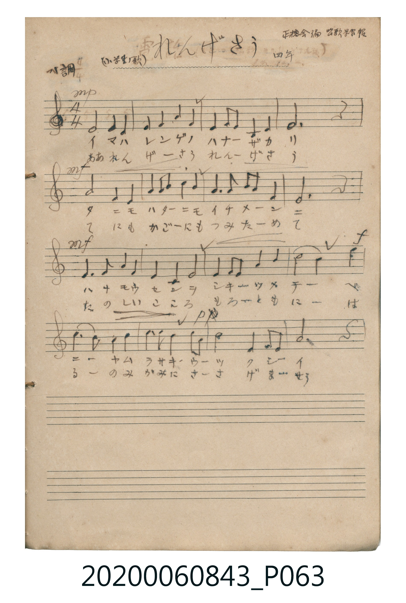

# れんげさう

> Re:Shōka 使用 AI 協助辨識與重建樂譜，可能會有錯誤。歡迎回報。

- **鋼琴伴奏版**：<br><audio controls src="rengeso.mp3"></audio>

- 詞：三木露風
- 曲：山田耕筰
- 出處：正聴会編 唱歌学習帳 四年（唱歌帖 P063）

## 說明

れんげさう (Rengesō)
Source: 唱歌帖 (Shōkachō, NMTH 2020.006.0843) — P063.jpg (Notebook 1, p.17)
Notation: Handwritten 5-line staff (1 flat = F major, 4/4 time, 16 bars)
Annotations: ヘ調 4/4, (小学生ノ歌), 正聴会編 唱歌学習帳 四年


## 歌詞

```text
（TMD 檔案未包含歌詞註解）
```

## ABC

<div class="abc-score" data-abc-src="rengeso.abc" aria-label="五線譜載入中"></div>

[下載 ABC 原始檔](rengeso.abc)

## TMD 檔案連結

- [主旋律 TMD 檔案](rengeso.tmd) [[在 TMD Studio 編輯](https://tmdlang.github.io/Tmd-TS/#tmd=s7IKdvYPcrWy4qpTUCpJTLdSSM7PyUlNLsnMz7MqzsjPTkzOyFeCS5bl55TmploBqXgDY4RwcX5pUXJqfEFieqpVgIEZhgzcpPi8_JLUpPz8bISKgqL8stS8xDygqtzEvNLi5KLMgpL45PyCSoSa1LLMlFSQitSUzJL8oszEHCQnpRYVgx0LcUNJUWIexAygIEJVSUYq0N0FOYl5JQhBoEnpmXlWJYmZQPfFA3F5YnxuYmYeUFUKsqqSjPz0osSCjEqrjMxikP3JiTnx2Yl5iUpcWloKj5t6HjdNftw46XHj1MeNbQpaWlyKtgqWZlz2tgpuXDYm-iZ2ILNerJz3fs-sJzs6n81Z8XLOppeLVoCteDZ7E1D46caNz6dseNEw9fnaDWDhp-27XsycCpR5tnbxi8YtT_bMer59hcLTKRufre15unbZ8_2Tnu7YrPB09uynO7e839MBldgxTQEU_O_3dCpxcelrKdhSC3ApKGD4UyMoNS89tfhoryZINhgS0TAnAl2iEZxxtBcU60d7dRT8fEM8FIwMjAz0DAzM9AwsTIw1FR41TAE7Vy-rIF1Bww-aMhQMdRQK9AzNwaYCBRPBSVHBAxgn5UWZJSWpeQqmujmZeakKxSWJaWkKGoYKaTmJJQrAwFbITczKL9JRAAa5QklmbqqOgqGZQlJiUTHYLMc8YOIDm1ZspfC4ecaLVftBKnUUNJ5u6AeF6ZT5j5v7gI7X1FEgItRBRlIesFCgoKXPxQUJz3yrgMzEvHyHGoOaapAdCjaGZlp2YBYwRoEOASYkK5B6qIihHjBmljxunve4uR_orTWPmzc_btoE9AmQ0_-4uQsou-1x0-rHzasU9IHs_Y-bux83LwJLIjggAxofNy8EagbKdINUgjUDJR83LQPK7wYZ27wJyNr-uGnt4-YWoGKgmjawypkgLY-bgWYsAFIrHzdtBaoBKl0GVAek1oM1LUFysxHQzY1NIAROU0AOLFFhCADNb1z2uHH146YmIKv7ceMUOGfJ48b9jxvnP25qBKkBq5z_uHHd48bpjxuB9jYC0-rkx029QDOB9vQ-blwB0bYarBLoKKCbQar3Q8wFGrUayAJaOhVi_b7HjbPB-Rni7BqF6tyCWgXTeAVdMDSE0sZQ2hRK1ygY4ZCB8VFVgNgws8xghtcg7EGHBjAlsMB0CMsHlkfAJA0MYmAyAMUcKB0AMTAum4BRBkkKQAxOC0AM9CcwNSCiA25CIyh8gLipB4jBsQAKESAGRwyGGFLIpOEJGRgf4m-QKCxEcIcMeugghQzMOBICBhjF4BQKTvZQ_h6EGDjggIkInKRB4pBMgC2AgHkBlEwgiRGIp0B0wMWAJoET1HyIODRpogYUuh9hoQATR3gR7muMsMVMQ5jp0AwtgGAy1UA3GMbhDC1YUoFnfWiAgDM_EANzNihbQ_M_JMD2YA0sYCA0rgNiWH6EYEiOhNCNK6DhBkqSKAZBnA9yMrrHEB6sBuZHdFXoSQwRmDAZ5OAHyZGToppnQlMPKOWACz2gP7ZCAwcU78CAA_sHXP5BAg4sjlwKIgIKpAJcGkFTD4gNoqGhAspuMBqc_fZB-bDyqZaLS9dOAVp_KACZylwA)]
- [鋼琴伴奏 TMD 檔案](rengeso_piano.tmd) [[在 TMD Studio 編輯](https://tmdlang.github.io/Tmd-TS/#tmd=s7IKdvYPcrWy4qpTUCpJTLdSyC8qychPL0osyKi0ysgsLskvykxOzInPTsxLVIIrKs4vLUpOjS9ITE-1CjAwM0bIlGSk5qZapaaUJieWZObnKXFpaSk8bup53DT5ceOkx41THze2KWg8bp7yuGnR4-a-J3u2PF3a_2T3DE0FLS0uRVsFSzMue1sFNy4bE30TO5ChL1bOe79n1pMdnc_mrHg5Z9PLRSvAdj2bvQko_HTjxudTNrxomPp87Qaw8NP2XS9mTgXKPFu7-EXjlid7Zj3fvkLh6ZSNz9b2PF277Pn-SU93bFZ4Onv2051b3u_pgErsmKYA8sT7PZ1KXFz6Wgq21AJcCgqYng9KzUtPLT7aq6nwqGGKQkBmYl6-gmNycn5uQWJeZm5qXglIVzA4gK1gTge6UCM442hvdmIykNRR8PMN8VAwMjAy0DMwMNMzsDAxhpoG9IZeVkG6goZffklqUn5-toKhjkKBnqG5JshUyn0EBQpa-lxcEI_kW4G94FBjUFMNskPBxtBMyw7MqlGozi2oVTCNV9AFQ0MobQylTaF0jYIRDhkYH1UFiA0zywxmeA3CHnRoAFMCdhUwgh3C8oFp2gocO0sUHjfPA-J-IF4DxJuBYpuAdB9UrAvI3wbEq4HsVSB_Y5rR2ATBTT1APBnIngTEU4G4DasY1AxQ6KThCR0YH-J3kCgsVHCHDnoIIYUOzDj8gQN1FLp5MBth4gjj4DZg-AMzzjDj3QzNMTCZaqAbDOPQXAZSDFKAbgzCuGpgakNXhR54CKfDZJA9C5IjJqxq0ZJ_kAeODABO_9qG2nBH4-QAWdoIRwKlzOO1YU7DqRBFAhhECC1ITJN4bSAP5ikwD67DKF4bbBUsTPByMdMKXu8hOxTI0kbEKJr3kBXi8R1GmKCFEFYPGoO9AM9ceHi4fIfTThAT2a1IUmDHYnMQ2EpMNxP2HI50Yqhtog3LRahshCpQbkINf6gPkTXgtAPVPlCCxqkNT_CgBAgeTejBSE70oWdOH-TMaQLPm4agMssQaAqk7jCEsY3iQcgEjMAyQJ5pfDzQAqwVyH5gxdANxIsgFQaYvwchBq5gGoF4IVQcWMEA5bBXJMuAGFjRNIEqFKD-xikQPXAxoFmNQPMb50PEm4DmAvXAKxRcPgKywVywhyCKcHkHVuc1L3rcBHRN026oi4FVYtN2IF4LZLdAfQOs3sA-2oPDN0BXNq4D4umPG4FaGkG1IBA39UI8A6IbV0A9BqpdUYxCBDwIgVwNdDyad8AcSDyBvIrVOzOhMQGKhQVAvBJo4VaoP0AhCPQj2GKgA5vWQ_wIFl-Cw08gNaCYAfkLFBMgNoiGegBUxcNocJW_D8qfjVLzQ10M8wA4SqDeBIqBOehRBUzUunYK0HStAGQqcwEA)]

## 分析

```text
================================================================================
📊 TMD Song Profile: [ れんげさう ]
================================================================================
⏱  Duration:       0:40 (40.0s), 16 measures total
🎼 Key & Tempo:    首調基準 F, != 96.0 BPM, <4/4>
   - 分析範圍：      由實際發聲的音符與和弦推測調性；播放脈絡另行呈現
🎤 人聲音域:    C4 (MIDI 60) – F5 (MIDI 77) [跨度: 17 個半音 / 1.4 個八度, 難度: challenging]
   - 最低音:  C4 in [Rengeso #1 @ m.1, 0:00]
   - 最高音: F5 in [Rengeso #1 @ m.12, 0:29]
   - 適合: soprano, mezzo-soprano, contralto, tenor, baritone, bass
🏛  結構:      Rengeso (40.0s)
⚡ 編曲密度:        Peak 1 軌道同時演奏
🗝  調性診斷：       F 大調（純淨自然大調，未偵測到可信轉調）
   - 風格氣質:    純淨自然大調（陽光明朗、易唱易記，無明顯調外色彩）
   - 轉調歷程:    全曲維持單一推測調性（未偵測到可信轉調）
   - 核心骨幹音:  C, F, G, A, D
   - 調性數值:    F 大調 [相關度: 0.85, 穩定度: Moderate, 自然音純度: 100.0%]
   - 候選調性 (K-S): F 大調 (0.85), C 大調 (0.81), A 小調 (0.64)
   - 五度圈歷程:   -1
   - 各段落調性細節:
     • [Rengeso #1]: F 大調 (r: 0.85, 自然音純度: 100.0%)

  [ 五度圈游移軌跡 ]
               C  
        [F ]*          G  
      Bb               D  
      Eb               A  
         Ab           E  
            Db       B  
               F# 
     (* = active key center)

  [ 十二半音累積音高分佈 ]
     C  : ████████████████████████  27.9%
     C# :                            0.0%
     D  : ████████                   9.8%
     D# :                            0.0%
     E  :                            0.0%
     F  : █████████████████████     24.6%
     F# :                            0.0%
     G  : ████████████████          18.9%
     G# :                            0.0%
     A  : ████████████████          18.9%
     A# :                            0.0%
     B  :                            0.0%
--------------------------------------------------------------------------------
Assignment 軌道音域：
  - Piano         : C4 – F5 (17 個半音 / 1.4 個八度, 62 個音符)
================================================================================
```


## 原書掃描頁




