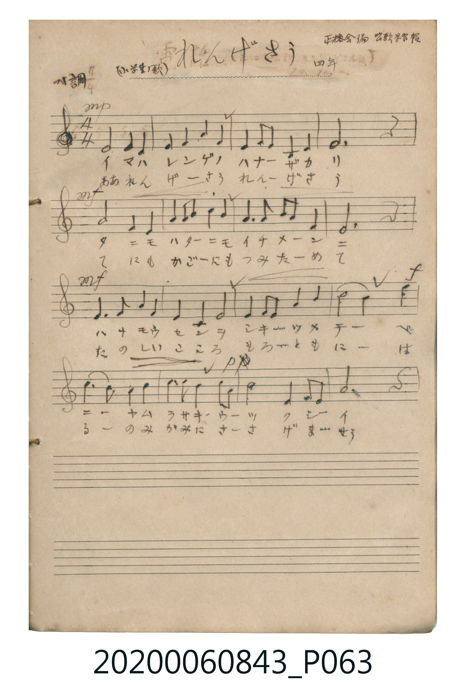

# れんげさう

<audio controls src="rengeso.mp3"></audio>

- 曲：正聴会編 唱歌学習帳 四年

## 說明

れんげさう (Rengesō)
Source: 唱歌帖 (Shōkachō, NMTH 2020.006.0843) — P063.jpg (Notebook 1, p.17)
Notation: Handwritten 5-line staff (1 flat = F major, 4/4 time, 16 bars)
Annotations: ヘ調 4/4, (小学生ノ歌), 正聴会編 唱歌学習帳 四年

## 歌詞

```text
（TMD 檔案未包含歌詞註解）
```

## ABC

```abc
X:1
T:れんげさう
C:曲：正聴会編 唱歌学習帳 四年
M:4/4
L:1/16
Q:1/4=96
K:F
V:V1 name="Vocal" snm="Voc"
[V:V1]
!mp! C4 A,4 C4 F4 | G4 A4 c4 A4 | G4 A2 G2 F4 D4 | C12 z4 |
!mf! F4 A,4 C4 F4 | G2 A2 c4 c4 A4 | G6 A2 G2 F2 D4 | F12 z4 |
!mf! G6 A2 c4 G4 | F4 D4 C4 F4 | G4 A2 G2 A4 c4 | !f! d8 c4 f4 |
d2 c2 A4 c4 c4 | !p! d2 c2 A4 G2 A2 c4 | F4 G2 A2 G6 F2 | F12 z4 |
```

## TMD 檔案連結

- [主旋律 TMD 檔案](rengeso.tmd) [[在 TMD Studio 編輯](https://tmdlang.github.io/Tmd-TS/#tmd=s7IKdvYPcrWy4qpTUCpJTLdSSM7PyUlNLsnMz7MqzsjPTkzOyFeCS5bl55TmploBqXgDY4RwcX5pUXJqfEFieqpVgIEZhgzcpPi8_JLUpPz8bISKgqL8stS8xDygqtzEvNLi5KLMgpL45PyCSoSa1LLMlFSQitSUzJL8oszEHCQnpRYVgx0LcUNJUWIexAygIEJVSUYq0N0FOYl5JUpcWloKj5t6HjdNftw46XHj1MeNbQpaWlyKtgqWZlz2tgpuXDYm-iZ2IL3PZm96v2fWs7WLXzRuebJn1vPtKxSeTtn4bG3P07XLnu-f9HTHZoWns2c_3blFiYtLX0vBllqAS0EBw4kaQal56anFR3s1QbLBkICFOWfHNAWN4IyjvaBQPtqro-DnG-KhYGRgZKBnYGCmZ2BhYqyp8KhhigIodvSyCtIVNPygMaFgqKNQoGdoDjYVKJgIjnoFj8S8lPKizJKS1DwFU92czLxUheKSxLQ0BQ1DhbScxBIFYDgp5CZm5RfpKABDS6EkMzdVR8HQTCEpsagYbJZjHjCywaYVWyk8bp7xYtV-kEodBY2nG_pB4Tdl_uPmPqDjNXUUiAhhkJGUBywUKGjpc3FBwjPfKiw_OTHHocagRqEaZImCjaGZlh2YBYxSoEterJxnBdIAFTHUA0bNksfN8x439wP9teZx8-bHTZuAXgFy-h83dwFltz1uWv24eZWCPpC9_3Fz9-PmRWBJBAdkQOPj5oVAzUCZbpBKsGag5OOmZUD53SBjmzcBWdsfN6193NwCVAxU0wZWOROk5XEz0IwFQGrl46atQDVApcuA6oDUerCmJUhuNgK6ubEJhMCJCsiBpSoMAaD5jcseN65-3NQEZHU_bpwC5yx53Lj_ceP8x02NIDVglfMfN6573Dj9cSPQ3kZgYp38uKkXaCbQnt7HjSsg2laDVQIdBXQzSPV-iLlAo1YDWUBLp0Ks3_e4cTY4L0KcDYyO3IJaBdN4BV0wNIYx4CKGULpGwQimBqYEjY-qAsSG6TWDGVaDMBcdGsCUwILTAZxkgKkaGMjAhACKO1BKAGJgbDYBIw2SGIAYnBqAGOhTYHpARAjchEZQCAFxUw8Qg-MBFCZADI4aDDGksEmrhXuCUNCAPA0LEtxBgx48SEEDM46EkAHGMjiRglM-lL8HIQYOOWA6AqdqkDgkH2ALIWB2AKUUSHoE4ikQHXAxoEngNDUfIg5Nnaghhe5HWCjAxBFehPuaQDKDhStymNYomKEFEEymGhRbcThDC5ZW4LkfGiDg_A_EwMwNytnQIgASYHuwBhYwEBrXATEsS0IwJFNC6MYV0HADpUkUgyDOBzkZ3WMID1YDsyS6KvQkhghMmAxy8IPkyElRzTOhqQeUcsDlHtAfW6GBA4p3YMCB_QMuAiEBBxZHLggRAQVSAS6QoKkHxAbR0FAB5TcYDc5_-6B8WBFVy8Wla6cArUMUgExlLgA)]
- [鋼琴伴奏 TMD 檔案](rengeso_piano.tmd) [[在 TMD Studio 編輯](https://tmdlang.github.io/Tmd-TS/#tmd=s7IKdvYPcrWy4tLSUnjc1PO4afLjxkmPG6c-bmxT0HjcPOVx06LHzX1P9mx5urT_ye4ZmgpaWlyKtgqWZlz2tgpuXDYm-iZ2XHUKSs9mb3q_Z9aztYtfNG55smfW8-0rFJ5O2fhsbc_Ttcue75_0dMdmhaezZz_duUWJi0tfS8GWWoBLQQHT3UGpeempxUd7NRUeNUxRCMhMzMtXcExOzs8tSMzLzE3NKwHpCs4vLUpOtYI5c8c0BY3gjKO92YnJQFJHwc83xEPByMDIQM_AwEzPwMLEGGqagZmxXlZBuoKGX35JalJ-fraCoY5CgZ6huSbIVMp9BAUKWvpcXBCP5FuF5Scn5jjUGNQoVIMsUbAxNNOyA7OAIrkFtQqm8Qq6YGgMY8BFDKF0jYIRTA1MCRofVQWIDdNrBjOsBmEuOjSAKQG7CxjHDmBXW4EjaInC4-Z5QNwPxGuAeDNQbBOQ7oOKdQH524B4NZC9CuR1TDMamyC4qQeIJwPZk4B4KhC3YRWDmgEKn7RauEcIBQ_I47BgwR086EGEFDww4_CHDtRV6ObBbISJI4yD20AgWmF-QHZ_jYIZmmNgMtWgkIlDcxlIMUgBujEI46qBCQ5dFXrgIZwOk0H2LEiOmLCqRWQBcC4O8sCVCYBOMo7XRsoG2Nmm8dqIgANyzOO1Ye4CSWnDvANkacM9jiwBDB-EFiSmSbw2kAczG8yD6zACOQBoFSxA8HIxEwo4e8ONJsNnyJ7B4zGM4EALHKx-AzsB1XE4eLg8htNOEBPZrUhSYMdicxDxcU1MzAOTqLaJNiz3oLIRqkC5CMjTxshJyBpw2oFqHygd49SGJ3hQAgSPJvRgJCf60DOlD65MiXAPzK9wk5GcjSaHRY0RIqtAGSYYDCST4KpM47FnKrS6aT-wzukG4kWQugjM34MQA9ddjUC8ECoOrLuActjrqGVADKzDmkB1FVB_4xSIHrgY0KxGoPmN8yHiTUBzgXrgdRW1QgwpD6ApQgowTMuICS5Ydd286HET0LdNu6EhAqzNm7YD8VoguwUaWsCaGRxie3CEFjAUGtcB8fTHjUAtjaAKHIibeiGBBaIbV0ADDtQwQDEKe4SjMxC-hHucpOBCUoSZ5tAjAGtwzYSmJFAqWgDEK4Ee2goNJ1AKAIYh2GPAAGhaDwlDsPgSHGEGUgNKWaBwA6UkEBtEQwMI1PqB0eDW0D4ofzZKowinH7B5GCOhYAlezIYVIvcRl9SAxYqunQK0ZFEAMpW5AA)]

## 分析

```text
================================================================================
📊 TMD Song Profile: [ れんげさう ]
================================================================================
⏱  Duration:       0:40 (40.0s), 16 measures total
🎼 Key & Tempo:    首調基準 F, != 96.0 BPM, <4/4>
   - 分析範圍：      由實際發聲的音符與和弦推測調性；播放脈絡另行呈現
🎤 人聲音域:    A3 (MIDI 57) – F5 (MIDI 77) [跨度: 20 個半音 / 1.7 個八度, 難度: challenging]
   - 最低音:  A3 in [Rengeso #1 @ m.1, 0:00]
   - 最高音: F5 in [Rengeso #1 @ m.12, 0:29]
   - 適合: soprano, mezzo-soprano, contralto, tenor, baritone, bass
🏛  結構:      Rengeso (40.0s)
⚡ 編曲密度:        Peak 1 軌道同時演奏
🗝  調性診斷：       F 大調（純淨自然大調，未偵測到可信轉調）
   - 風格氣質:    純淨自然大調（陽光明朗、易唱易記，無明顯調外色彩）
   - 轉調歷程:    全曲維持單一推測調性（未偵測到可信轉調）
   - 核心骨幹音:  C, F, G, A, D
   - 調性數值:    F 大調 [相關度: 0.85, 穩定度: Moderate, 自然音純度: 100.0%]
   - 候選調性 (K-S): F 大調 (0.85), C 大調 (0.81), A 小調 (0.64)
   - 五度圈歷程:   -1
   - 各段落調性細節:
     • [Rengeso #1]: F 大調 (r: 0.85, 自然音純度: 100.0%)

  [ 五度圈游移軌跡 ]
               C  
        [F ]*          G  
      Bb               D  
      Eb               A  
         Ab           E  
            Db       B  
               F# 
     (* = active key center)

  [ 十二半音累積音高分佈 ]
     C  : ████████████████████████  27.9%
     C# :                            0.0%
     D  : ████████                   9.8%
     D# :                            0.0%
     E  :                            0.0%
     F  : █████████████████████     24.6%
     F# :                            0.0%
     G  : ████████████████          18.9%
     G# :                            0.0%
     A  : ████████████████          18.9%
     A# :                            0.0%
     B  :                            0.0%
--------------------------------------------------------------------------------
Assignment 軌道音域：
  - Vocal         : A3 – F5 (20 個半音 / 1.7 個八度, 62 個音符)
================================================================================
```


## 原書掃描頁




