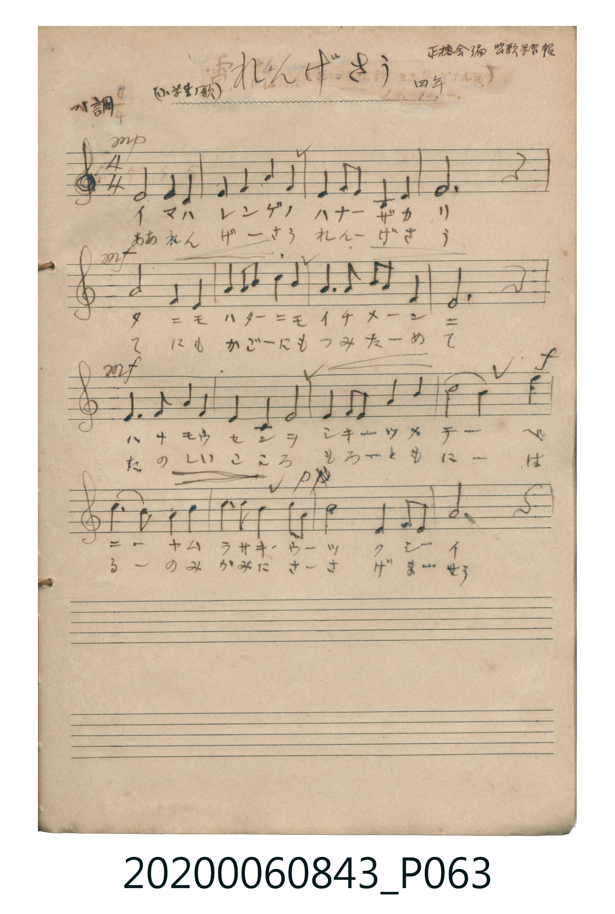

# れんげさう

> Re:Shōka 使用 AI 協助辨識與重建樂譜，可能會有錯誤。歡迎回報。

- **鋼琴伴奏版**：<br><audio controls src="rengeso.mp3"></audio>

- 曲：正聴会編 唱歌学習帳 四年

## 說明

れんげさう (Rengesō)
Source: 唱歌帖 (Shōkachō, NMTH 2020.006.0843) — P063.jpg (Notebook 1, p.17)
Notation: Handwritten 5-line staff (1 flat = F major, 4/4 time, 16 bars)
Annotations: ヘ調 4/4, (小学生ノ歌), 正聴会編 唱歌学習帳 四年


## 歌詞

```text
（TMD 檔案未包含歌詞註解）
```

## ABC

<div class="abc-score" data-abc-src="rengeso.abc" aria-label="五線譜載入中"></div>

[下載 ABC 原始檔](rengeso.abc)

## TMD 檔案連結

- [主旋律 TMD 檔案](rengeso.tmd) [[在 TMD Studio 編輯](https://tmdlang.github.io/Tmd-TS/#tmd=s7IKdvYPcrWy4qpTUCpJTLdSSM7PyUlNLsnMz7MqzsjPTkzOyFeCS5bl55TmploBqXgDY4RwcX5pUXJqfEFieqpVgIEZhgzcpPi8_JLUpPz8bISKgqL8stS8xDygqtzEvNLi5KLMgpL45PyCSoSa1LLMlFSQitSUzJL8oszEHCQnpRYVgx0LcUNJUWIexAygIEJVSUYq0N0FOYl5JQhBoEnpmXlWJYmZQPfFA3F5YnxuYmYeUFWKEpeWlsLjpp7HTZMfN0563Dj1cWObgpYWl6KtgqUZl72tghuXjYm-iR3IsGezN73fM-vZ2sUvGrc82TPr-fYVCk-nbHy2tufp2mXP9096umOzwtPZs5_u3KLExaWvpWBLLcCloIDhRI2g1Lz01OKjvZog2WBI8MOcs2OagkZwxtFeUFwc7dVR8PMN8VAwMjAy0DMwMNMzsDAx1lR41DBFARSHelkF6QoaftD4UjDUUSjQMzQHmwoUTAQnEAUPYEiVF2WWlKTmKZjq5mTmpSoUlySmpSloGCqk5SSWKADDSSE3MSu_SEcBGFoKJZm5qToKhmYKSYlFxWCzHPOASQJsWrGVwuPmGS9W7Qep1FHQeLqhHxR-U-Y_bu4DOl5TR4GIEAYZSXnAQoGClj4XFyQ8863C8pMTcxxqDGqqQXYo2BiaadmBWcAYBTrkxcp5ViD1UBFDPWDMLHncPO9xcz_QW2seN29-3LQJ6BMgp_9xcxdQdtvjptWPm1cp6APZ-x83dz9uXgSWRHBABjQ-bl4I1AyU6QapBGsGSj5uWgaU3w0ytnkTkLX9cdPax80tQMVANW1glTNBWh43A81YAKRWPm7aClQDVLoMqA5IrQdrWoLkZiOgmxubQAicpoAcWKLCEACa37jscePqx01NQFb348YpcM6Sx437HzfOf9zUCFIDVjn_ceO6x43THzcC7W0EptXJj5t6gWYC7el93LgCom01WCXQUUA3g1Tvh5gLNGo1kAW0dCrE-n2PG2eDsyLE2TUK1bkFtQqm8Qq6YGgMY8BFDKF0jYIRTA1MCRofVQWIDdNrBjOsBmEuOjSAKYEFpwM4xQATNTCQgQkBFHeglADEwNhsAkYaJDEAMTg1ADHQp8D0gIgQuAmNoBAC4qYeIAbHAyhMgBgcNRhiSGGTVgv3BKGgAXkaFiS4gwY9eJCCBmYcCSEDjGVwIgWnfCh_D0IMHHLAdARO1SBxSD7AFkLA7ABKKZD0CMRTIDrgYkCTwGlqPkQcmjpRQwrdj7BQgIkjvAj3NYFkBgtX5DCtUTBDCyCYTDUotuJwhhYsrcBzPzRAwPkfiIGZG5SzoUUAJMD2YA0sYCA0rgNiWJaEYEimhNCNK6DhBkqTKAZBnA9yMrrHEB6sBmZJdFXoSQwRmDAZ5OAHyZGToppnQlMPKOWAyz2gP7ZCAwcU78CAA_sHXARCAg4sjlwQIgIKpAJcIEFTD4gNoqGhAspvMBqc__ZB-bAiqpaLS9dOAVqFKACZylwA)]
- [鋼琴伴奏 TMD 檔案](rengeso_piano.tmd) [[在 TMD Studio 編輯](https://tmdlang.github.io/Tmd-TS/#tmd=s7IKdvYPcrWy4tLSUnjc1PO4afLjxkmPG6c-bmxT0HjcPOVx06LHzX1P9mx5urT_ye4ZmgpaWlyKtgqWZlz2tgpuXDYm-iZ2XHUKSs9mb3q_Z9aztYtfNG55smfW8-0rFJ5O2fhsbc_Ttcue75_0dMdmhaezZz_duUWJi0tfS8GWWoBLQQHT3UGpeempxUd7NRUeNUxRCMhMzMtXcExOzs8tSMzLzE3NKwHpCs4vLUpOtYI5c8c0BY3gjKO92YnJQFJHwc83xEPByMDIQM_AwEzPwMLEGGqagZmxXlZBuoKGX35JalJ-fraCoY5CgZ6huSbIVMp9BAUKWvpcXBCP5FuF5Scn5jjUGNRUg-xQsDE007IDs2oUqnMLahVM4xV0wdAYxoCLGELpGgUjmBqYEjQ-qgoQG6bXDGZYDcJcdGgAUwJ2FzCKHcCOtgLHzxKFx83zgLgfiNcA8Wag2CYg3QcV6wLytwHxaiB7FcjnmGY0NkFwUw8QTwayJwHxVCBuwyoGNQMUPmm1cI8QCh6Qx2HBgjt40IMIKXhgxuEPHair0M2D2QgTRxgHt4FAtML8gOz-GgUzNMfAZKpBIROH5jKQYpACdGMQxlUDExy6KvTAQzgdJoPsWZAcMWFVi8gB4Ewc5IEjDwBdZByvjZQLsLNN47UR4QbkmMdrw5wFktKG-QbI0ob7G1kCGDwILUhMk3htIA9mNpgH12EEcgDQKlh44OViphNw7oYbTYbPkD2Dx2MYwYEWOFj9BnYCquNw8HB5DKedICayW5GkwI7F5iDi45qYmAemUG0TbVjmQWUjVIEyEZCnjZGRkDXgtAPVPlA6xqkNT_CgBAgeTejBSE70oedJH-Q8aQLPkoagosoQVOCC6wxDGNsoHoRMwAgsA-SZxscDLcBacewHVgjdQLwIUlGA-XsQYuCKpRGIF0LFgRULUA57BbIMiIEVTBOoIgHqb5wC0QMXA5rVCDS_cT5EvAloLlAPvCLB5SMgG8wFewiiCJd3YHVd86LHTUDXNO2GuhhYFTZtB-K1QHYL1DfAag3soz04fAN0ZeM6IJ7-uBGopRFU-wFxUy_EMyC6cQXUY6BaFcUoRMCDEMjVQMejeQfMgcQTyKtYvTMTGhOgWFgAxCuBFm6F-gMUgkA_gi0GOrBpPcSPYPElOPwEUgOKGZC_QDEBYoNoqAdAVTuMBlf1-6D82Sg1PtTFMA-AowTqTaAYmIMeVcBErWunAE3XCkCmMhcA)]

## 分析

```text
================================================================================
📊 TMD Song Profile: [ れんげさう ]
================================================================================
⏱  Duration:       0:40 (40.0s), 16 measures total
🎼 Key & Tempo:    首調基準 F, != 96.0 BPM, <4/4>
   - 分析範圍：      由實際發聲的音符與和弦推測調性；播放脈絡另行呈現
🎤 人聲音域:    A3 (MIDI 57) – F5 (MIDI 77) [跨度: 20 個半音 / 1.7 個八度, 難度: challenging]
   - 最低音:  A3 in [Rengeso #1 @ m.1, 0:00]
   - 最高音: F5 in [Rengeso #1 @ m.12, 0:29]
   - 適合: soprano, mezzo-soprano, contralto, tenor, baritone, bass
🏛  結構:      Rengeso (40.0s)
⚡ 編曲密度:        Peak 1 軌道同時演奏
🗝  調性診斷：       F 大調（純淨自然大調，未偵測到可信轉調）
   - 風格氣質:    純淨自然大調（陽光明朗、易唱易記，無明顯調外色彩）
   - 轉調歷程:    全曲維持單一推測調性（未偵測到可信轉調）
   - 核心骨幹音:  C, F, G, A, D
   - 調性數值:    F 大調 [相關度: 0.85, 穩定度: Moderate, 自然音純度: 100.0%]
   - 候選調性 (K-S): F 大調 (0.85), C 大調 (0.81), A 小調 (0.64)
   - 五度圈歷程:   -1
   - 各段落調性細節:
     • [Rengeso #1]: F 大調 (r: 0.85, 自然音純度: 100.0%)

  [ 五度圈游移軌跡 ]
               C  
        [F ]*          G  
      Bb               D  
      Eb               A  
         Ab           E  
            Db       B  
               F# 
     (* = active key center)

  [ 十二半音累積音高分佈 ]
     C  : ████████████████████████  27.9%
     C# :                            0.0%
     D  : ████████                   9.8%
     D# :                            0.0%
     E  :                            0.0%
     F  : █████████████████████     24.6%
     F# :                            0.0%
     G  : ████████████████          18.9%
     G# :                            0.0%
     A  : ████████████████          18.9%
     A# :                            0.0%
     B  :                            0.0%
--------------------------------------------------------------------------------
Assignment 軌道音域：
  - Vocal         : A3 – F5 (20 個半音 / 1.7 個八度, 62 個音符)
================================================================================
```


## 原書掃描頁




